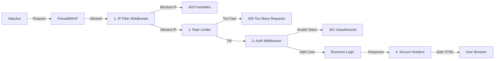

# Introduction

In the modern internet landscape, deploying a backend without protection is akin to leaving your front door wide open. Automated bots, script kiddies, and targeted attackers are constantly scanning for vulnerabilities.

"Working code" is not enough. We need **Secure Code**.

In this article, we will implement three layers of defense for our Go backend:
1.  **Network Layer Defense**: Application-level IP Filtering.
2.  **Traffic Control**: Granular Rate Limiting/Throttling.
3.  **Browser Defense**: Secure HTTP Headers.

### Visualizing Defense in Depth



---

# 1. Custom IP Filtering Middleware

While firewalls (AWS WAF, Cloudflare) are your first line of defense, adding application-level filtering gives you granular control. You can dynamically block IPs based on application behavior (e.g., "5 failed logins in 1 minute").

### 1.1 The Challenge: "Real" IP Address

In a containerized environment (Docker/Kubernetes) or behind a Reverse Proxy (Nginx), `RemoteAddr` gets obscured. It usually shows the IP of the internal docker gateway (e.g., `172.18.0.1`).

**The Solution**: We must trust distinct headers, but *only from trusted proxies*.

```go
// internal/ipFilter/ip_filter.go source analysis

func GetRealIP(req *http.Request) string {
    // 1. Check X-Forwarded-For (Standard)
    // Format: client, proxy1, proxy2
    xff := req.Header.Get("X-Forwarded-For")
    if xff != "" {
        parts := strings.Split(xff, ",")
        return strings.TrimSpace(parts[0]) // First IP is the client
    }
    
    // 2. Check X-Real-IP (Nginx specific)
    xri := req.Header.Get("X-Real-IP")
    if xri != "" {
        return xri
    }
    
    // 3. Fallback to RemoteAddr (strip port)
    ip, _, _ := net.SplitHostPort(req.RemoteAddr)
    return ip
}
```

### 1.2 Implementing the Blocklist

We maintain a list of banned CIDRs (Classless Inter-Domain Routing). This allows us to block single IPs (`192.168.1.5/32`) or entire subnets (`10.0.0.0/8`).

```go
type IPFilter struct {
    bannedSubnets []*net.IPNet
}

func NewIPFilter(bannedList []string) *IPFilter {
    var subnets []*net.IPNet
    for _, cidr := range bannedList {
        _, network, err := net.ParseCIDR(cidr)
        if err != nil {
            // Handle error: maybe log specific bad entry
            continue
        }
        subnets = append(subnets, network)
    }
    return &IPFilter{bannedSubnets: subnets}
}

func (f *IPFilter) IsBanned(ipStr string) bool {
    parsedIP := net.ParseIP(ipStr)
    if parsedIP == nil {
        return false // Malformed IP, technically safely ignored or strictly blocked
    }
    
    for _, subnet := range f.bannedSubnets {
        if subnet.Contains(parsedIP) {
            return true
        }
    }
    return false
}
```

**Middleware Integration**:

```go
func (f *IPFilter) Middleware(next echo.HandlerFunc) echo.HandlerFunc {
    return func(c echo.Context) error {
        ip := GetRealIP(c.Request())
        if f.IsBanned(ip) {
            // Return 403 Forbidden
            // Optionally: Log this attempt to a security audit log
            return echo.NewHTTPError(http.StatusForbidden, "Access Denied by IP Policy")
        }
        return next(c)
    }
}
```

---

# 2. Rate Limiting (Traffic Control)

Rate limiting protects your resources from exhaustion (CPU/Memory/DB Connections) and prevents brute-force attacks.

### 2.1 Token Bucket Algorithm (Conceptual)

Imagine a bucket that holds **Tokens**.
*   The bucket has a maximum capacity (e.g., 5 tokens).
*   New tokens "drip" into the bucket at a constant rate (e.g., 1 token per second).
*   When a request comes in, it must take a token to proceed.
*   If the bucket is empty, the request is rejected (429 Too Many Requests).

This allows for **Bursty traffic** (the user can make 5 fast requests) but enforces a long-term **Average rate**.

### 2.2 Implementation in Echo

We use `echo-middleware/rate` (or similar libraries like `golang.org/x/time/rate`).

```go
import (
    "golang.org/x/time/rate"
    "github.com/labstack/echo/v4/middleware"
)

func RateLimitConfig() middleware.RateLimiterConfig {
    return middleware.RateLimiterConfig{
        Skipper: middleware.DefaultSkipper,
        Store: middleware.NewRateLimiterMemoryStoreWithConfig(
            middleware.RateLimiterMemoryStoreConfig{Rate: rate.Limit(10), Burst: 30, ExpiresIn: 3 * time.Minute},
        ),
        IdentifierExtractor: func(ctx echo.Context) (string, error) {
            // Rate limit based on IP address
            return ctx.RealIP(), nil, 
        },
        ErrorHandler: func(context echo.Context, err error) error {
            return context.JSON(http.StatusTooManyRequests, map[string]string{
                "error": "Rate limit exceeded. Please slow down.",
            })
        },
        DenyHandler: func(context echo.Context, identifier string, err error) error {
            return context.JSON(http.StatusTooManyRequests, map[string]string{
                "error": "Rate limit exceeded",
            })
        },
    }
}
```

**Advanced Strategy:**
We don't just apply one global limit. We apply different limits to different routes:
*   **Public API (`GET /posts`)**: High limit (e.g., 100 req/min).
*   **Auth API (`POST /login`)**: Strict limit (e.g., 5 req/min) to prevent credential stuffing.

---

# 3. Secure HTTP Headers

Headers are instructions to the browser on how to behave securely.

### 3.1 Key Headers Explained

| Header | Value | Purpose |
| :--- | :--- | :--- |
| `X-Content-Type-Options` | `nosniff` | Tells the browser *not* to guess the file type. If we send a file as `text/plain`, Chrome shouldn't try to execute it as JavaScript even if it looks like code. |
| `X-Frame-Options` | `DENY` or `SAMEORIGIN` | Prevents **Clickjacking**. It ensures your site cannot be embedded in an `<iframe>` on an attacker's site (where they might overlay invisible buttons). |
| `X-XSS-Protection` | `1; mode=block` | (Legacy) Activates browser's built-in XSS filter. |
| `Strict-Transport-Security` | `max-age=31536000` | **HSTS**. Tells the browser "Only talk to me over HTTPS". Even if the user types `http://`, the browser upgrades the request internally. |
| `Content-Security-Policy` | `default-src 'self'` | **CSP**. The holy grail. It defines exactly where scripts, images, and styles can load from. |

### 3.2 Implementation in Go

Calls to `c.Response().Header().Set(k, v)` in a middleware ensure these are present on *every* response, even 404s.

```go
func SecureHeadersMiddleware(next echo.HandlerFunc) echo.HandlerFunc {
    return func(c echo.Context) error {
        header := c.Response().Header()
        
        header.Set("X-Frame-Options", "DENY")
        header.Set("X-Content-Type-Options", "nosniff")
        header.Set("X-XSS-Protection", "1; mode=block")
        header.Set("Strict-Transport-Security", "max-age=31536000; includeSubDomains")
        
        // A rigid CSP example
        csp := "default-src 'self'; script-src 'self' 'unsafe-inline' https://trusted.cdn.com; img-src 'self' data: https:;"
        header.Set("Content-Security-Policy", csp)
        
        return next(c)
    }
}
```

### 3.3 Sanitize Request Models

We must also scrub input. We use basic strippers on JSON input.

```go
import "strings"

func SanitizeInput(input string) string {
    // Basic example: Remove html tags
    // In production, use "github.com/microcosm-cc/bluemonday"
    return strings.ReplaceAll(input, "<script>", "")
}
```

---

# 4. Data Leakage Prevention

One common security flaw is **Data Leakage in API Responses**.
**Example**: Returning the entire User struct in a JSON response.

```go
// BAD
type User struct {
    ID       string `json:"id"`
    Password string `json:"password"` // OOPS! This gets sent to the client!
}
```

**The Fix**: Use **DTOs (Data Transfer Objects)** or explicit JSON tags.

```go
// GOOD
type User struct {
    ID       string `json:"id"`
    Password string `json:"-"` // Dash always ignores this field
}

// BETTER: Explicit Response Struct
type UserResponse struct {
    ID    string `json:"id"`
    Email string `json:"email"`
    Role  string `json:"role"`
}

func ToUserResponse(u *User) UserResponse {
    return UserResponse{
        ID:    u.ID,
        Email: u.Email,
        Role:  u.Role,
    }
}
```

At Golang4U, we adhere to strict DTO usage. The Service layer returns domain models, and the Handler layer converts them to DTOs before sending. This acts as a firewall for your data structure.

---

# Conclusion

Security is not a feature; it's a mindset. By implementing:
1.  **IP Filtering** to reduce the attack surface,
2.  **Rate Limiting** to mitigate abuse,
3.  **Secure Headers** to protect the client,
4.  and **DTOs** to prevent leaks,

We create a robust backend that is resilient against the most common web attacks. In the next post, we discuss **Authentication** and why we chose PASETO over the industry-standard JWT.
