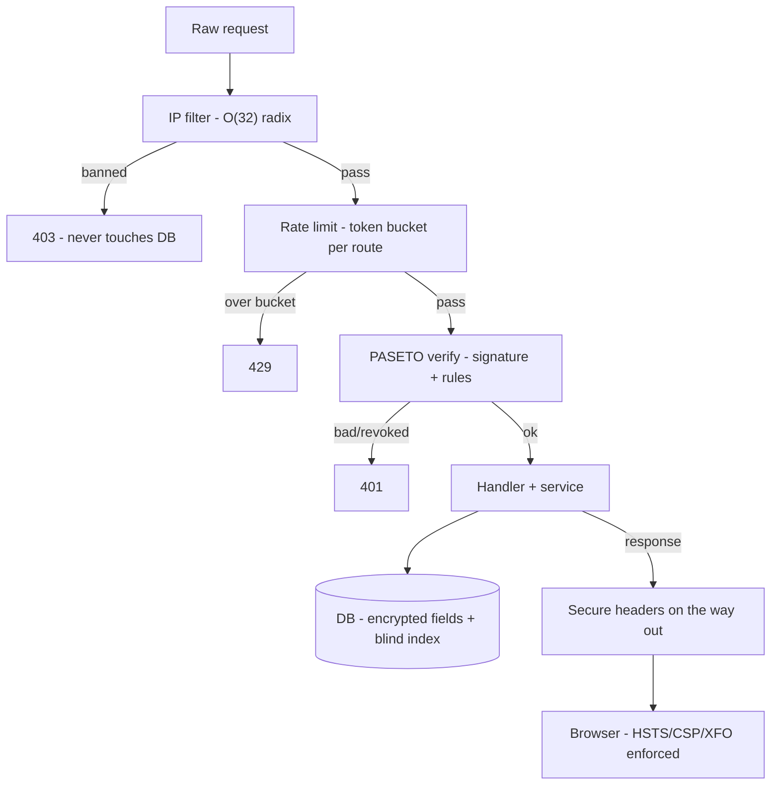

---

title: "The Golang4U Security Bible: A Defense-in-Depth Masterclass"
date: 2026-02-10T12:00:00+08:00
lastmod: 2026-02-10T12:00:00+08:00
author: "Punit Naran"
authorLink: ""
description: "A definitive guide to securing a Go backend. We dissect the `ipFilter` middleware (Mutex/Radix Tree), the `Tollbooth` rate limiter (Token Bucket), and the rigorous HSTS/CSP header configuration that protects Golang4U users."
tags: ["Go", "Security", "Middleware", "IPFilter", "RateLimit", "Cybersecurity", "Zero Trust", "HSTS", "CSP"]
categories: ["Security", "Engineering Handbook"]
featuredImage: ""
draft: false
---

# Preface: The Zero Trust Mindset

Security is often treated as a feature. "Add a login page, and we're secure."
This is false.
Security is a **Process**. It is the sum of every line of code that handles input.

In **Golang4U**, we adopt a **Zero Trust** mindset.
1.  **Trust No IP**: Even if it didn't attack us yesterday, it might attack us today.
2.  **Trust No User**: Even if they have a valid token, they might be spamming.
3.  **Trust No Browser**: Even if Chrome says it's secure, we enforce it with headers.

This guide will walk you through the three rings of defense: **Network**, **Application**, and **Presentation**.

---

# Chapter 1: The Network Layer (IP Filtering)

Before a request can even touch our business logic, it must pass the **IP Filter**.
This is our "Bouncer."

### 1.1 The Architecture of `internal/ipFilter`

We don't use a simple `map[string]bool`. Why?
Because IP ranges exist. Blocking `192.168.1.0/24` means blocking 256 addresses. A map cannot handle CIDR ranges efficiently.

We use a **Radix Tree** (via `github.com/jpillora/ipfilter`).
*   **Time Complexity**: $O(k)$ where $k$ is the number of bits in the IP (32 for IPv4, 128 for IPv6).
*   **Space Complexity**: Extremely efficient. It compresses common prefixes.

### 1.2 The Implementation (`ip_filter.go`)

Let's look at the `IPFilter` struct in `internal/ipFilter/ip_filter.go`.

```go
type IPFilter struct {
    ipBlockList *ipfilter.IPFilter // The Radix Tree Engine
    writer      *bufio.Writer      // Buffered Writer for Persistence
    file        *os.File           // File Handle
    mu          sync.Mutex         // The "Bathroom Key"
}
```

**The Concurrency Problem**:
Echo is multi-threaded. If two distinct requests try to ban an IP at the same time, they will race to write to `bannedIps.txt`.
*   Thread A writes: "1.2.3.4\n"
*   Thread B writes: "5.6.7.8\n"
Without a lock, the OS might interleave the bytes: "1.2.35.6.7.4.8\n". The file is now corrupt.

**The Solution (Mutex)**:
```go
func (f *IPFilter) BlockIP(ip string) error {
    f.mu.Lock()         // STOP. Only one thread passes.
    defer f.mu.Unlock() // OK, carry on.

    // 1. Update Memory (Instant)
    f.ipBlockList.BlockIP(ip)
    
    // 2. Update Disk (Persistent)
    if _, err := f.writer.WriteString(ip + "\n"); err != nil {
        return err
    }
    
    // 3. Flush (Durability)
    // We force the OS to write the buffer to disk immediately.
    return f.writer.Flush() 
}
```

### 1.3 The Middleware Hook

In `server.go`, we see:
```go
s.e.Use(s.ipfilter.IPBlockerMiddleware)
```

Inside `IPBlockerMiddleware`:
```go
func (f *IPFilter) IPBlockerMiddleware(next echo.HandlerFunc) echo.HandlerFunc {
    return func(c echo.Context) error {
        // Critical: c.RealIP() parses X-Forwarded-For headers
        ip := c.RealIP() 
        
        if f.ipBlockList.Blocked(ip) {
            // We return 403 Forbidden immediately.
            // The request NEVER reaches the Database.
            return c.String(http.StatusForbidden, "Your IP is banned.")
        }
        return next(c)
    }
}
```

---

# Chapter 2: The Application Layer (Rate Limiting)

Once the IP is allowed in, we must ensure they behave.
A "Good" user might turn "Bad" if their script malfunctions and hits our API 1,000 times a second.

We use **Tollbooth** (a generic middleware for rate limiting).

### 2.1 The Token Bucket Algorithm
Imagine a bucket with a small hole in the bottom.
*   **Tokens (Water)** drip out at a steady rate (1 request/second).
*   **Burst Capacity**: The size of the bucket (5 requests).
*   **Action**: Using the API adds water.
*   **Overflow**: If the bucket is full, the water spills (Request Rejected).

This allows a user to "click fast" for a few seconds (burst), but prevents sustained spam.

### 2.2 Granular Application
We don't rate limit everything equally.
*   **Serving Images**: Fast, Cheap. Limit = 100 req/sec.
*   **Hashing Passwords**: Slow, Expensive (Argon2). Limit = 1 req/sec.

In `server.go` (`EstablishRoutes`):
```go
// Only limit the Login route aggressively
s.e.POST("/login", s.h.Login, s.rateLimit.Middleware)
```

---

# Chapter 3: The Presentation Layer (Secure Headers)

The browser is a hostile environment. We use HTTP Headers to configure the browser's security sandbox.
Configured in `internal/server/server.go` via `middleware.SecureWithConfig`.

### 3.1 HSTS (Strict-Transport-Security)
**The Vulnerability**: SSL Stripping.
A hacker sits in a coffee shop Wi-Fi. You type `golang4u.com`. Your browser sends `GET http://golang4u.com`. The hacker intercepts this unencrypted packet and proxies the connection. You never see the padlock.

**The Fix**:
```go
HSTSMaxAge: 31536000, // 1 Year
```
This header tells Chrome: "For the next 365 days, NEVER send an unencrypted packet to this domain. Internalize the redirect to HTTPS."

### 3.2 X-Frame-Options
**The Vulnerability**: Clickjacking.
A site `win-iphone.com` loads `golang4u.com/delete-account` in an invisible `<iframe>`. The user clicks "Claim Prize" on the parent page, but the click passes through to the "Delete" button on your site.

**The Fix**:
```go
XFrameOptions: "SAMEORIGIN",
```
This tells the browser: "Only page on `golang4u.com` can iframe `golang4u.com`."

### 3.3 CSP (Content-Security-Policy)

```mermaid
sequenceDiagram
participant B as browser
participant X as xss'd <script>
B-->X
X-->X
B-->B
X--xB: postMessage is the only channel left (a controlled one)
```
**The Vulnerability**: XSS (Cross-Site Scripting).
A user posts a comment: `<script>stealCookies()</script>`. If you render this, the script runs in everyone's browser.

**The Fix**:
```go
ContentSecurityPolicy: "default-src 'self'",
```
This tells the browser: "Only load scripts from My Domain. If you see a script pointing to `evil.com`, BLOCK IT."

---

# Chapter 4: Data Layer Defense (The Blind Index)

We touched on this in Architecture, but let's look at the Security implications.

**Problem**: We encrypt emails in the DB (`EncryptedEmail`). But we need to stop duplicate signups.
**Naive Solution**: Decrypt every row to check. (Slow + Insecure).
**Insecure Solution**: Store `Hash(email)`. (Rainbow Table Attack possible).

**The Secure Solution**: HMAC-SHA256 Blind Index.
```go
// internal/service/user_service.go

key := "idx_email_" + Hex(HMAC(email, SecretKey))
```

*   **HMAC**: Hash-based Message Authentication Code.
*   It is impossible to reverse the hash without the `SecretKey` (stored in ENV, not DB).
*   If the DB leaks, the attacker sees `idx_email_a8f92...`. They cannot guess the email because they don't have the Secret Key to generate the hashes for their dictionary attack.

This is **k-anonymity**.

---

# Chapter 5: Docker & Infrastructure Security

Security doesn't stop at Go code.

### 5.1 The Rootless Container
In our `Dockerfile`, we should never run as root.
```dockerfile
# Create a group and user
RUN addgroup -S appgroup && adduser -S appuser -G appgroup
USER appuser
```
If a hacker exploits a vulnerability in Echo to get Remote Code Execution (RCE), they are trapped as `appuser`. They cannot install packages, modify system files, or read `/etc/shadow`.

### 5.2 Secrets Management
We NEVER commit secrets to Git.
We use `config/config.go` to read from Environment Variables.
`config.GmailToken = os.Getenv("GMAIL_TOKEN")`

In production (Kubernetes), these are injected as k8s Secrets.

---

# Chapter 6: Threat-Model-Driven Hardening

The five controls above are not a menu you pick from — they are the **answer to a threat model**. The lazy way to "add security" is to bolt on the control whose name you remember. The right way is to start from the threat and work backward to the cheapest control that kills it.

A **threat model** is a list of (actor, capability, asset) triples. For `golang4u` the three actors that matter are:

| Actor | Capability | Asset at risk |
|---|---|---|
| Anonymous IP | unbounded request rate | server CPU, DB, login (brute force) |
| Authenticated user | valid token + browser | other users' data, the admin's session |
| Server admin / insider | DB + log + RAM access | every user's *plaintext* email, the keys |

Every control in Chapters 1–5 exists to close one of these cells. The table below is the *whole* hardening program, one row per threat, with the control that answers it and the layer it lives in:

| Threat (actor → asset) | Control | Layer | Cost model |
|---|---|---|---|
| Bad IP floods the API | radix-tree IP block list | network | O(32) per request, 0 on a hit |
| Good user's script floods the login | token-bucket rate limit (per route) | application | O(1) per request |
| Coffee-shop MITM strips TLS | HSTS + X-Frame-Options + CSP | presentation | one header, zero per request |
| DB leaks emails in the clear | ECIES at-rest + HMAC blind index | data | one GCM + one HMAC per email |
| RCE lands as root | rootless container + k8s Secrets | infra | per-deploy, not per request |
| Insider reads a *live* token in RAM | short access (15 m) + stateful refresh | auth | one DB check per refresh |

The ordering in the table is the *order of enforcement* too: a request is denied at the **cheapest** layer it can be denied at, so an expensive layer never sees traffic a cheap one already rejected.



Notice the shape: **each layer only has to do what the previous layer is too coarse to do.** The IP filter is the bouncer (coarse, cheap, O(32)); the rate limiter is the doorman (per-route, O(1)); the token check is the badge (per-user, one sig verify); the DB is the vault (only the encrypted stuff). A layer that re-checks something an earlier layer already proved is wasted work — and a layer that *forgets* to prove it is the bug.

**Note**: the threat model is the *spec*, and the code is the *proof*. If you add a control you cannot point at a row in the table above for, it is a feature, not a defense — and the first thing to get deleted under load. If you find a threat with *no* row, that is a missing control, and it is the one to build next.

**Warning**: `c.RealIP()` (the `X-Forwarded-For` the IP filter trusts) is only as good as your edge. Behind a single known load balancer it is correct; behind *public* internet where any client can set the header, an attacker can spoof *their own* source IP and dodge the block list entirely. If the LB does not strip/overwrite `X-Forwarded-For` from untrusted clients, the IP filter is a suggester, not a decider — pin it to the LB's IP at the edge.

---

# Conclusion

Review the checklist for **Golang4U**:
1.  [x] **IP Filter**: Stops the bots at the door.
2.  [x] **Rate Limit**: Stops the flooding.
3.  [x] **HSTS/CSP**: Stops the browser tricks.
4.  [x] **HMAC Index**: Stops the DB leak from revealing emails.
5.  [x] **Rootless Docker**: Stops the RCE from taking over the server.

This is what "Production Ready" looks like.

---

## Takeaways

- **Model the threat, then buy the cheapest control that kills it.** Every control above maps to exactly one (actor, capability, asset) cell. A control with no cell is a feature; a threat with no control is your next incident.
- **Enforce at the cheapest layer that can.** Deny a bad IP at the radix tree (O(32)) before it spends a cycle on a signature verify (O(1) but pricier) before it costs a DB round-trip. The ordering is the design.
- **Each layer proves what the previous one is too coarse to prove.** Coarse → fine → per-user → per-row. The moment a layer re-proves what an earlier layer proved, you have paid for the same work twice and the second copy is where the bug lives.
- **Headers are a browser sandbox, not a firewall.** HSTS stops the stripping, X-Frame-Options stops the iframe, CSP stops the script — all three are *client-side* enforcement that only works because the browser obeys. A client that ignores them is exactly as open as a server that didn't send them.
- **The DB leak is the insider threat, and it is the only one a header can't fix.** HSTS/CSP/rate-limit all assume the *server* is honest. Encryption at rest + the HMAC blind index is the only control that survives the case where it isn't.
- **`X-Forwarded-For` is only as trustworthy as your edge.** One LB that strips it from untrusted clients = the IP filter is a real filter. Public internet that doesn't = it's a suggestion you can override by spoofing your own source.
