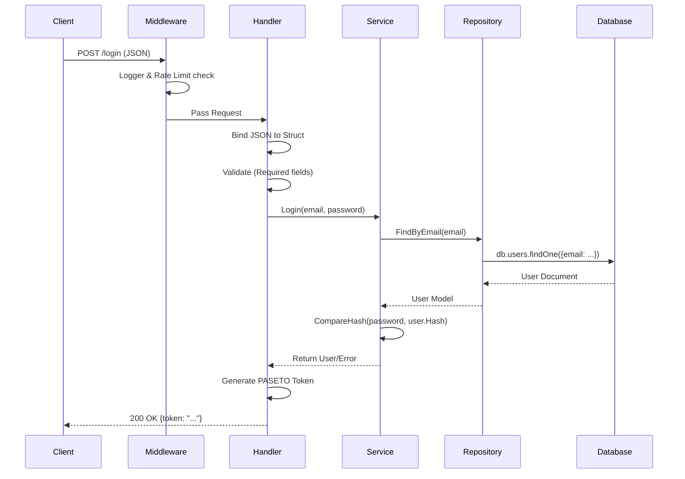

# Introduction

In the world of Go application development, "structure" is a topic of endless debate. Should you use a flat structure? Group by feature? Follow "Standard Go Project Layout"?

With **Golang4U**, we aimed to build a system that is robust enough for enterprise use cases but simple enough to be maintained by a small team. We adopted a **Service-Oriented** layered architecture (often called Clean Architecture or Hexagonal Architecture lite) to ensure separation of concerns, testability, and scalability.

In this deep dive, we will explore:
1.  **The Tech Stack Decisions**: Why Echo? Why MongoDB?
2.  **The Project Structure**: Mapping the `internal` folder.
3.  **Dependency Injection**: How we wire it all together without global state.
4.  **Request Lifecycle**: Tracing a request from the user's browser to the database and back.

---

# 1. The Tech Stack decisions

Every architectural choice comes with trade-offs. Here is why we chose our specific stack.

### 1.1 The Web Framework: Echo (v4)

Go's standard `net/http` library is powerful, but for a production REST API, you often find yourself rewriting the same boilerplate: routing with parameters, group middleware, data binding, and response formatting.

We chose **[Echo](https://echo.labstack.com/)** for three main reasons:

1.  **Performance**: Echo's router is highly optimized, with zero dynamic memory allocation for route dispatching.
2.  **Middleware Ecosystem**: It has a robust suite of built-in middleware (Recover, Logger, CORS, Secure) that are production-ready out of the box.
3.  **Context Interface**: The `echo.Context` interface simplifies request handling significantly.

**Code Example: The Power of Binding**

In standard Go, parsing a JSON body involves creating a decoder and handling EOF errors manually. In Echo:

```go
type LoginRequest struct {
    Email    string `json:"email" validate:"required,email"`
    Password string `json:"password" validate:"required"`
}

func (h *AuthHandler) Login(c echo.Context) error {
    var req LoginRequest
    // Bind() handles JSON, XML, Form data automatically based on Content-Type
    if err := c.Bind(&req); err != nil {
        return c.JSON(http.StatusBadRequest, map[string]string{"error": "Invalid request format"})
    }
    
    // ... validation and logic ...
}
```

### 1.2 The Database: MongoDB

We chose **MongoDB** (NoSQL) over a traditional relational database (PostgreSQL/MySQL) for specific reasons related to our domain:

*   **Content Management**: Blog posts, comments, and tags are inherently hierarchical and document-oriented. A post has embedded comments, arrays of tags, and dynamic metadata. Storing this in a single document avoids complex `JOIN` operations.
*   **Schema Flexibility**: As we iterate on User Profiles (adding social links, preferences, 2FA secrets), we can update the struct in Go without running heavy migration scripts on the database.
*   **Read Performance**: For a read-heavy application (viewing feeds), fetching a single document is generally faster than joining 4-5 tables.

**Go Driver**: We use the official `go.mongodb.org/mongo-driver/v2`.

---

# 2. The Project Structure

We follow the **Standard Go Project Layout**, designed to separate public API code from internal business logic. This isn't just arbitrary; it prevents "import cycles" and forces you to think about dependencies.

### 2.1 The "Clean Architecture" Map

```mermaid
graph TD
    subgraph "External World"
        Client[User Browser/Mobile]
        DB[(MongoDB)]
    end

    subgraph "Interface Layer (Transport)"
        Handler[HTTP Handlers (Echo)]
    end

    subgraph "Core Business Logic"
        Service[Service Layer]
    end

    subgraph "Data Access"
        Repo[Repository Layer]
    end

    Client -->|HTTP Request| Handler
    Handler -->|DTO| Service
    Service -->|Domain Model| Repo
    Repo -->|BSON| DB
```

### 2.2 The Directory Tree

```mermaid
graph LR
    Root[Project Root]
    Root --> Cmd[cmd/]
    Root --> Internal[internal/]
    
    Cmd --> Main[main.go (Wiring)]
    
    Internal --> Handler[handler/ (HTTP)]
    Internal --> Service[service/ (Logic)]
    Internal --> Repo[repository/ (DB)]
    Internal --> Model[model/ (Structs)]
    Internal --> Middleware[middleware/ (Security)]
```

### 2.3 `cmd/server/main.go`: The Composition Root
The `main` package is the *only* place where all layers meet. It performs **Dependency Injection**.
1.  **Config**: Loads `config.toml`.
2.  **Infra**: Connects to Mongo/Redis.
3.  **Wiring**: Injects `Repo` into `Service`, and `Service` into `Handler`.
4.  **Run**: Starts the HTTP listener.

### 2.4 `internal/model`: The Shared Language
This package contains **Pure Data Structures**. It has *zero* dependencies on other internal packages.
```go
// internal/model/user.go
type User struct {
    ID        string    `bson:"_id,omitempty" json:"id"`
    Email     string    `bson:"email" json:"email"`
    Profile   Profile   `bson:"profile" json:"profile"`
    // Password is NOT in JSON for security
    Password  string    `bson:"password" json:"-"` 
}
```

### 2.3 `internal/repository` (Data Access Layer)
**Responsibility**: Talk to the database.
This layer knows *how* to store things (BSON, SQL queries) but doesn't know *why*. It performs CRUD operations.

**Idiom**: We accept interfaces or specific structs and return domain models.

```go
// internal/repository/user_repository.go

type UserRepository struct {
    collection *mongo.Collection
}

func NewUserRepository(db *mongo.Database) *UserRepository {
    return &UserRepository{
        collection: db.Collection("users"),
    }
}

func (r *UserRepository) FindByEmail(ctx context.Context, email string) (*model.User, error) {
    var user model.User
    // Use a context with timeout for production safety
    ctx, cancel := context.WithTimeout(ctx, 5*time.Second)
    defer cancel()

    err := r.collection.FindOne(ctx, bson.M{"email": email}).Decode(&user)
    if err != nil {
        if errors.Is(err, mongo.ErrNoDocuments) {
            return nil, nil // Not found is not always an error
        }
        return nil, err
    }
    return &user, nil
}
```

### 2.4 `internal/service` (Business Logic Layer)
**Responsibility**: The brain of the application.
It validates business rules, combines data from multiple repositories, and handles external APIs (email, payment).

**Example Rule**: "A user cannot register with an email that is already blocked."

```go
// internal/service/auth_service.go

type AuthService struct {
    userRepo  *repository.UserRepository
    ipFilter  *ipfilter.Service
}

func (s *AuthService) RegisterUser(req model.RegisterRequest) error {
    // 1. Check if email exists
    existing, _ := s.userRepo.FindByEmail(context.Background(), req.Email)
    if existing != nil {
        return errors.New("email already taken")
    }

    // 2. Hash Password (bcrypt/argon2)
    hashed, _ := bcrypt.GenerateFromPassword([]byte(req.Password), 14)

    // 3. Create User Model
    newUser := model.User{
        Email:    req.Email,
        Password: string(hashed),
    }

    // 4. Save
    return s.userRepo.Create(context.Background(), &newUser)
}
```

### 2.5 `internal/handler` (Transport Layer)
**Responsibility**: Speak HTTP.
It reads the `echo.Context`, parses requests, calls the Service, and formats the Response.

**Crucial Rule**: The handler should rarely have `if` statements related to business logic. It should just handle *input parsing* and *output formatting*.

---

# 3. Dependency Injection (WIring)

Go doesn't have a "Magic Container" like Spring Boot (Java) or NestJS, and that's a good thing. We favor **Explicit Dependency Injection**. We manually pass dependencies into constructors (`New...` functions).

This happens in `main.go`. It makes the dependency graph obvious and makes testing easy (we can pass mocks implementation).

```go
// Main wiring in main.go

func main() {
    // 1. Infrastructure
    mongoClient := connectMongo()
    db := mongoClient.Database("golang4u")

    // 2. Repositories
    userRepo := repository.NewUserRepository(db)
    postRepo := repository.NewPostRepository(db)

    // 3. Services (injected with Repositories)
    authService := service.NewAuthService(userRepo)
    postService := service.NewPostService(postRepo)

    // 4. Handlers (injected with Services)
    authHandler := handler.NewAuthHandler(authService)
    postHandler := handler.NewPostHandler(postService)

    // 5. Routes
    e := echo.New()
    e.POST("/login", authHandler.Login)
}
```

---

# 4. Request Lifecycle: A Step-by-Step Flow

Let's visualize what happens when a user clicks "Log In".



### Detailed Breakdown

1.  **Ingress**: The request hits the server.
2.  **Middleware Chain**:
    *   **Recovery**: Ensures if the handlers panic, the server doesn't crash.
    *   **CORS**: Checks if the request is coming from an allowed origin (`golang4u.com`).
    *   **IPFilter**: Checks if the IP is in our Redis blocklist.
    *   **Logger**: Logs `path=/login status=... latency=...` for observability.
3.  **Handler**: `func (h *AuthHandler) Login` is called. It parses the JSON body.
4.  **Service**: `authService.Login` performs the password comparison. It avoids returning specific errors like "User not found" to prevent user enumeration attacks; instead, it returns "Invalid Credentials".
5.  **Response**: The handler wraps the result in a standard JSON envelope: `{"data": ..., "status": "success"}`.

---

# 5. Advanced Topcs

### 5.1 Context Usage
In Go, `context.Context` is the lifeline of a request. It carries concepts of:
*   **Deadlines**: "Stop this DB query if it takes > 2 seconds".
*   **Cancellation**: "The user closed the browser, stop processing".

We pass `ctx` from Handler -> Service -> Repository. MongoDB respects this context.

```go
// Creating a child context with timeout
ctx, cancel := context.WithTimeout(c.Request().Context(), 2*time.Second)
defer cancel()

user, err := h.service.GetUser(ctx, id)
```

### 5.2 Error Handling vs Logging
We don't log errors in the Repository. We return them.
We don't log errors in the Service. We return them.
**We log errors in the Handler.**

Why? If you log everywhere, your logs become spam. "Failed to query DB" would appear 3 times (Repo log, Service log, Handler log). By bubbling the error up, the Handler decides:
*   **500 Internal Error**: Log the full stack trace for devs. Return "Something went wrong" to user.
*   **400 Bad Request**: Don't log (user error). Return proper message to user.

---

# Conclusion

The architectural choices in Golang4U provide a stable foundation. By strictly separating **Transport (HTTP)** from **Logic** from **Storage**, we create a codebase that is easy to navigate and safe to modify. Dependencies flow *inwards*, and data flows *downwards*.

In the next post of this series, we will look at how we secure this architecture using **Advanced Security Middleware** like Custom IP Filtering and Token Buckets.
