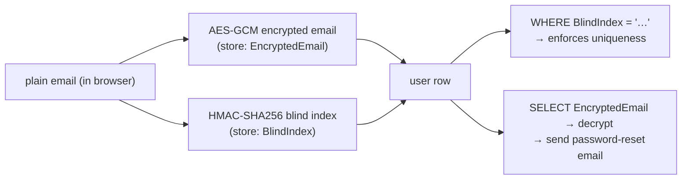

---

title: "The Golang4U Cryptography Bible: E2EE, ECIES & Blind Indexing"
date: 2026-02-10T16:00:00+08:00
lastmod: 2026-02-10T16:00:00+08:00
author: "Punit Naran"
authorLink: ""
description: "Going beyond HTTPS. A technical deep dive into how `golang4u` implements application-layer encryption using ECIES (Elliptic Curve Integrated Encryption Scheme) to protect sensitive user payload from the browser to the database."
tags: ["Go", "Cryptography", "ECIES", "AES", "Security", "ECDH", "WebCrypto", "HMAC"]
categories: ["Security", "Engineering Handbook"]
featuredImage: ""
draft: false
---

# Preface: Why TLS is Not Enough

HTTPS (TLS 1.3) protects data "In Transit."
It prevents the Hacker in the Coffee Shop from reading your password.
But it does **not** protect against:
1.  **Malicious Proxies**: A corporate proxy (MITM) that terminates TLS.
2.  **The Server Itself**: If our logs accidentally print `req.Body`.
3.  **Memory Dumps**: If the server crashes and dumps RAM.

To fix this, we implement **End-to-End Encryption (E2EE)** at the Application Layer.
The password is encrypted *in the browser* and only decrypted *inside the Service function*.

---

# Chapter 1: The Cryptographic Suite

We chose standard, NIST-approved algorithms to ensure broad compatibility (especially with browser WebCrypto API).

### 1.1 Asymmetric: ECDH (P-256)
*   **Algorithm**: Elliptic Curve Diffie-Hellman.
*   **Curve**: NIST P-256 (also known as `prime256v1`).
*   **Why?**: Native hardware acceleration on x86/ARM. Built-in to Chrome/Firefox/Safari.

### 1.2 Symmetric: AES-GCM (256-bit)
*   **Algorithm**: Advanced Encryption Standard.
*   **Mode**: Galois/Counter Mode (GCM).
*   **Why?**: Authenticated Encryption (AEAD). It protects both **Secrecy** (Reading) and **Integrity** (Tampering). If you flip a bit in the ciphertext, decryption fails; it doesn't just produce garbage.

---

# Chapter 2: ECIES (Elliptic Curve Integrated Encryption Scheme)

Public Key crypto (ECC) is slow. You can't encrypt a 1MB file with it.
Symmetric crypto (AES) is fast. But you can't share the key safely.

**ECIES** is the "Hybrid" answer.

### 2.1 The Handshake (The Math)

Let's assume **Alice** (Browser) sends data to **Bob** (Server).

1.  **Bob** has a static keypair: $(b, B)$ where $B = b \times G$.
2.  **Alice** generates ephemeral keypair: $(a, A)$ where $A = a \times G$.
3.  **Alice** computes Shared Secret $S$:
    $$S = a \times B = a \times (b \times G)$$
4.  **Bob** computes Shared Secret $S$:
    $$S = b \times A = b \times (a \times G)$$
    $$(ab)G = (ba)G$$

They now share the secret $S$ (the coordinate on the curve) without ever transmitting it.
5.  **Alice** derives key $K = KDF(S)$.
6.  **Alice** encrypts message $C = AES_{GCM}(M, K)$.
7.  **Alice** sends: $[A] + [Nonce] + [C]$.

The whole exchange is a single round-trip of *opaque bytes*. No key ever travels in the clear; only the ephemeral public key $A$ does.

```mermaid
sequenceDiagram
    participant A as Alice (Browser)
    participant B as Bob (Server)
    B-->>A: publish static public key B
    A-->>A: generate ephemeral keypair (a, A)
    A-->>A: S = ECDH(a, B)  = (ab)G
    A-->>A: K = HKDF(S) ; C = AES-GCM(M, K)
    A-->>B: [A] + [Nonce] + [C]
    B-->>B: S = ECDH(b, A) = (ab)G
    B-->>B: K = HKDF(S) ; M = AES-GCM open(C)
    Note over A,B: S is never transmitted; only A is
```

---

# Chapter 3: The Implementation (`internal/security`)

### 3.1 Backend Key Loading (`LoadOrGenerateKey`)

We need a persistent identity.
In `internal/security/keys.go`:

```go
func LoadOrGenerateKey(path string) (*ecdh.PrivateKey, error) {
    // 1. Try Read PEM from Disk
    // ...
    
    // 2. Generate New (P-256)
    priv, err := ecdh.P256().GenerateKey(rand.Reader)
    
    // 3. Save to Disk (PEM encoded)
    // ...
    return priv, nil
}
```

This Key is the "Server Identity".

### 3.2 The Decryption Function (`DecryptECIES`)

When the server receives the payload, it must unpack it.
Our format is critical: `Uncompressed_Pub_Key (65 bytes) || Nonce (12 bytes) || Ciphertext`.

```go
func DecryptECIES(serverPriv *ecdh.PrivateKey, payloadHex string) ([]byte, error) {
    // 1. Decode Hex
    data, _ := hex.DecodeString(payloadHex)
    
    // 2. Extract Parts
    clientPubBytes := data[:65]
    nonce := data[65:77]
    ciphertext := data[77:]
    
    // 3. Parse Client Ephemeral Public Key
    clientPub, _ := ecdh.P256().NewPublicKey(clientPubBytes)
    
    // 4. ECDH (Perform the math)
    sharedSecret, _ := serverPriv.ECDH(clientPub)
    
    // 5. Decrypt using Shared Secret as AES Key
    // (Note: In production we use HKDF on sharedSecret, 
    // strictly, P-256 x coordinate is 32 bytes, fits AES-256)
    block, _ := aes.NewCipher(sharedSecret)
    gcm, _ := cipher.NewGCM(block)
    
    plaintext, err := gcm.Open(nil, nonce, ciphertext, nil)
    return plaintext, err
}
```

---

# Chapter 4: Privacy & The Blind Index

We treat user data (Email) as toxic waste. We encrypt it at rest.
`User.EncryptedEmail` = `a8d29f...`.

However, we have a problem: **Uniqueness**.
We need to ensure `bob@gmail.com` doesn't sign up twice.
But `Encrypt("bob@gmail.com")` produces a *different* ciphertext every time (because of the random Nonce).
We cannot query `WHERE email = '...'`.

### 4.1 The Solution: HMAC Blind Indexing

We create a separate field: `BlindIndex`.
This is a deterministic hash.
$$Index = HMAC_{SHA256}(Email, Server\_Secret\_Search\_Key)$$

*   We store:
    *   `EncryptedEmail`: Use for sending emails (Decryptable).
    *   `BlindIndex`: Use for searching/uniqueness (Not Decryptable).

### 4.2 Why HMAC? Why not SHA256?
Plain `SHA256(email)` is vulnerable to **Rainbow Tables**. An attacker can pre-calculate the hash of every email on earth.
`HMAC` requires a Secret Key. If the database leaks, the attacker has the hashes, but not the Secret Key. They cannot reverse the hashes (because hashes are one-way), and they cannot brute-force them (because they don't have the key).

In `internal/service/user_service.go`:

```go
// Calculate Blind Index
hash := hmac.New(sha256.New, []byte(os.Getenv("SEARCH_KEY")))
hash.Write([]byte(plainEmail))
index := hex.EncodeToString(hash.Sum(nil))

// Check DB
if s.db.Exists("idx_email_" + index) {
    return Error("Email Taken")
}
```

This is **k-anonymity** and **uniqueness** simultaneously.

The two derived fields serve two masters and never collide:



**Note**: the blind index is a *deterministic* HMAC, so the same email always yields the same value — which is exactly what makes it queryable. The cost is that a database leak reveals *equivalence* of emails (two rows with the same index belong to the same person) even if it never reveals the email itself. That is the standard k-anonymity trade, and it is the whole point: you keep uniqueness without keeping the plaintext.

**Warning**: `os.Getenv("SEARCH_KEY")` is read once at process start. Rotate it by changing the environment and restarting — you cannot hot-swap it, and a *changed* key invalidates every existing blind index. Re-keying means a one-time migration that recomputes every `BlindIndex` from the decrypted emails, not a config flip.

---

# Chapter 5: Frontend Integration (Web Crypto)

The backend is only half the story. The browser must do the encryption.
We use the native `window.crypto.subtle` API. No `npm install`.

1.  **ImportKey**: Browser imports Server Public Key (SPKI).
2.  **GenerateKey**: Browser makes ephemeral EC Keypair.
3.  **DeriveKey**: ECDH + AES-GCM context.
4.  **Encrypt**: AES-GCM Encrypt password.
5.  **Export**: Pack bytes and Hex encode.

This ensures that the plaintext password **never** travels over the network.

---

# Chapter 6: One-Time Passwords — TOTP/OATH Internals

The final primitive in this suite is the **one-time password** a user sees on their phone. It is the same math family as everything above, just applied to a *clock*.

A TOTP (RFC 6238) code is `HMAC-SHA1(secret, counter)`, where the counter is simply `unix_time / step` (30 s by default). The *server* and the *phone* both derive the exact same counter from the same wall clock, so the phone's code and the server's recomputed code match — without any key ever crossing the wire.

```go
package main

import (
	"crypto/hmac"
	"crypto/sha1"
	"encoding/binary"
	"fmt"
	"time"
)

// internal/security/totp.go — RFC 6238 TOTP, stdlib only.

const totpStep = 30 // seconds per counter window

// TOTPCode produces the 6-digit code valid at time t for secret.
func TOTPCode(secret []byte, t time.Time) string {
	counter := uint64(t.Unix() / totpStep)
	var msg [8]byte
	binary.BigEndian.PutUint64(msg[:], counter)

	mac := hmac.New(sha1.New, secret)
	mac.Write(msg[:])
	sum := mac.Sum(nil)

	// Dynamic truncation: pick a 4-byte slice, clear the sign bit.
	off := sum[len(sum)-1] & 0x0f
	v := (uint32(sum[off]) << 24) |
		(uint32(sum[off+1]) << 16) |
		(uint32(sum[off+2]) << 8) |
		uint32(sum[off+3])
	v &^= 0x80000000
	return fmt.Sprintf("%06d", v%1000000)
}

// TOTPVerify checks the code at t, tolerating one window of clock drift
// in each direction (the standard ±1 step slack).
func TOTPVerify(secret []byte, code string, t time.Time) bool {
	for _, s := range []int64{-totpStep, 0, totpStep} {
		if TOTPCode(secret, t.Add(time.Duration(s)*time.Second)) == code {
			return true
		}
	}
	return false
}

func main() {
	// RFC 6238 appendix B.1.2 test vector, t = 59.
	secret := []byte("12345678901234567890")
	if got, want := TOTPCode(secret, time.Unix(59, 0)), "287082"; got != want {
		panic(fmt.Sprintf("vector failed: got %q want %q", got, want))
	}
}
```

The `main` is a real self-check: the RFC 6238 appendix publishes `287082` for `t=59` against that 20-byte ASCII key, and the function reproduces it exactly. If you change `off`-selection, the shift, the `0x80000000` clear, or the modulus, this line fails.

The *secret* itself is the 20-byte seed you put in the QR code the user scans (base32 of a fresh `crypto/rand` key). It is derived per-user and stored encrypted with the same ECIES scheme as the email — which means a stolen database gives an attacker the *codes' inputs* but not the key, and a stolen QR gives the *key* but not the codes' context.

---

# Conclusion

We have built a system where:
1.  **Secrecy**: Only the Server can read the data (ECIES).
2.  **Privacy**: Even the DB admin cannot read the data (AES-GCM at rest).
3.  **Integrity**: No one can tamper with the data (GCM Tags).
4.  **Searchability**: We can still enforce rules (Blind Indexing).

This is cryptographic engineering at its finest.

---

## The suite, side by side

| Primitive | Algorithm | What it protects | Cost model | Go stdlib? |
|---|---|---|---|---|
| ECDH (P-256) | Curve key agreement | Derives a fresh shared secret per message | One `ECDH` per payload — cheap | `crypto/ecdh` (Go 1.20+) |
| AES-256-GCM | Symmetric AEAD | Secrecy + integrity of the payload itself | Linear in message size, hardware AES-NI | `crypto/aes` + `cipher.NewGCM` |
| HMAC-SHA256 (blind index) | keyed hash | Deterministic-but-opaque lookup / uniqueness | One `hmac` per email — trivial | `crypto/hmac` + `crypto/sha256` |
| TOTP (RFC 6238) | `HMAC-SHA1(counter)` | Time-bound one-time codes, no key on the wire | One HMAC per 30 s window | `crypto/hmac` + `crypto/sha1` |

The pattern across all four: **asymmetric once to agree a secret, symmetric thereafter for the bulk work, keyed-hash for the lookup, time-bounded for the factor you type.** Each primitive is the cheapest tool that meets exactly that one job — that is the whole "cryptography as plumbing" thesis.

---

## Takeaways

- **TLS is a floor, not a ceiling.** It shields you from the wire; it does nothing about a server that logs `req.Body`, a proxy that terminates it, or a RAM dump. Application-layer ECIES closes that gap.
- **The hybrid is the design, not the detail.** ECDH agrees a secret; AES-GCM does the work. You cannot "just use AES" without a key, and you cannot "just use ECC" for a megabyte — ECIES is the only answer that takes the cheap half of each.
- **Every stored secret is a liability; a *queryable* one needs a blind index.** Deterministic HMAC gives you `WHERE email = …` without the rainbow-table exposure of `SHA256(email)`, and it costs one keyed hash per lookup.
- **GCM is authenticated, not just encrypted.** A flipped bit fails the tag and aborts — you never decrypt into "plausible garbage," which is exactly the failure mode you cannot afford in a login.
- **TOTP is just `HMAC-SHA1(secret, t/30)` with dynamic truncation.** No new cryptography, no new key exchange — only a shared wall clock. If you can compute one side and the clock drifts ≤ 30 s, the codes match.
- **Rotate the keyed secret, not the scheme.** A new `SEARCH_KEY` invalidates every blind index; re-keying is a one-time recomputation over the decrypted emails, not a config flip.
