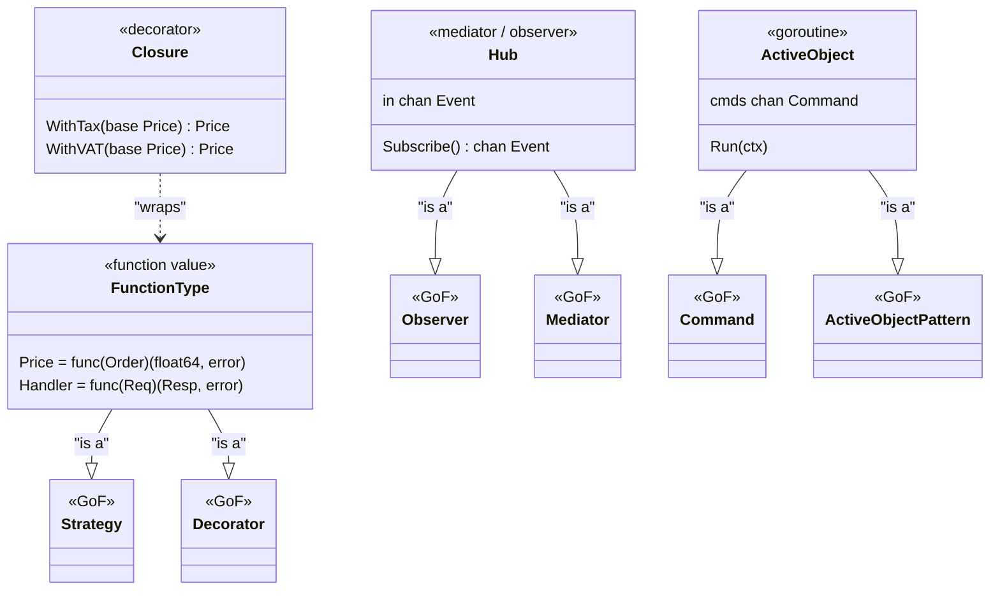
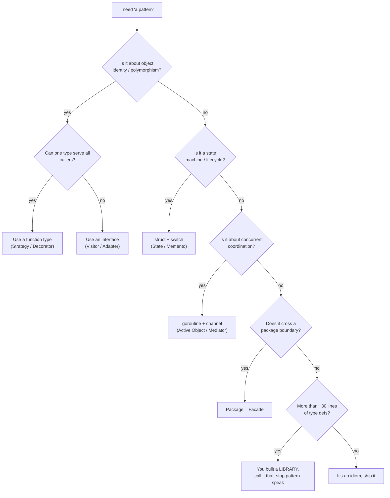

---

title: "Design Patterns in Go: The Once-per-Lifetime Patterns That Actually Pay Off"
date: 2026-10-15T09:00:00+00:00
author: "Punit Naran"
description: "Design Patterns in Go: The Once-per-Lifetime Patterns That Actually Pay Off"
tags: ["Go", "DesignPatterns"]
draft: false
---

Every Go developer has read *Design Patterns* (Gang of Four, 1994) and thought
"this is C++-ism". The refactoring.guru catalogue is the friendlier
reference, but most of it is *inheritance-based*, and Go has no inheritance.
So what is left? The answer is smaller than you expect, and that is the point.

This post walks the whole 23-pattern catalogue and marks **which patterns Go
handles natively** (with the exact idiom) and **which are better left to a
library**. The organizing rule is the thesis of the post:

> **If a pattern is about object identity / polymorphism, Go's type system
> already does it with a function type, an interface, or a generic. If it is
> about a state machine / lifecycle, the pattern is a struct + a `switch`. If
> it is about concurrent behavior, the pattern is a goroutine + a channel.**

Apply that three-way split and most of the catalogue collapses into idioms you
already know. By the end you will be able to **recognize which of the 23 are
native, which are "write the ten-line wrapper", and which to outsource to a
library** — and write the ~20-line Go that is the real "Strategy + Decorator"
without a single class hierarchy.

---

## The 23, ranked by "Go does this natively"

The table is the whole classification. The "Native?" column is the verdict.

| Pattern (Gang of Four) | Go idiom | Native? |
|------------------------|----------|---------|
| **Singleton** | package-level var + `sync.Once` | yes, trivially |
| **Factory** | constructor `NewFoo(deps...) *Foo` | yes, idiomatic |
| **Builder** | functional options `func WithX(x T) Opt` | yes, idiomatic |
| **Strategy** | function type `type Price = func(Order) (float64, error)` | yes, idiomatic |
| **Observer** | `chan Event` + a `Subscribe()` method | yes, goroutine-native |
| **Command** | `type Command struct { fn func(ctx context.Context) }` | yes |
| **Adapter** | just write the 10-line wrapper func | yes |
| **Facade** | a package that exposes 1 entry, hides 20 files | yes, idiomatic |
| **Decorator** | wrap `type Handler func(Req) (Resp, error)` | yes, idiomatic |
| **Chain of Responsibility** | `for _, h := range handlers { ... }` | yes, middleware **is** this |
| **Proxy** | wrap the real thing in `struct { inner T }` | yes |
| **Memento** | `snapshot := copy(orig)` (Go has no reference type) | mostly |
| **State** | `type State struct { cur State; next func() }` | yes |
| **Mediator** | a hub `chan` all parts talk to | yes, idiomatic |
| **Prototype** | `clone := orig` (value copy) — no deep-clone built-in | partly |
| **Flyweight** | a `sync.Map` of shared payloads + a key struct | yes |
| **Visitor** | `type Visitor interface { Visit(*T) }` | mostly |
| **Composite** | `type Node interface { children() []Node }` | yes |
| **Iterator** | `func(f func(T) bool) (bool, error)` (the `Slice` pattern) | yes, idiomatic |
| **Template Method** | **not native** — no inheritance; a function that takes a `func` | no |
| **Interpreter** | write a real parser (`go/parse`) — a pattern, not a type | no |
| **Active Object** | a goroutine + a `chan Request` | yes, **it's the goroutine** |
| **Bridge** | `type Bridge interface { Bridge() *Impl }` + two hierarchies | mostly |

The one pattern that is *always* the right answer in Go: **Active Object =
goroutine + channel**. The Gang of Four wrote it in 1994, before goroutines
existed. Every time you would write an `ActiveObject` in C++, you write a
`go func() { for req := range c { ... } }` in Go. That is not a pattern; that
is a *feature*.



The class diagram is the punchline: every "pattern" on the Go side is just a
**function value** (Strategy/Decorator), a **channel hub** (Observer/
Mediator), or a **goroutine** (Command/Active Object). The GoF column is the
90% you do *not* write.

---

## The idioms, in code

### Singleton: `sync.Once`

The Go idiom for "one instance, global access" is a package-level variable
whose construction is guarded by `sync.Once`. The `once` guarantees the
expensive init runs *exactly once* no matter how many goroutines race to
`Load()`.

```go
// singleton.go — the "Singleton" pattern as a package-level var + sync.Once.
//
// Package-level == globally reachable (the whole "Singleton" requirement).
// sync.Once makes the first init happen once, atomically, across goroutines.
package config

import (
	"os"
	"strconv"
	"sync"
)

// Config holds parsed settings.
type Config struct {
	Port  int
	Debug bool
}

// loader is the single Config instance.
var loader struct {
	once sync.Once
	cfg  *Config
}

// Load returns the shared Config, building it on first use only.
func Load() *Config {
	loader.once.Do(func() {
		port, _ := strconv.Atoi(os.Getenv("PORT"))
		if port == 0 {
			port = 8080
		}
		loader.cfg = &Config{Port: port, Debug: os.Getenv("DEBUG") == "1"}
	})
	return loader.cfg
}
```

> **Note**: the idiomatic Go *Singleton* is just a package variable. If you
> reach for a `Singleton` struct with an `Instance()` method and a lock, you
> are fighting the language. `sync.Once` + a package var is the entire
> pattern.

### Strategy + Decorator: the 20-line idiom

The *real* Go idiom for "Strategy" is a function type, and "Decorator" is a
closure that wraps one. No `PriceStrategy` interface, no `*Price` pointer, no
`NewPriceStrategy()` factory.

```go
// strategy.go — "Strategy" + "Decorator" as function types and closures.
//
// The class diagram the patterns book would draw is this one expression:
//
//     total := WithTax(0.20, WithVAT(0.20, Flat(5)))
//
// A function value *is* the strategy; a closure *is* the decorator.
package strat

import "fmt"

type Order struct{ Gross float64 }

// Price is the "Strategy". No interface, no struct, no pointer.
type Price = func(order Order) (float64, error)

// Flat is the base strategy: total = gross + fixed fee.
func Flat(fee float64) Price {
	return func(o Order) (float64, error) {
		return o.Gross + fee, nil
	}
}

// WithVAT is a decorator: it takes any Price and returns a new Price that
// applies VAT on top. Compose as many decorators as you like.
func WithVAT(vat float64, base Price) Price {
	return func(o Order) (float64, error) {
		p, err := base(o)
		if err != nil {
			return 0, err
		}
		return p * (1 + vat), nil
	}
}

// WithTax is a second decorator on the same base — "composition" is just
// function nesting, which Go makes trivial.
func WithTax(tax float64, base Price) Price {
	return func(o Order) (float64, error) {
		p, err := base(o)
		if err != nil {
			return 0, err
		}
		return p * (1 + tax), nil
	}
}

// main demonstrates the whole "pattern" as one call and one print.
func main() {
	total := WithTax(0.20, WithVAT(0.20, Flat(5)))
	p, err := total(Order{Gross: 100})
	if err != nil {
		fmt.Println("err:", err)
		return
	}
	fmt.Printf("gross 100 + flat 5, +20%% VAT, +20%% tax = %.2f\n", p)
}
```

### Observer / Mediator: the channel hub

The Go idiom for "Observer" (and "Mediator") is a single hub goroutine with an
inbound channel. Subscribing is just making a channel. No `AddObserver` /
`RemoveObserver` bookkeeping — the channel **is** the subscription.

```go
// observer.go — the "Observer"/"Mediator" pattern as a channel-driven hub.
//
// One goroutine reads from `in` and fans out to every subscriber channel.
// Subscribing is the whole "attach an observer" operation: make a channel.
package events

import (
	"context"
	"sync"
)

// Event is the thing that flows through the hub.
type Event struct {
	Type    string
	Payload map[string]any
}

// Hub is the single place every event passes through.
type Hub struct {
	in  chan Event
	mu  sync.Mutex
	sub map[string]chan Event
}

// NewHub builds a hub with a bounded inbound buffer.
func NewHub(buf int) *Hub {
	return &Hub{
		in:  make(chan Event, buf),
		sub: make(map[string]chan Event),
	}
}

// Publish pushes an event into the hub (the "subject" side of Observer).
func (h *Hub) Publish(e Event) {
	h.in <- e
}

// Subscribe returns a channel that receives every subsequent event.
func (h *Hub) Subscribe(name string) <-chan Event {
	h.mu.Lock()
	c := make(chan Event, 64)
	h.sub[name] = c
	h.mu.Unlock()
	return c
}

// Run drives the hub until the context is cancelled: the "active object"
// that services the inbound channel, fan-out included.
func (h *Hub) Run(ctx context.Context) {
	for {
		select {
		case <-ctx.Done():
			return
		case e := <-h.in:
			h.mu.Lock()
			for _, c := range h.sub {
				select {
				case c <- e:
				case <-ctx.Done():
					h.mu.Unlock()
					return
				}
			}
			h.mu.Unlock()
		}
	}
}
```

### Command / Active Object: a goroutine

```go
// activeobject.go — the "Active Object"/"Command" pattern = goroutine + channel.
//
// The Gang of Four wrote this in 1994, before goroutines existed. In Go an
// active object is just a goroutine reading commands from a channel.
package worker

import (
	"context"
)

type Command struct {
	Op  string
	Arg any
}

// ActiveObject is a long-lived worker: one goroutine, one command channel.
type ActiveObject struct {
	cmds chan Command
}

func NewActiveObject() *ActiveObject {
	return &ActiveObject{cmds: make(chan Command, 16)}
}

// Submit is the only way to talk to it — a push into the bounded buffer.
func (a *ActiveObject) Submit(c Command) {
	a.cmds <- c
}

// Run is the "active" part: the loop that executes one command at a time.
// The single goroutine *is* the active object.
func (a *ActiveObject) Run(ctx context.Context) {
	go func() {
		for {
			select {
			case <-ctx.Done():
				return
			case c := <-a.cmds:
				process(c)
			}
		}
	}()
}

func process(c Command) {
	// Consume the command: an active object *is* its executor, so this is
	// where the goroutine does the real work (here: a no-op, `c` held by ref).
	_ = c
}
```

---

## Picking the idiom: a decision flow

Given a pattern you "need", the flow below is the decision procedure. It encodes
the thesis: *identity/poly → function type, lifecycle → struct+switch,
concurrency → goroutine+channel*.



---

## The 30-line rule, and when to outsource

| Signal | What it means | Do |
|--------|---------------|-----|
| **≤ 30 lines** of type definitions | an idiom, not a framework | keep it inline, call it what it is |
| **> 30 lines** of type definitions | a class hierarchy in disguise | rename it a **library**, write a README, stop "pattern"-speak |
| needs **reflection / interfaces with 5+ methods** | you are fighting the type system | a small, well-tested **library** (e.g. a real parser) is cheaper to maintain |
| is really **concurrency** | it is not a "pattern" at all | goroutine + channel; the pattern name is a vestige |

> **Warning**: the failure mode is not "I used the wrong pattern" — it is "I
> built a 400-line class hierarchy and called it a *pattern* so it feels
> smaller than it is." In Go the 30-line rule is the line between *idiom* and
> *framework*. Under it, idiom. Over it, you have written a **library** — and
> that is fine, just *say so* and stop pretending it is a "pattern". If your
> "pattern" needs a README, it is a library.

---

## Takeaways

- **Most of the 23-pattern catalogue is native in Go**, because Go's type
  system and concurrency model absorb the two categories GoF cared about:
  *polymorphism* (function types + interfaces) and *concurrent behavior*
  (goroutines + channels).
- **The four idioms that matter**: Singleton = package var + `sync.Once`;
  Strategy/Decorator = function type + closure; Observer/Mediator = channel
  hub; Active Object/Command = goroutine + channel.
- **The 30-line rule**: if a "pattern" needs more than ~30 lines of *type
  definitions* (not logic), you have built a **library**, not a pattern — call
  it that and stop the pattern-speak.
- **Template Method and Interpreter are the two that are genuinely *not*
  native** (no inheritance, and a real parser is a program, not a type) —
  outsource them to a small, well-tested library.

## Next steps

- **Audit your codebase for "pattern" classes**: every `*Manager`, `*Factory`,
  `*Builder` struct with a 30+ line type surface is a candidate to collapse
  into a function type or a package.
- **Read your existing middleware** (the `Chain of Responsibility` you already
  ship) as the canonical Go "pattern" — it is the pattern, and it is ~10 lines.
- **If you outsource** (a real parser, a state-machine library), make the
  boundary a package so the "pattern" stays a ten-line wrapper around a
  well-tested library, not a 400-line class in your domain code.
