---

title: "Domain-Driven Design in Go: the Rich Model, the User/Store split, and the referral-code algorithm"
date: 2026-10-17T09:00:00+00:00
author: "Punit Naran"
description: "Anemic Domain Models are data bags with all the logic in Services. The Rich Model puts behavior on the struct. This post is the Golang4U domain layer: the User business entity (constructor-validated, never nil-shaped), the Store persistence record (system metadata the API must never leak), and the collision-free referral-code minting algorithm that lives on the record, not the service. Every code block here compiles with the stdlib alone."
tags: ["Go", "DDD", "Rich Model", "Domain-Driven-Design", "Validation"]
draft: false
---

# Domain-Driven Design in Go: the Rich Model, the User/Store split, and the referral-code algorithm

The classic Go "gotcha" is not a concurrency bug — it is the **anemic domain model**: your structs are data bags (`type User struct { Name string }`) and *all* the behavior lives in a `Service` (`func (s *Service) IsAdult(u *User) bool { return u.Age >= 18 }`). The result is a codebase where the *data* has no *semantics*, and the *semantics* have no *home* — every rule is a function that takes a data bag and a flag, and the *type system* is telling you *nothing* about what a valid `User` is. This post is the **Rich Model** in Go, from the Golang4U domain layer: a `User` that *is* structurally valid (every constructor validates it once, at the boundary), a `Store` record that *wraps* the `User` with system metadata the API must *never* leak, and a **referral-code minting algorithm** that lives on the *record* (because it mutates the record's referral list) — not in the service, not in a helper, *right where the data lives.*

The *thesis* is one sentence: **a `*User` should be un-constructible in an invalid state, so that *every* downstream method can assume its invariants without re-checking anything.** *Everything* *below* *is* *the* *consequence* *of* *that* *one* *decision* — *and* *it* *is* *a* *decision* *that* *the* *Go* *type* *system* *can* *enforce* *for* *you,* *if* *you* *put* *the* *validation* *where* *it* *belongs.*

## The three layers, and where each rule *belongs*

DDD's "domain model" is not a framework — it is a *placement* discipline: *where* does each rule of the business live? Golang4U's answer is a three-way split, and the split is the *point*:

| Layer | Type | Owns | Never owns |
|---|---|---|---|
| **Entity** | `*User` | business *invariants* (name shape, country) + the *entity's* view of its own data (removing a referral from *its* list) | system state, persistence, TTL |
| **Record** | `*Store` | *system* metadata (disable flag, TTL/lifetime) + the *private* referral-code list + *minting* those codes (it mutates the list) | business-name validation |
| **Service** | `*UserService` | *orchestration* (load `Store`, call methods, persist) | the rules themselves (those are on the types) |

The *one* *consequence* *of* *the* *split* *that* *is* *worth* *its* *own* *section:* **the `User` is what the *API* serializes, and the `Store` is what the *database* serializes — and the *type* *system* *makes* *a* *leak* *impossible.** *A* *handler* *that* *serializes* *a* *`*User`* *cannot* *accidentally* *send* *`ReferralCodes`* *or* *`Disabled`* *to* *a* *client,* *because* *those* *fields* *are* *on* *the* *`Store,* *not* *the* *`User.` *No* *lint* *rule,* *no* *code-*review* *habit,* *no* *"*remember* *to* *redact*"* *comment* *has* *to* *remember* *it* *— *the* *type* *does.*

```mermaid
flowchart TB
    subgraph boundary["the boundary: one validation, once"]
        N["NewUser(avatar, country) — validates 2-24 alnum, non-blank country"]
    end
    subgraph entity["User (the business entity — what the API sees)"]
        U["AvatarName, Country — *always* structurally valid"]
        R["RemoveReferral: the entity's view of its own codes (pure slice math)"]
    end
    subgraph record["Store (the persistence record — what the DB sees)"]
        S["User (embedded) + Disabled + Lifetime(TTL) + ReferralCodes (private)"]
        M["NewStore: mints the referral batch, collision-free, on the record"]
    end
    N -->|returns *User| U
    U -->|embedded in| S
    S --> M
    style N fill:#1a3a1a
    style U fill:#2a3a1a
    style S fill:#3a2a1a
```



## The `User`: a value that is *structurally* valid

The `User` is the business entity. Its *entire* design is the claim that **a `*User` is *only* constructible via `NewUser`, and `NewUser` is the *only* place the invariants are checked** — a *constructor* *validation,* *not* *a* *per-read* *re-check:*

```go
// User is the business entity. Its invariants are enforced by NewUser:
// a non-blank AvatarName (2-24 alphanumeric chars) and a non-empty
// Country. A *User is therefore *always* addressable in code as "a real
// user" — no nil-checks, no empty-string special cases downstream.
type User struct {
	AvatarName string
	Country    string
}

// NewUser validates and returns a User. Validation is *constructor*
// validation: the type is the invariant, so the check runs exactly
// *once* (here) instead of on every read (everywhere).
func NewUser(avatarName, country string) (*User, error) {
	if n := strings.TrimSpace(avatarName); n == "" || len(n) < 2 || len(n) > 24 {
		return nil, fmt.Errorf("ddd: avatar name must be 2-24 chars, got %q", avatarName)
	}
	// Alphanumeric only: the avatar name lands in URLs and referral
	// codes, so a space or hyphen in it would break link parsing.
	for _, r := range avatarName {
		if !isAlnum(r) {
			return nil, fmt.Errorf("ddd: avatar name %q is not alphanumeric", avatarName)
		}
	}
	if strings.TrimSpace(country) == "" {
		return nil, fmt.Errorf("ddd: country is required")
	}
	return &User{AvatarName: avatarName, Country: country}, nil
}

func isAlnum(r rune) bool {
	return (r >= 'a' && r <= 'z') || (r >= 'A' && r <= 'Z') || (r >= '0' && r <= '9')
}
```

The *subtle* *part* *is* *why* *the* *alphanumeric* *check* *is* *there* *at* *all* *— *it* *is* *not* *a* *business* *rule,* *it* *is* *a* *consequence* *of* *where* *the* *name* *lands:* *the* *avatar* *name* *is* *embedded* *in* *referral* *codes* *(`alice-XXXXXXX`), *which* *land* *in* *URLs,* *so* *a* *space* *or* *hyphen* *in* *the* *name* *breaks* *link* *parsing.* *The* *invariant* *is* *a* *consequence* *of* *the* *data* *model,* *not* *a* *policy* *choice* *— *which* *is* *exactly* *what* *a* *constructor* *should* *own:* *the* *consequences* *of* *the* *shape* *of* *the* *data,* *checked* *once,* *where* *the* *value* *is* *born.*

> **Note**: The *alphanumeric* *restriction* *is* *the* *kind* *of* *constraint* *that* *looks* *like* *a* *policy* *choice* *but* *is* *load-bearing:* *the* *avatar* *name* *is* *embedded* *in* *referral* *codes* *that* *land* *in* *URLs.* *If* *you* *loosen* *the* *constraint* *to* *allow* *spaces,* *you* *have* *to* *URL-escape* *the* *name* *in* *every* *code* *— *the* *constraint* *is* *cheaper* *than* *the* *escaping.* *This* *is* *a* *DDD* *rule* *with* *a* *consequence,* *not* *a* *rule* *for* *its* *own* *sake.*

### The `RemoveReferral` method: why it is on `*User`, *not* on `*Store`

```go
// RemoveReferral removes code from the caller's list and returns the
// remaining codes. It is a method on *User (not *Store) because it
// touches only the entity's *view* of its own codes — the slice math
// is pure and the result is a *new* slice (the original is left alone).
//
// The copy-before-remove is load-bearing: Go slices share their
// backing array, so appending to a filtered sub-slice can overwrite
// live elements. removeReferral returns a freshly-allocated slice, so
// the caller can keep using the original with zero aliasing.
func (u *User) RemoveReferral(codes []ReferralCode, code string) []ReferralCode {
	out := make([]ReferralCode, 0, len(codes))
	for _, c := range codes {
		if c.Code != code {
			out = append(out, c)
		}
	}
	return out
}
```

The *placement* *is* *the* *DDD* *decision: *`RemoveReferral` *is* *slice* *math* *over* *the* *entity's* *own* *codes,* *so* *it* *is* *on* *the* *entity* (a *pure* *function* *of* *the* *list); *minting* *new* *codes* *is* *record* *logic* (it *mutates* *the* *record's* *list), *so* *it* *is* *on* *the* *`Store.* *The* *two* *operations* *look* *similar* *but* *live* *on* *different* *types* *because* *they* *touch* *different* *state* — *and* *the* *copy-before-remove* *is* *a* *Go* *gotcha* *worth* *naming:* *filtering* *a* *slice* *by* *re-slicing* *(`s[:i]` + `s[i+1:]`) *aliases* *the* *backing* *array,* *so* *a* *later* *append* *can* *clobber* *live* *elements.* *The* *fix* *is* *a* *fresh* *slice,* *not* *a* *deeper* *copy* *of* *the* *world.*

## The `Store`: the record the *API* can *never* leak

The `Store` is the *database* *document: *it* *embeds* *the* *`User`* *by* *value* *and* *adds* *the* *system-level* *state* *that* *is* *not* *part* *of* *the* *business* *entity:*

```go
// Store is the database record. It wraps the User (embedded, not
// pointer) and adds the system-level state that is *not* part of the
// business entity: whether the account is disabled, its TTL, and the
// private referral-code list.
//
// The separation is a leak-prevention device: a handler serializes a
// *User* to the API, so ReferralCodes and Disabled can *never* reach a
// client response through the User type. The *type system* enforces
// the API contract; no lint rule or code-review habit has to remember it.
type Store struct {
	User
	Disabled      bool
	Lifetime      time.Time
	ReferralCodes []ReferralCode
}
```

The *load-bearing* *line* *is* *the* *embed:* *the* *`User`* *is* *embedded* *by* *value* *in* *the* *`Store,* *so* *the* *`Store`* *is* *a* *superset* *of* *the* *`User`* *with* *system* *state* *added.* *The* *API* *handler* *serializes* *the* *`User`* *half* (which *does* *not* *contain* *`Disabled`* *or* *`ReferralCodes`), *so* *a* *leak* *is* *a* *type* *error,* *not* *a* *bug.* *This* *is* *the* *DDD* *version* *of* *"the* *type* *system* *is* *your* *only* *real* *friend":* *the* *invariant* *is* *a* *type,* *and* *a* *type* *cannot* *leak* *a* *field* *it* *does* *not* *have.*

> **Warning**: *Embedding* *the* *`User`* *by* *value* *is* *the* *load-bearing* *decision* *— *embedding* *a* *`*User`* *pointer* *instead* *breaks* *the* *leak* *prevention,* *because* *a* *`*User`* *pointer* *is* *assignable* *from* *any* *`Store`* *field* *and* *a* *sloppy* *serialization* *of* *the* *whole* *`Store`* *can* *alias* *the* *`User`* *and* *leak* *the* *`Disabled`* *flag* *by* *reference.* *If* *you* *see* *`User`* *as* *a* *pointer* *in* *your* *`Store,* *you* *have* *traded* *the* *type* *system's* *leak* *prevention* *for* *a* *small* *memory* *saving* *you* *did* *not* *need.*

### Minting the referral codes: the algorithm that *is* the record

The *most* *interesting* *piece* *of* *the* *domain* *is* *the* *referral-code* *algorithm: *it* *mints* *a* *batch* *of* *single-use* *invite* *codes,* *collision-free,* *and* *lives* *on* *the* *`Store`* *because* *it* *mutates* *the* *record's* *referral* *list:*

```go
// NewStore mints a fresh record: the embedded User, a 24h lifetime,
// and a first batch of MaxReferralBatch referral codes.
//
// The collision rule is the interesting part. Each code slot gets up to
// referralTries random suffixes; a suffix that matches *any* code
// already in this batch is a collision and is retried. After
// referralTries failures the slot errors out — the alternative
// (return a duplicate) would let two users hold the same invite code,
// and the *first* one to redeem it wins the other's signup.
func (s *Store) NewStore() error {
	s.Lifetime = time.Now().Add(24 * time.Hour)
	batch := make([]ReferralCode, 0, MaxReferralBatch)
	seen := map[string]bool{}
	for i := 0; i < MaxReferralBatch; i++ {
		var suffix uint32
		for attempt := 0; ; attempt++ {
			if attempt >= referralTries {
				return fmt.Errorf("ddd: referral slot %d: %d random draws all collided", i, referralTries)
			}
			n, err := rand32()
			if err != nil {
				return fmt.Errorf("ddd: referral slot %d: %w", i, err)
			}
			suffix = n
			if !seen[base32(suffix)] {
				break
			}
		}
		seen[base32(suffix)] = true
		batch = append(batch, ReferralCode{
			Code:     s.AvatarName + "-" + base32(suffix),
			IssuedAt: time.Now(),
		})
	}
	s.ReferralCodes = batch
	return nil
}

// base32 renders a 32-bit value as 8 standard-base32 chars (no padding)
// — the same encoding authenticator secrets use, which keeps the
// referral alphabet (A-Z, 2-7) case-insensitive and no-lookalike.
func base32(v uint32) string {
	const alphabet = "ABCDEFGHIJKLMNOPQRSTUVWXYZ234567"
	out := make([]byte, 8)
	for i := 0; i < 8; i++ {
		out[i] = alphabet[(v>>(5*(7-i)))&0x1f]
	}
	return string(out)
}
```

The *three* *subtle* *decisions* *in* *this* *function:* **(1) *the* *`seen`* *set* *is* *per-batch,** *not* *global* — *within* *one* *minting* *batch,* *no* *two* *codes* *may* *collide;* *across* *batches,* *the* *space* *is* *56-bit* *so* *a* *global* *check* *is* *unnecessary* *overhead* (a *`ponytail`-style* *deliberate* *ceiling: *batch-local* *collision* *checking* *is* *O(batch²)* *on* *a* *4-element* *batch* — *trivial* — *and* *a* *global* *index* *is* *a* *real* *cost* *that* *the* *56-bit* *space* *does* *not* *justify). **(2) *the* *`referralTries`* *ceiling* *is* *a* *loud* *failure,** *not* *a* *silent* *duplicate:* *16* *colliding* *draws* *in* *a* *56-bit* *space* *means* *the* *random* *source* *is* *broken,* *and* *the* *right* *response* *is* *an* *error,* *not* *a* *duplicate* *that* *lets* *two* *users* *hold* *the* *same* *code.* **(3) *the* *`base32`* *alphabet* *is* *the* *same* *as* *TOTP* *secrets:** *no* *`0/O`, *no* *`1/I`, *no* *lookalikes* — *a* *code* *a* *user* *reads* *off* *a* *QR* *by* *eye* *is* *not* *ambiguous.*

The flow, end to end — *the* *service* *calls* *the* *two* *methods* *and* *does* *nothing* *else:*

```mermaid
sequenceDiagram
    participant Svc as UserService (orchestration)
    participant U as User (entity)
    participant ST as Store (record)
    Svc->>U: NewUser("alice","IN") — validates once
    U-->>Svc: *User (structurally valid, or an error)
    Svc->>ST: Store{User} — embed the entity, add system state
    Svc->>ST: NewStore() — mint 4 collision-free referral codes
    ST-->>Svc: Store (private ReferralCodes attached)
    Note over Svc,ST: the API serializes the *User* half; ReferralCodes never leave the record
```

## Why the *service* is thin (and why that is the *point*)

The *service* *layer* *is* *the* *part* *that* *looks* *boring:* *it* *loads* *a* *`Store,* *calls* *the* *methods* *on* *it,* *and* *persists.* *The* *service* *owns* *no* *rules* *— *the* *`NewUser`* *constructor* *owns* *validation,* *the* *`NewStore`* *method* *owns* *minting,* *the* *`RemoveReferral`* *method* *owns* *removal.* *The* *service* *is* *a* *seam* *between* *the* *type* *system* *and* *the* *database,* *not* *a* *home* *for* *logic:*

```go
// UserService is the thin orchestration layer. It owns *no* business
// rules — NewUser owns validation, NewStore owns minting, RemoveReferral
// owns removal. The service is a seam between the type system and the
// database: it loads a Store, calls the methods, and persists.
type UserService struct {
	repo Repo // the one dependency: a Store repository
}

// ActivateReferral is the *whole* "service" for referral redemption:
// load the record, *remove* the code (entity method), persist. No
// business rule is checked *here* — the code is either in the list
// (a valid redemption) or it is not (a `not found` the caller maps).
func (s *UserService) ActivateReferral(code string) (string, error) {
	st, err := s.repo.FindByReferralCode(code)
	if err != nil {
		return "", err
	}
	remaining := st.User.RemoveReferral(st.ReferralCodes, code)
	st.ReferralCodes = remaining
	if err := s.repo.Save(st); err != nil {
		return "", err
	}
	return st.User.AvatarName, nil
}
```

The *one-line* *summary* *of* *the* *placement* *discipline:* **persistence* *logic* *in* *the* *`Store`* (a *record), *entity* *logic* *in* *the* *`User`* (an *entity), *orchestration* *in* *the* *`Service`* (a *seam).** *The* *codebase* *is* *manageable* *because* *the* *logic* *lives* *where* *the* *data* *lives* — *not* *in* *a* *god* *object* *that* *knows* *everything* *about* *everything.*

## Takeaways

- **A *Rich* *Model* *in* *Go* *is* *a* *placement* *discipline:** *the* *`User`* *owns* *its* *invariants* (constructor-validated) *and* *the* *entity-level* *operations* *on* *its* *own* *data;* *the* *`Store`* *owns* *the* *system* *metadata* *and* *the* *record-mutating* *algorithms* (minting); *the* *`Service`* *owns* *only* *orchestration.* *The* *types* *are* *where* *the* *logic* *lives.*
- **The* *User/Store* *split* *is* *a* *leak-prevention* *device:** *the* *API* *serializes* *the* *`User`* *half,* *so* *the* *private* *`ReferralCodes`* *and* *the* *`Disabled`* *flag* *cannot* *reach* *a* *client* *by* *type* *error,* *not* *by* *a* *remembered* *redaction.* *The* *type* *system* *is* *the* *enforcer.*
- **The* *referral-code* *algorithm* *is* *a* *record* *method* *because* *it* *mutates* *the* *record's* *referral* *list:** *batch-local* *collision* *checking* (a *`seen`* *set* *per* *batch), *a* *`referralTries`* *ceiling* *that* *turns* *a* *broken* *random* *source* *into* *a* *loud* *error* (a *silent* *duplicate* *lets* *two* *users* *hold* *the* *same* *code), *and* *a* *no-lookalike* *base32* *alphabet* *for* *human* *redemption.*
- **Constructor* *validation* *is* *the* *load-bearing* *decision:** *check* *the* *invariants* *once,* *where* *the* *value* *is* *born,* *and* *every* *downstream* *method* *can* *assume* *them* *without* *re-checking.* *The* *`isAlnum`* *constraint* *looks* *like* *a* *policy* *but* *is* *a* *consequence* *of* *where* *the* *name* *lands* (URLs).

## Next steps

1. **Model your own domain the same way:** *an* *entity* *type* *with* *a* *`New*` *constructor* *that* *validates,* *a* *record* *type* *that* *embeds* *the* *entity* *and* *adds* *system* *state,* *and* *a* *service* *that* *only* *orchestrates.* *The* *placement* *is* *the* *DDD.*
2. **Put the *mutating* *algorithms* *on* *the* *record** *and* *the* *pure* *slice* *math* *on* *the* *entity.** *Minting* *mutates* *the* *list* (record); *removing* *is* *pure* *over* *the* *list* (entity). *The* *two* *look* *similar* *but* *own* *different* *state.*
3. **Make the *leak* *a* *type* *error:** *serialize* *the* *entity* *half* *to* *the* *API,* *keep* *the* *private* *fields* *on* *the* *record* *only.* *A* *`Disabled`* *flag* *on* *the* *`User`* *is* *a* *leak* *by* *construction.*
4. **Treat a *broken* *random* *source* *as* *a* *loud* *failure:** *a* *collision* *ceiling* *that* *errors* *out* *is* *cheaper* *than* *a* *silent* *duplicate* *that* *lets* *two* *users* *redeem* *the* *same* *code.*
