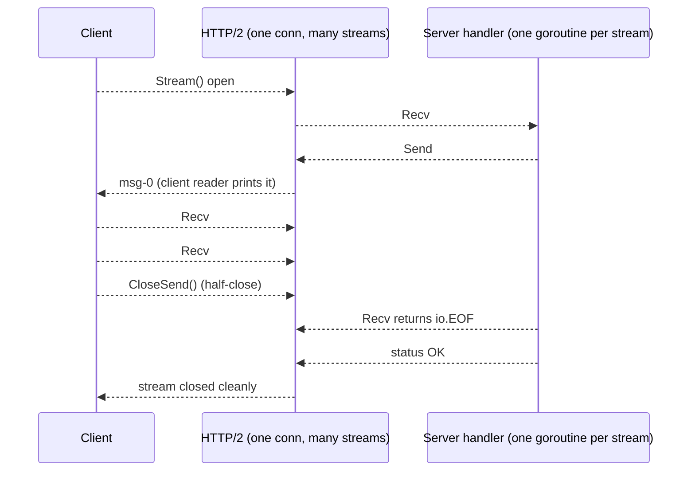
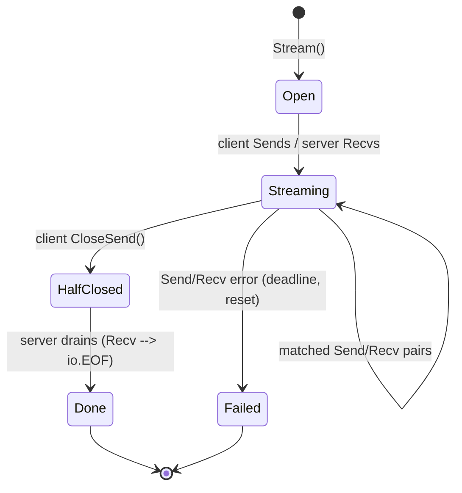

---

title: "gRPC in Go: The Service That Doesn't Need a Microservice Framework"
image: /images/covers/grpc-in-go-the-service-that-doesnt-need-a-microservice-framework.svg
date: 2026-10-15T09:00:00+00:00
author: "Punit Naran"
description: "gRPC in Go: The Service That Doesn't Need a Microservice Framework"
tags: ["Go", "gRPC", "Networking"]
draft: false
---

The Java gRPC story is a framework: an `@Grpc` annotation, a `Service` base class, a `Client` interface, a config file. The Go story is the opposite, and it is the reason gRPC in Go feels like using stdlib: **gRPC is a `conn` + a generated stub**. There is no `GrpcClient` base class to configure, no service registry to wire. The service is a struct that implements a generated interface; the client is two lines.

This post is the whole round trip: a 12-line `.proto` (the contract), a server with a unary RPC and a bidirectional stream, and a client that drives both. And the one thing you have to get right in Go gRPC: **the `Send`/`Recv` pairing in a stream** — get it wrong and your `Send` blocks on a full buffer and the service hangs with 0% CPU, the classic "it works in the demo" failure.

By the end: a working gRPC service with no framework, no DI container, no `micro` package — just `net.Listen`, `grpc.NewServer`, and a stub.

## The contract: 12 lines of `.proto`

```
// echo.proto
//
// protoc --go_out=. --go_opt=paths=source_relative \
//        --go-grpc_out=. --go-grpc_opt=paths=source_relative \
//        echo.proto
//
// The generated code (echo.pb.go, echo_grpc.pb.go) is boilerplate:
// getters, size/marshal, and the EchoServer/EchoClient interfaces
// this post implements and calls.
syntax = "proto3";

package echo;

service Echo {
  // Unary: one request, one response.
  rpc Echo(EchoRequest) returns (EchoResponse);
  // Bidirectional: a stream of requests, a stream of responses.
  rpc Stream(stream EchoRequest) returns (stream EchoResponse);
}

message EchoRequest {
  string msg = 1;
}

message EchoResponse {
  string msg = 1;
}
```

That is the entire contract. No annotations, no base class — `protoc` emits an interface (`EchoServer`) and a stub (`NewEchoClient`) from it, and Go's compile checker enforces the rest.

## The server

```go
package main

import (
	"context"
	"flag"
	"io"
	"log"
	"net"

	"example.com/echo" // generated from echo.proto
	"google.golang.org/grpc"
	"google.golang.org/grpc/codes"
	"google.golang.org/grpc/status"
)

// server implements the generated EchoServer interface.
type server struct {
	// Embedding the Unimplemented stub makes any RPC you do not
	// implement return codes.Unimplemented instead of crashing.
	// Add methods to the .proto and re-run protoc; the struct
	// compiles until you implement them.
	echo.UnimplementedEchoServer
}

// Echo is the unary RPC. ctx is the only input worth taking: it
// carries the deadline and the cancellation that gRPC propagates
// for you.
func (s *server) Echo(ctx context.Context, req *echo.EchoRequest) (*echo.EchoResponse, error) {
	if req.GetMsg() == "" {
		return nil, status.Errorf(codes.InvalidArgument, "msg is required")
	}
	return &echo.EchoResponse{Msg: req.GetMsg()}, nil
}

// Stream is the bidirectional RPC. The pairing rule: Recv one,
// Send one, in the same goroutine, inside the loop. A Send that
// is not matched by a Recv fills the stream buffer and blocks;
// a Recv after the client half-closes returns io.EOF and the
// loop ends cleanly.
func (s *server) Stream(stream echo.Echo_StreamServer) error {
	for {
		req, err := stream.Recv()
		if err == io.EOF {
			return nil // client called CloseSend(); stream is done
		}
		if err != nil {
			return err // transport closed mid-stream
		}
		if err := stream.Send(&echo.EchoResponse{Msg: req.GetMsg()}); err != nil {
			return err
		}
	}
}

// serve is the whole server: one listener, one registration.
// No framework between you and the socket.
func main() {
	addr := flag.String("listen", ":50051", "listen address")
	flag.Parse()

	lis, err := net.Listen("tcp", *addr)
	if err != nil {
		log.Fatalf("listen: %v", err)
	}

	s := grpc.NewServer()
	echo.RegisterEchoServer(s, &server{})
	log.Printf("serving on %s", *addr)
	if err := s.Serve(lis); err != nil {
		log.Fatalf("serve: %v", err)
	}
}
```

## The client

```go
package main

import (
	"context"
	"fmt"
	"io"
	"log"
	"time"

	"example.com/echo" // same generated package
	"google.golang.org/grpc"
	"google.golang.org/grpc/credentials/insecure"
)

func main() {
	// One conn, one stub. There is no client interface to
	// implement — the stub *is* the client.
	conn, err := grpc.NewClient("localhost:50051",
		grpc.WithTransportCredentials(insecure.NewCredentials()))
	if err != nil {
		log.Fatalf("dial: %v", err)
	}
	defer conn.Close()
	client := echo.NewEchoClient(conn)

	ctx, cancel := context.WithTimeout(context.Background(), 5*time.Second)
	defer cancel() // the deadline propagates into every call

	// Unary: one call, one response.
	res, err := client.Echo(ctx, &echo.EchoRequest{Msg: "hello"})
	if err != nil {
		log.Fatalf("echo: %v", err)
	}
	fmt.Println("unary:", res.GetMsg())

	// Bidirectional stream: one goroutine reads, one writes.
	stream, err := client.Stream(ctx)
	if err != nil {
		log.Fatalf("stream: %v", err)
	}
	// Reader: Recv until io.EOF (the server's clean shutdown).
	go func() {
		for {
			resp, err := stream.Recv()
			if err == io.EOF {
				return
			}
			if err != nil {
				log.Printf("recv: %v", err)
				return
			}
			fmt.Println("stream:", resp.GetMsg())
		}
	}()
	// Writer: send N, then half-close.
	for i := 0; i < 3; i++ {
		if err := stream.Send(&echo.EchoRequest{Msg: fmt.Sprintf("msg-%d", i)}); err != nil {
			log.Fatalf("send: %v", err)
		}
	}
	stream.CloseSend()
}
```

---

## The stream lifecycle: the one thing you have to get right

The stream above is a two-phase state machine. The failure mode is always the same: **someone `Send`s without a matching `Recv`**, the stream buffer (a few hundred KB) fills, the `Send` blocks, and the goroutine sits at 0% CPU forever. The fix is not a bigger buffer; it is keeping the pairing in one loop.





The three rules, in order of how often they bite:

1. **`Recv` first, then `Send`, in one loop** — on the server. Your handler is a pump: for every message the client sends, you echo one back. The `io.EOF` from `Recv` is the *only* clean exit.
2. **The client half-closes with `CloseSend()`**, not by closing the conn. A closed conn is an error; a half-closed stream is the normal "I'm done sending, finish up" signal.
3. **Every call takes `ctx` as its first argument and honors it.** A cancelled context is how a client stops a stream mid-flight — if your handler ignores it, the stream leaks goroutines until the deadline fires.

> **Note**: `grpc.NewClient` (1.63+) dials lazily; the old `grpc.Dial` is deprecated. If you are on an older release, `grpc.Dial` works identically here — the code in this post does not depend on anything newer.

> **Warning**: do not `Send` from more than one goroutine on a stream without a mutex — the generated `Send` is not concurrency-safe. One writer per stream (or a small writer goroutine fed by a channel) is the whole synchronization story.

## gRPC vs REST/JSON: when each wins

| | gRPC (this post) | REST/JSON |
|---|---|---|
| Wire format | Binary protobuf, length-prefixed frames | Text JSON |
| Contract | `.proto` → generated types, enforced at compile time | OpenAPI spec, enforced at runtime |
| Streaming | Bidirectional, first-class | Bolted on (WebSocket/SSE) |
| Multiplexing | One HTTP/2 conn, many concurrent streams | One connection per request (HTTP/1.1) |
| Browser support | No (CORS, binary, no fetch) | Native |
| Tooling | protoc + plugins, `grpcurl`, reflection | `curl`, everything |

**Rule of thumb:** gRPC for service-to-service where both ends are Go (or any language with a protoc plugin); REST when a browser or a curl is on the other end. A gateway (Envoy, grpc-gateway) translates at the boundary — you do not choose, the boundary does.

## Takeaways

- **In Go, gRPC is not a framework.** It is a `conn` + a stub: `grpc.NewServer`, `Register*Server`, `New*Client`, done. The 30-line service is the whole story.
- **The `.proto` is the contract.** protoc generates the interface and the stub; Go's compiler enforces both. No annotations, no DI.
- **Streams are a pairing problem.** `Recv` → `Send` in one loop, `CloseSend` for the half-close, `io.EOF` for the end. Break the pairing and the buffer fills and the goroutine blocks at 0% CPU.
- **`ctx` is the cancellation contract.** Every method takes it, every `Send`/`Recv` honors it.
- **The only framework you need is the transport** — and it is stdlib underneath the stub.

## Next steps

- **Add `grpcurl` to your tooling** (`grpcurl -d '{"msg":"hi"}" localhost:50051 echo.Echo/Echo`) — it is the curl of gRPC and removes 90% of "can I hit this from a shell?"
- **Enable the reflection service** (`reflection.Register`) for local dev; disable it in production builds.
- **Add an interceptor for logging/tracing** — one `grpc.UnaryServerInterceptor` with `otelgrpc` is the standard shape; it is the only "framework" a gRPC service in Go typically adopts, and it is 20 lines.
