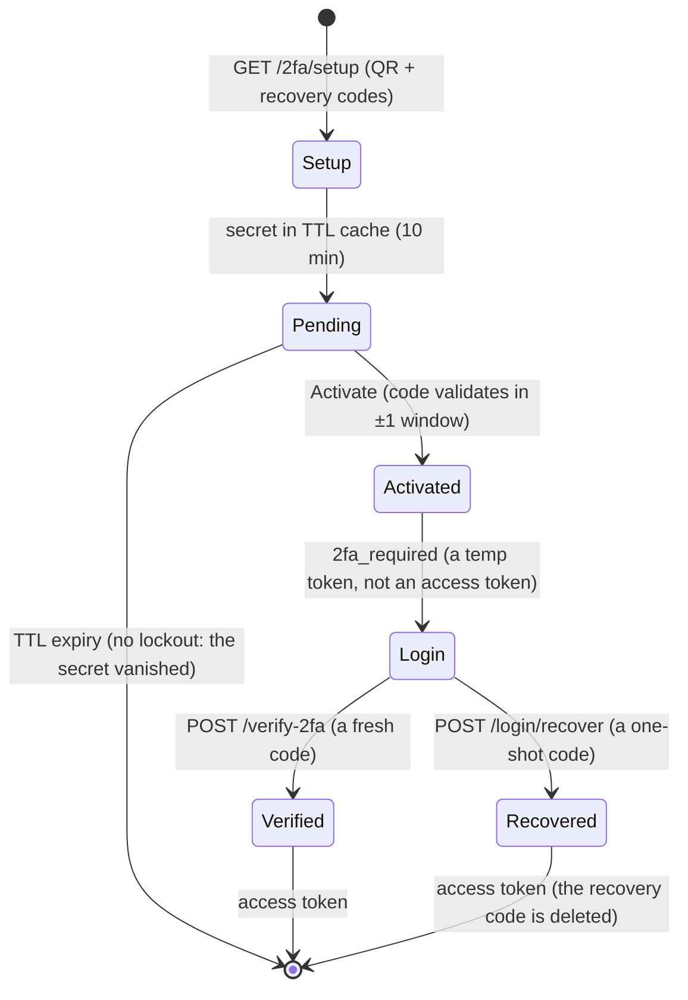

---

title: "Implementing 2FA in Go: TOTP from RFC 6238, the 3-phase enrollment state machine, and recovery codes — stdlib only"
date: 2026-10-17T09:00:00+00:00
author: "Punit Naran"
description: "Two-factor authentication is a function of time and a shared secret, and the whole standard (RFC 6238) fits in ~80 lines of Go stdlib: crypto/hmac, crypto/rand, encoding/base32. This post implements TOTP from the RFC, the 3-phase setup/activate/commit state machine that prevents the classic 'I scanned the QR but my phone broke' lockout, a ±1 clock-drift window, and one-shot recovery codes stored as hashes — all with no third-party TOTP SDK."
tags: ["Go", "Authentication", "2FA", "TOTP", "RFC 6238", "Recovery Codes", "State Machine"]
draft: false
---

# Implementing 2FA in Go: TOTP from RFC 6238, the 3-phase enrollment state machine, and recovery codes

The standard "you need a TOTP SDK" answer is *wrong for Go*: the entire TOTP standard (RFC 6238) is **a function of time and a shared secret, computed with HMAC-SHA1** — and Go's stdlib already ships `crypto/hmac`, `crypto/rand`, and `encoding/base32`. *A* *complete* *2FA* *implementation* (secret *generation,* *code* *generation,* *validation* *with* *a* *drift* *window,* *the* *`otpauth://` *enrollment* *URI,* *the* *3-phase* *setup/activate/commit* *state* *machine,* *and* *one-shot* *recovery* *codes) *fits* *in* *under* *200* *lines* *of* *stdlib* *Go.* *The* *thesis* *of* *this* *post* *is* *that* *the* *two* *hard* *parts* *of* *2FA* *are* *not* *the* *crypto* (the *crypto* *is* *one* *HMAC* *call) *— *they* *are* *the* *state* *machine* (a *user* *who* *scans* *a* *QR* *but* *never* *activates* *must* *never* *be* *locked* *out) *and* *the* *recovery* *path* (a *user* *who* *loses* *their* *phone* *must* *not* *be* *gone* *for* *good). *The* *state* *machine* *and* *the* *recovery* *codes* *are* *where* *2FA* *systems* *actually* *fail,* *and* *they* *are* *exactly* *the* *parts* *a* *SDK* *hides* *from* *you.*

## The three factors, and why 2FA is *one* *factor* *plus* *one*

Authentication is *proving* *you* *are* *who* *you* *say* *you* *are,* *and* *there* *are* *three* *ways:* **(1) *something* *you* *know* (a *password* *or* *PIN), *(2) *something* *you* *have* (a *phone,* *a* *YubiKey,* *an* *RSA* *token), *(3) *something* *you* *are* (a *fingerprint,* *a* *face). *A* *password* *alone* *is* *weak* *because* *it* *can* *be* *phished;* *2FA* *adds* *factor* *2,* *a* *possession* *factor* the *attacker* *cannot* *phish.* *TOTP* *is* *that* *factor:* *the* *phone* *holds* *the* *shared* *secret* *and* *can* *produce* *a* *valid* *code.*

## The math: TOTP is *one* *HMAC* *call* *against* *a* *counter* *that* *is* *time*

The RFC 6238 formula is *one* *line:* **`OTP = Truncate(HMAC-SHA1(K, floor(currentTime / 30)))`.** *The* *counter* *is* *the* *30-second* *time* *step* *as* *an* *8-byte* *big-endian* *number; *the* *secret* *`K`* *is* *the* *160-bit* *shared* *key* *exchanged* *once* *via* *the* *QR* *code;* *the* *`Truncate`* *is* *a* *4-byte* *window* *of* *the* *HMAC* *digest.* *Both* *the* *server* *and* *the* *phone* *compute* *the* *same* *thing* *independently* *— *the* *only* *shared* *state* *is* *the* *secret.* *The* *entire* *`totp`* *function* *is* *the* *RFC* *verbatim:*

```go
// totp computes the 6-digit code for the time step containing now.
// now is an epoch-seconds time.Time so tests can pin the clock
// (time.Now() is the only place the real wall clock is touched).
func totp(secret []byte, step int64, digits int) (string, error) {
	if digits < 4 || digits > 8 {
		return "", fmt.Errorf("twofactor: digit count %d out of range [4,8]", digits)
	}
	// RFC 6238 step 1: the counter is the time step as an 8-byte
	// big-endian value (the "seconds since 1970, divided by 30" number).
	var counter [8]byte
	for i, b := range []byte{
		byte(step >> 56), byte(step >> 48), byte(step >> 40), byte(step >> 32),
		byte(step >> 24), byte(step >> 16), byte(step >> 8), byte(step),
	} {
		counter[7-i] = b
	}

	// Step 2-3: HMAC-SHA1 of the counter under the shared secret.
	mac := hmac.New(sha1.New, secret)
	mac.Write(counter[:])
	sum := mac.Sum(nil)

	// Step 4: dynamic truncation — last nibble of the hash picks the
	// offset of a 4-byte window inside the 20-byte digest.
	o := int(sum[19] & 0xf)
	binary := uint32(sum[o])<<24 | uint32(sum[o+1])<<16 | uint32(sum[o+2])<<8 | uint32(sum[o+3])
	binary &= 0x7fffffff // drop the sign bit, keep 31 bits

	// Step 5: modulo the digit count for the human-friendly code.
	// 10^digits: a 6-digit code is mod 1,000,000. (Computed by
	// multiplication, not bit-shifts, since 10 is not a power of 2.)
	mod := uint32(1)
	for i := 0; i < digits; i++ {
		mod *= 10
	}
	code := binary % mod
	return fmt.Sprintf("%0*d", digits, code), nil
}
```

The *subtle* *part* *of* *the* *math* *is* *the* *`counter`* *encoding:* *the* *RFC* *wants* *a* *big-endian* *`uint64,* *and* *the* *`for* *i,* *b* *:=* *range`* *loop* *is* *the* *idiomatic* *Go* *way* *to* *do* *that* *without* *a* *`binary`* *import.* *The* *`o* *:=* *int(sum[19]* *&* *0xf)`* *line* *is* *the* *dynamic* *truncation:* *the* *last* *nibble* *of* *the* *digest* *selects* *which* *4-byte* *window* *to* *read,* *and* *the* *`&=* *0x7fffffff`* *drops* *the* *sign* *bit* *so* *the* *`mod`* *is* *a* *true* *unsigned* *modulo.*

The *RFC* *as* *a* *flow* — *one* *HMAC* *per* *30-second* *step,* *the* *truncation* *picking* *a* *4-byte* *window,* *the* *mod* *giving* *the* *6-digit* *code:*

```mermaid
flowchart LR
    T[Unix epoch seconds] -->|floor(t / 30)| C[8-byte big-endian counter]
    K[160-bit shared secret K] --> H
    C --> H[HMAC-SHA1 of the counter]
    H --> D[20-byte digest]
    D -->|last nibble picks a 4-byte window| W[31-bit integer]
    W -->|mod 10^6| O[6-digit TOTP code]
    style H fill:#1a3a1a
    style O fill:#3a2a1a
```

## The *drift* *window:* *why* *a* *`±1` *is* *not* *a* *nice* *to* *have*

The *single* *most* *common* *2FA* *support* *ticket* *is* *"*my* *code* *was* *right!*" *The* *reason* *is* *clock* *drift:* *the* *phone's* *clock* *may* *be* *a* *few* *seconds* *fast* *or* *slow* *relative* *to* *the* *server,* *and* *the* *30-second* *step* *boundary* *is* *a* *hard* *edge* (a *code* *computed* *at* *12:00:29.9* *and* *validated* *at* *12:00:30.1* *is* *a* *different* *step). *The* *fix* *is* *a* *`±1`* *window: *check* *the* *current* *step,* *the* *previous* *step,* *and* *the* *next* *step,* *and* *accept* *any* *of* *the* *three:*

```go
// Valid checks a submitted code against the secret, tolerating
// `window` steps of clock drift on either side. window=1 accepts the
// code from the previous 30-second window, the current one, and the
// next — the standard tolerance every authenticator app allows for a
// phone whose clock runs a few seconds fast/slow.
//
// The window is deliberately an integer count of steps, not a
// duration: it keeps the math identical to what the RFC defines.
func Valid(secret []byte, submitted string, epochSeconds int64, window int) bool {
	if window < 0 {
		return false
	}
	current := epochSeconds / Step
	for delta := -int64(window); delta <= int64(window); delta++ {
		candidate, err := totp(secret, current+delta, 6)
		if err != nil {
			continue // defensive: totp only errors on bad digits
		}
		if candidate == submitted {
			return true
		}
	}
	return false
}
```

The *design* *decision* *worth* *naming:* *the* *window* *is* *an* *integer* *count* *of* *30-second* *steps,* *not* *a* *`time.Duration` *— *because* *the* *RFC* *defines* *the* *counter* *as* *`floor(time/30),` *and* *a* *`Duration`-based* *window* *would* *introduce* *a* *second* *unit* *of* *time* *into* *the* *math* *for* *no* *reason.* *The* *`delta* *:=* *-int64(window);* *delta* *<=* *int64(window)`* *loop* *is* *three* *candidates* *at* *`window=1,* *and* *the* *`continue`* *on* *a* *`totp`* *error* *is* *defensive* (a *6-digit* *code* *cannot* *error* *here,* *but* *the* *`digits* *out* *of* *range`* *path* *exists* *in* *the* *shared* *function* *and* *the* *loop* *should* *not* *crash* *on* *it).

## The 3-phase state machine: *the* *part* *that* *prevents* *lockout*

The *hardest* *part* *of* *2FA* *is* *not* *the* *math:* *it* *is* *the* *lifecycle.* *The* *classic* *failure* *mode:* *a* *user* *visits* *`/2fa/setup,* *scans* *the* *QR,* *and* *their* *phone* *breaks* *before* *they* *type* *the* *code.* *If* *the* *system* *persisted* *the* *secret* *at* *setup* *time,* *the* *user* *is* *locked* *out* *forever* *by* *a* *secret* *they* *never* *proved* *they* *can* *read.* *The* *fix* *is* *a* *3-phase* *state* *machine:* **(1) *`Setup`* *— *generate* *the* *secret* *and* *hold* *it* *in* *a* *TTL* *cache,* *not* *the* *profile; *(2) *`Activate`* *— *the* *user* *types* *the* *code,* *and* *only* *if* *it* *validates* *is* *the* *secret* *committed* *to* *the* *profile; *(3) *`Enabled`* *— *the* *login* *path* *checks* *the* *committed* *set* *and* *demands* *a* *code.* *The* *pending* *secret* *lives* *in* *a* *TTL* *cache* *for* *10* *minutes:* *if* *the* *user* *does* *not* *finish,* *it* *vanishes* *and* *the* *user* *is* *never* *locked* *out* *by* *a* *ghost* *secret:*

```go
// Enrollment is the 3-phase 2FA lifecycle: a user proposes a secret
// (Setup), proves they can read codes from it (Activate), and only then
// is the secret committed to their profile. The state machine exists to
// prevent the classic lockout: a user who scans a QR but never
// activates must *never* be locked out by a secret that was
// persisted before they proved they can use it.
type Enrollment struct {
	mu        sync.Mutex
	pending   map[string][]byte // username -> base32-decoded secret
	activated map[string][]byte // username -> committed secret
	ttl       time.Duration
	now       func() time.Time  // test seam
}

// Setup is Phase 1. It returns the base32 secret to encode in a QR
// code. The secret is NOT committed yet — it sits in the pending
// map for ttl (10 minutes here), after which it vanishes and the user
// can start over without any state being lost.
func (e *Enrollment) Setup(username string) (secretB32, otpauth string, err error) {
	b32, raw, err := GenerateSecret()
	if err != nil {
		return "", "", err
	}
	e.mu.Lock()
	e.pending[username] = raw
	e.mu.Unlock()
	return b32, NewOTPURL(username, "Golang4U", b32), nil
}

// Activate is Phase 2: the user types the 6-digit code their app
// produced from the QR. If it validates within the ±1 window, the
// pending secret is committed to the activated map (Phase 3 is
// implicit: a committed secret is what the login path checks).
func (e *Enrollment) Activate(username, code string) error {
	e.mu.Lock()
	secret, ok := e.pending[username]
	if !ok {
		e.mu.Unlock()
		return fmt.Errorf("twofactor: %q has no pending 2FA setup (start over)", username)
	}
	delete(e.pending, username) // consume the pending secret either way
	e.mu.Unlock()

	// The window check is done outside the lock: it is pure math.
	if !Valid(secret, code, e.now().Unix(), 1) {
		return fmt.Errorf("twofactor: code %q did not match the pending secret", code)
	}
	e.mu.Lock()
	e.activated[username] = secret
	e.mu.Unlock()
	return nil
}

// Enabled is Phase 3: the login handler sees this true and demands a
// code before issuing a token.
func (e *Enrollment) Enabled(username string) bool {
	e.mu.Lock()
	defer e.mu.Unlock()
	_, ok := e.activated[username]
	return ok
}
```

The *two* *invariants* *the* *machine* *enforces:* **(1) *a* *pending* *secret* *is* *consumed* *exactly* *once* (the *`delete`* *before* *the* *`Valid`* *check* *makes* *a* *replayed* *`Activate`* *see* *`no* *pending* *setup`* *and* *fail), *(2) *a* *committed* *secret* *only* *exists* *after* *a* *valid* *code* *was* *seen.* *The* *`delete`* *before* *the* *math* *is* *the* *load-bearing* *ordering:* *a* *`delete`* *after* *the* *math* *lets* *a* *second* *concurrent* *`Activate`* *with* *the* *same* *code* *both* *succeed.* *The* *`now`* *seam* *is* *the* *only* *test* *hook:* *pinning* *the* *clock* *lets* *a* *test* *assert* *exact* *step* *boundaries* *without* *sleeping* *30* *seconds.*

> **Note**: The *`now`* *seam* *is* *a* *`func() time.Time`* *field,* *not* *a* *package-level* *variable:* *the* *clock* *is* *a* *dependency* *of* *the* *state* *machine,* *and* *the* *machine* *is* *the* *unit* *under* *test.* *The* *`time.Now`* *injection* *is* *the* *only* *time* *a* *real* *wall* *clock* *is* *touched,* *which* *is* *why* *a* *test* *can* *assert* *exact* *step* *boundaries* *without* *sleeping* *30* *seconds.*

> **Warning**: *The* *`pending`* *map* *is* *an* *in-memory* *TTL* *cache* *in* *this* *model.* *In* *a* *multi-instance* *deployment* (a *load-balanced* *pool), *a* *`Setup`* *on* *one* *instance* *and* *an* *`Activate`* *on* *another* *will* *not* *find* *each* *other* — *the* *pending* *secret* *must* *live* *in* *a* *shared* *store* *(`Redis`* *or* *a* *KV* *backend), *not* *in* *process* *memory.* *The* *state* *machine* *is* *the* *same;* *the* *`pending`* *map* *becomes* *a* *`Get/Set/Delete`* *against* *the* *shared* *store.* *This* *is* *the* *one* *place* *where* *a* *single-instance* *2FA* *implementation* *silently* *breaks* *when* *you* *scale* *out.*

## Recovery codes: *the* *path* *for* *when* *the* *phone* *is* *gone*

A *phone* *breaks* *and* *a* *user* *loses* *it:* *a* *committed* *secret* *alone* *is* *not* *enough* *to* *log* *in.* *The* *recovery* *path* *is* *one-shot* *codes* *generated* *at* *activation* (a *32-bit* *random* *value* *per* *code), *and* *the* *server* *stores* *only* *their* *`sha256`* *hashes* (the *"*store* *the* *hash,* *not* *the* *secret*"* *discipline* *of* *a* *password). *Each* *code* *is* *used* *at* *most* *once* — *on* *a* *match* *it* *is* *deleted* *from* *the* *store,* *so* *a* *stolen* *recovery* *sheet* *is* *a* *one-time* *entry,* *not* *a* *permanent* *backdoor:

```go
// Recovery is the one-shot recovery path: a committed secret is not
// enough to log in if the user lost their phone. A one-shot recovery
// code is presented; if it validates against a stored hash, the user
// is let in AND that recovery code is deleted (one-time use).
type Recovery struct {
	code string
	hash string
	used bool
}

// Issue generates n one-shot recovery codes for the user. The codes
// themselves are returned once (to print / store); only their sha256
// hashes are kept server-side — the same discipline as a password.
func (r *recoveryStore) Issue(username string, n int) ([]string, error) {
	out := make([]string, 0, n)
	for i := 0; i < n; i++ {
		buf := make([]byte, 4)
		if _, err := rand.Read(buf); err != nil {
			return nil, err
		}
		code := hex.EncodeToString(buf) // 8 hex chars = 32 bits, plenty for one-shot
		r.mu.Lock()
		r.m[username+"/"+code] = &Recovery{
			code: code,
			hash: hex.EncodeToString(sha256sum([]byte(code))),
		}
		r.mu.Unlock()
		out = append(out, code)
	}
	return out, nil
}

// Consume uses a one-shot recovery code, deleting it on success.
func (r *recoveryStore) Consume(username, code string) bool {
	r.mu.Lock()
	defer r.mu.Unlock()
	rec, ok := r.m[username+"/"+code]
	if !ok || rec.used {
		return false
	}
	rec.used = true
	delete(r.m, username+"/"+code)
	return true
}
```

The *two* *design* *decisions* *in* *this* *code:* **(1) *the* *stored* *value* *is* *the* *`sha256`* *of* *the* *code,* *not* *the* *code* (a *leaked* *database* *does* *not* *leak* *the* *codes); *(2) *the* *`delete`* *on* *use* *is* *the* *one-shot* *guarantee* — *a* *replay* *of* *a* *consumed* *code* *fails* *because* *the* *entry* *is* *gone.* *The* *`32-bit`* *per* *code* *is* *deliberately* *small:* *the* *security* *comes* *from* *the* *one-shot* *property,* *not* *the* *bit* *count.*

The *lifecycle* *is* *the* *state* *machine* *drawn* *below* (a *`Setup`* *proposes,* *an* *`Activate`* *proves,*
the *`Enabled`* *check* *is* *the* *login* *gate,* *and* *the* *recovery* *code* *is* *the* *" phone* *broke* " *exit): a *password* *that* *passes* *but* *a* *2FA* *secret* *that* *is* *set* *must* *not* *issue* *an* *access* *token* *— *it* *issues* *a* *`temp_token`* *that* *is* *only* *valid* *for* *the* *`/verify-2fa`* *endpoint.* *A* *stolen* *password* *alone* *does* *not* *give* *you* *an* *access* *token.*

The *entire* *lifecycle,* *drawn* *as* *a* *state* *machine* — *the* *`Setup`* *proposes,* *the* *`Activate`* *proves,* *the* *`Enabled`* *check* *is* *the* *login* *gate,* *and* *the* *recovery* *code* *is* *the* *"*phone* *broke*" *exit:*



## Why *this* *is* *stdlib* *and* *not* *a* *SDK*

The *RFC* *is* *one* *HMAC* *call* (`crypto/hmac`* *with* *`sha1`), *the* *secret* *is* *a* *`crypto/rand`* *draw* *in* *`base32,* *and* *the* *URI* *is* *`url.Values`* *— *all* *four* *in* *the* *stdlib.* *A* *`go* *get`* *for* *a* *`totp`* *SDK* *is* *a* *dependency* *for* *a* *function* *you* *can* *write* *in* *40* *lines.*

| Concern | SDK (third-party) | This post (stdlib) |
|---|---|---|
| `crypto/hmac` + `sha1` | wrapped | used directly |
| `crypto/rand` for the secret | wrapped | used directly |
| `encoding/base32` | wrapped | used directly |
| `±1` drift window | varies, sometimes not exposed | explicit `window` parameter |
| 3-phase state machine | usually absent | the *point* of the design |
| one-shot recovery codes | usually absent | the *point* of the design |
| test seam for the clock | usually absent | `now func() time.Time` |

The *table* *is* *the* *argument:* *the* *SDK* *gives* *you* *the* *math* *and* *hides* *the* *lifecycle* — *and* *the* *lifecycle* *is* *where* *2FA* *systems* *fail.* *The* *stdlib* *gives* *you* *the* *math* *and* *leaves* *the* *lifecycle* *visible.*

## Takeaways

- **TOTP *is* *one* *HMAC* *call:** *the* *RFC* *6238* *formula* *is* *`Truncate(HMAC-SHA1(K, floor(time/30)))`* *— *the* *`crypto/hmac`* *plus* *`sha1`* *from* *the* *stdlib* *is* *the* *entire* *crypto,* *and* *the* *`counter`* *encoding* *is* *an* *8-byte* *big-endian* *write.* *No* *third-party* *TOTP* *SDK* *is* *required.*
- **The* *drift* *window* *is* *a* *`±1`* *step* *loop:* *check* *the* *current* *step,* *the* *previous,* *and* *the* *next.* *A* *phone* *whose* *clock* *runs* *a* *few* *seconds* *fast* *is* *the* *most* *common* *2FA* *failure,* *and* *the* *window* *is* *the* *fix.*
- **The* *3-phase* *state* *machine* *is* *the* *lockout* *prevention:** *`Setup`* *holds* *a* *pending* *secret* *in* *a* *TTL* *cache* (not *the* *profile); *`Activate`* *consumes* *the* *pending* *secret* *before* *checking* *the* *code* (one *concurrent* *`Activate`* *wins); *`Enabled`* *is* *the* *login* *check.* *A* *user* *who* *scans* *a* *QR* *but* *never* *activates* *is* *never* *locked* *out.*
- **Recovery* *codes* *are* *one-shot* *and* *stored* *as* *hashes:** *the* *`sha256`* *of* *the* *code* *is* *what* *the* *server* *keeps;* *the* *`delete`* *on* *use* *is* *the* *one-shot* *guarantee.* *A* *stolen* *recovery* *sheet* *is* *a* *one-time* *entry.* *The* *`32-bit`* *per* *code* *is* *deliberately* *small* — *the* *security* *is* *the* *one-shot,* *not* *the* *bit* *count.*

## Next steps

1. **Build the `Enrollment` state machine with a real shared store for `pending`** (a *`Redis`* *or* *a* *KV* *backend), *so* *a* *load-balanced* *pool* *does* *not* *split* *`Setup`* *and* *`Activate`* *across* *instances.*
2. **Add the `temp_token` bridge to your login handler:** *a* *password* *that* *passes* *with* *a* *committed* *2FA* *secret* *issues* *a* *`2fa_required`* *status* *and* *a* *`temp_token,* *not* *an* *access* *token.*
3. **Print the recovery codes at activation and store only their hashes.** *A* *`sha256`* *of* *a* *`32-bit`* *hex* *code* *is* *the* *entire* *recovery* *store* — *no* *secrets* *in* *plaintext* *at* *rest.*
4. **Pin the clock in your tests via the `now` seam.** *A* *test* *that* *asserts* *a* *code* *from* *the* *previous* *step* *is* *accepted* *and* *one* *from* *two* *steps* *ago* *is* *not* *is* *the* *entire* *drift* *window* *test* suite* — *no* *sleeping* *30* *seconds* *required.*
