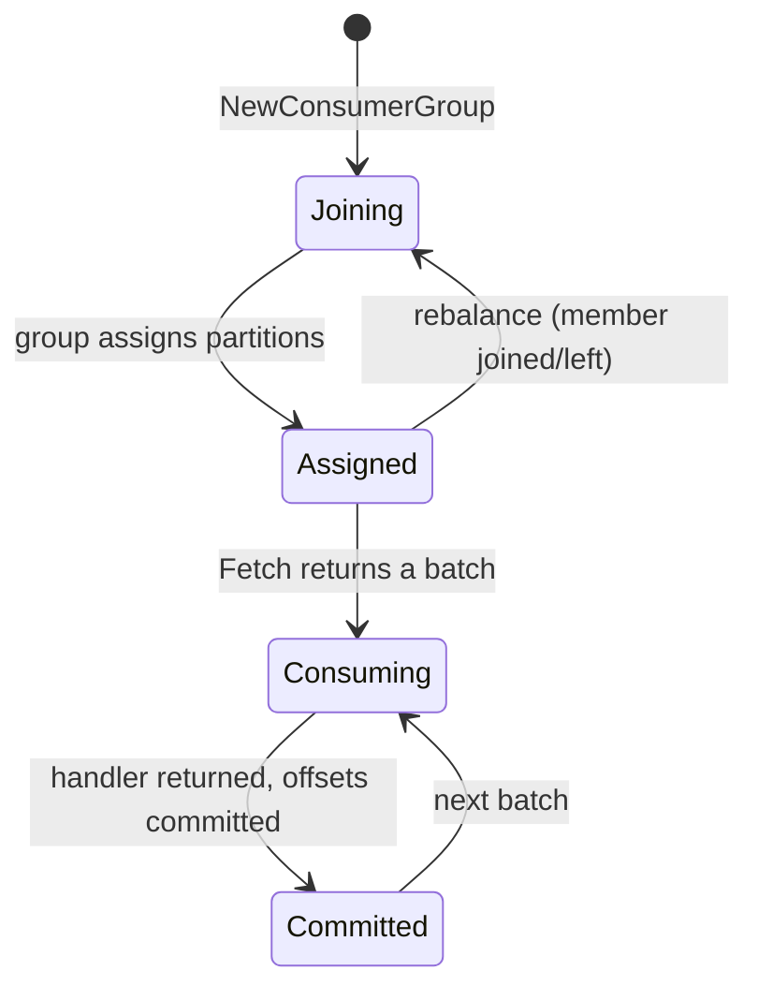
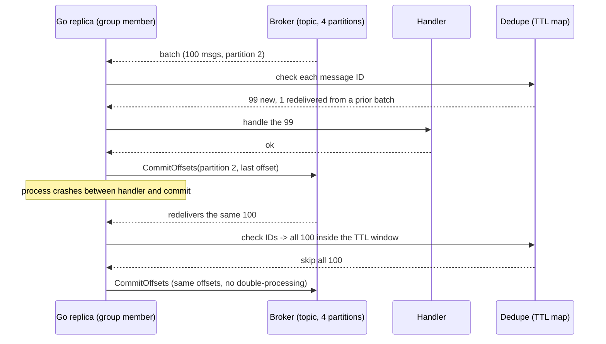

---

title: "Kafka in Go: The Consumer Group That Actually Works"
date: 2026-10-15T09:00:00+00:00
author: "Punit Naran"
description: "Kafka in Go: The Consumer Group That Actually Works"
tags: ["Go", "Kafka", "Messaging"]
draft: true
---

Every Go service that "integrates with Kafka" starts the same way and ends the same way: a `NewConsumerGroup`, a fetch loop, and a 3am page — the consumer died, the group rebalanced, the committed offset was for the previous batch, and the next batch got delivered twice. The failure is never in the broker. It is in three decisions your service makes: **how it joins the group, when it commits, and what it does on a rebalance.**

This post is the design that removes that page, in Go: one group per process, one commit per batch (not per message), and a rebalance that *logs* instead of panics. Plus the one piece of real logic a consumer needs — an in-memory dedupe store with a TTL — because batched commits buy you at-least-once delivery and redelivered messages are a fact of life, not an accident.

By the end: a working consumer group, a dedupe store, a test, and the three rules that keep the whole thing boring.

## How a consumer group actually works

A **consumer group** is a set of *members*; the broker assigns each partition of the subscribed topics to exactly one member, and reassigns on a **rebalance** (a member joins, leaves, or lags). The mental model that fixes most Kafka bugs:

- A **Go process is a member**, not a group. Four replicas of your service that each open a consumer with the same `GroupID` are four members of *one* group — Kafka load-balances the partitions across them for free.
- A **rebalance is normal traffic**, not an error. The only thing a rebalance must not do is take your process down with it.
- **Offsets are committed per partition, by the group.** A commit advances "where the group was up to" — a slow member on one partition holds back the group's progress on that partition.



---

## The three rules

1. **One group per process.** A consumer group is a Kafka concept; a Go process is *not* one. If you run 4 replicas of your service and each opens its own group (4 distinct `GroupID`s), you have 4 groups, 4× the work, and zero load balancing. Same `GroupID` everywhere: the replicas are 4 members of 1 group, and the broker does the partition assignment.
2. **Commit at the end of the batch, after the handler, not per message.** A commit per message is O(n) round-trips; a commit per batch (100 messages or 500ms, whichever first) is O(1) per batch. The trade is at-least-once delivery: a crash between handler and commit redelivers the batch. You absorb that with a dedupe store keyed on the message ID.
3. **The rebalance callback is where you clean up, not where you panic.** A member that panics during a rebalance is dropped from the group, which triggers *another* rebalance — a rebalance of a rebalance, each one re-fetching offsets. Log, drain the in-flight batch, continue.

## The code: the consumer (the whole thing)

```go
package main

import (
	"context"
	"errors"
	"log"
	"sync"
	"time"

	kafka "github.com/segmentio/kafka-go"
)

// batchSize / flushInterval set the commit cadence: a batch is
// flushed when it reaches 100 messages OR 500ms elapse, whichever
// comes first. Per-message commits would be 1000 round-trips per
// 1000 messages; per-batch commits are ~10.
const (
	batchSize     = 100
	flushInterval = 500 * time.Millisecond
)

// Handle is your business logic for one batch. It must be
// idempotent: the commit happens AFTER Handle returns, so a crash
// in that gap redelivers the batch.
type Handle func(batch []kafka.Message)

// Consume runs the consumer group until ctx is done.
func Consume(ctx context.Context, brokers []string, topic, groupID string, h Handle) {
	// One group per process: every replica passes the SAME groupID,
	// so the N replicas are N members of one group and the broker
	// load-balances the partitions across them.
	group, err := kafka.NewConsumerGroup(kafka.ConsumerGroupConfig{
		ID:      groupID,
		Brokers: brokers,
		Topics:  []string{topic},
	})
	if err != nil {
		log.Fatalf("new consumer group: %v", err)
	}
	defer group.Close() // leaves the group cleanly on exit
	log.Printf("joined group %q, topic %q", groupID, topic)

	// The batch is shared across the per-partition reader goroutines
	// that gen.Start() launches, so it sits behind a mutex.
	var mu sync.Mutex
	var pending []kafka.Message
	offsets := make(map[int]int64) // partition -> last consumed offset

	// flush takes the pending batch, hands it to the handler, then
	// commits the per-partition offsets. Commit-after-handler is the
	// at-least-once contract: a crash in the gap redelivers, and the
	// dedupe store absorbs the redelivery.
	flush := func() {
		mu.Lock()
		batch, pending := pending, nil
		snap := make(map[string]map[int]int64)
		if len(offsets) > 0 {
			part := make(map[int]int64, len(offsets))
			for p, o := range offsets {
				part[p] = o
			}
			snap[topic] = part
		}
		mu.Unlock()
		if len(batch) == 0 {
			return
		}
		h(batch)
		if len(snap) > 0 {
			if err := group.CommitOffsets(snap); err != nil {
				log.Printf("commit: %v", err)
			}
		}
	}
	flushTicker := time.NewTicker(flushInterval)
	defer flushTicker.Stop()
	go func() {
		for range flushTicker.C {
			flush()
		}
	}()

	// Next blocks until the group assigns this member partitions (a
	// rebalance) or ctx is done. A rebalance is a NORMAL event — a
	// member joining/leaving — and just yields the next Generation.
	for {
		gen, err := group.Next(ctx)
		if err != nil {
			return // ErrGroupClosed / ctx done: loop ends cleanly
		}
		// One reader goroutine per assigned partition; gen.Start
		// tracks them and ends the generation when all return.
		for _, a := range gen.Assignments[topic] {
			partition, offset := a.ID, a.Offset
			gen.Start(func(ctx context.Context) {
				r := kafka.NewReader(kafka.ReaderConfig{
					Brokers:   brokers,
					Topic:     topic,
					Partition: partition,
				})
				defer r.Close()
				r.SetOffset(offset) // resume at the last committed offset

				for {
					msg, err := r.ReadMessage(ctx)
					if err != nil {
						// ErrGenerationEnded is the rebalance signal:
						// the group is reassigning this partition, so
						// record the last offset and hand it back.
						if errors.Is(err, kafka.ErrGenerationEnded) {
							mu.Lock()
							offsets[partition] = offset
							mu.Unlock()
							return
						}
						return
					}
					offset = msg.Offset
					mu.Lock()
					pending = append(pending, msg)
					full := len(pending) >= batchSize
					mu.Unlock()
					if full { // size-triggered flush
						flush()
					}
				}
			})
		}
	}
}
```

## The code: the dedupe store (and its test)

```go
package main

import (
	"sync"
	"time"
)

// Dedupe remembers recently seen message IDs for a TTL window.
// A redelivered batch is dropped on the key check before it ever
// reaches your handler.
// ponytail: in-memory — one process, one Dedupe. If the SAME
// group runs across replicas and redeliveries can land on a
// different replica than the one that first handled the message,
// move the map to a shared KV (Redis) — the Seen() call is the
// only thing that changes.
type Dedupe struct {
	mu   sync.Mutex
	ttl  time.Duration
	now  func() time.Time
	seen map[string]time.Time
}

func NewDedupe(ttl time.Duration) *Dedupe {
	d := &Dedupe{ttl: ttl, now: time.Now, seen: make(map[string]time.Time)}
	go d.sweep()
	return d
}

// Seen reports whether id was recorded inside the TTL window, and
// records it if not. Call it before handling each message.
func (d *Dedupe) Seen(id string) bool {
	d.mu.Lock()
	defer d.mu.Unlock()
	exp, ok := d.seen[id]
	now := d.now()
	if ok && now.Before(exp) {
		return true
	}
	d.seen[id] = now.Add(d.ttl)
	return false
}

// sweep evicts expired keys so the map does not grow one entry
// per message forever.
func (d *Dedupe) sweep() {
	t := time.NewTicker(d.ttl / 2)
	defer t.Stop()
	for range t.C {
		d.mu.Lock()
		now := d.now()
		for id, exp := range d.seen {
			if now.After(exp) {
				delete(d.seen, id)
			}
		}
		d.mu.Unlock()
	}
}
```

```go
package main

import (
	"testing"
	"time"
)

// The dedupe logic is pure state: build the struct directly with a
// fake clock (no sweep goroutine needed to assert on the map).
func newTestDedupe(now *time.Time) *Dedupe {
	return &Dedupe{
		ttl:  5 * time.Minute,
		now:  func() time.Time { return *now },
		seen: make(map[string]time.Time),
	}
}

func TestDedupeDropsRedeliveryWithinTTL(t *testing.T) {
	now := time.Unix(1_700_000_000, 0)
	d := newTestDedupe(&now)

	if d.Seen("m-123") {
		t.Fatal("first delivery: expected unseen")
	}
	if !d.Seen("m-123") {
		t.Fatal("redelivery inside TTL: expected duplicate")
	}

	now = now.Add(6 * time.Minute) // TTL elapsed
	if d.Seen("m-123") {
		t.Fatal("after TTL: expected unseen again")
	}
}
```

---

## The rebalance and the redelivery

The 3am page, traced end to end — this is what the design above survives:



## Commit strategy: the actual trade

| Commit style | Round-trips / 1000 msgs | Crash between handler and commit | Redelivery window | Dedupe load |
|---|---|---|---|---|
| Per message | ~1000 | Nothing to redeliver (but 1000× the latency) | None | None needed |
| Per batch of 100 (this post) | ~10 | The incomplete batch redelivers | ≤ 1 batch (≤ 500ms) | IDs for ≤ 500ms |
| Per partition per second | ~10 | Up to 1s of that partition | ≤ 1s | Up to 1s of IDs |

> **Note**: use the producer's message ID (Kafka's `Message.Key` or a header) as the dedupe key. A hash of the content only works when you need to bound memory with a hash — and then the hash *is* the key, not a stand-in for one.

> **Warning**: commits are per-partition, so a slow handler on one partition holds back the *entire group's* progress on that partition — other members keep consuming the other partitions, but this one stalls. Keep handlers sub-second, or fan them out to a goroutine pool and commit on completion.

## Takeaways

- **A consumer group is the load balancer.** Same `GroupID` across all replicas; the broker assigns partitions, you just make your members behave.
- **Batch the commit**: 100 messages / 500ms, whichever first. O(1) per batch instead of O(n) per message.
- **Commit after the handler** = at-least-once. Redelivered batches are normal; a TTL dedupe store absorbs them.
- **A rebalance is not an error.** Log it, drain the batch, continue. A panicking member triggers a rebalance of a rebalance.
- **The dedupe store is the only real logic** in a production consumer; everything else is Kafka doing its job.

## Next steps

- **Exactly-once?** Kafka's transactional producers plus idempotent consumers get you there — but only if your *handler* is idempotent; the framework does not make your SQL idempotent for you.
- **Add a consumer lag metric** (log end-offset − committed-offset per partition). A growing lag on one partition is the 3am page arriving 20 minutes earlier.
- **Backpressure**: if the handler is slower than the fetch rate, the batch buffer grows without bound. Cap it: when the in-flight batch list exceeds a high-water mark, stop `Fetch` and drain — the group's rebalance protocol handles the rest.
