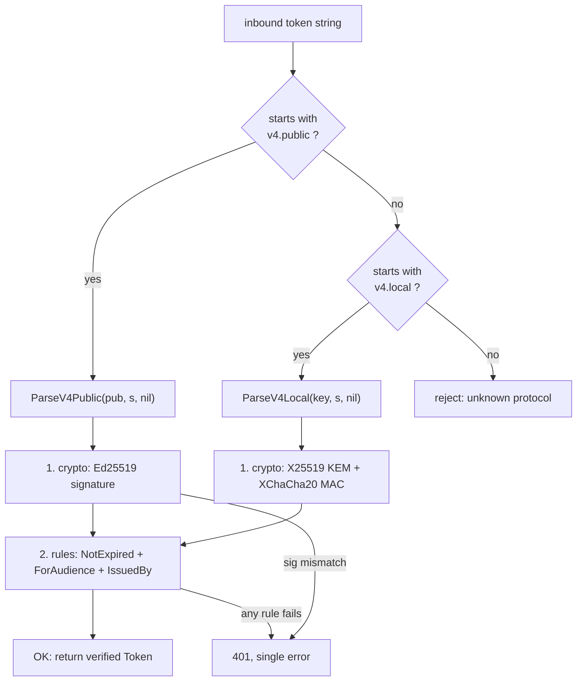

---

title: "PASETO: The Token Format You Didn't Know You Needed"
image: /images/covers/paseto-the-token-format-you-didnt-know-you-needed.svg
date: 2026-10-15T09:00:00+00:00
author: "Punit Naran"
description: "PASETO: The Token Format You Didn't Know You Needed"
tags: ["Go", "Auth", "Cryptography"]
draft: false
---

JWT has been the default for a decade, and the default is the problem. Every
JWT deployment is *its own* crypto stack: pick an `alg`, pick a `kid`, stand up
a JWKS endpoint, wire up an `aud` check, and get any of the four wrong and you
have the **`alg: "none"`** bug, the **`kid` confusion** bug, or the
**"token signed for service A used against service B"** bug. Paragonie's "JWT
is a Bad Standard" is the canonical indictment, and PASETO (Platform-Agnostic
SEcurity TOkens) is the fix that ships. The whole idea is to *remove the
rope*: one token format, no `alg` field, no `kid`, no header/body ambiguity —
the version **is** the algorithm, and the library decides the rest.

This post is the Go story, and it is concrete because it is the library our
own server runs: [`aidanwoods.dev/go-paseto`](https://github.com/aidantwoods/go-paseto)
v1.6. By the end you will be able to **issue and verify a signed `v4.public`
access token**, **encrypt and decrypt a `v4.local` refresh token**, and
**explain — with the exact Go calls — why PASETO removes three whole classes of
JWT bug**. The code below is run-tested against v1.6.0.

## The two purposes, the three versions

PASETO has exactly two *purposes*, and the rest is version:

| Purpose | What it does | Key model | Go (sign) | Go (verify) |
|---------|--------------|-----------|-----------|-------------|
| **`public`** | *signs* the token (integrity, no secrecy) | asymmetric — 1 private, N public | `tok.V4Sign(priv, nil)` | `parser.ParseV4Public(pub, s, nil)` |
| **`local`** | *encrypts* the token (confidentiality) | symmetric — one shared key | `tok.V4Encrypt(key, nil)` | `parser.ParseV4Local(key, s, nil)` |

The three **versions** fix the crypto so you never choose it:

| Version | `public` (sign) | `local` (encrypt) |
|---------|-----------------|-------------------|
| **v2** | Ed25519 | X25519 KEM + XChaCha20-Poly1305 AEAD |
| **v3** | Ed25519 | X25519 KEM + XChaCha20-Poly1305 AEAD |
| **v4** | Ed25519 | X25519 KEM + XChaCha20 + GenericHash MAC |

> **Note**: in this library `v2` and `v3` take *no* `implicit` argument;
> `v3`/`v4` do. `NewParser()` preloads the `NotExpired()` rule for you, so an
> expired token is rejected before you write a single check.

## Why `v4.public` for access, `v4.local` for refresh

The split that matches a real Go service:

- **Access token = `v4.public` (Ed25519-signed).** The issuer signs with a
  32-byte private key; *every* verifier node needs only the 32-byte public
  key. No shared secret, no HSM round-trip, no "who is holding the signing key"
  class of bug — a public key is *safe to broadcast*, which is the whole point
  of the split.
- **Refresh token = `v4.local` (X25519 + XChaCha20).** Symmetric: one 256-bit
  key, and the payload is *encrypted*, not just signed, so a stolen refresh
  token is unreadable off the wire and unforgeable without the key.

```mermaid
sequenceDiagram
    participant C as client
    participant I as issuer (holds 32B private key)
    participant V as any verifier (holds 32B public key)
    C-->>I: POST /login
    I-->>I: NewV4AsymmetricSecretKey().Public()
    I-->>I: NewToken() + V4Sign(priv, nil)
    I--->>C: v4.public.<base64>  (the access token)
    C-->>V: GET /api  (Authorization: Bearer ***
    V-->>V: NewParser() + AddRule(ForAudience, IssuedBy)
    V-->>V: ParseV4Public(pub, token, nil)  --> crypto + rules
    alt signature ok, not expired, aud+iss match
        V--->>C: 200 OK
    else tampered / expired / wrong audience
        V--->>C: 401 (one error, no ambiguity)
    end
```

The sequence is the entire access-token lifecycle. The *entire* cryptographic
surface is the two library calls; everything else — the `Ed25519` sign, the
`X25519` key schedule, the `Pae` (Pre-Auth Encode) binding of header + payload
+ footer + implicit — is hidden inside them.

### The access token: issue + verify

```go
// pasetoAccess.go — the signed "public" token layer.
//
// "public" is asymmetric: ONE private key signs, N public keys verify.
// The 32-byte private key is the only secret; the 32-byte public key is
// safe to ship to every node. v4's public-purpose crypto is Ed25519, fixed
// by the spec — there is no `alg` to pick and no `none` to fall into.
package main

import (
	"time"

	"aidanwoods.dev/go-paseto"
)

// issueAccessToken mints a 15-minute signed access token.
func issueAccessToken(sub, aud, jti, issuer string) string {
	// In production priv persists (HSM/KMS, or a boot-time env var). Here it
	// is freshly generated so the example is self-contained.
	priv := paseto.NewV4AsymmetricSecretKey()

	tok := paseto.NewToken()
	tok.SetSubject(sub)          // "sub"  — the principal
	tok.SetAudience(aud)         // "aud"  — the one service that accepts it
	tok.SetIssuer(issuer)        // "iss"  — who signed
	tok.SetJti(jti)              // "jti"  — unique id, revocable by id
	tok.SetIssuedAt(time.Now())
	tok.SetExpiration(time.Now().Add(15 * time.Minute))
	tok.SetString("role", "reader")

	return tok.V4Sign(priv, nil)
}

// verifyAccessToken checks the signature AND a set of claim rules. Any
// failure — bad signature, expired, wrong audience, wrong issuer — is a
// single error. There is no second, subtler failure mode to discover in prod.
func verifyAccessToken(pub paseto.V4AsymmetricPublicKey, signed string) (*paseto.Token, error) {
	p := paseto.NewParser() // NotExpired() rule preloaded
	p.AddRule(paseto.ForAudience("golang4u-api"))
	p.AddRule(paseto.IssuedBy("golang4u"))
	return p.ParseV4Public(pub, signed, nil)
}
```

### The refresh token: `v4.local`

```go
// pasetoRefresh.go — the encrypted "local" token layer.
//
// "local" is symmetric: one 256-bit key known only to the two ends. The
// payload is ENCRYPTED (X25519 key exchange + XChaCha20 stream) and then
// MAC'd, so a refresh token is unreadable off the wire and unforgeable
// without the key — a property a signed JWT does not give you.
package main

import (
	"time"

	"aidanwoods.dev/go-paseto"
)

// issueRefreshToken mints a 30-day encrypted refresh token.
func issueRefreshToken() string {
	key := paseto.NewV4SymmetricKey() // the shared 256-bit secret

	tok := paseto.NewToken()
	tok.SetJti("refresh-a1b2c3d4")
	tok.SetIssuedAt(time.Now())
	tok.SetExpiration(time.Now().Add(30 * 24 * time.Hour))
	tok.SetString("session", "s-42")

	return tok.V4Encrypt(key, nil)
}

// verifyRefreshToken decrypts + checks the MAC. A wrong key is a "bad message
// authentication code" error — it fails closed, it never decrypts garbage.
func verifyRefreshToken(key paseto.V4SymmetricKey, encrypted string) (*paseto.Token, error) {
	return paseto.NewParser().ParseV4Local(key, encrypted, nil)
}
```

## The three JWT bugs PASETO deletes

| | JWT | PASETO |
|---|-----|--------|
| **`alg` field** | present — `none` / `HS256`↔`RS256` confusion is a live CVE class | **absent** — the version string pins the algorithm |
| **key id (`kid` / JWKS)** | present — needs a JWKS endpoint, a round-trip per verify | **absent** — the verifier holds one public key in memory |
| **`aud` enforcement** | a field *you* must check yourself (and often don't) | a `ForAudience` **rule**, applied inside `ParseV4Public` — can't be skipped |
| **replay** | a valid token is valid anywhere, any time | `jti` id + `exp`/`nbf` rules; `local` tokens are encrypted |



The flowchart is the verifier in one picture: **one entry per purpose, one
crypto step, then a rule pass** — and any failure is a single `401`. There is
no branch where you "forgot to check `alg`", because the version string *is*
the check.

> **Warning**: PASETO `local` is **not** a substitute for a session store. A
> `v4.local` refresh token is tamper-proof and unforgeable, but it is
> *stateless* — it does not by itself stop replay. If you need server-side
> revocation, pair it with a short-lived `jti` you track in Redis, or a
> `nbf`/rotation window. "Signed" also means the *payload is public* — put
> only what you intend to expose in a `public` token.

---

## Takeaways

- **PASETO trades algorithm agility for versioned protocols.** The `alg` field
  — and the `none` / `kid` / JWKS confusion that field creates — simply does
  not exist. The version string picks the crypto; the library does it.
- **`v4.public` = sign (Ed25519), `v4.local` = encrypt (X25519 + XChaCha20).**
  Access tokens are signed and broadcast; refresh tokens are encrypted and
  secret. One 32-byte private key, one 256-bit symmetric key, that is the
  whole secret surface.
- **Verification is one call with built-in rules.** `NewParser()` preloads
  `NotExpired()`; `AddRule(ForAudience, IssuedBy)` makes the `aud` / `iss`
  checks you usually forget into part of `ParseV4Public` itself. A bad token
  is *one* error, not four.
- **The Go library is a thin wrapper over `crypto/ed25519` +
  `golang.org/x/crypto`.** No config, no `alg` table, no JWKS fetch — the
  whole token layer is two functions.

## Next steps

- **Wire it into your server:** `golang4u_server` already depends on
  `aidanwoods.dev/go-paseto v1.6.0` in `internal/paseto_middleware/` — read
  that package to see the real middleware shape (it is exactly this API).
- **Rotate the `v4.local` key on a schedule** and carry both old and new
  during the overlap window; a 256-bit key you never rotate is a single point
  of failure.
- **Add a `jti` revocation list** (a `SET` in Redis keyed by `jti`) if you
  need to kill a token before it expires — the crypto is tamper-proof, but
  revocation is a policy decision the token cannot make for you.
