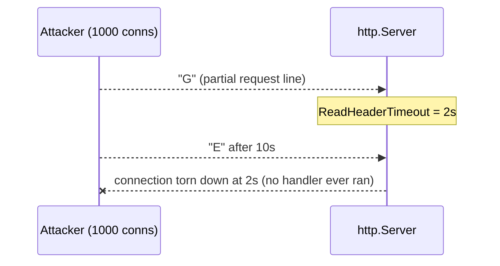
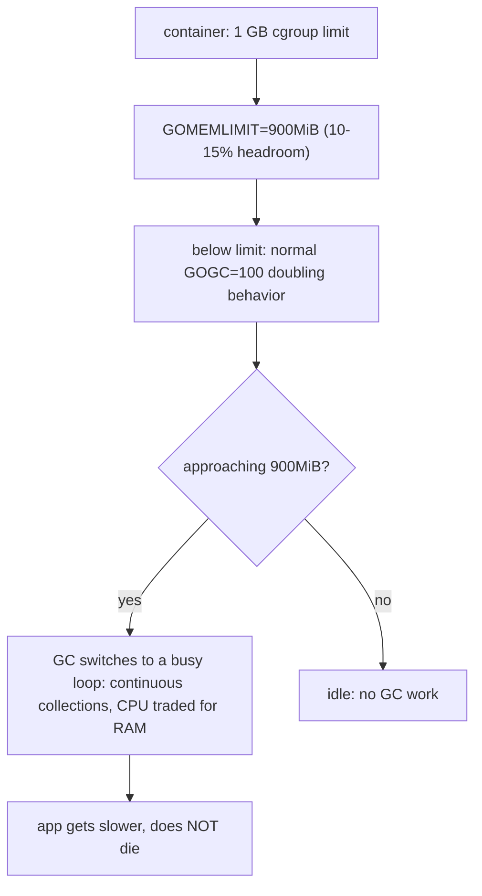

---

---


title: "The Golang4U Hardening Bible: DDoS-Proofing & OOM Prevention"
image: /images/covers/production-hardening.svg
date: 2026-02-14T15:00:00+08:00
lastmod: 2026-02-14T15:00:00+08:00
author: "Punit Naran"
authorLink: ""
description: "Your code is correct, but your server is vulnerable. The Golang4U hardening playbook: Slowloris timeouts, GOMEMLIMIT OOM prevention, and bounded database pooling - the runtime knobs that stop the 3 a.m. page."
tags: ["Go", "DevOps", "DDoS", "OOM", "GOMEMLIMIT", "Production", "Docker", "Kubernetes"]
categories: ["DevOps", "Engineering Handbook"]
featuredImage: ""


Your code is correct. It passed every test. Then the 3 a.m. page: OOM kill, a hung pool of connections, a Slowloris-shaped incident. The difference is that **default settings are tuned for a laptop demo, not a production box**. This post is the Golang4U hardening playbook, told through the runtime's own knobs: `GOMEMLIMIT`, the HTTP server timeout ladder, and database pooling.

## The three defaults that get you paged

1. **Default `http.Server`** — no timeouts at all. An attacker (or a slow client) can hold a connection open forever, one byte at a time.
2. **Default GC (`GOGC=100`)** — the heap is allowed to double between collections. In a 1 GB container, "allowed to double" is "OOM killed."
3. **Default driver pooling** — a connection storm under load takes your database down with your app.

Each is a one-line or one-env-var fix. The rest of this post is the exact code.

## Chapter 1: the Slowloris ladder (timeouts)

Slowloris: open 1,000 connections, send `G`… wait 10 s … `E`… wait 10 s… The request line never finishes, so the handler never runs — but the connection (and its buffers) live on. A default `http.Server` has **no** read timeout, so it waits forever.



The fix is the explicit timeout ladder in `internal/server/server.go`:

```go
// server.go — the Slowloris-proof server.
package main

import (
	"fmt"
	"log"
	"net/http"
	"os"
	"time"
)

func main() {
	// GOMEMLIMIT is read by the runtime at process start. It cannot be
	// changed later (no runtime.GC* API for it), so set it in the
	// environment before the binary runs — and fail loudly if you forgot.
	if os.Getenv("GOMEMLIMIT") == "" {
		log.Fatal("GOMEMLIMIT is not set; refusing to run with unlimited heap")
	}

	srv := &http.Server{
		Addr: ":8080",
		Handler: http.HandlerFunc(func(w http.ResponseWriter, r *http.Request) {
			w.WriteHeader(http.StatusOK)
			fmt.Fprint(w, "ok\n")
		}),
		// How long to wait for the request *headers*. This is the
		// Slowloris answer: a client that dribbles the request line for
		// more than 2 seconds is cut, on every open connection.
		ReadHeaderTimeout: 2 * time.Second,
		// How long to read the whole request body.
		ReadTimeout: 5 * time.Second,
		// How long the handler gets to write the response.
		WriteTimeout: 10 * time.Second,
		// How long to keep an idle (keep-alive) connection open before
		// reaping it.
		IdleTimeout: 120 * time.Second,
	}
	log.Fatal(srv.ListenAndServe())
}
```

With `ReadHeaderTimeout = 2s`, a client that pauses more than 2 seconds while "typing" `GET /` is cut. The server is now Slowloris-proof: no number of slow connections can pile up unbounded, because each one is guaranteed to die.

## Chapter 2: the OOM math (GOMEMLIMIT)

Go's GC triggers when the heap **doubles** (`GOGC=100` means "collect when live heap has grown 100% since the last collection"). Now put that in a 1 GB container:

1. App settles at 600 MB live.
2. GC's next trigger point is 600 × 2 = **1.2 GB**.
3. The runtime happily allocates toward 1.2 GB.
4. The kernel sees 1 GB used. **OOM killer: `KILL -9`.**

The code was "correct"; the runtime was allowed to outgrow the box. The fix is `GOMEMLIMIT` (Go 1.19+), an absolute ceiling on heap growth:



In `cmd/server/main.go` (or the Docker env):

```sh
export GOMEMLIMIT=900MiB   # ~90% of the 1 GB cgroup limit
```

Cross-check it at startup, right alongside the timeout ladder:

```go
// memlimit.go — pair with server.go; refuses to boot without a ceiling.
package main

import (
	"fmt"
	"os"
	"runtime"
)

func main() {
	// runtime.GOMAXPROCS(-1) prints the current setting; GOMEMLIMIT has
	// no runtime getter — the env var is the source of truth, so we check it.
	ml := os.Getenv("GOMEMLIMIT")
	if ml == "" {
		fmt.Fprintln(os.Stderr, "FATAL: set GOMEMLIMIT (e.g. 900MiB) before starting")
		os.Exit(1)
	}
	fmt.Printf("GOMEMLIMIT=%s, GOMAXPROCS=%d, GOGC=%s\n",
		ml, runtime.GOMAXPROCS(0), os.Getenv("GOGC"))
}
```

Why 90%, not 100%? Go's memory is not all heap: goroutine stacks, mmaps, the runtime itself, and C-heap (cgo) allocations all sit *outside* `GOMEMLIMIT`. A 10–15% headroom for non-heap memory is the working rule of thumb.

> **Note:** `GOMEMLIMIT` and `GOGC` are complementary, not alternatives. `GOGC=100` alone: "double between collections" (relative). `GOMEMLIMIT` alone: "never exceed X" (absolute). In a container you want **both** set: `GOGC` for normal pacing, `GOMEMLIMIT` as the hard wall.

> **Warning:** `GOMEMLIMIT` is read **once, at process start**. There is no `runtime.SetGOMEMLIMIT`. A changed value in your config file does nothing until the process restarts — a release, not a hotfix.

## Chapter 3: the connection storm (DB pooling)

Under a load spike, a Go app opens one database connection per in-flight query. Ten app instances × 100 connections = a 1,000-connection storm into your database, which now crashes *with* your app. The fix is a bounded pool, set explicitly and configured, not left to driver defaults:

```go
// pool.go — bounded, idle-pruning pool via database/sql.
package main

import (
	"database/sql"
	"fmt"
	"time"

	_ "github.com/lib/pq" // real, pure-Go PostgreSQL driver
)

func newPool(dsn string, maxOpen, maxIdle int, idleTTL time.Duration) (*sql.DB, error) {
	db, err := sql.Open("postgres", dsn)
	if err != nil {
		return nil, err
	}
	// Hard ceiling on simultaneously open connections per app instance.
	db.SetMaxOpenConns(maxOpen)
	// Keep a warm set of idle connections, but prune ones unused for idleTTL
	// so the steady-state connection count matches real load, not peak load.
	db.SetMaxIdleConns(maxIdle)
	db.SetConnMaxIdleTime(idleTTL)
	db.SetConnMaxLifetime(30 * time.Minute) // recycle: fight stale-state bugs
	return db, nil
}

func main() {
	db, err := newPool("dsn=host=db", 50, 10, 5*time.Minute)
	if err != nil {
		panic(err)
	}
	defer db.Close()
	fmt.Println("pool ready: 50 open / 10 idle / 5m idle-TTL")
}
```

| Knob | What it caps | The failure it prevents |
|---|---|---|
| `SetMaxOpenConns(50)` | concurrent open connections | DB fd exhaustion under a load spike |
| `SetMaxIdleConns(10)` | warm idle connections | steady-state connection bloat after a spike |
| `SetConnMaxIdleTime(5m)` | idle connection lifetime | half-dead connections after a network blip |
| `SetConnMaxLifetime(30m)` | max connection age | stale-transaction / DNS-rotation bugs |

The same discipline applies to the *HTTP client* side: `http.Transport` has `MaxIdleConns` / `MaxIdleConnsPerHost` / `IdleConnTimeout` for exactly the mirror-image problem (your app hoarding connections to *downstream* services).

## The whole hardening, as config

```yaml
# docker-compose.yml — the kernel-level backstop.
services:
  app:
    cpus: "1.0"
    mem_limit: 1024m
    mem_reservation: 512m
    environment:
      - GOMEMLIMIT=900MiB        # ~90% of mem_limit: headroom for non-heap
      - GOGC=100
      - db_max_pool_size=50
      - db_max_conn_idle_time=5m
```

## Takeaways

- **Impatient**: every timeout on the server is set (`ReadHeaderTimeout` is the Slowloris answer).
- **Self-aware**: the runtime knows its memory wall (`GOMEMLIMIT`, set at start, checked at boot).
- **Polite**: the pool is bounded and idle-pruned, so a load spike can't take the database down.

A production-ready Go service is the one where *none* of these is left at the default.

## Next steps

- Add `GOMEMLIMIT` (90% of the cgroup limit) and `ReadHeaderTimeout` to your service template *before* the first production deploy, not after the first OOM.
- Graph `/proc/<pid>/status` `VmRSS` against `GOMEMLIMIT` in staging to watch the GC busy-loop engage.
- Re-run this post's three knobs after any kernel or distro upgrade — they are the only ones that move.
