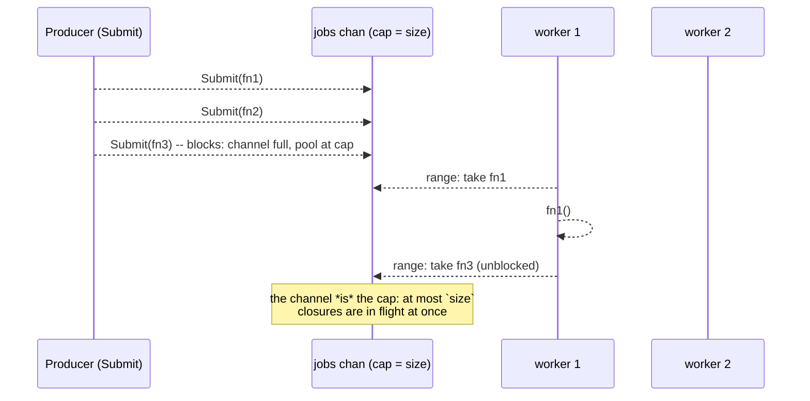
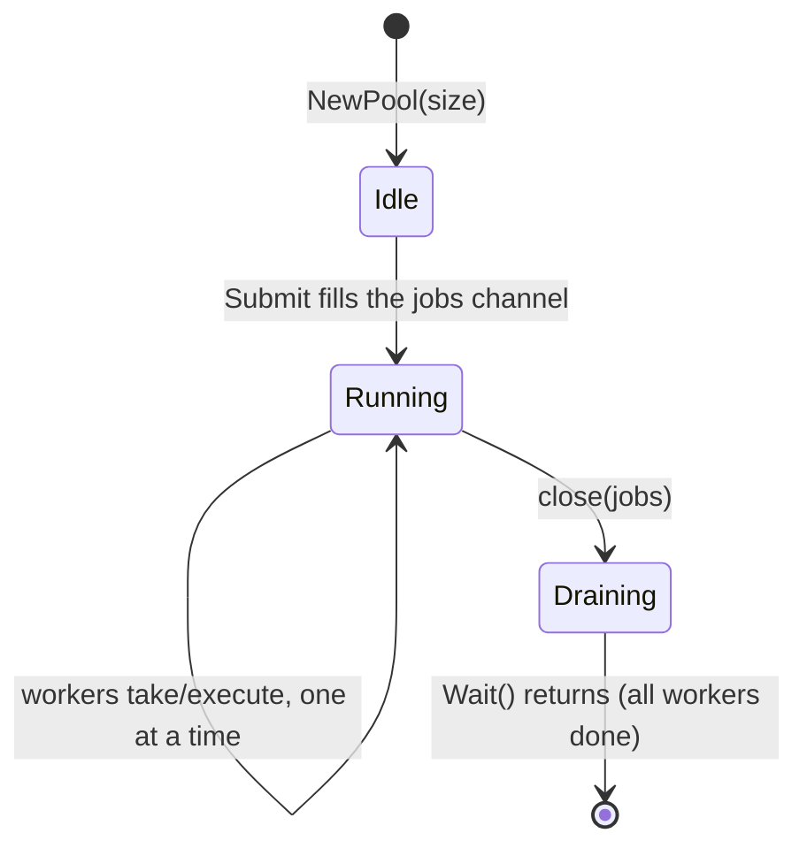

---

title: "The Go Goroutine Pool Pattern That Always Works"
date: 2026-10-15T09:00:00+00:00
author: "Punit Naran"
description: "The Go Goroutine Pool Pattern That Always Works"
tags: ["Go"]
draft: false
---

The goroutine pool is the most over-engineered pattern in the Go ecosystem and the most under-engineered one in production. The standard library gives you `sync.WaitGroup` (a barrier, not a pool) and `errgroup` (a fan-out, not a pool); everything else — the 40-line `WorkerPool` on StackOverflow, the channel-based "pool" in every blog post — is a re-implementation of the same 50-line pattern, each with a slightly different name for the *slot* and a slightly different condition for *slot free*.

This post is the one pattern that always works and the one condition that always breaks it. By the end: a 50-line pool (a `chan func()` + a `sync.WaitGroup`), a test that proves the pool bounds concurrency, the deadlock that a worker that submits into its own pool causes, and the three rules that keep the pool boring.

## The pattern: a `chan func()` is the pool

The entire pattern is a channel of closures, a fixed set of worker goroutines, and a barrier. No `acquire`, no `release`, no `Lock`, no `Unlock` — **the channel is the mutex, and the `range` is the lock.** A worker is a goroutine blocked on the channel; a free slot is an empty channel slot; a full pool is a full channel.





---

## The code: the 50-line pool

```go
package pool

import "sync"

// Pool bounds how many jobs run at once. A job is a func();
// Submit blocks when the pool is at capacity, which is the entire
// backpressure story.
type Pool struct {
	jobs chan func()
	wg   sync.WaitGroup
}

// NewPool starts `size` workers. ponytail: size is the hard
// concurrency cap; a value of 0 is allowed (no workers, Submit
// blocks forever) — pass a real number.
func NewPool(size int) *Pool {
	p := &Pool{jobs: make(chan func(), size)}
	for i := 0; i < size; i++ {
		p.wg.Add(1)
		go p.worker()
	}
	return p
}

// worker is the whole loop: range the channel, run the job.
// The range is the lock; the channel is the slot.
func (p *Pool) worker() {
	defer p.wg.Done()
	for fn := range p.jobs {
		fn()
	}
}

// Submit enqueues a job. Blocks until a worker is free.
func (p *Pool) Submit(fn func()) {
	p.jobs <- fn
}

// Wait closes the pool and blocks until every in-flight job
// drains. It does not cancel, does not interrupt, does not time
// out — it is a barrier, not a scheduler.
func (p *Pool) Wait() {
	close(p.jobs)
	p.wg.Wait()
}
```

That is the whole thing. A `chan func()` is the pool; a `sync.WaitGroup` is the barrier that tells you when it has drained. `Submit` is the only way to add work; `Wait` is the only way to drain it.

## The code: a test that proves the bound

```go
package pool

import (
	"sync"
	"sync/atomic"
	"testing"
)

// The one test that matters: the pool never runs more than `size`
// jobs at once. The probe increments a shared counter on entry and
// decrements on exit; a max observed concurrency > size means the
// pool is not a pool.
func TestPoolBoundsConcurrency(t *testing.T) {
	const size = 4
	const jobs = 200

	p := NewPool(size)
	var running, peak int64
	for i := 0; i < jobs; i++ {
		p.Submit(func() {
			n := atomic.AddInt64(&running, 1)
			for {
				cur := atomic.LoadInt64(&peak)
				if n <= cur || atomic.CompareAndSwapInt64(&peak, cur, n) {
					break
				}
			}
			atomic.AddInt64(&running, -1)
		})
	}
	p.Wait()
	if peak > size {
		t.Fatalf("peak concurrency = %d, pool size = %d", peak, size)
	}
}

// The deadlock the pool is *not* supposed to have: a worker that
// submits a *new* job into the same pool. The submitted job blocks
// on a full channel that the submitting worker is holding a slot in
// — the classic "pool stops making progress, CPU at 0%" symptom.
//
// The fix is not to change the pool: it is to never Submit from
// inside a worker. If you must fan out, spawn a goroutine and
// Submit from *that* (the new goroutine does not hold a slot, so
// the cycle is broken).
func TestWorkerSubmittingIntoItself(t *testing.T) {
	p := NewPool(1) // one worker: a self-submit fills the only slot
	var mu sync.Mutex
	done := make(chan struct{})
	go func() {
		defer close(done)
		p.Submit(func() {
			// worker body: the fan-out must NOT call p.Submit
			// directly. Spawn a goroutine for the child job.
			go func() {
				p.Submit(func() {
					mu.Lock()
					mu.Unlock()
				})
			}()
		})
	}()
	p.Wait()
	<-done
}
```

## The one condition that always breaks it

The pattern above is correct **as long as the workers never block on the caller**. The one thing that breaks it is a worker that *calls back into the pool* — a worker that `Submit`s a new job into the very pool it is running in.

That creates a cycle in the work graph: a job holds the only slot and waits for a slot to run its child, and the child is waiting for the parent's slot. The `chan` is a FIFO with no priority, so the last job in the queue that needs the slot is the one that deadlocks it. The symptom is "the pool stops making progress and the CPU is at 0%."

The fix is *never* to `Submit` from inside a worker that blocks on the pool. If you need to fan out, spawn a new goroutine inside the worker and `Submit` from *that* — the new goroutine is not a worker, so it does not hold a slot, and the cycle is broken.

## The three rules that keep the pool boring

1. **The pool is a `chan`.** No `mutex`, no `cond`, no `atomic`. The channel is the only synchronization primitive; if you find yourself adding a `sync.Mutex` *around* the channel, you have re-implemented the channel.
2. **The worker is a `goroutine`.** Not a `thread`, not a `task`, not a `coroutine`. A goroutine is the only thing the channel blocks on. If you make the worker a C thread via cgo, the channel blocks on the goroutine that wraps the thread and you have re-implemented the scheduler.
3. **`Wait` is a barrier, not a scheduler.** It closes the channel and waits for the `wg` to drain. It does not cancel, does not interrupt, does not time out. If you need any of those, you have left the pool and entered the scheduler.

## Pools vs errgroup vs raw goroutines

| Pattern | Concurrency bound | Backpressure | Cancellation | Lines |
|---|---|---|---|---|
| `errgroup` | Unlimited (one goroutine per task) | None | `context` | ~10 |
| Raw `go` + `WaitGroup` | Unlimited | None | `context` | ~10 |
| **`chan func()` pool (this post)** | `size` | `Submit` blocks | Manual (`close` + `wg`) | ~50 |

> **Note**: if you only need *bounded fan-out with an error*, `errgroup` with a `SetLimit(n)` is 20 lines and gives you `context` cancellation for free. The raw `chan func()` pool is for when you need *unbounded* work with a *hard* concurrency cap and no per-task result plumbing.

> **Warning**: the classic "pool stops making progress, CPU at 0%" is a worker that `Submit`s into its own pool. If your jobs fan out (a parser that submits sub-parses, a crawler that submits next URLs), the fan-out must happen in a *new* goroutine, not in the worker. The pool does not detect the cycle — the deadlock is the only signal.

## The 50-line rule

If your pool is more than 50 lines, you have added a *scheduler*. The 50-line pool is the only pool that always works: a `chan func()` for the slots, a `WaitGroup` for the drain, and a test that proves the cap. Everything else is a scheduler in a trench coat.

## Takeaways

- **A `chan func()` is the pool.** The channel is the cap, the `range` is the lock, the `WaitGroup` is the barrier. No `acquire`, no `release`, no `Mutex`.
- **`Submit` blocking is the backpressure.** A pool that accepts work faster than it runs it is not a pool; it is a queue that lies to you.
- **Never `Submit` from inside a worker.** A worker that blocks on its own pool is a deadlock. Fan out in a new goroutine.
- **The 50-line rule is the design test.** More than 50 lines and you have a scheduler; the scheduler is where the 3am pages live.

## Next steps

- **Add `context` where you need cancellation**: `Submit` takes a `ctx` and the worker checks it before running the job. The `chan` pattern and `context` compose cleanly; the barrier becomes "drain until the context is done."
- **Add a bounded queue metric** (len of the `jobs` channel) and alert when it approaches capacity — a pool that is always full is a pool that is always the bottleneck.
- **Prefer `errgroup` with `SetLimit`** for the common "bounded fan-out with an error" case. Reach for the raw `chan` pool only when you need unbounded work with a hard cap and no per-task result plumbing.
