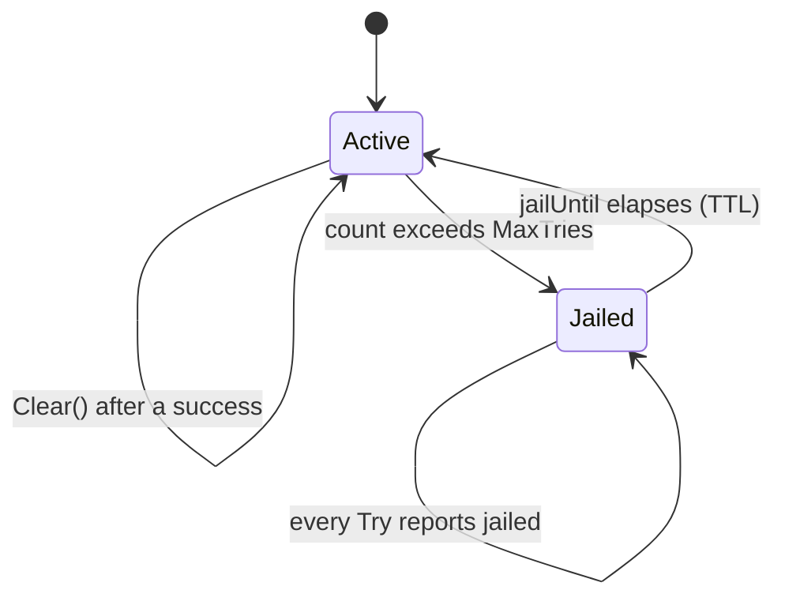
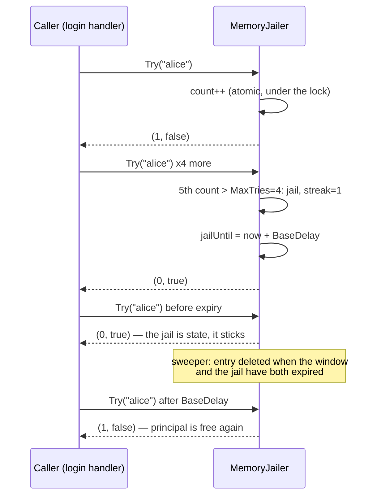

---

title: "The Jailer in My Codebase: In-Memory Jail and Why It Became a Library"
date: 2026-10-15T09:00:00+00:00
author: "Punit Naran"
description: "The Jailer in My Codebase: In-Memory Jail and Why It Became a Library"
tags: ["Go", "Security", "Jail"]
draft: true
---

Every login system grows a jail. Mine started as a `map[string]int` of failed logins and a comment saying "5 and they're out". Six sprints later it was a 300-line blob with three kinds of counters, two kinds of windows, and a backoff that someone hand-tuned in production at 3am. The *data* never changed; the **rules** did — what counts as a try, what "exceeding" a budget means, who gets jailed and for how long.

That's when I split the thing in two and it stopped being a blob and became a library: a *store* (where the counts live) and a *policy* (the rules). The interface between them is four lines; the policy is a value type a test can build in one literal; the backoff is a *function of the streak*, not a property of the principal.

This post is the full design: the `Jailer` interface, the in-memory store with TTL eviction, the tumbling window, the exponential backoff — and the test that rewinds the clock to prove all three. By the end you will have a jailer with no Redis, no Kafka, no "jailer service": stdlib and one small map.

## Architecture: one store, one policy

The split in one sentence: **the store answers *how many*; the policy decides *what happens*.**

- **`Jailer`** — a 3-method interface (`Try`, `Clear`, `IsJailed`). This is the only thing any caller sees. Every caller compiles against the interface, never the store.
- **`Policy`** — a value struct: `MaxTries`, `Window`, `BaseDelay`, `MaxDelay`, and an injectable `Now` clock. One literal in a test replaces a configuration file.
- **`MemoryJailer`** — `map[string]*entry` behind a `sync.Mutex`, plus one background goroutine that evicts entries whose window *and* jail have both expired.

The lifecycle of a jailed principal is a state machine, which is the right lens for a jail:





---

## The code: the jailer (the whole library)

```go
package main

import (
	"sync"
	"time"
)

// Jailer is the only interface any caller talks to.
// The rules (what counts as a try, how long a principal stays
// jailed) live in Policy, not here, so a test swaps the rules
// without touching the store.
type Jailer interface {
	// Try records one try. Returns the principal's current
	// in-window count and a jailed flag. A jailed principal
	// reports jailed on every call until the jail expires.
	Try(principal string) (count int, jailed bool)
	// Clear releases a principal (e.g. after a successful
	// login): the counter resets and any active jail lifts.
	Clear(principal string)
	// IsJailed reports whether the principal is jailed right now.
	IsJailed(principal string) bool
}

// Policy is the rulebook: how many tries per window, how big
// the window is, how long the jail lasts, and how it escalates.
// It is a value type: a test builds a custom one in one literal.
type Policy struct {
	MaxTries  int
	Window    time.Duration
	BaseDelay time.Duration
	MaxDelay  time.Duration
	Now       func() time.Time // injectable clock; tests rewind it
}

func DefaultPolicy() Policy {
	return Policy{
		MaxTries:  5,
		Window:    time.Minute,
		BaseDelay: 30 * time.Second,
		MaxDelay:  time.Hour,
		Now:       time.Now,
	}
}

// entry is per-principal state: one counter, one window start,
// one jail timestamp, one escalation streak.
type entry struct {
	count       int
	windowStart time.Time
	jailUntil   time.Time
	streak      int
}

// MemoryJailer is the in-memory store.
// ponytail: single-process only — state is lost on restart, and a
// multi-replica deploy jails each replica independently. Swap in a
// Redis impl behind the same interface when you need a shared jail;
// the interface does not change.
type MemoryJailer struct {
	mu      sync.Mutex
	p       Policy
	entries map[string]*entry
	stop    chan struct{}
}

// New builds a jailer and starts the background sweeper.
func New(p Policy) *MemoryJailer {
	if p.Now == nil {
		p.Now = time.Now
	}
	j := &MemoryJailer{
		p:       p,
		entries: make(map[string]*entry),
		stop:    make(chan struct{}),
	}
	go j.sweep()
	return j
}

// Stop shuts the sweeper down. Call it on process shutdown;
// without it the sweeper leaks a goroutine per jailer.
func (j *MemoryJailer) Stop() { close(j.stop) }

// Try implements Jailer. One try = one locked, atomic increment —
// never a read-modify-write across two calls.
func (j *MemoryJailer) Try(principal string) (int, bool) {
	j.mu.Lock()
	defer j.mu.Unlock()
	now := j.p.Now()
	e := j.entry(principal, now)

	// A jailed principal *stays* jailed: the jail is state,
	// not a return value of this call. A failed try does not
	// reset the counter.
	if now.Before(e.jailUntil) {
		return e.count, true
	}

	e.count++
	if e.count > j.p.MaxTries {
		e.streak++
		e.jailUntil = now.Add(j.delay(e.streak))
		e.count = 0 // next window starts clean
		return e.count, true
	}
	return e.count, false
}

// delay is the exponential backoff: base * 2^(streak-1), capped.
// The escalation is a policy — a function of the streak — not a
// property of the principal.
func (j *MemoryJailer) delay(streak int) time.Duration {
	d := j.p.BaseDelay
	for i := 1; i < streak && d < j.p.MaxDelay; i++ {
		d *= 2
	}
	if d > j.p.MaxDelay {
		d = j.p.MaxDelay
	}
	return d
}

// entry returns the principal's entry, resetting the counter when
// the window has elapsed.
func (j *MemoryJailer) entry(principal string, now time.Time) *entry {
	e, ok := j.entries[principal]
	if !ok {
		e = &entry{windowStart: now}
		j.entries[principal] = e
		return e
	}
	// Tumbling window: when it elapses, the counter restarts.
	// ponytail: tumbling, not sliding — a sliding window needs a
	// timestamp per try, which buys nothing for login attempts.
	if now.Sub(e.windowStart) > j.p.Window {
		e.count = 0
		e.windowStart = now
	}
	return e
}

// Clear implements Jailer.
func (j *MemoryJailer) Clear(principal string) {
	j.mu.Lock()
	defer j.mu.Unlock()
	delete(j.entries, principal)
}

// IsJailed implements Jailer.
func (j *MemoryJailer) IsJailed(principal string) bool {
	j.mu.Lock()
	defer j.mu.Unlock()
	e, ok := j.entries[principal]
	return ok && j.p.Now().Before(e.jailUntil)
}

// sweep evicts entries whose window and jail have both expired.
// Without it the map grows one entry per principal that ever tried
// (and failed) and never came back.
func (j *MemoryJailer) sweep() {
	t := time.NewTicker(j.p.Window)
	defer t.Stop()
	for {
		select {
		case <-j.stop:
			return
		case <-t.C:
			j.mu.Lock()
			now := j.p.Now()
			for p, e := range j.entries {
				if now.Sub(e.windowStart) > j.p.Window && now.After(e.jailUntil) {
					delete(j.entries, p)
				}
			}
			j.mu.Unlock()
		}
	}
}
```

## The code: the test (clock rewound)

```go
package main

import (
	"testing"
	"time"
)

// testPolicy builds a jail policy against a fake clock the tests
// move by hand: 3 tries per 1ms window, 10ms base jail, 100ms cap.
func testPolicy(now *time.Time) Policy {
	return Policy{
		MaxTries:  3,
		Window:    1 * time.Millisecond,
		BaseDelay: 10 * time.Millisecond,
		MaxDelay:  100 * time.Millisecond,
		Now:       func() time.Time { return *now },
	}
}

// The 4th try (after 3) jails the principal, and the jail sticks
// until the delay elapses.
func TestJailAfterMaxTries(t *testing.T) {
	now := time.Unix(1_700_000_000, 0)
	j := New(testPolicy(&now))
	defer j.Stop()

	for i := 0; i < 3; i++ {
		if _, jailed := j.Try("alice"); jailed {
			t.Fatalf("try %d: jailed before exceeding MaxTries", i+1)
		}
	}
	if _, jailed := j.Try("alice"); !jailed {
		t.Fatal("4th try: expected jailed, got clean")
	}
	if !j.IsJailed("alice") {
		t.Fatal("IsJailed: expected true immediately after jail")
	}

	now = now.Add(10 * time.Millisecond) // exactly one BaseDelay
	if j.IsJailed("alice") {
		t.Fatal("IsJailed: expected free after BaseDelay")
	}
}

// The second jail runs for 2x the first (exponential backoff),
// and the streak cap holds at MaxDelay.
func TestExponentialBackoff(t *testing.T) {
	now := time.Unix(1_700_000_000, 0)
	j := New(testPolicy(&now))
	defer j.Stop()

	for i := 0; i < 3; i++ {
		j.Try("bob")
	}
	j.Try("bob") // first jail: 10ms
	if !j.IsJailed("bob") {
		t.Fatal("first jail: expected jailed")
	}
	now = now.Add(10 * time.Millisecond) // first jail expires

	for i := 0; i < 3; i++ {
		j.Try("bob")
	}
	j.Try("bob") // second jail: 20ms
	now = now.Add(10 * time.Millisecond)
	if !j.IsJailed("bob") {
		t.Fatal("second jail: still jailed at 1x base")
	}
	now = now.Add(10 * time.Millisecond) // 2x base elapsed
	if j.IsJailed("bob") {
		t.Fatal("second jail: free at 2x base")
	}
}

// Clear is a hard release: counter and jail both die.
func TestClear(t *testing.T) {
	now := time.Unix(1_700_000_000, 0)
	j := New(testPolicy(&now))
	defer j.Stop()

	for i := 0; i < 4; i++ {
		j.Try("carol")
	}
	if !j.IsJailed("carol") {
		t.Fatal("expected jailed after 4 tries")
	}
	j.Clear("carol")
	if j.IsJailed("carol") {
		t.Fatal("Clear: expected not jailed")
	}
}
```

---

## The three rules that make it boring

1. **One try = one atomic increment.** No `read-modify-write` across two calls. The `sync.Mutex` (or a Redis `INCR`) *is* the atomicity. If you write `if j.counts[p] < 5 { j.counts[p]++ }` outside the lock, the jail is racy under concurrency.
2. **The jail is a state, not a return value.** A jailed principal *stays* jailed for the duration; a failed try does not reset the counter. This is the difference between a *counter* (resets on success) and a *jail* (persists across the window). Keeping the two apart is what makes the rules composable.
3. **The backoff is a policy, not a property.** 10s, then 20s, then 40s — that escalation is a *function of the streak*, applied to the `jailed` state. The principal is jailed; the policy decides *how long*. Same rules-versus-state split as the store/policy split above.

## Edge cases and the multi-replica trap

- **The sweeper is load-bearing.** Without TTL eviction the map grows one entry per principal that ever tried and failed. The sweep only deletes entries whose window *and* jail have both expired, so an active jail is never evicted mid-sentence.
- **`Stop()` on shutdown.** The sweeper is a goroutine; a service that creates a jailer per request and never stops it leaks one goroutine per request.

> **Note**: an in-memory jail is a *soft* lockout — a process restart drops it. That is the right trade for login throttling (the attacker just retries), but pair it with a persistent audit log so the *evidence* of the jail survives the *memory* of it.

> **Warning**: with N replicas behind a round-robin load balancer, each replica jails independently — an attacker gets N times the attempts before any replica jails them. If the jail must be global, use a shared store (Redis) behind the same interface, or sticky sessions. The interface never changes; only the store does.

## In-memory vs Redis vs a jailer service

| | In-memory `map` (this post) | Redis behind the same interface | Dedicated "jailer service" |
|---|---|---|---|
| Multi-replica jail | No — each replica jails independently | Yes — one shared jail | Yes, at a network hop per try |
| Crash behavior | Jail resets (soft lockout) | Jail resets; timestamps survive with `EX` | Per your chosen store |
| TTL eviction | Built-in sweeper goroutine | Key TTL does it | The service's job |
| Added dependencies | None | A Redis instance | A service to run, monitor, scale |

**Rule of thumb:** in-memory until you have more than one replica *and* the jail must be global. Everything beyond that is scale, not design.

## Takeaways

- The jail is a **store plus a policy**; the only contract between them is a 3-method interface.
- **One try = one atomic increment**, under the lock — a read-modify-write across two calls is a racy jail.
- **The jail is state**; the counter resets on the window, the jail only expires on its TTL.
- **Backoff is a function of the streak** (base × 2ⁿ, capped) — a policy, not a property of the principal.
- **TTL eviction is load-bearing**: the sweeper keeps the map bounded without ever evicting a live jail.
- **Tests inject the clock**: `Now func() time.Time` turns "jail expires in 10 minutes" into a two-line test.

## Next steps

- **Go multi-replica?** Implement the same interface over Redis (`INCR` + `SET key EX` for the jail timestamp). The callers do not change.
- **Add a metrics hook** that exports the jail *rate* (jailed principals per minute) — a sudden jump is your brute-force canary.
- **Add per-action budgets** when one principal needs different limits for login vs OTP: the policy is already a value type, make it a `map[string]Policy` keyed by action.
