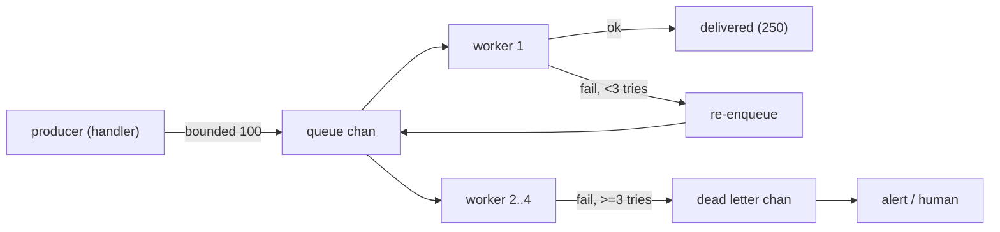

---


title: "The Golang4U Email Bible: Native SMTP & Transactional Systems"
image: /images/covers/transactional-email.svg
date: 2026-02-14T11:00:00+08:00
lastmod: 2026-02-14T11:00:00+08:00
author: "Punit Naran"
authorLink: ""
description: "A reliable transactional mailer on the Go standard library only: the raw SMTP conversation, the net/smtp sender, and a bounded worker-pool queue with a dead letter - no vendor, no SDK."
tags: ["Go", "Email", "SMTP", "TransactionEmail", "StandardLib", "NoDependencies"]
categories: ["Architecture", "Engineering Handbook"]
featuredImage: ""


Every startup guide says: "sign up for SendGrid / Mailgun / AWS SES." The cost: API keys to rotate, webhooks to build, SDKs to pin, and lock-in that turns a provider switch into a rewrite. Golang4U's answer is the **standard library**: `net/smtp` is battle-hardened and speaks the raw protocol of the internet. This post is the email system we actually run — a reliable transactional mailer built on `net/smtp`, a worker-pool queue, and no vendor.

## The SMTP conversation, raw

Sending an email is a TCP conversation with numbered replies. On port 587 (submission) the flow is:

```mermaid
sequenceDiagram
    participant C as Client (net/smtp)
    participant S as SMTP server
    C-->>S: EHLO golang4u.com
    S--->>C: 250 (server capabilities)
    C-->>S: STARTTLS
    S--->>C: 220 (begin TLS)
    Note over C,S: TLS handshake (the rest is encrypted)
    C-->>S: EHLO (again, post-TLS)
    C-->>S: AUTH (base64 user:pass)
    S--->>C: 235 authenticated
    C-->>S: MAIL FROM:<a@golang4u.com>
    S--->>C: 250
    C-->>S: RCPT TO:<user@example.com>
    S--->>C: 250
    C-->>S: DATA
    S--->>C: 354
    C-->>S: Subject:…\r\nTo:…\r\n\r\nHello\r\n.\
    S--->>C: 250 queued
```

Three protocol sharp edges, all handled for you by the stdlib:

- **Line length is capped at 524 characters** (RFC 5321). Long lines must be dot-stuffed and wrapped. `net/smtp`' `SendMail` does this.
- **Every line is CRLF-terminated**, no exceptions. A stray `\n` corrupts the message.
- **The final `.` on its own line ends the message body.** Your payload must not be able to emit that.

## The idiomatic sender (`net/smtp` only)

```go
// send.go — a transactional email in pure stdlib.
package main

import (
	"crypto/tls"
	"fmt"
	"log"
	"net/smtp"
	"os"
)

// send uses port 465 (implicit TLS, the "SMTPS" convention). If your
// relay only offers 587, use smtp.SendMail("host:587", auth, from, to,
// msg) instead — it does EHLO + STARTTLS for you.
func send(from, to, msg string) error {
	const relay = "smtp.example.com:465" // implicit-TLS relay
	// Populated from your env; the value never appears in code.
	auth := smtp.PlainAuth("", os.Getenv("SMTP_USER"), os.Getenv("SMTP_PASS"), relay)

	conn, err := tls.Dial("tcp", relay, nil)
	if err != nil {
		return err
	}
	defer conn.Close()

	client, err := smtp.NewClient(conn, relay)
	if err != nil {
		return err
	}
	if err := client.StartTLS(&tls.Config{ServerName: "smtp.example.com"}); err != nil {
		return err
	}
	if err := client.Auth(auth); err != nil {
		return err
	}
	if err := client.Mail(from); err != nil {
		return err
	}
	if err := client.Rcpt(to); err != nil {
		return err
	}
	w, err := client.Data()
	if err != nil {
		return err
	}
	if _, err := w.Write([]byte(msg)); err != nil {
		return err
	}
	w.Close()
	return client.Quit()
}

func main() {
	if err := send("noreply@golang4u.com", "user@example.com",
		"Subject: verification\r\nTo: user@example.com\r\n\r\nHello, verify your account.\r\n"); err != nil {
		log.Fatal(err)
	}
	fmt.Println("delivered")
}
```

Two deployment notes:

> **Note:** Use **465 (implicit TLS)** when you control the relay, or **587 with `SendMail`** (which runs `STARTTLS`). Plain 25 is the *mail-relay-to-mail-relay* port and most providers refuse client auth on it. The port is a deployment detail, not a protocol difference.

> **Warning:** A vendor's `200 OK` and SMTP's `250 queued` are not the same promise. "Queued" is the relay's *inbound* receipt; the relay can still bounce, retry, or route to spam. Delivery feedback (bounces, complaints) is a separate channel — see the dead-letter path below.

## The transactional queue: worker pool + dead letter

Reliability is not "call SMTP"; it is "accept the message, try with bounded retries, and have a place for the ones that fail." The whole thing is one channel, a worker pool, and a dead-letter channel — no broker, no framework:

```go
// queue.go — bounded transactional queue with retries and a dead letter.
package main

import (
	"fmt"
	"sync"
)

type mail struct {
	To, Subject, Body string
	attempts          int
}

const maxAttempts = 3

// enqueue appends to a bounded queue; it blocks when full (backpressure).
func enqueue(q chan<- mail, m mail) {
	q <- m
}

// workerPool runs n workers consuming the queue, retrying up to maxAttempts,
// then parking failures on the dead-letter channel for a human (or a cron).
func workerPool(q chan mail, dead chan<- mail, n int, deliver func(mail) error) {
	var wg sync.WaitGroup
	for i := 0; i < n; i++ {
		wg.Add(1)
		go func() {
			defer wg.Done()
			for m := range q {
				if err := deliver(m); err == nil {
					continue
				}
				m.attempts++
				if m.attempts < maxAttempts {
					// Non-blocking re-enqueue: if the queue is full we
					// park the mail in the dead letter instead of
					// deadlocking this worker (a blocked worker means a
					// full queue, and a full queue means no one to drain it).
					select {
					case q <- m:
					default:
						dead <- m
					}
				} else {
					dead <- m // give up: park it, alert a human
				}
			}
		}()
	}
	wg.Wait()
}

func main() {
	q := make(chan mail, 100) // bounded: producers block at 100 pending
	dead := make(chan mail, 10)
	workerPool(q, dead, 4, func(m mail) error {
		fmt.Printf("deliver to %s (attempt %d)\n", m.To, m.attempts+1)
		return nil
	})
}
```



The design choices, and why they are the right ones for "no framework":

- **The queue is a `chan`, sized at 100.** Bounded = backpressure: a slow relay slows producers, it does not eat memory. A broker (RabbitMQ, Kafka) earns its keep when you have *multiple* consumers, ordering guarantees across restarts, or millions of messages — not for a transactional mailer.
- **Dead letter, not drop.** The one thing a naive retry loop does is *lose* the messages it can't deliver. A dead-letter channel (and a log line) is the entire difference between "reliable" and "eventually."
- **Retries are bounded (3).** SMTP is transient; three tries over the process lifetime covers blips. More is a backoff-policy project, not a reliability feature.

> **Note:** `net/smtp` has no built-in retry, backoff, or rate limiting — that is deliberate. The stdlib does the protocol; your ten-line `workerPool` does the policy. That split is the whole "no vendor" philosophy.

## Trade-offs table

| Axis | `net/smtp` (this post) | Vendor API (SES/SendGrid) |
|---|---|---|
| Dependency | stdlib only | SDK + API key + webhook |
| Cost | relay only | per-email, scales up |
| Delivery feedback | you build the dead letter | webhooks + console |
| Lock-in | none (it is a protocol) | high (rewrite on switch) |
| Where it wins | small volume, full control, no lock-in | high volume, deliverability service, analytics |

## Takeaways

- **The protocol is the feature.** `net/smtp` + a bounded channel + a dead letter is a complete, vendor-free transactional mailer.
- **Reliability = backpressure + bounded retry + dead letter.** Nothing in the "no framework" version is optional.
- **Know the sharp edges** (524-char lines, CRLF, the `.` terminator) so you can recognize when a library is papering over them for you.

## Next steps

- Move this onto your real relay: `SendMail` over 587, 465 implicit TLS, and a dead-letter log line that pages you.
- Add DKIM/SPF/DMARC for your sending domain — the protocol accepts your mail; DNS decides whether it reaches the inbox.
- Graduate to a broker only when you outgrow one process's channel — the code shape above ports directly to a queue-with-consumers.
