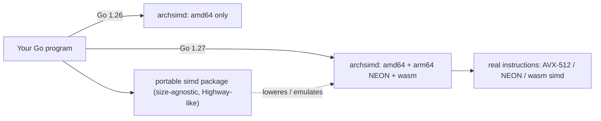
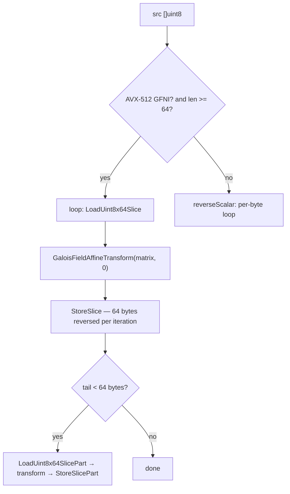

---

title: "Arch-specific SIMD in Go"
date: 2026-10-15T09:00:00+00:00
author: "Punit Naran"
description: "Go 1.27 extends its experimental SIMD intrinsics to arm64 (NEON) and wasm alongside amd64; a Go developer's guide to the archsimd API, the GFNI bit-reversal trick, and the trade-offs."
tags: ["Go", "Community"]
draft: true

---

Go 1.26 gave amd64 an experimental SIMD API. Go 1.27's headline change: the same API now lands on **arm64 (NEON) and wasm**, and the design rules that will shape the API for years are settled. If you have ever wanted to touch machine-wide registers from Go without writing assembly, this is the post.

## What SIMD actually is

Single Instruction, Multiple Data: one instruction operates on a wide register (128, 256, 512 bits) holding several 8- to 64-bit elements, in parallel. `add 8 float64 values` is one instruction. For uniform, element-parallel work — crypto, signal processing, data shuffling, numeric kernels — this is a real multiplier, not a micro-optimization.

Until this work, Go's access to SIMD was exactly one door: hand-written `asm` files per architecture. Worth it for a handful of hot kernels, too much friction for everyone else. The `simd` project (parent issue [#73787](https://go.dev/issue/73787)) is the second door: typed intrinsics.

## The three layers: `archsimd`, `simd`, the compiler

| Layer | Package | Status in 1.27 | Who uses it |
|---|---|---|---|
| Intrinsic layer | `simd/archsimd` | amd64 (AVX/AVX2/AVX-512), **arm64 NEON (SVE/SVE2 coming)**, wasm | You, when you need architecture-specific instructions |
| Portable layer | `simd` | AVX/AVX2/AVX-512, NEON, wasm SIMD; emulates where unsupported | You, for write-once near-native code |
| Runtime use | (internal) | — | The Go runtime: Green Tea GC already uses SIMD to scan memory for live objects |



> **Note:** `archsimd` is the intrinsics layer — the thing other languages call intrinsics. The portable `simd` package is what you should reach for first; drop to `archsimd` only when the portable intersection does not cover the instruction you need (via `ToArch` and the `*FromArch` conversions).

### API design: the decisions that matter

The API deliberately does **not** mirror hardware mnemonics:

- **Sensible names, not mnemonics.** Instead of `_mm512_slli_epi64` you get `ShiftAllLeft`.
- **One method name per semantic operation, across all widths and architectures.** Addition is `x.Add(y)` everywhere; the *type* of `x` decides which instruction is emitted.
- **Edge-case differences get distinct names.** The 16-byte table lookup on amd64 (`VPSHUFB`) zeros the byte for a *negative* index and wraps modulo 16 otherwise → `PermuteOrZero`. NEON `VTBL` and wasm `i8x16.swizzle` zero on *any* out-of-range index → `LookupOrZero`. Same-looking, silently-different behavior is never merged into one name.
- **Lane boundaries are named, not hidden.** On amd64, many 256/512-bit instructions work per 128-bit lane, not across the whole register. Those methods carry a `Grouped` suffix (`InterleaveLoGrouped`, `PermuteOrZeroGrouped`) so the 128-bit lane boundary is visible in your code.
- **Masks are opaque.** AVX-512 `k` registers, full-vector bitmasks (AVX2/NEON/wasm), SVE predicates — all hidden behind `Mask32x4`-style types. `x.Greater(y)` yields a mask; `x.Masked(m)` zeros lanes where `m` is false; `x.IfElse(m, y)` (1.27 renamed `Merge`) selects per-lane. The compiler peepholes `x.Add(y).Masked(m)` into a single masked instruction where the hardware has one.
- **Reinterpretation is zero-cost and composable.** 1.26's `As*` methods exploded quadratically in type pairs; 1.27 replaces them with `x.ToBits()` (int→bit vector) and `BitsToFloat32()` / `BitsToUint32()` (back), plus `ReshapeToUint<W>s()` to change element width within the same register width: `x.ReshapeToUint32s().BitsToFloat32()` reinterprets a `Uint8x16` as `Float32x4` with no runtime cost.

Construction and memory access use package-level functions named for the target type: `LoadFloat32x4(s []float32)`, `x.Store(s)`, `LoadFloat32x4Part(s)` (zero-fills short tails), `BroadcastFloat32x4(v)`, and the `*Array` variants for `*[4]float32` pointers.

## Worked example: bit-reversing 64 bytes in one instruction

The flagship instruction on the new surface is the AVX-512 GFNI extension's `GaloisFieldAffineTransform` (`VGF2P8AFFINEQB`). Each 8x8 bit matrix `A` is packed row-by-row into one `uint64`; the operation is `z[i] = A[i/8] * x[i] + b` where `*` is AND and `+` is XOR over 8 bits. Any bit permutation or linear combination of a byte is an 8x8 matrix — so one instruction is a Swiss Army knife for byte-level bit manipulation.

The canonical trick: **reversing all 8 bits of every byte** normally costs nibble tables, masks, shifts and ORs. With GFNI it is one multiply by the anti-diagonal identity matrix `0x8040201008040201` (the 8x8 bit-reversal matrix). On a 512-bit register: 64 bytes, one instruction.

```go
// simd_reverse.go — Go 1.27: archsimd AVX-512 GFNI fast path + pure-Go fallback.
//
// archsimd is a *stdlib* package: the import path is "simd/archsimd"
// (lives in GOROOT), not a third-party path. It only compiles when the
// simd experiment is on:
//
//	GOEXPERIMENT=simd go build .
//
// The experiment flag's exact spelling may move between 1.26/1.27 —
// check the Go 1.27 release notes.
//go:build goexperiment.simd

package main

import (
	"fmt"
	"time"

	"simd/archsimd"
)

// reverse64simd reverses the bit order of every 64-byte block using
// VGF2P8AFFINEQB. The anti-diagonal 8x8 matrix, packed row-by-row into
// a uint64:
//
//	[0 0 0 0 0 0 0 1]   [x7]
//	[0 0 0 0 0 0 1 0]   [x6]
//	[0 0 0 0 0 1 0 0]   [x5]
//	[0 0 0 0 1 0 0 0]   [x4]
//	[0 0 0 1 0 0 0 0]   [x3]
//	[0 0 1 0 0 0 0 0]   [x2]
//	[0 1 0 0 0 0 0 0]   [x1]
//	[1 0 0 0 0 0 0 0] * [x0] = [x0 x1 x2 x3 x4 x5 x6 x7]
const reverseMatrix = uint64(0x8040201008040201)

const blockSize = 64 // Uint8x64 holds 512 bits = 64 bytes

// reverse64simd handles full 64-byte blocks with one GFNI instruction each.
// Returns the number of bytes it processed.
func reverse64simd(dst, src []uint8) int {
	// One broadcast matrix per block; reusing it is cheaper than rebuilding.
	matrix := archsimd.BroadcastUint64x8(reverseMatrix)

	var v archsimd.Uint8x64
	i := 0
	for i = 0; i < len(src)-blockSize+1; i += blockSize {
		// Load a full 64-byte vector from the slice.
		v = archsimd.LoadUint8x64Slice(src[i : i+blockSize])
		// z = matrix * x + 0: reverse every byte's 8 bits in parallel.
		v.GaloisFieldAffineTransform(matrix, 0)
		v.StoreSlice(dst[i : i+blockSize])
	}
	// Tail shorter than a vector: load with zero-filled lanes, transform,
	// store back only the bytes that exist.
	if i < len(src) {
		v = archsimd.LoadUint8x64SlicePart(src[i:])
		v.GaloisFieldAffineTransform(matrix, 0)
		v.StoreSlicePart(dst[i:])
	}
	return len(src)
}

// reverseScalar is the portable fallback: one bit-reversal at a time.
func reverseScalar(dst, src []uint8) {
	for i, b := range src {
		var r uint8
		for k := 0; k < 8; k++ {
			r = (r << 1) | (b & 1)
			b >>= 1
		}
		dst[i] = r
	}
}

// ReverseBits bit-reverses every byte, using the fast path when the CPU
// has AVX-512 GFNI and a pure-Go loop otherwise.
func ReverseBits(dst, src []uint8) {
	if len(src) > len(dst) {
		src = src[:len(dst)]
	}
	if archsimd.X86.AVX512GFNI() && len(src) >= blockSize {
		reverse64simd(dst, src)
		return
	}
	reverseScalar(dst, src)
}

func main() {
	fmt.Println("GFNI available:", archsimd.X86.AVX512GFNI())

	// Self-check: the SIMD result must equal the scalar one, byte for byte.
	n := 1000 + 64 // deliberately not a multiple of the block size
	src := make([]uint8, n)
	for i := range src {
		src[i] = uint8(i*31 + 7)
	}
	simdOut := make([]uint8, n)
	scalarOut := make([]uint8, n)
	ReverseBits(simdOut, src)
	reverseScalar(scalarOut, src)
	for i := range src {
		if simdOut[i] != scalarOut[i] {
			panic(fmt.Sprintf("mismatch at %d: %x vs %x", i, simdOut[i], scalarOut[i]))
		}
	}
	fmt.Println("self-check: simd output == scalar output for", n, "bytes")

	// Same-size throughput comparison, 1 MiB.
	const size = 1 << 20
	a := make([]uint8, size)
	b := make([]uint8, size)
	for i := range a {
		a[i] = uint8(i)
	}
	start := time.Now()
	ReverseBits(b, a)
	simdNS := time.Since(start).Nanoseconds()
	start = time.Now()
	reverseScalar(b, a)
	scalarNS := time.Since(start).Nanoseconds()
	fmt.Printf("1 MiB reversed: simd path %d ns (%.1f ns/byte), scalar %d ns (%.1f ns/byte)\n",
		simdNS, float64(simdNS)/float64(size), scalarNS, float64(scalarNS)/float64(size))
}
```



Reading the loop: each iteration moves 64 bytes through one 512-bit register. The `Part` pair exists because real buffers do not end on 512-bit boundaries; `LoadUint8x64SlicePart` zero-fills the missing lanes and `StoreSlicePart` writes back only the bytes that exist.

### Trade-offs, honestly

- **Experimental.** The package lives under `golang.org/x/exp` semantics: method names and gating (`GOEXPERIMENT`) can move between 1.26 and 1.27 and onward. Pin your code to one release and re-test on upgrade.
- **Fixed-width only, for now.** SVE/SVE2 (arm64) and RISC-V `RVV` use *scalable* vector lengths; they get their own struct types. Matrix extensions (AMX, SME) are explicitly not settled.
- **When to use it.** The 100x case: a hot kernel you have profiled where the portable `simd` package is 20% slower than the native instruction (the transpose example in the blog is exactly this — permutation instructions are shaped per-architecture). The anti-case: glue code, IO, anything below a few million instructions per second.

> **Warning:** `x.Add(y).Masked(m)` compiles to a *single* zero-masked instruction on AVX-512, but to a separate `AND` on AVX2/NEON. A method chain is a promise to the compiler, not a contract with the hardware — benchmark on the exact CPU class you ship to.

## Takeaways

- 1.27 = SIMD intrinsics on **three** architectures: amd64 (AVX→AVX-512), arm64 NEON, wasm.
- The API is designed to *read like Go*: one name per operation, `Grouped` suffixes for lane boundaries, opaque masks, zero-cost reinterpretation.
- The escape hatch is real: GFNI bit-matrix multiplication reverses 64 bytes per instruction.

## Next steps

- Port a scalar kernel to the portable `simd` package first; measure; drop to `archsimd` only where it pays.
- Watch `go 1.27` release notes for the final `GOEXPERIMENT` spelling and the SVE/SVE2 and AMX/SME follow-ups.
- Re-read this post when SVE lands — the `ReshapeToUint*` family changes shape for scalable vectors.
