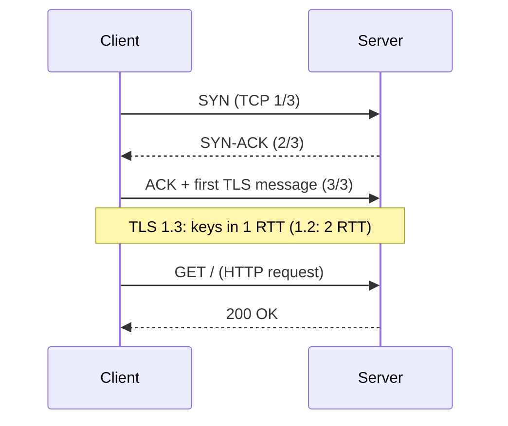
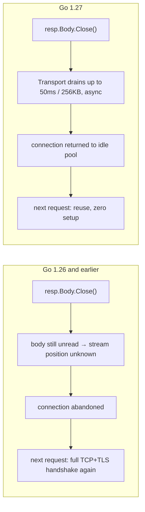

---

title: "Better HTTP/1 connection reuse"
date: 2026-10-15T09:00:00+00:00
author: "Punit Naran"
description: "Go 1.27's net/http change makes 100 sequential HTTP/1 GETs ~5x faster by draining unread response bodies; the mechanics of why an unread body kills connection reuse, and the fix."
tags: ["Go", "Community"]
draft: true

---

100 sequential `http.Get` calls against `index.golang.org`, HTTP/1 only: **710 ms on Go 1.26, 150 ms on Go 1.27**. Same program, same machine, same code — the 5x comes from a behavioral change in `net/http` about what happens when you *don't read a response body*. This is the most-likely-to-quietly-help-you item in the 1.27 release, and it is also a lesson in how HTTP/1 connection reuse actually works.

## What a new HTTP/1 connection really costs

Every HTTP version runs over TCP, usually over TLS. The setup ladder before your first request byte flies:



Count the round trips: **1 RTT** for TCP (the first TLS message piggybacks the final ACK), **1–2 RTT** for TLS (1.3 compresses it to 1), then the request itself. Cross-region, one way is often 50+ ms: ~300 ms can go to *establishing* the connection when the actual response is cheap. The only cure is **reusing** the connection for the next request.

### How reuse works per HTTP version

| Version | Reuse rule | An unread body blocks the next request? |
|---|---|---|
| HTTP/1.0 | Opt-in via `Connection: keep-alive` header | Yes |
| HTTP/1.1 | Persistent **by default**; either side can end it with `Connection: close` | **Yes — this is the gotcha** |
| HTTP/2 | Frames multiplexed over one connection | No — streams are independent |

On HTTP/1 the wire is a single byte stream. Two `GET`s on one connection come back as one concatenated stream of responses. `net/http` can only find where response *n+1* begins after response *n*'s body has been consumed to its exact end (per `Content-Length` or `Transfer-Encoding`). If you never read the body, the transport cannot find the next response's start — and through 1.26, it concluded the connection was done and threw it away.

## The 1.27 change: bounded asynchronous draining

`http.Get` reads only the status line and headers, then hands you a `Response` whose `Body` is still sitting on the wire. If your code does the obvious thing —

```go
// getStatus.go — the canonical shape. On Go 1.27, this is the whole story:
// the Transport drains the unread body (up to 50 ms / 256 KB) so the
// connection goes back into the per-host idle pool and the next Get
// reuses it. On 1.26 and earlier, every call here opens a new TCP+TLS
// connection.
package main

import (
	"fmt"
	"io"
	"net/http"
)

// getStatus sends a GET and returns the status code, reading no body.
func getStatus(url string) (int, error) {
	resp, err := http.Get(url) // uses http.DefaultClient → default Transport
	if err != nil {
		return 0, err
	}
	// defer closes the body. Closing an unread HTTP/1 body is no longer a
	// connection-killer: Go 1.27's Transport drains it in the background.
	defer resp.Body.Close()
	return resp.StatusCode, nil
}

// drainBody is the pre-1.27 manual fix, kept here for reference:
// cap the bytes (256 KB) and the time (50 ms) spent draining, run it
// asynchronously so a slow server cannot stall our request path.
func drainBody(body io.ReadCloser) {
	done := make(chan struct{}, 1)
	go func() {
		io.CopyN(io.Discard, body, 256<<10)
		done <- struct{}{}
	}()
	select {
	case <-done:
	}
	body.Close() // interrupts a stalled io.CopyN: no goroutine leak
}

func main() {
	for i := 0; i < 100; i++ {
		if _, err := getStatus("https://index.golang.org"); err != nil {
			fmt.Println(err)
			return
		}
	}
}
```

1.27 makes the Transport do the whole dance for you, with three judgment calls baked in:

- **Drain is bounded.** Up to **256 KB** and **50 ms** of unread body. A 200 KB response that drains in 20 ms → the connection is *reused* for the next request. A body that trickles for 200 ms → it is given up, the connection goes idle in the pool, and the next request simply opens a new connection. The expensive case (huge body, slow drip) costs no more than one abandoned connection.
- **Draining is skipped when it is provably wasted.** A `Connection: close` response means the server itself is ending the connection; there is nothing to drain.
- **The drain is asynchronous.** It races against subsequent requests: if it wins, the connection is reused; if it loses, the next request proceeds on a new connection and the old one is left idle in the pool for a *different* future request to pick up.

In one diagram, the whole 1.26 → 1.27 change:



The pre-1.27 manual versions of this fix (drain-before-close, capped drain, capped-and-async drain) were real code people wrote — and the blog post walks through why each naive version is subtly wrong: a blocking `io.Copy` to drain a slow body adds 50 ms to every close; an uncapped drain can be *slower* than just opening a new connection; a leaked `go func` drain is a goroutine leak. All of that complexity is now the standard library's problem.

### Measuring the effect

```go
// hcr_bench.go — run on 1.26 vs 1.27 to see the whole post in one number:
// GODEBUG=http2client=0 forces HTTP/1 (the case the post is about).
// 1.26: ~710 ms. 1.27: ~150 ms, on the author's machine.
package main

import (
	"fmt"
	"net/http"
	"time"
)

func main() {
	const n = 100
	start := time.Now()
	for i := 0; i < n; i++ {
		resp, err := http.Get("https://index.golang.org")
		if err != nil {
			panic(err)
		}
		resp.Body.Close() // 1.27: safe; 1.26: this is what leaked the connection
	}
	fmt.Printf("%d sequential HTTP/1 GETs: %v\n", n, time.Since(start).Round(time.Millisecond))
}
```

## Where the old behavior bit

Three shapes of "harmless" code that silently paid the 3-RTT tax per request before 1.27:

1. **Status-only calls.** Your code reads the status code and discards the body. The body (even a small `{"success":true}` JSON) was unread, so every call opened a new connection.
2. **`json.Decoder` against a trailing newline.** The decoder stops at the closing `}`; a single `\n` remains on the stream. One byte from reusable — through 1.26, the whole connection was abandoned.
3. **Partial reads that stop "just short" of the end.** Same root cause: the transport can only split the stream at exact body boundaries.

HTTP/2 never had this problem — multiplexed streams are independent, so one stream's unread body cannot block another stream's requests on the same connection.

> **Note:** The 50 ms / 256 KB values are 1.27 defaults chosen to keep the common case (small JSON) in the reuse path while capping the damage of the pathological one. The blog explicitly flags the behavior as *allowed to evolve*; if you benchmark around it, pin your Go version.

> **Warning:** "Draining" is not a reason to *not* close. `resp.Body` must still be closed on every path — the 1.27 drain is an internal detail of the Transport, and an unbounded leak of *open bodies* (not draining, just forgetting to close) is still a goroutine + file-descriptor leak exactly as it was in 1.26.

## Trade-offs table

| Strategy | Code | Latency cost | Reuse when body unread | 1.27 needed? |
|---|---|---|---|---|
| `defer resp.Body.Close()` only | 1 line | 0 | Yes (Transport drains) | **Yes** |
| Manual capped+async drain (above) | ~15 lines | ≤50 ms in the bad case | Yes | No (the 1.26 workaround) |
| `io.Copy(io.Discard, body)` before close | 1 line | **Unbounded** on a slow server | Yes | No, but fragile |
| HTTP/2 (no drain at all) | 0 lines | 0 | Yes, always | N/A |

## Takeaways

- On Go 1.27, `defer resp.Body.Close()` is the complete, correct answer for connection reuse. The 15-line drain helper is a relic.
- The mechanism to internalize: HTTP/1 reuse dies the instant a body is left unread, because the next response cannot be located in the stream.
- If you are stuck on 1.26: cap the drain (256 KB), cap the time (50 ms), run it async, and close no matter what.

## Next steps

- Re-run your benchmark harness on 1.27 with `GODEBUG=http2client=0` and keep the 1.26 numbers for the changelog entry.
- Audit clients that call `http.Get` in a loop for the three shapes above; the fix is deleting code.
- For HTTP/2 users, confirm no code "helpfully" drains bodies — it is unnecessary there and was the source of a class of misunderstandings the post specifically calls out.
