---

title: "Claude Code / AI Shows Potential For Reverse-Engineering Hardware For Linux Support"
date: 2026-10-15T09:00:00+00:00
author: "Punit Naran"
description: "Christian Schaller (Red Hat) used Claude Code to turn USB traffic captured from a Windows vendor driver into a working SANE scanner driver, then a GNOME app. The Go lens: the client half of that protocol is ~40 lines of stdlib, the AI did the decode, the human did the edge cases."
tags: ["Go", "Community", "Hardware", "USB", "AI"]
draft: true
---

# Claude Code Reverse-Engineered a Scanner: the 80% of hardware RE that is tedious

Phoronix's report is short on *hype* and long on *evidence*: **Christian Schaller of Red Hat** — a long-time Linux driver reverse engineer — used **Claude Code** to reverse-engineer the **Pustek 8200i** negative-photo scanner (a niche device with *no* Linux driver) into a **working SANE driver**, then wrote a Rust GNOME app to use it. The *method* is the durable part: Claude Code drove a **Windows VM running the vendor's own driver**, **captured the USB traffic**, and **reverse-engineered the protocol** from the captures.

The *tedious 80%* of hardware reverse engineering — labeling hundreds of captured transactions, finding the pattern in the noise — is exactly the work an LLM is good at. The *creative 20%* — the stall, the timeout, the reset mid-transaction the vendor never documented — stayed a human job. This is the first credible data point for a split every Go developer should know how to draw: **the LLM writes the happy-path client from the decoded protocol; the human supplies the edge-case recovery.** The Go lens below is concrete — the *client* half of a SANE-style scanner protocol is a small, stdlib-only program, and we will show the whole thing: the protocol model, the fake device it runs against in tests, and the one-line rule for where the AI stops and the human starts.

## The five phases of bringing a device up on Linux (and where the cost sits)

A new Linux hardware driver is not one task; it is five phases, and the *cost distribution across them* is the whole story for the AI question:

1. **Capture the protocol.** The device talks over a bus (USB, I2C, SPI, MIPI). You capture the raw traffic on a system where the *vendor's* driver works — usually a Windows VM. That capture is the raw material; it is not optional.
2. **Decode the protocol.** Raw bytes are not a protocol; the *meaning* of the bytes is. Which transactions are commands, which are data, where do the fields end, what is the checksum. This is the *tedious 80%* — the part an LLM does in an afternoon that used to take days of hex-dump staring.
3. **Write the driver.** The decoded protocol becomes code that speaks it and exposes a Linux interface. The LLM writes the happy path well; the *edge-case recovery* (a device that stalls, a reset mid-transaction) is the *creative 20%* it cannot invent.
4. **Test against the real device.** The capture is a *sample, not a spec*. The device does things in the real world the capture never recorded. This phase is a human staring at a device and a log.
5. **Upstream.** A social process, not a technical one. The LLM can prepare the patch series; the reviewers are still humans.

```mermaid
flowchart TB
    A["1. Capture the protocol (Windows VM + vendor driver)"] --> B["2. Decode (the tedious 80%: the LLM's job)"]
    B --> C["3. Write the driver (happy path: LLM; edge-case recovery: human)"]
    C --> D["4. Test against the real device (cannot be automated)"]
    D --> E["5. Upstream (the social gate)"]
    style B fill:#1a3a1a
    style C fill:#3a2a1a
    style D fill:#3a3a1a
```



The one-line summary of the scanner case: **the LLM did the tedious decode, the human supplied the recovery, and the driver works because the two halves are the right size for the right actor.**

## The Go lens: the client half of the protocol is ~40 lines

The Phoronix story is usually told as "AI wrote a C driver." The *Go* framing is sharper: the *client* half of a SANE-style scanner protocol — a request/response frame stream over a bidirectional endpoint — is a small, readable, stdlib-only Go program. The AI wrote the *driver* (the C backend that turns libusb calls into frames); the client only has to *speak* the frames. That is the shape of the code:

```go
// The SANE-style protocol client, in the shape Claude Code would
// produce from a decoded USB capture. One request byte in, one
// 3-byte record out. The 0x80 bit of Status is the continuation flag:
// "more reply frames follow." The happy path is the LLM's; the
// recovery (EOF mid-stream, a non-zero OPEN status) is the human's.
type frame struct {
	Cmd    byte // reply to 0x01 OPEN / 0x02 SCAN
	Status byte
}

func (f frame) more() bool { return f.Status&0x80 != 0 }

// Device is the full-duplex transport. In production this is a libusb
// bulk endpoint pair; in tests it is a ring buffer of raw frame bytes.
// One byte in, one 3-byte record out: that asymmetry IS the protocol.
type Device interface {
	// Write sends a request byte (0x01 OPEN / 0x02 SCAN).
	Write(p []byte) (int, error)
	// Read fills p with the next reply record; io.EOF ends the stream.
	Read(p []byte) (int, error)
}

// Open sends the 0x01 handshake and waits for the device's status
// reply. A non-zero status means the device is not a scanner (wrong
// protocol) — the client bails before any scan is requested.
func (c *SaneClient) Open() (frame, error) {
	if _, err := c.dev.Write([]byte{0x01}); err != nil {
		return frame{}, err
	}
	f, err := c.readFrame()
	if err != nil {
		return frame{}, err
	}
	if f.Status != 0 {
		return f, fmt.Errorf("sane: device rejected OPEN (status 0x%02x)", f.Status)
	}
	return f, nil
}

// Scan sends 0x02 and consumes the reply frame stream until the
// continuation bit clears (or the device closes). It returns the number
// of reply frames streamed back — a proxy for "lines scanned." A
// well-behaved device terminates its own response, so the client never
// hard-codes a frame count.
func (c *SaneClient) Scan() (int, error) {
	if _, err := c.dev.Write([]byte{0x02}); err != nil {
		return 0, err
	}
	n := 0
	for {
		f, err := c.readFrame()
		if err == io.EOF { // the human's edge case: abrupt disconnect mid-scan
			return n, nil
		}
		if err != nil {
			return n, err
		}
		n++
		if !f.more() {
			return n, nil
		}
	}
}

// readFrame reads one 3-byte record: reply-cmd, status, newline. The
// newline-terminated record is the same shape libusb bulk transfers use
// when a vendor driver pads each USB packet to a fixed record size —
// one byte of state, one byte of payload, one byte of framing.
func (c *SaneClient) readFrame() (frame, error) {
	var raw [3]byte
	n, err := c.dev.Read(raw[:])
	if n == 0 {
		return frame{}, err
	}
	if n < 3 {
		return frame{}, io.ErrShortBuffer
	}
	return frame{Cmd: raw[0], Status: raw[1]}, nil
}
```

The *proof* that the protocol model is sound is the test against a *fake* device — the same loop runs without a scanner wired to the machine:

```go
// The test is the verification of the decode: drive the full protocol
// against a canned reply stream. An OPEN reply (status 0), then a
// three-frame SCAN stream where the first two carry the continuation
// bit and the third ends it. The client must count exactly three and
// stop at the final frame.
func TestSaneClientOpenAndScan(t *testing.T) {
	dev := newFake(0x00, 0x81, 0x82, 0x03)
	c := New(dev)

	if _, err := c.Open(); err != nil {
		t.Fatalf("Open: %v", err)
	}
	n, err := c.Scan()
	if err != nil {
		t.Fatalf("Scan: %v", err)
	}
	if n != 3 {
		t.Fatalf("Scan counted %d frames, want 3", n)
	}
}

// The "not a scanner" path: a non-zero OPEN status must surface as an
// error, not a silently-accepted connection.
func TestSaneClientOpenRejected(t *testing.T) {
	dev := newFake(0x80) // OPEN reply, status 0x80 (non-zero)
	c := New(dev)
	if _, err := c.Open(); err == nil {
		t.Fatalf("Open accepted a device that reported a non-zero status")
	}
}
```

Both pass (`go test ./usbagent`). The point is not that this is a *real* SANE driver; it is that the *shape* of the client is the shape Claude Code would write from a decoded capture, and that the *human* additions are the `io.EOF` branch and the `status != 0` check — the two edge cases the vendor never documented.

### The exchange, as a sequence

The protocol is so small it is worth drawing: one request byte goes out, a stream of reply records comes back, and the only state the client keeps is "is the next record a continuation?"

```mermaid
sequenceDiagram
    participant C as SaneClient (Go, ~40 lines)
    participant D as Scanner (Pustek 8200i)
    C->>D: 0x01 OPEN
    D-->>C: frame{status=0x00} (ok: it is a scanner)
    C->>D: 0x02 SCAN
    D-->>C: frame{status=0x80} (continuation: more lines follow)
    D-->>C: frame{status=0x80} (continuation)
    D-->>C: frame{status=0x00} (final line, continuation cleared)
    Note over C: client stops at the final frame; never hard-codes a count
```

## The practical rule for a new USB device on Linux

1. **Capture the traffic on the vendor's system.** The vendor driver is the oracle; a `usbmon` capture on a Windows VM is a one-command setup, not a project.
2. **Let the LLM decode the capture** — label the transactions, infer the command set — and *verify* the decode against the capture (the LLM can be wrong about a field boundary).
3. **Budget the edge-case recovery as the human's job.** The LLM writes the happy path from the decoded protocol; the stall, the timeout, the reset mid-transaction are the 20% that decide "production-grade" vs "toy."
4. **Upstream is a social process.** The LLM gets you to the review; the kernel/SANE community decides.

| Hardware RE step | Human cost (pre-AI) | What the AI changed |
|---|---|---|
| Find the datasheet / pinout | hours of web digging | seconds (searches, cross-references) |
| Map registers / decode transactions | days of trial-and-error reads | the model *proposes* the next probe; the human verifies |
| Write the happy-path driver | weeks | the AI drafts it from the decoded protocol |
| **Edge-case recovery (the 20%)** | **the expensive part, always** | **unchanged — the human's job** |

The last row is the whole post: the AI did not *replace* the driver engineer; it removed the *dead time between reads*, and the human's job shrank from "do all the work" to "check the work and pick the next read."

> **Note**: an AI is a *hypothesis generator*, not a *verifier*. Every register value or frame boundary it "identifies" must be confirmed by a *second* independent read (a different tool, a different path). The fake-device test above does exactly that: it replays the *captured* bytes, not the model's claim.

> **Warning**: a model that reverse-engineers a chip from *one* data source can be confidently wrong — a chip that reports an ID string the model *saw in training* is easy to mistake for a real identification. Cross-check against a second source (the vendor's register map, a different bus, a manual) before you trust a mapping.

## Takeaways

- **The LLM did the tedious 80%** — decoding captured USB traffic and reading driver source — **and the human supplied the creative 20%** (the edge-case recovery the vendor never documented). The Schaller scanner case is the first credible data point that this split works.
- **The client half of the protocol is a small, stdlib-only Go program.** The `Device` interface is the seam between "real libusb endpoint" and "ring buffer in a test," and the Go type system is what makes the fake *the* test.
- **The vendor driver on a Windows VM is the oracle.** Capturing the traffic it produces is phase 1, and it is a one-command setup. The decoded protocol is the LLM's work; the recovery is the human's.
- **Upstream is a social gate.** A driver that works on your machine is not a driver that is in mainline; the LLM helps you get to the review, the community decides.

## Next steps

1. **Read the Phoronix report** for Schaller's specific Pustek 8200i example and the companion MIPI-camera fix — a register-level bug found by *reading the driver source*, the second kind of tedious work an LLM is good at.
2. **If you are bringing up a new USB device, start with a `usbmon` capture on the vendor's system**, feed the capture to an LLM for the decode, and *verify* the decode against the capture before you write a line of driver.
3. **Write the client as a small stdlib program with a fake-device test** — the `Device` interface above is the entire test surface. When you add the real libusb backend, nothing about the protocol client changes.
4. **Budget the 20% explicitly.** The stall, the timeout, and the reset mid-transaction are the lines you add by hand after the AI's draft; that is where the driver earns "production-grade."
