---

title: "Code That Passes Every Test Can Still Break the Next AI Agent That Touches It"
image: /images/covers/2026-10-15-code-that-passes-every-test-can-still-break-the-next-ai-agen.svg
date: 2026-10-15T09:00:00+00:00
author: "Punit Naran"
description: "The New Stack's reframe of Go in the agent era: the language that wins is the one a non-author can read, fix, and maintain at the lowest cost. The test suite is the floor; the reading cost is the ceiling. The two failure modes a green CI cannot catch, and the rule that makes AI code safe to merge."
tags: ["Go", "Community", "AI", "Testing", "Maintainability"]
draft: false
---

# Code that passes every test can still break the next AI agent that touches it

The New Stack's framing of Go in the agent era is a *reframe*, not a *hype* cycle: **the language that wins the agent era is the one a *non-author* can *read, understand, and fix* at the lowest cost** — and that is the property Go currently has the most of. The counterintuitive part: it is *not* because AI writes Go best (it writes every language competently), but because a *second* agent — or the human on call at 3am — can *read* Go better than it can read the alternatives. The **test suite is the floor** that makes the first agent's work look right; the **reading cost is the ceiling** that decides whether the second agent can maintain it at all.

This post is that reframe, made concrete with Go code: why "passes every test" is not "the next agent can read it," the *four measurable properties* that "readable by a non-author" actually means (and why Go maximizes all four), the *two specific failure modes* a test suite is structurally incapable of catching, and the practical rule for putting AI code into a production codebase.

## The reframe: the agent era measures *reading* cost, not *writing* cost

The old question (the *human* era) was "how fast can I write this?" The new question (the *agent* era) is "how cheap is it for the *next reader* to understand this and fix the one line that is wrong?" The reason the question changed is that the *writing* cost collapsed to near-zero (an LLM writes a function in seconds), but the *reading* cost did not (the next reader still has to reconstruct the meaning from the code).

The asymmetry is structural: an *author* knows the meaning at the moment of writing; a *reader* reconstructs it later. AI agents collapse the *author* side (the LLM is the author); they do not collapse the *reader* side. The consequence for language choice: **the generation axis is a race to the bottom** (every LLM can write every language), **but the maintenance axis is a race to the top** (the language easiest for a non-author to read wins).

```mermaid
flowchart LR
    A["Writing cost (LLM): collapsed to ~0"] --> B["code in the repo"]
    B --> C["Reading cost (next agent / human on call): unchanged, expensive"]
    C --> D["the language that minimizes C wins the agent era"]
    style A fill:#1a3a1a
    style C fill:#3a2a1a
```



## What "readable by a non-author" actually means (four measurable properties)

"Readable" is not a vibe. It is four concrete properties, and Go maximizes all four:

1. **The surface area is small** — few ways to say the same thing. One idiom per concept (one way to loop, one way to express a type constraint, one way to handle errors). A non-author does not have to *disambiguate* between equally-valid idioms.
2. **The errors are readable** — a type error is a one-line explanation, not a two-page template-instantiation trace. A non-author reading a compile error can usually tell what the author *meant* and what the compiler *says* is wrong, without a reference.
3. **The formatting is enforced** — `gofmt` means reading line *N* does not depend on the author's preferences; the layout is the same on every line.
4. **The standard library is the shared vocabulary** — code that uses `net/http`, `crypto/hmac`, `encoding/base32` is code a non-author *can* read, because the standard library is the common language. A codebase that reaches for a third-party framework for everything is one a non-author cannot read without the framework's docs.

The four properties, in one function a non-author can read:

```go
// SumWords counts the total character length of the words in text.
// It is the four readability properties, in one function:
//   1. one idiom: the for-range loop is the only loop,
//   2. a readable error: the compiler says "no words" in one line,
//   3. enforced format: gofmt, so the reader never parses taste,
//   4. standard library: strings.Fields is the shared vocabulary.
// No third-party framework, no metaclass, no decorator — a non-author
// can read this line by line.
func SumWords(text string) (int, error) {
	words := strings.Fields(text)
	if len(words) == 0 {
		return 0, fmt.Errorf("no words in %q", text) // one-line error
	}
	total := 0
	for _, w := range words { // the only loop
		total += len(w)
	}
	return total, nil
}
```

## The two failure modes a test suite *cannot* catch

The New Stack headline is the claim, and there are two specific failure modes a test suite is *structurally* incapable of catching:

**Failure mode 1 — the test covers the happy path; the code has an edge case the test does not.** Agent 1 writes a function and a test for the input it is called with most of the time. Agent 2 (or a human at 3am) reads the function, sees a line that looks wrong for a *rare* input (a nil, an empty slice, a negative index), "fixes" it in a way that changes the *contract* — not just the bug — and the test *still passes* (because it never tested that input). The breakage is silent precisely because the suite is a floor, not a ceiling.

**Failure mode 2 — the code is correct but unreadable, and the reader "fixes" the style and breaks the logic.** Agent 1 writes a function that works but is non-idiomatic (a deeply nested if-chain where a table would be clearer). Agent 2 refactors it to make it readable, and in the refactor changes *one* boundary by a single comparison operator (`<` → `<=`). The test suite passes (it never hits the boundary), and the code is now broken in a way that is *harder* to find than the original bug, because the refactor made it look *more* correct than it is.

Made concrete:

```go
// Agent 1's "working" code: correct, but a nested if-chain that is
// hard to read. The boundary is `req.Priority < s.cap`.
func (s *Scheduler) admit(req Request) bool {
	if req.Priority < s.cap {
		if req.Payload != nil {
			if len(req.Payload) <= s.maxPayload {
				return true
			}
		}
	}
	return false
}

// Agent 2's "readability" refactor: the table is cleaner, and in the
// refactor the boundary silently becomes `<= s.cap` (off-by-one). The
// test suite passes because it never tests the boundary.
type tier struct{ min, max int }

var tiers = []tier{
	{0, s_cap}, // the refactor changed `< cap` to `<= cap` here
}

// The rule that follows: a green suite is a list of things you
// *checked*, not a certificate that nothing is *un-checked.* A pull
// request that adds code without edge-case tests shifts the maintenance
// cost to the next reader. Reject it.
```

### The merge gate, as a flow

The practical fix is not "more tests" in the abstract — it is making the *edge-case test* the merge gate, so the two failure modes above are caught *before* the second reader is paid to find them:

```mermaid
flowchart TB
    A["AI agent writes code + happy-path tests"] --> B{"review: edge-case tests present? (nil, empty, negative, boundary)"}
    B -- "yes" --> C["merge: the tests are the floor, the code is readable"]
    B -- "no (happy-path only)" --> D["reject: the reading cost is shifted to the next reader"]
    C --> E["next agent reads the code: low cost (small surface, readable errors)"]
    D --> A
    style C fill:#1a3a1a
    style D fill:#3a2a1a
```



## What "passes every test" actually buys you

Coverage tells you the *known* paths work. It says nothing about the *unknown* paths — the ones your tests never named. A small, honest map:

| Test outcome | What it proves | What it hides |
|---|---|---|
| All green, 100% line coverage | every *named* line executed | the *unnamed* branches (the `if` nobody tested) |
| All green, property tests pass | the *invariants* hold over a sampled domain | the samples you *didn't* draw (properties are probabilistic) |
| All green, integration green | the *seams you wired up* behave | the *seams you didn't* wire (every untested adapter is a fake) |
| All green, fuzzing clean (10k seeds) | no crash on *the inputs you tried* | the 10,001st input; fuzzing is *negative* evidence |

The last column is the whole post: **a green suite is a list of things you checked, not a certificate that nothing is un-checked.**

> **Note**: the fix is not *more* tests — it is *naming the cases you didn't*. A one-line `if lo > hi { return 0, errors.New("lo > hi") }` at the top of a `clamp` function turns an invisible gap (the `hi < lo` case, which "passes" as `hi` by accident) into a *visible contract*. Coverage measures lines; *naming* measures cases.

> **Warning**: "the tests pass" is not a reason to merge when the *contract* is untested. An agent that can read the code can also *break* it; the only thing standing between a green CI and a broken production is a test that names the case the next agent is about to touch.

## Takeaways

- **The agent era measures *reading* cost, not *writing* cost.** The writing collapsed to near-zero (an LLM writes a function in seconds); the reading did not (the next reader still reconstructs the meaning). The language that minimizes the reading cost wins the agent era.
- **"Passes every test" is a floor, not a ceiling.** A happy-path suite makes the next reader's mistakes silent. The two failure modes a test cannot catch are the *edge case* the test doesn't cover (the first reader "fixes" it and breaks the contract) and the *readability refactor* that changes a boundary by one operator.
- **Go maximizes the four readability properties** (small surface area, readable errors, enforced formatting, standard library as the shared vocabulary). That is why "Google is repositioning Go for AI agents" is a *strategic* move, not a marketing one: the maintenance axis is the axis that decides which languages win.
- **The practical rule is three parts:** the AI agent is a *junior* developer (review is mandatory), the *edge-case test* is the merge gate (a happy-path-only pull request is rejected), and the *language* is the maintainability bet (pick the one a non-author can read).

## Next steps

1. **Read the New Stack article in full** for the specific Go examples the author uses to make the "repositioning" argument. The one-liner is the thesis; the article is the evidence.
2. **If you are putting AI code into a production codebase, make the edge-case test the merge gate** — nil, empty, negative, and boundary inputs, not just the happy path. A pull request that only tests the happy path shifts the reading cost to the next reader. Reject it.
3. **If you are choosing a language for an AI-heavy codebase, weight the reading cost for a non-author heavier than the generation cost.** Go is the current best answer for that reason; the argument is not "Go is the smartest" — it is "Go is the easiest for a non-author to read."
