---

title: "Go Experts: 'I Don't Want to Maintain AI-Generated Code'"
date: 2026-10-15T09:00:00+00:00
author: "Punit Naran"
description: "Two long-time Go programmers on the future of the language in the age of AI agents. The generation cost of AI code is the cheap half; the maintenance cost is the expensive half. Go is the 'boringest' major language — and boring is exactly what a non-author needs to read it. The test suite is the floor; the reading cost is the ceiling."
tags: ["Go", "Community", "AI", "Maintainability", "Engineering"]
draft: false
---

# Go Experts: "I Don't Want to Maintain AI-Generated Code"

The New Stack ran a conversation with **two long-time Go programmers** on the future of their language in the age of AI agents — and the headline is the punchline of the title: **"I don't want to maintain AI-generated code."** The *generation* cost of AI code is the easy half; the *maintenance* cost is the expensive half, and it is the half that decides which languages win the agent era. The conversation is worth reading in full, but the durable lesson is a *systems* one: **a language's fitness for AI agents is measured by how cheap it is for a *human* (or a later agent) to read, understand, and fix the code the first agent wrote — not by how fast the first agent wrote it.**

This post is that lesson, made concrete: why *generation* is cheap and *maintenance* is expensive (the asymmetry is structural, not a phase), what makes a language "maintainable by a non-author" (and why Go is the current best answer — not because it is the smartest, but because it is the *boringest*), why "passes every test" is not "maintainable," and the practical rule for anyone integrating AI code into a production codebase.

## The asymmetry: generation is cheap, maintenance is expensive (and the gap is structural)

The entire argument rests on one observation: **AI code generation has collapsed the cost of *writing* code to near-zero, but it has done nothing to the cost of *understanding* code you did not write.** The first agent writes a function in seconds. The second agent — or the human on call at 3am — has to read that function, understand what it does, and fix the one line that is wrong. The first cost is a *token* cost (cheap, and falling); the second is a *cognitive* cost (expensive, and not falling).

The asymmetry is *structural*, not a phase. The fundamental cost of software is the information gap between *author* and *reader*: an author knows what they meant; a reader has to reconstruct the meaning from the code. AI agents collapse the *author* side (the LLM is the author, and it knows what it meant at the moment it wrote it). They do not collapse the *reader* side (the next reader still reconstructs). That is why the expensive half of AI code is the maintenance half, and why the *language* matters more in the agent era than in the human era.

```mermaid
flowchart LR
    A["Agent 1: writes code (seconds, cheap)"] --> B["code in the repo"]
    B --> C["Agent 2 / human on call: reads + fixes (hours, expensive)"]
    C --> D["the cost is the *reading*, not the *writing*"]
    style A fill:#1a3a1a
    style C fill:#3a2a1a
```



The practical consequence: **the language with the lowest *reading* cost for a non-author wins the agent era on the maintenance axis.** The generation axis is a race to the bottom (every LLM can write every language); the maintenance axis is a race to the top (the language easiest for a non-author to read wins). Go is the current winner of that race for the reasons below.

## Why Go is the "most maintainable by a non-author" language

The experts' argument is *not* "Go is the smartest language" — it is "**Go is the boringest**," and boring is exactly the right property for a non-author to read. The specific properties:

1. **Small, stable surface area.** One way to do most things: no five idioms for a loop, no ten ways to express a type constraint. A non-author reading Go does not have to disambiguate between equally-valid idioms — there is one idiom.
2. **Readable errors.** The type system is simple enough that a type error is a one-line explanation of what is wrong, not a two-page template-instantiation trace. A non-author reading a compile error can usually tell what the author meant and what the compiler says is wrong, without a reference.
3. **The standard library is the idiom.** Code that uses `net/http`, `crypto/hmac`, `strings` is code a non-author can read because the standard library is the shared vocabulary. A codebase that reaches for a third-party framework for everything is one a non-author cannot read without the framework's docs.
4. **Enforced, uniform formatting** (gofmt). A non-author reading Go does not have to parse the author's formatting preferences to find the logic — the formatting is the same on every line. That sounds trivial, but the reading cost of a codebase with inconsistent formatting is real and cumulative.

The one-line summary: **Go is the language a non-author can read because it is the language with the fewest ways to say the same thing.** Boring is the feature. The agent era does not change that calculation; it *increases* the weight of the reading side of the asymmetry, and Go is the best answer to that weight.

## "Passes every test" is not "maintainable" (the test suite is the floor, not the ceiling)

The companion post's headline was "code that passes every test can still break the next AI agent that touches it." That is the second half of the argument, and it is the one that *bites* in practice: a test suite is a *floor* (it proves the code does not do the specific wrong things the tests check), not a *ceiling* (it does not prove the code does the right thing for the cases the tests do not express).

The failure mode that matters in the agent era, made concrete with a real shape: Agent 1 writes a `Parse` function and a test that only checks the happy path. Agent 2 reads the function, sees an unhandled case, "fixes" it in the *caller* (the wrong layer), and now the function's contract is ambiguous — while the test suite, all green, says everything is fine.

```go
// Agent 1: the function. "Empty input means zero, no error" is the
// *intended* contract — but nothing in the code says so.
func Parse(s string) (int, error) {
	if s == "" {
		return 0, nil // "empty is zero, no error"
	}
	n, err := strconv.Atoi(s)
	return n, err
}

// Agent 1's test: the happy path only. Green.
func TestParseHappy(t *testing.T) {
	if n, _ := Parse("42"); n != 42 {
		t.Fatal("expected 42")
	}
}

// Agent 2's "fix": a caller starts hitting "" and the caller's test
// breaks, so Agent 2 adds a guard *at the call site*:
//
//     if s == "" { s = "0" } // now "" and "0" are indistinguishable,
//                            // and a caller that wanted an *error* on
//                            // "" gets 0, silently.
//
// The function's contract is now ambiguous (does "" mean 0, or an
// error?), the fix lives in the wrong layer, and the test suite
// still passes. A green CI, a broken contract.
```

The practical rule that follows: **a test suite is a maintainability asset only to the extent that it covers the edge cases the next reader is likely to misread.** A suite that only covers the happy path is one that makes the next reader's mistakes *silent* — which, for AI-generated code, is exactly the failure mode the first reader is about to pay for.

## The maintenance math: the cost is the *re-derivation* of intent

The objection is not "AI writes bad code." It is "**I cannot *verify* AI code at the speed it is written.**" A small model of the cost, in code:

```go
package main

// The cost of AI code is not the *writing*; it is the *verification*.
// The same function, two eras of maintenance cost:
//
//   Human-authored: the author's mental model IS the documentation.
//   Change cost ~ 1 (you know why it is written this way).
//   AI-authored: the author's mental model *does not exist* (the LLM
//   is gone). Change cost ~ the full re-derivation of *why*, every
//   time a human must reason about the code.
//
// ponytail: this is a *statement*, not a benchmark; the real cost is
// the re-derivation, not the line count.
func maintainComplexity(n int) int {
	return n
}

func main() {
	_ = maintainComplexity(1)
}
```

| Code source | Who can change it safely | Cost of a *correct* change | Cost of a *bug* |
|---|---|---|---|
| The original author | that one person | low (the model is in their head) | low (they know where to look) |
| A successor engineer | a few, after onboarding | medium (read the code, infer intent) | medium (debug the *inferred* intent) |
| **AI-generated code** | **anyone with an AI** | **high (re-derive the intent every time)** | **high (the intent is *unwritten*)** |

The last column is the heart of the objection: when the intent is *unwritten*, a bug is not "the code does X instead of Y" — it is "the code does X instead of *the thing the AI thought you wanted*, which no one can point to."

```mermaid
flowchart TB
    A["AI agent writes code + happy-path tests"] --> B{"human / 2nd-agent review: edge-case tests present?"}
    B -- "yes" --> C["merge: the tests are the contract"]
    B -- "happy-path only" --> D["reject: the maintenance cost is shifted to the next reader"]
    C --> E["codebase: the language's low reading cost keeps it maintainable"]
    D --> A
    style C fill:#1a3a1a
    style D fill:#3a2a1a
```



> **Note**: the senior engineers' objection is *specifically about the maintenance regime*, not the AI itself. "I don't want to maintain AI-generated code" is a *process* statement: the *verification cost* of the code exceeds the *value* of the code. The fix is a *verification regime* — edge-case tests, a small trusted core the AI is allowed to touch — not "never use an AI."

> **Warning**: if you *do* let an AI write code, the maintenance cost is *front-loaded debt* — you pay it every time a human must *reason about* that code. The debt is *compounding*: the more AI-written code in the repo, the harder every *human* change gets, because the ratio of code a human *cannot verify* keeps growing.

## Takeaways

- **The generation cost of AI code is cheap and falling; the maintenance cost is expensive and not falling.** The asymmetry is structural (the author knows the meaning, the reader reconstructs it), and it is why the *language* matters more in the agent era than in the human era.
- **Go is the current best answer for a non-author to read because it is the boringest major language:** small surface area, one idiom per concept, readable type errors, enforced formatting, standard library as the shared vocabulary. Boring is the feature.
- **"Passes every test" is a floor, not a ceiling:** a happy-path suite makes the next reader's mistakes silent. The practical rule is that every AI pull request must come with edge-case tests, and a pull request that does not is rejected.
- **The AI agent is a *junior* developer, not a peer:** its code is reviewed before it is merged, the review *is* the maintenance cost, and it is not optional. The language you pick is the maintainability bet: pick the one a non-author can read.

## Next steps

1. **Read the New Stack conversation in full** — the two Go experts' specific examples of AI-generated code that was *hard to maintain* are the concrete version of the asymmetry argument. The one-liner is the thesis; the conversation is the evidence.
2. **If you are integrating AI code into a production codebase, make the edge-case test the merge gate, not the happy-path test.** A pull request without edge-case tests shifts the maintenance cost to the next reader. Reject it.
3. **If you are choosing a language for an AI-heavy codebase, weight the *reading* cost for a non-author heavier than the generation cost.** Go is the current best answer for that reason; the argument is not "Go is the smartest" — it is "Go is the easiest for a non-author to read."
