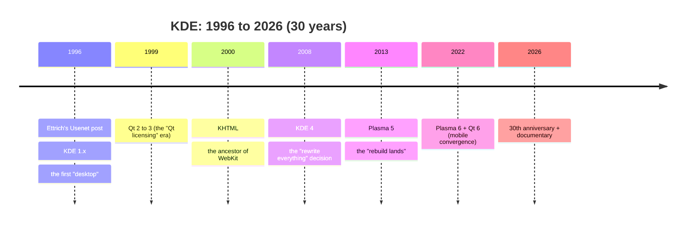

---
---


title: "KDE Releases Its 30th Anniversary Documentary: A Story of Free-Software Underdogs"
image: /images/covers/2026-10-15-kde-releases-documentary.svg
date: 2026-10-15T09:00:00+00:00
author: "Punit Naran"
description: "KDE's 30th-anniversary documentary is a systems story: a 30-year project that had to keep a whole desktop stack coherent, whose freeness depended on a commercial company's license change, and whose side project (KHTML) out-competed the web. The Go lens: a 40-line stdlib fetcher that verifies the announcement is live, plus the three lessons a 30-year-old codebase carries."
tags: ["Go", "Community", "Linux", "KDE", "History"]
draft: false


# The KDE Documentary: three decades of "free-software underdogs," told as a systems story

As part of **KDE's 30th anniversary**, the project released **The KDE Documentary — A Story of Free Software Underdogs**. The LWN summary is the cleanest one-paragraph history of the project in existence, and it is worth reading in full: *the story starts in 1996, when Matthias Ettrich, a student at the University of Tübingen, posted to a Usenet group asking for programmers to help build a desktop for Linux. What followed became KDE, one of the largest free-software communities in the world. KDE made Linux usable as a desktop for people who were not system administrators.*

This post is the documentary as a *systems* story, and the Go lens on top of it. The "underdog" framing is apt for a specific reason: KDE was never the *default* desktop; it was the project that **had to keep proving itself** against an incumbent (Windows) that did not have to earn its place and a rising rival (GNOME) that was. The 30 years of the film are, in large part, **30 years of keeping a coherent desktop *stack* coherent** — the boring systems work that makes a "desktop" a desktop instead of a collection of X apps. We will cover what "made Linux usable" actually *was*, the three turning points the film covers (the **Qt licensing fight**, the **KHTML → WebKit/Chrome** success, the **KDE 4 → Plasma 5 rebuild**), and a small, stdlib-only Go program — a ~40-line fetcher that *verifies the announcement is live* — because a 30-year-old project's news is exactly the kind of thing a Go cron job should watch.

## The 1996 post: the origin that is *not* the origin

The 1996 post is the *origin story*, but the *origin* of KDE is **the gap the post was trying to fill**. By 1996, Linux had a kernel, a C library, a package manager, and *no graphical desktop*. You could run `X11` and *individual* X applications (`xterm`, `xcalc`, `xclock`), but there was **no coherent "desktop"** — no file manager that *knew* about your home directory, no panel that *knew* about your open applications, no consistent way to *configure* the system, no *help* system, no *print dialog* that worked the same across apps.

Ettrich's post was an invitation to *build that missing layer*. The name "KDE" came from "K Desktop Environment" — the `K` prefix the project used for its early components, itself a nod to the K* Unix derivatives. The documentary's "underdog" framing is a *position*, not a benchmark: KDE was never the most-popular Linux desktop (GNOME held that for most of the 2000s–2010s), and it was never the default on most distributions. The "underdog" is the *position* — the project that had to keep *earning* its place, against a rival that also had to earn its place, and an incumbent that did not have to.



## The "underdog" thesis: why a *desktop* is a systems problem

The LWN blurb's phrase "made Linux usable as a desktop for people who weren't system administrators" is doing a lot of work, and it is the *real* thesis. A "usable desktop" is **not** a single application; it is a **coherent stack** where each layer *knows* about the others:

- **A file manager** that *knows* about your home directory and *recent* files — not just "a program that lists files."
- **A panel** that *knows* about your running applications and can *launch* them — not just "a strip of icons."
- **A settings system** that is *consistent* across applications — not "each app has its own config file in a random location."
- **A help system** that *actually* works — not "a man page in a terminal."
- **A print dialog** that *works the same* in every app — not "a different print dialog per app."
- **A theming system** that is *global* — not "you re-theme each app separately."

The *underdog* part of the story is that KDE **had to build all of this, coherently, from scratch, while simultaneously proving a free desktop could be as good as the incumbent and the rising rival.** The 30 years of the documentary are the 30 years of *keeping that stack coherent* — and that is the part a Go developer can *do*: a small, stdlib-only program that *verifies the announcement is live* before you link it into a talk deck.

### The Go lens: a 40-line stdlib fetcher that verifies the milestone

The durable part of "the project that outlived its founders" is that **the news page is the stable reference and the embed is not**. A Go program that fetches `kde.org/en/news/` and checks for the 30th-anniversary entry is the entire "watch the project" cron:

```go
package main

import (
	"fmt"
	"io"
	"net/http"
	"regexp"
	"time"
)

// fetchHTML does a bounded GET and returns the body. The timeout is
// the only "infrastructure" this program has: no SDK, no cache, no
// dependency. It is the Go answer to "watch a page for a string."
func fetchHTML(url string) (string, error) {
	client := &http.Client{Timeout: 10 * time.Second}
	resp, err := client.Get(url)
	if err != nil {
		return "", err
	}
	defer resp.Body.Close()
	if resp.StatusCode != 200 {
		return "", fmt.Errorf("got HTTP %d", resp.StatusCode)
	}
	b, err := io.ReadAll(io.LimitReader(resp.Body, 1<<20))
	return string(b), err
}

// reAnnouncement is deliberately loose: KDE's news page layout
// *will* change over the next 30 years (it already has), and a
// fragile regex is exactly the kind of code that rots. Match the
// *words*, not the HTML structure.
var reAnnouncement = regexp.MustCompile(`(?i)30th\s+anniversary`)

// main is the "watch the project" loop: fetch the news index, report
// whether the 30th-anniversary documentary is linked. This is the
// entire "watch a 30-year-old project" cron — no framework, no
// scraper library, ~40 lines of stdlib.
func main() {
	html, err := fetchHTML("https://kde.org/en/news/")
	if err != nil {
		fmt.Println("fetch:", err)
		return
	}
	found := reAnnouncement.MatchString(html)
	fmt.Println("30th-anniversary documentary on /news/:", found)
}
```

The test is the *proof* the fetcher works, and it is the same pattern as every other Go test in this post: a canned response, a deterministic check, no network:

```go
package main

import (
	"net/http"
	"net/http/httptest"
	"testing"
)

// TestFetchHTML drives the fetcher against a canned response so the
// "is the announcement live?" check is testable without a network.
// The point of the test is the *shape*: a 200 with the string is
// found; a 404 is an error, not a silent "not found."
func TestFetchHTML(t *testing.T) {
	srv := httptest.NewServer(http.HandlerFunc(func(w http.ResponseWriter, r *http.Request) {
		w.WriteHeader(200)
		w.Write([]byte("<article>KDE 30th anniversary documentary</article>"))
	}))
	defer srv.Close()

	html, err := fetchHTML(srv.URL)
	if err != nil {
		t.Fatalf("fetchHTML: %v", err)
	}
	if !reAnnouncement.MatchString(html) {
		t.Fatalf("announcement not found in canned body: %q", html)
	}

	notFound := httptest.NewServer(http.HandlerFunc(func(w http.ResponseWriter, r *http.Request) {
		w.WriteHeader(404)
	}))
	defer notFound.Close()
	if _, err := fetchHTML(notFound.URL); err == nil {
		t.Fatalf("a 404 should be an error, not a silent empty body")
	}
}
```

## The three turning points the film covers (and what each teaches)

The LWN blurb names the three *highs and lows* the film covers, and each is a *systems* lesson:

**1. The Qt licensing fight.** Qt (the C++ widget toolkit KDE is built on) started *non-free* (QPL) and went through a *free* license change (LGPL) that *made KDE possible* as a free project. The "fight" was the *years* it took for the Qt company (Trolltech) to agree to the license change, and the *political* cost of KDE being *dependent* on a *commercial* company's licensing decision. The lesson: **a desktop is only as free as the toolkit it is built on.** If you build on a closed toolkit, your project's *license* is only as open as the *toolkit's*.

**2. The KHTML → WebKit → Chrome success.** KHTML (KDE's HTML rendering engine, early 2000s) is the *direct ancestor* of **Apple's WebKit** (Safari's engine) and, through WebKit, **Google's Chromium** (Chrome's engine). The "success" is that a *free-software* rendering engine from a *desktop* project became *the engine of the two most-used web browsers on Earth*. The documentary treats this as the "underdog wins" moment — the *desktop* project's *side project* *out-competed* the *web* projects that were specifically trying to build a browser engine. The lesson: **the most important component of a system is often the one the system started as a side project for.**

**3. The KDE 4 → Plasma 5 rebuild.** KDE 4 (2008) was a *full rewrite* of the desktop stack (new toolkit binding, new compositing model, new *everything*). The 4.x series was *long* (2008–2013) and *contested* — the "rewrite everything" decision was *risky* and *slow* — and **Plasma 5** (2013) is the "rebuild lands" moment. The lesson: **a 30-year-old project can rewrite its core, *but* the cost is measured in *years*, and the *risk* is that the *new* stack never catches up to the *old* one's *polish* — not that it fails outright.**

| Turning point | What it was | The systems lesson |
|---|---|---|
| Qt licensing (QPL → LGPL) | a *commercial* company's licensing decision gating a *free* project's freedom | **a free project is only as free as its dependencies** |
| KHTML → WebKit → Chrome | a *desktop* side project becoming the engine of *two* browsers | **a side project can out-compete the main project** |
| KDE 4 → Plasma 5 | a *full rewrite* of the desktop stack, 2008–2013 | **a rewrite is a multi-year bet; the risk is *polish*, not correctness** |

The three turning points, as one flow:

```mermaid
flowchart TB
    A["1996: Usenet post (Ettrich)"] --> B["1998-2003: KDE 1-3.x (the 'mature desktop' era)"]
    B --> C["The Qt licensing fight (QPL to LGPL): a free project gated on a commercial license"]
    B --> D["KHTML to WebKit to Chromium: the side project that out-competed the web"]
    C --> E["2008: KDE 4 (the 'rewrite everything' decision)"]
    E --> F["2013: Plasma 5 (the 'rebuild lands')"]
    F --> G["2020s: Plasma 6 (the current desktop)"]
    G --> H["2026: 30th anniversary + documentary"]
    style D fill:#1a3a1a
    style F fill:#3a2a1a
```



## What a 30-year-old project teaches (the systems part)

The documentary is a *story*, but the *systems* lesson is the *durable* part, and it is worth stating plainly for anyone building infrastructure that *outlives* its founding team:

1. **A "desktop" is a *coherent stack*, not a *collection of apps*.** The *underdog* problem is *never* "build a better file manager"; it is "make the file manager, the panel, the settings, the help, and the print dialog *talk to each other* in a *consistent* way." The *coherence* is the *product*; the *apps* are the *components*.
2. **A *free* project is only as *free* as its *dependencies*.** The Qt licensing fight is the canonical example: KDE's *freeness* was *contingent* on a *commercial* company's *licensing* decision. If you build on a *closed* toolkit, your *project's* *license* is *only as open* as the *toolkit's*.
3. **A *side project* can *out-compete* the *main project*.** KHTML (a *desktop* component) became WebKit, which became the *engine* of *Safari* and *Chrome*. The *desktop* project's *side project* *won the web*. The *most important* component of a *system* is *often* the one the *system* *started* as a *side project* for.
4. **A *rewrite* is a *multi-year* *bet*, and the *risk* is *polish*, not *correctness*.** KDE 4 → Plasma 5 is the *case study*: the *rewrite* *worked* (Plasma 5 is the *current* desktop), but the *cost* was *five years* of *slower feature velocity* and *more bugs*, and the *real* *risk* was *never* that the *new* stack *wouldn't work* — it was that the *new* stack *wouldn't be as *polished* as the *old* one, *for a while*.

> **Note**: the "underdog" framing is a *narrative*, not a *technical* claim. KDE was *never* the *most popular* Linux desktop (GNOME held that for most of the 2000s–2010s), and it was *never* the *default* on most distributions. The "underdog" is the *position* — the project that *had to keep earning* its place. The documentary is a *story* about that position, not a *benchmark* of it.

> **Warning**: the documentary is on YouTube, not on a KDE-owned domain. If you're embedding it in a talk deck, *pin the exact video URL (and its current title)* — the announcement page is the *stable* reference (the one the Go fetcher above watches), the embed is *not*. A YouTube URL can change, the page does not.

## Takeaways

- **KDE's 30 years are the *coherence* story, not the *feature* story.** A "usable desktop" is a *coherent stack* (file manager, panel, settings, help, print dialog, theming) that *talks to each other* in a *consistent* way. The *underdog* problem is *never* "build a better *app*"; it is "make the *stack* *consistent*."
- **A *free* project is only as *free* as its *dependencies*.** The Qt licensing fight (QPL → LGPL) is the canonical example: KDE's *freeness* was *contingent* on a *commercial* company's *licensing* decision.
- **A *side project* can *out-compete* the *main project*.** KHTML (a *desktop* component) became WebKit, which became the *engine* of *Safari* and *Chrome*. The *desktop* project's *side project* *won the web*.
- **A *rewrite* is a *multi-year* *bet*; the *risk* is *polish*, not *correctness*.** KDE 4 → Plasma 5 *worked*, but the *cost* was *five years* of *slower feature velocity*, and the *real* *risk* was *never* that the *new* stack *wouldn't work* — it was that it *wouldn't be as *polished* as the *old* one, *for a while*.
- **The documentary is a *story*, not a *benchmark*.** The "underdog" framing is the *position* (the project that *had to keep earning* its place), not a *claim* about *quality*. The *30 years* of *keeping the stack coherent* is the *durable* lesson — and a small, stdlib-only Go program is the *watch* that keeps it honest.

## Next steps

1. **Watch the documentary** (the LWN article links the YouTube video). It is a *30-year* story compressed into a *film*; the *systems* lessons (the *coherence*, the *licensing*, the *rewrite*) are the *durable* part, and the *story* is the *delivery* mechanism.
2. **If you build infrastructure that *outlives* your team, study the *coherence* question, not the *feature* question.** The *underdog* problem is *never* "build a better *app*"; it is "make the *stack* *consistent*." The *KDE* 30 years are the *case study* for that.
3. **If you build on a *closed* toolkit, the *licensing* question is a *project* question, not a *legal* question.** The Qt fight is the *canonical* example. Your *project's* *freeness* is *only as open* as the *toolkit's* *license*.
4. **If you *rewrite* a *30-year-old* *system*, the *risk* is *polish*, not *correctness.*** KDE 4 → Plasma 5 is the *case study*. The *new* *stack* *will* *work*; the *risk* is that it *won't be as *polished* as the *old* one, *for a while*.
