---

title: "LPDDR5 5467 vs. 6400 vs. 7467 MT/s: what the memory speed actually costs a laptop"
date: 2026-10-15T09:00:00+00:00
author: "Punit Naran"
description: "Phoronix benchmarks the Star Labs StarFighter Ultra (Core Ultra 9 285H, 8x8GB LPDDR5-7467) at three memory speeds. The vendor default is 6400, not the rated 7467. The Go lens: a ~60-line stdlib Go microbenchmark is the cheapest 'lab instrument' a laptop with a speed knob in the BIOS can have, and the interesting number is the perf-per-watt ratio, not the raw delta."
tags: ["Go", "Community", "Hardware", "Memory", "Benchmarks"]
draft: true
---

# LPDDR5 5467 vs. 6400 vs. 7467 MT/s: the memory speed is a *power* knob as much as a *speed* knob

Most laptop vendor BIOSes lock the memory to a single speed and treat the question "how fast should the RAM run?" as *not a user question*. **Star Labs** does the opposite: the **StarFighter Ultra** — the machine Phoronix recently reviewed, equipped with an **Intel Core Ultra 9 285H** (Arrow Lake), **8 × 8 GB LPDDR5-7467**, a 1 TB Samsung 990 EVO Plus, and **Intel Xe** integrated graphics — ships a BIOS that *lets you pick the memory speed*, and Phoronix's Michael Larabel *took the bait* and benchmarked **three** of the four available speeds: **LPDDR5-5467**, **LPDDR5-6400**, and **LPDDR5-7467**. The *default* the Star Labs designers chose is **6400**, "in the name of a balanced user experience for power/performance" — and this post is the *quantification* of that trade: how much *performance* do you give up by running 7467-rated memory at 6400, and how much *power* do you save?

The honest answer up front: **the performance delta between 6400 and 7467 is small and highly workload-dependent; the power delta is small too; and the *interesting* number is the *ratio* — how much performance per watt of memory you get at each speed.** The rest is the *why*: what "MT/s" means for LPDDR5, why a laptop's memory speed is a *power* knob as much as a *speed* knob, and how to read the Phoronix numbers without the "faster is always better" reflex. The Go lens is the part that makes this *yours*: a ~60-line stdlib Go program is the cheapest "lab instrument" a laptop with a BIOS speed knob can have, and the output is a table you can paste into a review.

## What "MT/s" means (and what it does *not*)

**MT/s = mega-transfers per second** — the *data rate* of the memory bus, *not* the *clock frequency* of the memory. The two are related by the transfer multiplier of the memory generation:

- **DDR** (double data rate) transfers on *both* edges of the clock → effective rate = 2 × clock.
- **DDR5** runs the data bus at *half* the I/O clock, with 16-bit sub-channels and on-die ECC, so the MT/s number is *not* a simple multiple of the I/O clock — but for *comparing* two LPDDR5 speeds, MT/s is the right unit.
- **LPDDR5** is the *mobile* variant of DDR5: lower voltage (1.05 V core, separate VDD / VDDQ / VPP rails), wider bus (16-bit per channel, two channels on a laptop SoC), on-die ECC by default. The grades (5467, 6400, 7467, 8533) are *the supported data rates*; the underlying I/O clock is derived from them.

The practical consequence for a laptop: **the memory subsystem is the single biggest power consumer after the CPU itself on an integrated-graphics machine**, because the *Xe* iGPU *reads and writes video memory through the same LPDDR5 bus the CPU uses for its main RAM* — there *is* no separate VRAM. Raising the MT/s raises the bus clock *and* the VDD/VDDQ voltage, which raises the *idle and load* power of the memory subsystem in proportion. **That is why Star Labs chose 6400 as the default:** the marginal performance of 7467 is small, and the marginal power is not.

```mermaid
flowchart LR
    A["LPDDR5-7467 (rated, fastest)"] --> B["higher bus clock + higher VDD/VDDQ"]
    C["LPDDR5-6400 (vendor default)"] --> D["moderate clock, moderate voltage"]
    E["LPDDR5-5467 (slowest tested)"] --> F["lowest clock, lowest voltage"]
    B --> G["more perf, more power"]
    D --> H["balanced: the chosen default"]
    F --> I["least perf, least power"]
    style D fill:#1a3a1a
    style B fill:#3a2a1a
    style F fill:#3a3a1a
```



## The three tested speeds, and what the vendor *actually* ships

| Speed (MT/s) | Role in this test | What it means |
|---|---|---|
| **5467** | the *floor* — the slowest of the three tested | the *lowest* *supported* speed; the *power* floor |
| **6400** | **the vendor default** — what the StarFighter Ultra ships with | the *balanced* choice; the designer's answer to "how fast should the RAM run?" |
| **7467** | the *rated* speed of the installed modules (8 × 8 GB) | the *fastest* supported; the *performance* ceiling |

The *key fact* in the Phoronix summary: the *default* is **6400**, *not* 7467. The memory is **7467-rated**, *but* the *BIOS* *runs* it *at* **6400** *by* *default*. *That* *one* *decision* *is* the *whole* *motivation* *for* the *benchmark*: *if* the *vendor* *thinks* *6400* *is* *the* *right* *default*, *how* *much* *performance* *is* *the* *user* *giving* *up* *by* *not* *running* *7467*? *And* *how* *much* *power* *is* *the* *user* *saving*?

### The Go lens: the cheapest "lab instrument" a laptop can have

The Phoronix methodology (same binary, same kernel, same workload at all three speeds, wall power measured with an external meter) has a *Go* shape: a small, static, stdlib-only binary that runs *one streaming-copy trial* and prints the GiB/s. A Go program is the right instrument here for the same reasons Go won the cloud infra layer: a **10 MB static binary, no interpreter to ship, cheap to run at high concurrency, and cheap to read at 3am** when the number looks wrong. The whole thing is ~60 lines:

```go
// Speed is one configurable memory speed from the laptop's BIOS
// options menu (the StarFighter Ultra exposes 5467, 6400, and
// 7467 MT/s — this struct models the menu, not the hardware).
type Speed struct {
	Name    string // "LPDDR5-5467"
	MTPS    int    // 5467 / 6400 / 7467
	Default bool   // Star Labs' factory default (6400, for balance)
}

// bench is one streaming-copy trial: n bytes of src copied into dst
// in chunks, repeated reps times. The chunk size is large (1 MiB)
// because the measurement target is *bandwidth*, not instruction
// latency — small chunks would measure the loop overhead, not the
// memory path.
type bench struct {
	n     int
	reps  int
	chunk int
}
```

````go

// Run executes the trial and returns total copied bytes and wall time.

// Run executes the trial and returns total copied bytes and wall time.
// The copy is a plain copy() into a fresh slice: no cache-warming
// tricks, no alignment — this is a throughput number, not a cache
// study. The slice is kept alive by the return so the compiler
// cannot prove it dead and fold the whole loop away.
func (b bench) Run() (bytes int64, elapsed time.Duration) {
	src := make([]byte, b.n)
	dst := make([]byte, b.n)
	start := time.Now()
	for r := 0; r < b.reps; r++ {
		for off := 0; off < b.n; off += b.chunk {
			end := off + b.chunk
			if end > b.n {
				end = b.n
			}
			copy(dst[off:end], src[off:end])
		}
	}
	elapsed = time.Since(start)
	// Keep the result referenced: the whole point of the trial is
	// that the copy happened, and the GC/compiler must not notice
	// otherwise the whole loop folds away.
	runtime.KeepAlive(dst)
	return int64(b.n * b.reps), elapsed
}

// gbps formats a bytes/sec rate in GiB/s, one decimal — the unit a
// memory review reports in.
func gbps(elapsed time.Duration, bytes int64) float64 {
	return float64(bytes) / (1 << 30) / elapsed.Seconds()
}

// main is the demo: three speeds, one trial each, a pastable table.
// In the real review the trial is the *same* Go program run three
// times, once per BIOS setting — the *only* variable is the memory
// speed, which is exactly what makes the table honest.
func main() {
	var (
		reps = flag.Int("reps", 4, "copies per trial")
		size = flag.Int("size", 1<<30, "bytes per copy (default 1 GiB)")
		out  = flag.String("out", "", "write the table to a file")
	)
	flag.Parse()

	speeds := []Speed{
		{Name: "LPDDR5-5467", MTPS: 5467},
		{Name: "LPDDR5-6400", MTPS: 6400, Default: true},
		{Name: "LPDDR5-7467", MTPS: 7467},
	}

	var rows []string
	rows = append(rows, fmt.Sprintf("%-18s %8s %12s", "Speed", "GiB/s", "Notes"))
	for _, s := range speeds {
		trial := bench{n: *size, reps: *reps, chunk: 1 << 20}
		bytes, elapsed := trial.Run()
		rate := gbps(elapsed, bytes)
		note := ""
		if s.Default {
			note = "factory default"
		}
		rows = append(rows, fmt.Sprintf("%-18s %8.2f %12s", s.Name, rate, note))
	}

	writer := io.Discard
	if *out != "" {
		f, err := os.Create(*out)
		if err != nil {
			fatal(err)
		}
		defer f.Close()
		writer = f
	}
	for _, r := range rows {
		fmt.Fprintln(writer, r)
	}
}

func fatal(err error) {
	fmt.Fprintln(os.Stderr, "membench:", err)
	os.Exit(1)
}
```

The *shape* is the whole lesson: **the trial is the same binary at all three speeds**, so the *only* variable is the memory speed — and the *decision* the table feeds is the *ratio*, `perf(speed) / power(speed)`. If the marginal performance of 7467 is small *and* the marginal power is not, *then* 6400 is the right default, and the vendor's choice is the defensible one. A benchmark that reports only the performance delta is reporting *half* the trade.

> **Note**: the *StarFighter Ultra's* BIOS *letting you pick* the memory speed is the *rare* part of this story. Most laptop BIOSes lock the memory to the JEDEC speed and do not expose a faster or slower option at all. The benchmark is *only* possible because the vendor gave the user the knob. If you are buying a laptop and memory efficiency matters to you, *the BIOS knob is the feature to look for* — not the peak MT/s on the spec sheet.

> **Warning**: **Do not read "6400 default" as "6400 is *better*.*** It is the *vendor's* *default*, chosen for a *balanced* power/performance experience — *not* a *claim* that *7467* *is* *worse*. If *your* *workload* *is* *bandwidth-bound* and you *are* *on* *AC* *power* and do *not* *care* *about* *battery* *life*, *7467* *may* *be* *the* *right* *choice* *for* *you*. *The* *benchmark* *quantifies* *the* *trade*; *it* *does* *not* *make* *the* *choice* *for* *you.*

## How to read the benchmark (without the "faster is always better" reflex)

The Phoronix review runs "a variety of benchmarks … not only for the impact on performance but for the power consumption too," with an **external WattsUp Pro power meter** measuring *total AC wall power* over the course of the benchmarks. That *methodology* is the *right* one, and it is worth stating *why*, because *most* memory-speed benchmarks measure *only* the *performance* *side* *and* *pretend* the *power* *is* *free*:

1. **Performance is *workload-dependent*.** A *memory-bandwidth-bound* *workload* (a *memcpy*-class *test*, a *large* *matrix* *multiply* *that* *streams* *through* *the* *bus) *will* *show* a *meaningful* *delta* *between* *6400* *and* *7467*. A *latency-bound* *workload* (a *small* *cache-resident* *loop) *will* *show* *almost* *none*. *The* *Phoronix* *suite* *mixes* *the* *two*, *which* *is* *why* the *numbers* *are* *the* *numbers* *they* *are* — *not* *a* *single* *"*faster* *is* *X%* *faster*"* *number.*

2. **Power is *measured at the wall*, not estimated.** The *WattsUp* *Pro* *meter* *is* *the* *whole* *point*: the *delta* *between* *5467* *and* *7467* *in* *wall* *power* *is* *the* *real* *cost* *of* *the* *memory* *speed*, *including* *the* *iGPU's* *extra* *draw* *from* *a* *faster* *bus* (the *Xe* *iGPU* *shares* *the* *LPDDR5* *bus). *A* *benchmark* *that* *reports* *only* *the* *performance* *delta* *is* *reporting* *half* *the* *trade.*

3. **The *interesting* *number* *is* *the* *ratio*, *not* *the* *delta.* "You *lose* *X%* *performance* *and* *save* *Y%* *power* *by* *running* *6400* *instead* *of* *7467" *is* *the* *trivial* *reading*. *The* *useful* *number* *is* *"*performance-per-watt* *at* *6400* *vs* *7467*": *if* the *marginal* *performance* *of* *7467* *is* *small* *and* *the* *marginal* *power* *is* *not*, *then* *6400* *is* *the* *right* *default*, *and* *the* *vendor's* *choice* *is* *the* *defensible* *one.*

The benchmark grid, as a flow — the point is that *one* *binary* runs at *every* *speed*, so the *only* *variable* *is* *the* *speed*:

```mermaid
flowchart LR
    subgraph HW["One laptop, three memory configurations"]
        A["5467 MT/s"]
        B["6400 MT/s (vendor default)"]
        C["7467 MT/s (rated)"]
    end
    subgraph TESTS["Same Go binary, same kernel, same workload"]
        D["streaming copy (bandwidth-bound)"]
        E["small-loop (latency-bound)"]
        F["wall power (WattsUp Pro)"]
    end
    A --> D
    B --> D
    C --> D
    A --> E
    B --> E
    C --> E
    D --> F
    style B fill:#1a3a1a
    style F fill:#3a2a1a
```



### The practical takeaway: when *you* should pick *which* speed

| If your use is… | Pick | Why |
|---|---|---|
| **Battery-first** (travel, all-day on the laptop, light workloads) | **5467 or 6400** | the *lowest* *power* *of* the *three*; the *performance* *delta* *from* *6400* *is* *small* *for* *light* *work* |
| **Balanced** (the vendor default; mixed workloads, mixed power) | **6400** | the *defensible* *default*; the *vendor's* *answer* *to* the *trade* |
| **Performance-first** (rendering, video, large matrix work, on AC) | **7467** | the *bandwidth* *ceiling*; *pay* the *power* *for* *the* *extra* *throughput* |

The *one-line* *summary* *of* *the* *Phoronix* *review*: **the *memory* *speed* *is* *a* *power* *knob* *as* *much* *as* *a* *speed* *knob*, *and* *the* *vendor's* *6400* *default* *is* *the* *defensible* *middle* *of* *that* *knob* — *not* *a* *compromise*, *but* *the* *answer* *to* *the* *question* *"*what* *is* *the* *right* *default*?"* *for* *a* *laptop* *that* *has* *to* *run* *on* *battery* *as* *much* *as* *on* *AC.*

## Takeaways

- **MT/s is the *data rate*, not the *clock*, and it is the *right* unit for comparing two LPDDR5 speeds.** The 5467/6400/7467 grades are the supported data rates; the underlying I/O clock is derived from them.
- **On an *integrated-graphics* laptop, the *memory* subsystem is the *second-biggest* power consumer after the CPU itself**, because the iGPU shares the LPDDR5 bus. Raising the MT/s raises the bus clock *and* the VDD/VDDQ voltage, and with them the idle and load power of the whole subsystem.
- **The *Phoronix* methodology is the *point**: an external WattsUp Pro meter measuring *wall* power over the *entire* benchmark run, with the *same* performance suite at all three speeds so the *only* variable is the speed. The *interesting* number is the *performance-per-watt* ratio, not the raw performance delta.
- **The *Go* lens is a *60-line stdlib* binary** that runs one streaming-copy trial and prints the GiB/s — the cheapest "lab instrument" a laptop with a BIOS speed knob can have. The trial is the *same* program at all three speeds, which is exactly what makes the table honest.
- **The *vendor's* *6400* *default* *is* *a* *defensible* *engineering* *answer*, *not* *a* *compromise:** the *marginal* *performance* *of* *7467* *is* *small* *and* *workload-dependent*, *and* *the* *marginal* *power* *is* *not* *zero.* *If* *your* *workload* *is* *bandwidth-bound* *and* *you* *are* *on* *AC*, *7467* *may* *be* *right* *for* *you*; *if* *you* *are* *on* *battery*, *5467/6400* *is.*

## Next steps

1. **Read the full Phoronix review** for the actual numbers across the benchmark suite at each of the three speeds. The *trend* is the point; the specific percentage is *workload-dependent* and therefore *not* a number to memorize.
2. **If you are buying a laptop and memory efficiency matters, look for the *BIOS knob*, not the peak MT/s on the spec sheet.** The StarFighter Ultra's BIOS is the feature; the 7467 rating is the marketing.
3. **If you are running a bandwidth-bound workload on AC power, the *7467* setting is the *performance* choice; if you are on battery, the *5467/6400* setting is the *runtime* choice.** The benchmark gives you the numbers to make that call on your own workload.
4. **Do not extrapolate this one laptop to all laptops.** The StarFighter Ultra is an Arrow Lake machine with an Intel Xe iGPU and 8 × 8 GB LPDDR5. The *trade* is the same *shape* on any integrated-graphics laptop, but the *specific* numbers are *this* machine's numbers.