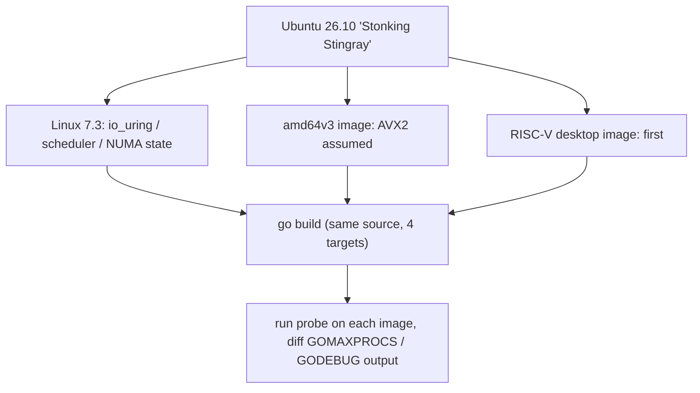
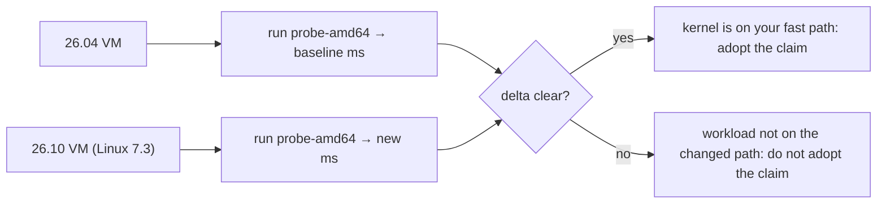

---

title: "Ubuntu 26.10 Released With Linux 7.3 + GNOME 51, Rust Coreutils Migration Complete"
date: 2026-10-15T09:00:00+00:00
author: "Punit Naran"
description: "Ubuntu 26.10 'Stonking Stingray' as the new six-month non-LTS update: Linux 7.3, GNOME 51, the finished Rust coreutils migration, and new RISC-V + amd64v3 images, framed for Go cross-compilers."
tags: ["Go", "Community"]
draft: true

---

Ubuntu 26.10 "Stonking Stingray" is out — the six-month, non-LTS update after 26.04, per [Phoronix](https://www.phoronix.com/news/Ubuntu-26.10-Released): **Linux 7.3** in near-final shape, **GNOME 51**, the **Rust `uutils` coreutils migration completed**, TPM-backed full-disk encryption, and — the line that matters for this site — **RISC-V desktop images and an optimized amd64v3 image** for the first time. This is the "new distro, new targets" post: what a Go toolchain shop does the week a distro lands.

## The release, at kernel level

Linux 7.3 is the headline. Kernel releases are where Go workloads feel a distro bump, because the Go runtime's whole world view is syscalls: thread creation, `epoll`, `io_uring`, signal delivery, cgroup limits. A new kernel changes all of those under your program without a single line of Go changing. The Phoronix benchmarking puts 26.10 ahead of 26.04 in the aggregate, driven by the kernel plus updated components (Mesa 26.2 and friends).

Everything else on the release sheet, in one table:

| Item | 26.04 (Apr 2026) | 26.10 (Oct 2026) |
|---|---|---|
| Kernel | 6.x LTS line | **7.3** (near-final) |
| Desktop | GNOME 4x line | **GNOME 51** (+ all flavors) |
| Coreutils | Rust migration in progress | **Rust uutils: complete** |
| FDE | LUKS | LUKS + **TPM-backed** improvements |
| Speech | — | **Myna** (tech preview) |
| **RISC-V desktop images** | No | **Yes (first)** |
| **amd64v3 image** | No | **Yes** |
| Support window | ~5 years (LTS) | ~6 months (until 27.04) |

## The new target matrix, from the toolchain's seat

Two of those lines change what `go build` can target in a meaningful way:

1. **`GOARCH=riscv64` now has an official desktop image to run on.** The port has been real for years, but a distro that *ships* riscv64 desktops moves it from "CI curiosity" to "supported target" for the people who build for it.
2. **`GOAMD64=v3` as a distribution image.** An image built on the assumption that every amd64 core is AVX2-class is a statement about the fleet. For a Go shop, that statement is a supported build configuration:

```go
// target-probe.go — one source, cross-compiled for the 26.10 matrix.
// Run each binary on its matching image and diff the output.
package main

import (
	"fmt"
	"os"
	"runtime"
)

func main() {
	fmt.Printf("go        : %s\n", "go1.27 (installed from the go.dev tarball)")
	fmt.Printf("GOOS      : %s\n", runtime.GOOS)
	fmt.Printf("GOARCH    : %s\n", runtime.GOARCH)
	fmt.Printf("GOMAXPROCS: %d\n", runtime.GOMAXPROCS(0))
	fmt.Printf("GODEBUG   : %q\n", os.Getenv("GODEBUG"))
	fmt.Printf("NumCPU    : %d\n", runtime.NumCPU())
}
```

```sh
# The 26.10 cross-compile matrix, straight from the toolchain's env vars:
GOOS=linux GOARCH=amd64         go build -o probe-amd64    target-probe.go
GOOS=linux GOARCH=amd64 GOAMD64=v3 go build -o probe-amd64v3 target-probe.go
GOOS=linux GOARCH=arm64         go build -o probe-arm64    target-probe.go
GOOS=linux GOARCH=riscv64       go build -o probe-riscv64  target-probe.go
file probe-*   # confirm: x86-64, x86-64 v3 code, ARM aarch64, RISC-V
```



## Rust coreutils at 100%: what a Go shop should care about

The uutils completion is the release's quiet infrastructure event. The last native coreutils are gone from the default image. Two practical consequences:

- **Shell-out tests.** Any Go test or CI step that greps `--version` output of `cp`, `sort`, `wc` for a glibc-era string string is now testing a Rust binary. Re-baseline those assertions.
- **The CLI language war, with data.** The migration took the whole lifetime of a distro cycle to reach 100%. The lesson for "should our internal CLI be a Go binary or a Rust reimplementation of a POSIX tool" is not speed — it is that the *compatibility long tail* (edge flags, locale quirks, `--` handling) is where multi-year migrations die. A Go tool that does one thing well does not inherit that tail.

## Proving the toolchain on the new distro, end to end

The one thing a Go shop actually *does* the week a distro lands is prove the toolchain runs on it. A fresh 26.10 container is a 30-second exercise, and it is the single most useful thing you can put in a release notes entry:

```sh
# Spin up a clean 26.10, drop the official Go toolchain in, and prove it.
docker run --rm -it ubuntu:26.10 bash -lc '
  set -e
  apt-get update >/dev/null
  apt-get install -y ca-certificates >/dev/null
  curl -fsSL https://go.dev/dl/go1.27.linux-amd64.tar.gz -o /tmp/go.tgz
  tar -C /usr/local -xzf /tmp/go.tgz
  export PATH=/usr/local/go/bin:$PATH
  go version
  # Prove the full target matrix builds from this box:
  GOOS=linux GOARCH=amd64          go build -o /tmp/p_amd64    hello.go && echo "built amd64"
  GOOS=linux GOARCH=amd64 GOAMD64=v3 go build -o /tmp/p_amd64v3 hello.go && echo "built amd64v3"
  GOOS=linux GOARCH=arm64          go build -o /tmp/p_arm64    hello.go && echo "built arm64"
  GOOS=linux GOARCH=riscv64        go build -o /tmp/p_riscv64  hello.go && echo "built riscv64"
'
```

That `for` loop is the entire 26.10 story in executable form: four `GOARCH`/`GOAMD64` targets, all built from one source, on a distro that *ships* the RISC-V and `v3` variants. If the `riscv64` build fails on your machine, that is a GOROOT toolchain issue, not a distro one — and this container test is how you tell them apart.

## The kernel under the runtime, in one measurement

The Linux 7.3 bump is where Go workloads actually feel a distro. The fastest honest measurement is a fixed-workload micro-benchmark run twice — once on a 26.04 VM, once on a 26.10 VM — and the delta *is* the kernel. A 1 MiB int-slice sum (the `distro_probe.go` from the sibling post) is small enough to be stable and real enough to move:

```sh
# Same binary, two kernels:
./probe-amd64   # on the 26.04 VM  →  baseline
./probe-amd64   # on the 26.10 VM  →  kernel delta
```

If the 26.10 number is not clearly better, do not buy the "faster distro" claim — your workload is not on the fast path the new kernel changed (scheduler, `io_uring`, NUMA). Go is the kind of workload where a kernel bump often changes nothing; measuring is how you find out which side of that line you are on.



> **Note:** "Sticks to using GCC 15 by default" is the release's other toolchain note — the Go toolchain is unaffected (it ships its own C toolchain for cgo), but if your cgo code assumes a specific libstdc++/GCC pair from the image, re-check after the bump.

> **Warning:** non-LTS means the 26.10 kernel is supported for roughly six months. Anything you validate on it for performance should be re-validated on 27.04 before it becomes a production claim.

## Takeaways

- 26.10 = the week you add `riscv64` and `GOAMD64=v3` to the build matrix and stop hand-rolling them.
- The kernel is the actual change; the toolchain just has new targets to point at.
- Rust coreutils at 100% is the end-state data point for the "rewrite POSIX tools in Rust/Go" debate — re-baseline any tooling that parses their output.

## Next steps

- Cross-compile the four targets, run each on its 26.10 image, archive the probe output (it doubles as your "toolchain runs on the new distro" evidence).
- If you serve RISC-V users: 26.10 is the first Ubuntu image you can actually hand them.
- For production servers: 26.04 LTS until 27.04; this release is the lab.
