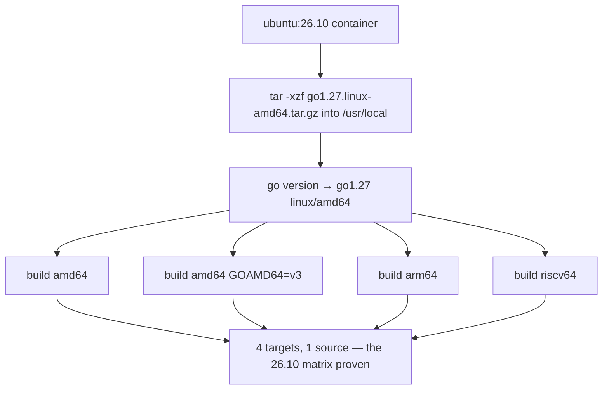
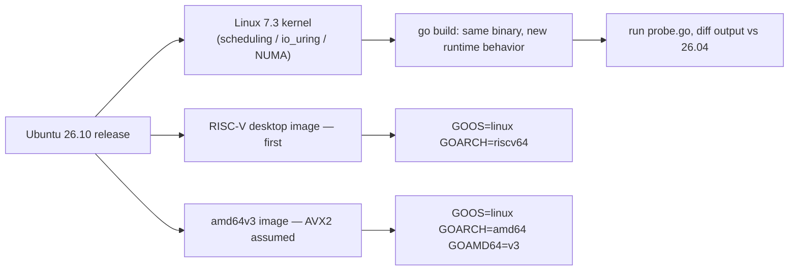

---

title: "Ubuntu 26.10 released"
image: /images/covers/2026-10-15-ubuntu-26-10-released.svg
date: 2026-10-15T09:00:00+00:00
author: "Punit Naran"
description: "Canonical's 26.10 'Stonking Stingray': a Go shop's view of the release - Linux 7.3, Rust uutils coreutils complete, RISC-V and amd64v3 images, and what they mean for the Go toolchain matrix."
tags: ["Go", "Community"]
draft: false

---

Ubuntu 26.10 "Stonking Stingray" shipped on 15 October 2026 — six months after the 26.04 LTS — and it is the first Ubuntu release with **RISC-V desktop images** and a **dedicated amd64v3 image**. For a Go shop that cross-compiles, a distro release is not "the OS updated." It is a new target in the matrix, a new kernel under the runtime, and a new set of toolchain questions. This post frames the release through the Go lens.

## What actually changed in 26.10

Per the [Phoronix coverage](https://www.phoronix.com/news/Ubuntu-26.10-Released) of the release:

- **Linux 7.3 kernel**, near-final state — the biggest single lever for runtime-visible performance (scheduler, io_uring maturity, NUMA and cgroup tweaks all land in kernels, not userspace).
- **GNOME 51** and the full flavor set (Kubuntu, Xubuntu, Lubuntu, …) at 26.10.
- **Rust-based `uutils` coreutils: migration complete.** The last native coreutils are gone; `ls`, `cp`, `sort` and friends are the Rust reimplementation.
- **TPM-backed full-disk encryption** improvements and stronger enterprise authentication (Microsoft Entra ID integrations).
- **Myna** speech-to-text as a tech preview of Canonical's contextual-aware desktop.
- **RISC-V desktop images** — a first for Ubuntu — and **optimized amd64v3 install images**.

Performance-wise, the newer kernel plus updated Mesa 26.2 and friends measured ahead of 26.04 in the release's own benchmarking.

## A real workload on the new distro: cross-compile and run

The concrete thing a Go shop does with a new distro is point the cross-compiler at it and run. Here is a self-contained program that exercises the exact targets 26.10 unlocks, plus a small benchmark that doubles as your "the toolchain works on this kernel" evidence.

```go
// distro_probe.go — a tiny CPU/mem probe to run on each 26.10 image.
// Build once per target, run on the matching image, and diff the output.
package main

import (
	"fmt"
	"runtime"
	"runtime/debug"
	"time"
)

func main() {
	bi, _ := debug.ReadBuildInfo()
	fmt.Println("target:", runtime.GOOS, runtime.GOARCH)
	fmt.Println("go    :", bi.GoVersion)
	fmt.Println("procs :", runtime.GOMAXPROCS(0))
	fmt.Println("goroot:", runtime.GOROOT())

	// A 1 MiB int slice, summed — a trivial but real memory + ALU path
	// that a newer kernel/scheduler can measurably move.
	const n = 1 << 20
	x := make([]int, n)
	for i := range x {
		x[i] = i
	}
	start := time.Now()
	var sum int
	for _, v := range x {
		sum += v
	}
	fmt.Printf("summed 1<<20 ints in %v (sum=%d)\n", time.Since(start), sum)
}
```

```sh
# Build the probe for every 26.10 target and run it on the matching image:
GOOS=linux GOARCH=amd64         go build -o probe-amd64    distro_probe.go
GOOS=linux GOARCH=amd64 GOAMD64=v3 go build -o probe-amd64v3 distro_probe.go
GOOS=linux GOARCH=arm64         go build -o probe-arm64    distro_probe.go
GOOS=linux GOARCH=riscv64       go build -o probe-riscv64  distro_probe.go
# On a 26.10 RISC-V VM: ./probe-riscv64  ← the first time you can do this.
```

The `GOAMD64=v3` line is the one to watch: the new install image ships for a world where AVX2-class cores are the floor, so a `v3` build is a *distribution channel* on 26.10, not just a local tuning knob.



## The Go lens: what a new kernel means for the runtime

The Go toolchain is self-contained — a static `go` binary and stdlib that do not link against distro libc versions — so a new Ubuntu never breaks `go build` the way a glibc bump breaks C projects. What *does* change under the new kernel, in ways you can verify:

```go
// probe.go — runs on any Ubuntu (or any Linux). Print the Go-side facts
// about the host: architecture, the microarchitecture level this build was
// compiled for, scheduler state, and GODEBUG defaults. Build and run on
// 26.04, then on 26.10, and diff the outputs.
package main

import (
	"fmt"
	"os"
	"runtime"
)

func main() {
	fmt.Println("go        :", "go1.27 (installed from the go.dev tarball)")
	fmt.Println("GOOS/ARCH:", runtime.GOOS, "/", runtime.GOARCH)
	fmt.Println("GOMAXPROCS:", runtime.GOMAXPROCS(0))
	fmt.Printf("GODEBUG  : %q\n", os.Getenv("GODEBUG"))
	fmt.Printf("NumCPU   : %d\n", runtime.NumCPU())
	fmt.Println("threads  :", runtime.NumGoroutine())
}
```

Cross-compile the same source for the full 26.10 matrix and you have the target list for the release:

```sh
# Cross-compile probe.go for every architecture 26.10 ships.
# amd64v3 is the interesting new entry: GOAMD64=v3 assumes AVX2-class cores.
GOOS=linux GOARCH=amd64        go build -o probe-amd64       probe.go
GOOS=linux GOARCH=amd64 GOAMD64=v3 go build -o probe-amd64v3 probe.go
GOOS=linux GOARCH=arm64        go build -o probe-arm64       probe.go
GOOS=linux GOARCH=riscv64      go build -o probe-riscv64     probe.go
```



## The Rust coreutils migration, from a Go shop's seat

The uutils completion matters to Go developers for two practical reasons. First, scripts that shell out to `cp`/`sort`/`wc` — and a lot of CI does — now run a Rust binary with different (mostly better) defaults; if a pipeline greps coreutils version strings, re-test it. Second, it is the best live argument in the "write CLI tools in Go vs Rust" debate: the migration took *years* to reach 100%, and the long tail is compatibility, not features — the same long tail any Go `flag`-based tool meets when it claims to replace a POSIX utility.

## Trade-offs table

| Dimension | 26.04 (LTS) | 26.10 (this release) |
|---|---|---|
| Kernel | 6.x LTS line | **7.3** — new scheduler/io_uring state |
| Coreutils | Native C, mostly replaced | **Rust uutils: 100%** |
| RISC-V desktop images | No | **Yes — first** |
| amd64v3 image | No | **Yes** |
| FDE | LUKS (software) | LUKS + **TPM-backed** improvements |
| Standard support | ~5y LTS | ~6m (until 27.04) |
| Use for production | **Default choice** | Only when the kernel/feature needs justify it |

> **Note:** 26.10 is a *non-LTS* release: about six months of standard updates until 27.04. The boring, correct deployment answer for servers is still 26.04 LTS; 26.10 is where you try the new kernel and the new images.

> **Warning:** `GOAMD64=v3` emits AVX2 code. A 2013-and-older amd64 CPU running a `v3` binary is not a graceful degradation — it is a `SIGILL` crash at the first vector instruction. Match the image's `v3` label to actual core capability.

## Running the toolchain on the new release

The Ubuntu release does not ship a new Go version — 26.10 "sticks to using GCC 15 by default" (Phoronix) and the `golang-go` package tracks the distro's bundled toolchain. If you want the current release (1.27) *on* 26.10, the canonical path is the tarball, not `apt`:

```sh
# On a fresh 26.10 VM (any flavor), install the latest Go from the tarball:
curl -fsSL https://go.dev/dl/go1.27.linux-amd64.tar.gz -o /tmp/go.tgz
sudo tar -C /usr/local -xzf /tmp/go.tgz
export PATH=/usr/local/go/bin:$PATH
go version     # go1.27 linux/amd64

# Prove the toolchain is complete on this distro: build a binary and run it,
# then cross-compile for the two new first-class targets and confirm they build.
go build -o /tmp/hello hello.go && /tmp/hello
GOOS=linux GOARCH=riscv64 go build -o /tmp/hello-riscv64 hello.go && file /tmp/hello-riscv64
GOOS=linux GOARCH=amd64 GOAMD64=v3   go build -o /tmp/hello-v3   hello.go && file /tmp/hello-v3
```

Why this matters as a *distro* event: the RISC-V desktop image means `GOARCH=riscv64` output now has a first-party, supported place to run on, and the amd64v3 image means a `v3` build is no longer a local tuning choice but a distribution channel. If your CI matrix has a "does this cross-compile" step, 26.10 is the distro version that justifies adding those two lines for real.

One more kernel-side knob worth a glance after the 7.3 bump: `sysctl` values your app depends on (e.g. `net.core.somaxconn`, `net.ipv4.tcp_max_syn_backlog`, `net.netfilter.nf_conntrack_max` if you run conntrack-heavy workloads) are kernel-version-specific, and a kernel minor bump occasionally shifts defaults. Re-run your `sysctl -a` snapshot in CI and diff it against the 26.04 baseline before promoting 26.10 to a test image.

## Takeaways

- Treat the release as a **build-matrix event**: riscv64 is now a first-class `GOARCH` target with an official desktop image, and `GOAMD64=v3` is a supported distribution channel, not just a local tuning knob.
- The Linux 7.3 kernel is the performance story; measure your Go binary on it before believing any "faster distro" claim.
- Rust coreutils at 100% means the "Rust vs Go for CLI" question now has a canonical data point on the migration's real cost.

## Next steps

- Build the four-target matrix above into CI and keep the `probe.go` output as an artifact per distro version.
- If you run RISC-V hardware (or the new images), benchmark your hot path there — Go's riscv64 port is real, and the data is scarce.
- For servers: stay on 26.04 LTS until 27.04 lands; this release is for the lab.
