---


title: "Vendor hooks in the Android kernel: the Go way of thinking about a kernel extension point"
image: /images/covers/2026-10-15-vendor-hooks-in-the-android-kernel.svg
date: 2026-10-15T09:00:00+00:00
author: "Punit Naran"
description: "At the 2026 Linux Plumbers Conference, Todd Kjos (Google) ran the Android-track session on vendor hooks — the mechanism that lets phone vendors keep out-of-tree kernel changes close to mainline without a full fork. The Go lens: a vendor hook is a one-branch indirection, a named call point, and a small registration function. That is an *idiom* — and Go has a perfectly portable 40-line model of it (a function-pointer table, a registration, a call-site check) you can compile, run, and extend on any platform. The kernel is a fork, the Go model is a function pointer."
tags: ["Go", "Community", "Linux", "Android", "Kernel", "LPC"]
draft: false


# Vendor hooks in the Android kernel: the Go way of thinking about a kernel extension point

At the **2026 Linux Plumbers Conference**, **Todd Kjos (Google)** ran a fast-paced session in the Android track on **vendor hooks** — the mechanism that lets phone vendors keep their *out-of-tree* kernel changes *close to* mainline *without* a full fork. The *shape* of the mechanism is simple enough to fit in a paragraph: a vendor hook is **a small, named call point in the mainline kernel** that **a vendor module *fills* with vendor-specific behavior at init time**, and the mainline code **checks one pointer per call site and falls back to the default if the pointer is unset.** Everything interesting about vendor hooks is that this is *not* a callback list, *not* a plugin system, *not* a hook *framework* — it is *one* *checked* *branch* *and* *one* *registration* *function.*

This post is the *Go* *lens* *on* *that* *mechanism: *the* *hook* *is* *an* *idiom,* *and* *Go* *has* *a* *portable* *40-line* *model* *of* *it* (a *function-pointer* *table*, *a* *registration,* *a* *call-site* *check) *that* *compiles* *and* *runs* *on* *any* *platform.* *The* *kernel* *is* *a* *fork;* *the* *Go* *model* *is* *a* *function* *pointer.* *The* *same* *design* *tension* — *vendor* *needs* *vs* *mainline* *purity* — *resolves* *the* *same* *way* *in* *both* *languages: *a* *named* *call* *point,* *a* *registration,* *and* *a* *one-branch* *indirection* *at* *the* *call* *site.*

## The mechanism, in one paragraph (and why it is *not* a callback list)

The core problem is simple to state: **the mainline kernel is a *shared* resource, and vendors need *private* behavior in it.** Without a mechanism, the *only* way for a vendor to add a private behavior to a shared kernel is to **fork** the kernel (a vendor kernel tree that diverges from mainline and is rebuilt against every mainline release — the "kernel fork debt" that ate Android for a decade). The *generic kernel image* (GKI, introduced around Android 10 / kernel 5.4) was the big win: the *vendor* kernel became a set of *modules* loaded on top of a mainline-based *base* kernel. *But* GKI is *not* a cure for all out-of-tree behavior: the vendor still has to implement board-specific and power-specific behaviors *somewhere*, and the vendor hooks are that somewhere.

The key property of a vendor hook is that **the mainline code only knows the *hook* *interface*, not the *implementation*.** A new module can add a *device*; it *cannot* change how an *existing* device behaves mid-stream. The hook is the *only* mechanism that lets vendor code *intercept* core code — and the "no vendor present" fast path is a *single NULL test*, so the check costs nothing.

```mermaid
flowchart LR
    subgraph mainline["mainline kernel (shared, in-tree)"]
        A["call site: one checked branch"]
        B["NULL = mainline default"]
    end
    subgraph vendor["vendor kernel tree (out-of-tree)"]
        C["module_init: register the hook (one line)"]
        D["hook implementation: vendor behavior"]
    end
    A -->|if hook set| D
    A -->|if NULL| B
    C -->|fills in| D
    style A fill:#1a3a1a
    style C fill:#3a2a1a
```



The whole trick is that **the hook is *registered at module load* and *checked at the call site* — nothing in the core kernel is recompiled.** The vendor module is a *thin* layer over the base kernel; the mainline code is *unchanged* by the presence of the vendor module. It just calls a function pointer that is set *or not.*

## The Go model: a 40-line portable implementation of the mechanism

The *shape* of a vendor hook — a named call point, a vendor implementation, a mainline call site with a one-branch check — is an *idiom* that Go models *directly*. The `vendor_hooks.h` C header is a function-pointer struct; the Go equivalent is a `struct` of `func` fields, a `Register` method that fills it, and a call site that checks the pointer. The *only* difference is that Go has no module init — registration is a normal function call, and the "module" is a `package` that calls `Register` from a `func init()`.

```go
// vendorHook is the Go model of the Android kernel's vendor_hooks.h:
// a struct of function pointers the *vendor* fills in, and a *mainline*
// call site that checks one pointer per site and falls back to the
// default if it is unset. The 0x00 == "no vendor" contract is exactly
// the kernel's: a NULL pointer is the fast path, and the fast path
// costs nothing.
//
// This is the *shape*, not the exact kernel API — the real vendor_hooks.h
// has a different registration mechanism (Kconfig + module init), but the
// *contract* is the same: a named hook, a vendor implementation, a
// mainline call site.
package main

import "fmt"

// vendorHooks is the mainline hook table. The mainline code does not
// know *what* the hooks do — it only knows *that* they exist and *when*
// to call them. A nil field means "no vendor cares about this one".
type vendorHooks struct {
	powerPolicy  func(state int) int
	thermalThrot func(cpu, temp int)
	memTune      func(channel int) int
}

// mainline is the kernel core. It holds the *only* reference to the hook
// table. mainline never #includes the vendor package; it only sees the
// function pointers the vendor module fills in at init time.
var mainline = &vendorHooks{}

// Register is the "module_init": the vendor module calls it once at init,
// filling the hooks it cares about. The mainline code is *unchanged* by
// this call — it just now sees non-nil pointers.
func (h *vendorHooks) Register(power func(int) int, thermal func(int, int), mem func(int) int) {
	h.powerPolicy = power
	h.thermalThrot = thermal
	h.memTune = mem
}

// The mainline call site: call the hook if it is set, else do the
// mainline default. This is the *entire* "hook" mechanism — one branch.
func (h *vendorHooks) powerEvent(state int) int {
	if h.powerPolicy != nil {
		return h.powerPolicy(state) // vendor path: one indirect call
	}
	return 0 // mainline default: no special power policy
}

func (h *vendorHooks) thermalEvent(cpu, temp int) {
	if h.thermalThrot != nil {
		h.thermalThrot(cpu, temp)
		return
	}
	// mainline default: no throttling (server-style, fan-cooled)
}

func (h *vendorHooks) memEvent(channel int) int {
	if h.memTune != nil {
		return h.memTune(channel)
	}
	return 0 // mainline default: no memory-controller tuning
}
```

````go

// The vendor side: a 'module' that registers its hooks

// The vendor side: a "module" that registers its hooks and implements
// them with vendor-specific behavior. The mainline code is *unchanged*
// by the presence of this package — it just calls a function pointer
// that is set or not.
type vendorModule struct {
	name string
}

func (m *vendorModule) init() {
	mainline.Register(
		func(state int) int {
			// Vendor power policy: the phone's power rail is different
			// from a server's, so the vendor tunes the policy here.
			fmt.Printf("vendor %q: power state %d\n", m.name, state)
			return state
		},
		func(cpu, temp int) {
			// Vendor thermal: the phone has *no* fan, so the vendor
			// throttles at a lower threshold than a server would.
			fmt.Printf("vendor %q: throttling cpu %d at %dC\n", m.name, cpu, temp)
		},
		nil, // this vendor does not care about memory tuning
	)
}

func main() {
	// The vendor module registers its hooks at "module load".
	v := &vendorModule{name: "starfighter-ultra"}
	v.init()

	// The mainline code path: the one-branch check, end to end.
	fmt.Println("power:", mainline.powerEvent(1))     // vendor path
	mainline.thermalEvent(0, 45)                        // vendor path
	fmt.Println("mem:", mainline.memEvent(0))          // mainline default (nil)

	// The "no vendor" case: a fresh mainline (no vendor registered) is
	// the fast path — every check is a nil test, no indirect call.
	fresh := &vendorHooks{}
	fmt.Println("fresh power:", fresh.powerEvent(1))  // mainline default
}
```

The *shape* is the whole lesson: **one `func` field per hook, one `Register` call at "module load", one `if` at each call site.** The *cost* of the "no vendor" case is a single nil test — *nothing* else. The *cost* of the "vendor present" case is one indirect call. *That* is the entire vendor-hook mechanism, and it is *identical* in Go and in C.

## Why this is a *Go* *post* *and* *not* *a* *C* *post

The kernel is C. *But* *the* *mechanism* *is* *a* *design* *pattern,* *and* *Go* *is* *the* *language* *that* *makes* *the* *pattern* *legible* *at* *the* *call* *site:*

- **The *one-branch* *check* *is* *a* *Go* *idiom.** *Go's* *`if* *p* *!=* *nil*` *is* *the* *idiom* *for* *a* *"call* *if* *set"* *pointer;* *C* *does* *the* *same* *thing* *with* *`if* *(p)*` *but* *the* *Go* *form* *is* *the* *one* *the* *reader* *recognizes* *immediately.* *The* *mainline* *call* *site* *is* *one* *line* *of* *Go,* *not* *a* *macro.*

- **The* *registration* *is* *a* *function* *call,** *not* *a* *`module_init` *attribute.* *Go* *has* *no* *module* *system; *the* *`func* *init()` *is* *the* *registration.* *The* *vendor* *package* *is* *imported* *for* *the* *side* *effect* *of* *registering* *the* *hook* — *the* *same* *shape* *as* *a* *C* *module's* *`module_init`, *only* *without* *the* *`__attribute__((constructor))` *ceremony.*

- **The* *fallback* *is* *a* *return,** *not* *a* *`goto* *default`.* *Go's* *`if* *p* *!=* *nil* { return p() }` *with* *a* *fall-through* *default* *is* *the* *idiom* *for* *a* *hook* *with* *a* *default.* *The* *C* *version* *is* *the* *same* *logic* *with* *a* *`else` *and* *a* *call* *to* *the* *default* *function* — *the* *Go* *version* *is* *the* *one* *you* *can* *read* *in* *the* *review* *without* *a* *C* *refresher.*

> **Note**: The Go model is a *teaching* model of the mechanism, not the kernel API. The *real* `vendor_hooks.h` uses a Kconfig option (`CONFIG_VENDOR_HOOKS`) and a `module_init` registration; the Go `vendorHooks` struct is a *portable* *rendering* of the *same* *contract* (named hook, vendor impl, one-branch call site) so it compiles and runs anywhere — including on a phone.

> **Warning**: A hook is a *one-way door*. Once vendor code is registered at a core call site, the core code can no longer reason about what happens there — you have *traded kernel maintainability for vendor flexibility*. The Go model has the same property: if the `Register` call happens *after* a `powerEvent` call, the *first* call took the mainline path and the *second* took the vendor path. The *ordering* of registration vs. first use is the *entire* *safety* *question*, and it is *the* *governance* *question* *the* *LPC* *session* *was* *about.*

## The governance question: who adds a hook, and when is it promoted?

The LPC session's *durable* question is not the *mechanism* (that is the one-paragraph above) — it is the *governance:*

- **Who adds a hook?** The *default* posture is that a hook is a *temporary* measure: the ideal end state is that the vendor behavior is *upstreamed* as a *real* mainline feature (with the hook *deleted*), and the hook is a *bridge* between "the vendor has this behavior" and "mainline now has this behavior."
- **When is a hook promoted?** A hook that lives for *years* is either a hook that *should* have been upstreamed, or a hook that mainline *genuinely* does not want to take on (in which case it is a *permanent* vendor hook, and the cost is paid *forever*).
- **The *cost* is *asymmetric:*** the *vendor* *pays* *the* *implementation* *cost* *once* *and* *forever; *mainline* *pays* *the* *maintenance* *cost* *of* *the* *hook* *site* *on* *every* *release* *forever.* *That* *asymmetry* *is* *why* *the* *LPC* *session* *is* *a* *governance* *session,* *not* *a* *technical* *one.*

### The three approaches, compared

| Approach | Core kernel rebuilt? | Can be removed? | What it is good for |
|---|---|---|---|
| Built-in (in-tree) | yes | no (until the next release) | features *everyone* wants |
| Loadable module | no | yes (uninstall) | self-contained *new* features |
| **Vendor hook** | no | yes (the module goes, the hook goes) | *changes to existing core behavior* that can't be a new module |

The *last* *row* *is* *the* *whole* *point: *a* *new* *module* *can* *add* *a* *device; *it* *cannot* *change* *how* *an* *existing* *device* *behaves* *mid-stream.* *The* *hook* *is* *the* *only* *mechanism* *that* *lets* *vendor* *code* *intercept* *core* *code.*

## The mechanism, drawn out

```mermaid
sequenceDiagram
    participant V as Vendor module (out-of-tree)
    participant K as Kernel core (in-tree)
    participant H as Call site with a vendor hook
    V-->>K: module_init: register the hook (one line, no recompile)
    K-->>H: later: a code path checks "any hook registered?"
    alt a hook is registered
        H-->>V: call the vendor function (one indirect call)
    else no vendor present
        H--->>K: the mainline path (the check is a single NULL test)
    end
```

The *sequence* *is* *the* *mechanism: *registration* *at* *init,* *a* *one-branch* *check* *at* *the* *call* *site,* *and* *the* *vendor* *function* *called* *only* *if* *it* *is* *set.* *Nothing* *in* *the* *core* *is* *recompiled;* *the* *vendor* *module* *is* *a* *thin* *layer* *over* *the* *base* *kernel.*

## Takeaways

- **A vendor hook is a *named, mainline-defined call point* that a vendor module *fills* with vendor-specific behavior.** The mainline code only knows the *hook interface*, not the *implementation.* The vendor code is *out-of-tree* (it lives in the vendor kernel tree), *but* the mainline kernel does *not* fork for it.
- **The mechanism is a *one-branch* indirection: a function pointer, a registration, and a `if p != nil` at the call site.** The "no vendor present" fast path is a single NULL test — *nothing* else. The Go model of the mechanism is *portable*, *compilable*, and *identical* in shape to the C.
- **The *governance* *question* *is* *the* *durable* *one:** *who* *adds* *a* *hook,* *and* *when* *does* *a* *hook* *get* *promoted* *to* *a* *real* *mainline* *feature?* *The* *ideal* *end* *state* *is* *upstreaming* (the *hook* *is* *deleted); *a* *hook* *that* *lives* *for* *years* *is* *a* *permanent* *divergence* *with* *a* *maintenance* *cost* *paid* *by* *mainline* *forever.*
- **The *generic* *kernel* *image* *is* *the* *context,* *not* *the* *cure:** *GKI* *let* *the* *vendor* *kernel* *be* *a* *thin* *module* *layer* *over* *a* *mainline* *base,* *but* *the* *vendor* *still* *has* *to* *implement* *board/power/thermal* *behavior* *somewhere.* *The* *vendor* *hooks* *are* *that* *somewhere.*

## Next steps

1. **Read the LWN article** (the full LPC session writeup) for the *specific* hooks discussed and the *governance* *proposal* Todd Kjos made. The *mechanism* *is* *the* *one-liner;* *the* *governance* *is* *the* *real* *story.*
2. **If you maintain a vendor kernel tree, inventory your out-of-tree changes and classify them as "hook candidates" vs. "fork-only."** *A* *change* *that* *can* *be* *a* *hook* *should* *be* *a* *hook* *request,* *not* *a* *fork* *patch.*
3. **Model the mechanism in Go** (the 40-line `vendorHooks` struct above) to *teach* the pattern to a team that does not read C. The *shape* is identical; the *legibility* is better.
4. **Watch for hook *promotions:*** *a* *hook* *that* *gets* *upstreamed* *as* *a* *real* *mainline* *feature* *is* *the* *success* *case;* *a* *hook* *that* *lives* *forever* *is* *the* *cost* *case.* *The* *LPC* *session* *is* *where* *that* *distinction* *is* *drawn.*
