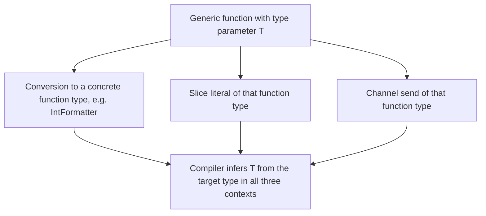
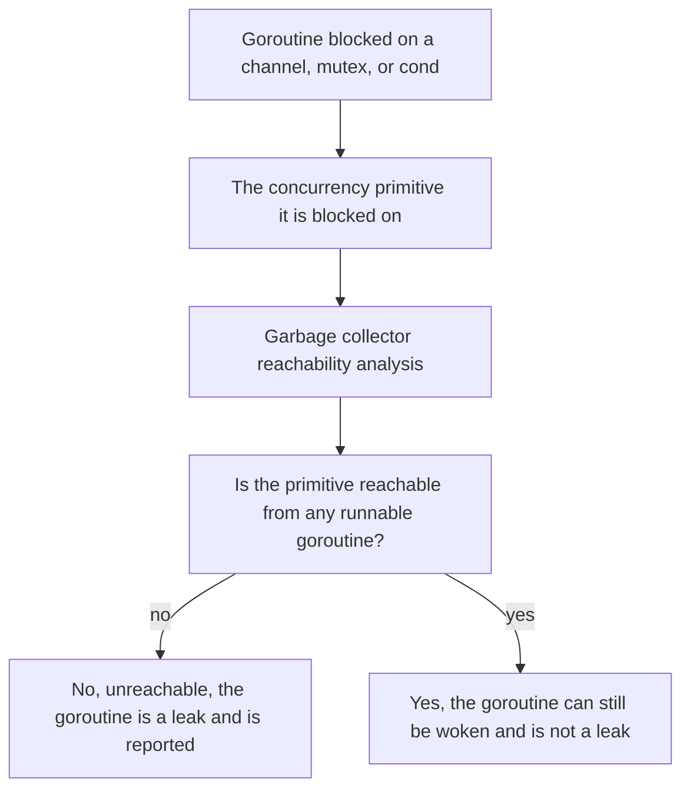

Go 1.27 was released in August 2026, and it is one of the larger releases in the language's history: **generic methods** finally exist, the standard library gained a **`uuid` package**, a new **post-quantum** signature scheme made it into `crypto/tls` and `crypto/x509`, a long-anticipated **`encoding/json/v2`** package landed (and quietly became the implementation behind the v1 `encoding/json`), the runtime got **size-specialized memory allocation** and a **generally-available goroutine-leak profile**, and the toolchain gained a batch of new `go fix` modernizers.

For a Go developer, the value of a release like this is not the list — it is knowing which of the items on the list change the way you write code *today*. That is the split this post makes: the language and standard-library changes first, with code for every one of them, then the toolchain/runtime changes, each with the exact command or flag that matters.

---

## Generic methods: the language's last big missing piece

The single most requested language feature for over a decade is now in: **methods can declare their own type parameters**. Before 1.27, generics existed at the function level only, which forced a common pattern — writing a *function* where the code *obviously* belongs as a method.

`math/rand/v2` is the canonical example. Before 1.27 the `Rand` type needed a separate method for every integer type:

```go
// Prior to Go 1.27: one method per type.
func (r *Rand) Int32N(n int32) int32
func (r *Rand) Int64N(n int64) int64
func (r *Rand) IntN(n int)    int

// Go 1.27: a single generic method that covers all integer types.
func (r *Rand) N[Int intType](n Int) Int
```

The constraint `Int intType` (a new constraint added in 1.27) says "any of the integer types," so `N` works for `int8` through `uint64` without a single extra method. The release notes are explicit about the one restriction: **interface methods cannot declare type parameters, and interface methods cannot be implemented by generic methods** — generics and interfaces remain deliberately orthogonal.

The second language change is smaller but immediately useful: **a key in a struct literal may now be any valid field selector**, not just a top-level field name. For a type with an embedded struct:

```go
type Habitat struct {
	Burrow string
}

type Gopher struct {
	Name    string
	Habitat // embedded
}

// Before 1.27 you had to write Habitat: Habitat{Burrow: "..."}.
// 1.27 lets you reach straight through the embedded field:
g := Gopher{
	Name:   "Gopher",
	Burrow: "Burrow #42",
}
```

The third change is **generalized function-type inference**: a generic function can now be used without explicit type arguments in *every* assignment context — composite literals, type conversions, and channel sends. Before 1.27 this worked only in a few specific spots:

```go
func GenericFormatter[T any](v T) string {
	return fmt.Sprintf("value: %v", v)
}

type IntFormatter func(int) string

// All three of these now infer T = int automatically:
formatters := []IntFormatter{GenericFormatter}
fn           := IntFormatter(GenericFormatter)
ch           := make(chan IntFormatter, 1)
ch <- GenericFormatter
```



The practical consequence: you can finally use generic functions *as values* — store them in a slice, pass them over a channel, convert them — without writing `GenericFormatter[int]` at the call site.

---

## encoding/json/v2: the new standard (and the old one, quietly upgraded)

The standard library gained two new JSON packages:

- **`encoding/json/v2`** — a major revision of `encoding/json` with `Marshal`, `MarshalWrite`, `MarshalEncode`, `Unmarshal`, `UnmarshalRead`, and `UnmarshalDecode`, all accepting variadic `Options`.
- **`encoding/json/jsontext`** — a lower-level package that treats JSON as a sequence of `Token` and `Value` values with a state machine ensuring the output is valid JSON text.

The two properties of `v2` that matter for existing code are **stricter defaults** (it rejects invalid UTF-8 in JSON strings and rejects duplicate object keys — both common real-world bugs that `v1` silently accepted) and, more surprisingly, that **the existing `encoding/json` package is now backed by the v2 implementation**. Unmarshaling is significantly faster, marshaling is at parity, behavior is preserved, and if you hit an edge case the `GOEXPERIMENT=nojsonv2` build-time flag restores the original v1 implementation.

```go
// v2-style options: the same call now takes configuration.
func decodeStrict(b []byte, v *any) error {
	// RejectDuplicateNames is stricter than the v1 default.
	return jsonv2.Unmarshal(b, v, jsonv2.RejectDuplicateNames)
}

func encodeSorted(b []byte, v any) ([]byte, error) {
	return jsonv2.Marshal(v, jsonv2.SortMapKeys)
}
```

| | `encoding/json` (v1, as you import it today) | `encoding/json/v2` (new) |
|---|---|---|
| Options | Package-level, implicit | Per-call, variadic `Options` on every function |
| Duplicate object keys | Silently accepted (last one wins) | **Rejected** by default |
| Invalid UTF-8 in a string | Silently accepted | **Rejected** by default |
| Unmarshal speed | Baseline | **Significantly faster** |
| Marshaling speed | Baseline | Roughly at parity |
| Rollback | — | `GOEXPERIMENT=nojsonv2` restores the old v1 implementation |

Because `v1` is now `v2` under the hood, the migration cost for most code is zero: keep importing `encoding/json` and you inherit the speed. The `v2` import is only necessary if you want the new `Options`.

> **Note**: the v1 API continues to be supported and there is no requirement to migrate. The v2-specific options (e.g. the renamed `embed` tag option, the removed `#` format tag option, the removed `SkipFunc` sentinel) are only reachable through the `encoding/json/v2` import; the `encoding/json` import keeps v1 semantics with a set of `Options` to opt into v2 behavior where needed.

---

## The new packages: `crypto/mldsa`, `uuid`, and the experimental `simd`

Three new packages landed in the standard library in 1.27:

**`crypto/mldsa`** implements the post-quantum **ML-DSA** signature scheme from **FIPS 204**, and — the important part for server developers — `crypto/x509` now supports ML-DSA keys and signatures, and `crypto/tls` supports ML-DSA in TLS 1.3 with the new `MLDSA44`, `MLDSA65`, and `MLDSA87` `SignatureScheme` values. This is the same class of change as the `MLKEM1024` key exchange added to `crypto/tls` (enableable via `Config.CurvePreferences`): the standard library is now the first place most Go programs will meet post-quantum crypto, without a third-party module.

**`uuid`** provides native generation and parsing of UUIDs — no more `github.com/google/uuid` for the common cases:

```go
import "uuid"

u := uuid.NewRandom()   // v4
_ = u.String()          // "8f2a4c1e-..."
parsed, err := uuid.Parse("8f2a4c1e-...")
```

**`simd`** (experimental, `GOEXPERIMENT=simd`) is covered in its own post on this site; it is a portable, vector-size-agnostic SIMD API alongside the architecture-specific `simd/archsimd`.

The remaining standard-library changes are smaller but worth knowing exist: `strings.CutLast` / `bytes.CutLast` (the inverse of `Cut`), `net/http/httptest.NewTestServer` (an in-memory fake network for use with `testing/synctest`), `crypto/tls` `MLKEM1024` key exchange support, `Config.ConnectionState.LocalCertificate` (the chain your peer saw during the handshake), `database/sql` `ConvertAssign` (exposes the type conversions `Rows.Scan` performs to drivers), `math/big` `Int.Divide` (quotient *and* remainder in one call), `url.URL.Clone` / `url.Values.Clone` (deep copies), and a `testing/synctest.Sleep` helper.

---

## Runtime: faster small allocations, and the goroutine-leak profile goes GA

Two runtime changes in 1.27 are directly relevant to performance and to debugging Go services:

**Size-specialized memory allocation.** The compiler now emits calls to allocation routines specialized by size class, cutting the cost of small (under 80-byte) allocations by up to 30% and improving overall throughput by roughly 1% for allocation-heavy programs, at a cost of about 60KB in binary size. If your program is allocation-heavy this is a free win; if you need the old behavior the `GOEXPERIMENT=nosizespecializedmalloc` build flag disables it (the flag is expected to be removed in 1.28).

**The `goroutineleak` profile is now generally available.** A "leaked" goroutine is one blocked on a concurrency primitive (channel, `sync.Mutex`, `sync.Cond`, …) that *can never* be unblocked; the runtime detects these using the garbage collector's reachability graph — if the goroutine is blocked on primitive `P` and `P` is unreachable from any runnable goroutine, `P` can never fire. The profile is exposed through `runtime/pprof` and at the HTTP endpoint **`/debug/pprof/goroutineleak`**:

```go
import (
	"runtime/pprof"
	"os"
)

// Dump the goroutine-leak profile to a file for offline analysis.
// Run the app under load, then inspect with `go tool pprof`.
func dumpLeaks() {
	f, _ := os.Create("goroutineleak.out")
	defer f.Close()
	if err := pprof.Lookup("goroutineleak").WriteTo(f, 0); err != nil {
		log.Printf("goroutineleak: %v", err)
	}
}
```



The one limitation, stated plainly in the release notes: the detection is reachability-based, so it **cannot see leaks where the blocking primitive is held through a global variable or a local of a *runnable* goroutine**. Treat the profile as a high-precision, bounded-recall detector, not a proof of leak-freeness.

---

## Toolchain: the new `go fix` modernizers, `go doc` versions, and the `go.mod` tidy rule

Three tooling changes in 1.27 are worth putting in your muscle memory:

- **New `go fix` modernizers:** `atomictypes`, `embedlit`, `slicesbackward`, and `unsafefuncs`. `go fix` is the standard mechanism for mechanically migrating a codebase when a newer standard-library function replaces an older idiom; run it and diff the result.
- **`go doc` supports `package@version`**, e.g. `go doc example.com/pkg@v1.2.3`, and a new `-ex` flag lists *executable examples* for a symbol — a small but real addition for exploring third-party packages.
- **`go mod tidy` now enforces the two-block `go.mod` layout** (one `require` block for direct deps, one for indirect) for modules declaring `go 1.27` or later, merging any stray extra `require` blocks and preserving attached comments. If your `go.mod` accumulated multiple `require` blocks through manual edits or merge conflicts, `go mod tidy` will now clean it up for you.

The `go test` changes (a new default `stdversion` vet check that flags standard-library symbols too new for the `go` directive in `go.mod`, and an `OutputType` field on `go test -json` output lines) are the kind of change that quietly improves CI signal quality.

| `gofmt` / `go test` | Column-alignment logic fixed (stops varying across CPU architectures) | New `stdversion` vet check runs by default; `go test -json` lines gain an `OutputType` field |
| `go doc` | No change to existing usage | New `package@version` syntax and a `-ex` flag to list executable examples |
| `go mod tidy` | Left multiple `require` blocks in place | Merges them into the canonical two-block (direct + indirect) layout for `go 1.27`+ modules |
| `go fix` | Existing analyzers | New `atomictypes`, `embedlit`, `slicesbackward`, and `unsafefuncs` modernizers added |

> **Warning**: the `gofmt` column-alignment logic was fixed in 1.27 to stop varying across CPU architectures, which means **running `gofmt` from 1.27 on code formatted by an older release may produce small whitespace changes**. That is not a bug and not a reason to pin your formatter; it is a one-time, mechanical, safe reformat. If your CI diffs `gofmt` output, expect a single noisy run when you bump the toolchain, then silence.

---

## Takeaways

- **Generic methods are in.** `math/rand/v2.Rand.N[Int intType](n Int) Int` is the flagship; the one restriction is that interface methods cannot be generic. Struct-literal keys can now reach through embedded structs, and generic functions can be used as values (conversions, slice literals, channel sends) without explicit type arguments.
- **`encoding/json` is now `encoding/json/v2` under the hood** — faster unmarshaling, no migration required — while the new `encoding/json/v2` and `encoding/json/jsontext` imports expose the stricter, option-based API (rejects invalid UTF-8, rejects duplicate keys).
- **New standard-library packages:** `crypto/mldsa` (FIPS 204, wired into `crypto/x509` and `crypto/tls` as `MLDSA44/65/87`), `uuid`, and experimental `simd` (see the dedicated post).
- **Runtime:** size-specialized allocation (up to 30% cheaper small-object allocs, ~1% overall for allocation-heavy programs, `GOEXPERIMENT=nosizespecializedmalloc` to opt out) and a GA `goroutineleak` profile at `/debug/pprof/goroutineleak` (reachability-based, so high-precision/bounded-recall).
- **Toolchain:** new `go fix` modernizers (`atomictypes`, `embedlit`, `slicesbackward`, `unsafefuncs`), `go doc pkg@version` plus `-ex` for examples, and `go mod tidy` enforcing the two-block `go.mod` layout on `go 1.27`+ modules.

### Next steps

1. Bump `go.mod` to `go 1.27` and run `go mod tidy` to let it normalize your `require` blocks.
2. Add a `/debug/pprof/goroutineleak` endpoint (or a `pprof.Lookup("goroutineleak").WriteTo` call behind a `SIGUSR1`) to your long-running services and check it under a realistic load — the profile is a free regression detector for a class of bug that is otherwise silent.
3. If you serve TLS and your peer set includes any post-quantum-capable client, experiment with adding `MLKEM1024` to `Config.CurvePreferences` and the `MLDSA65` signature scheme in a staging environment; the standard library is now the first-class place to do it.

*Source: [Go 1.27 is released](https://go.dev/blog/go1.27) (Nicholas Husin, on behalf of the Go team, 19 August 2026) and the [Go 1.27 Release Notes](https://go.dev/doc/go1.27).*
