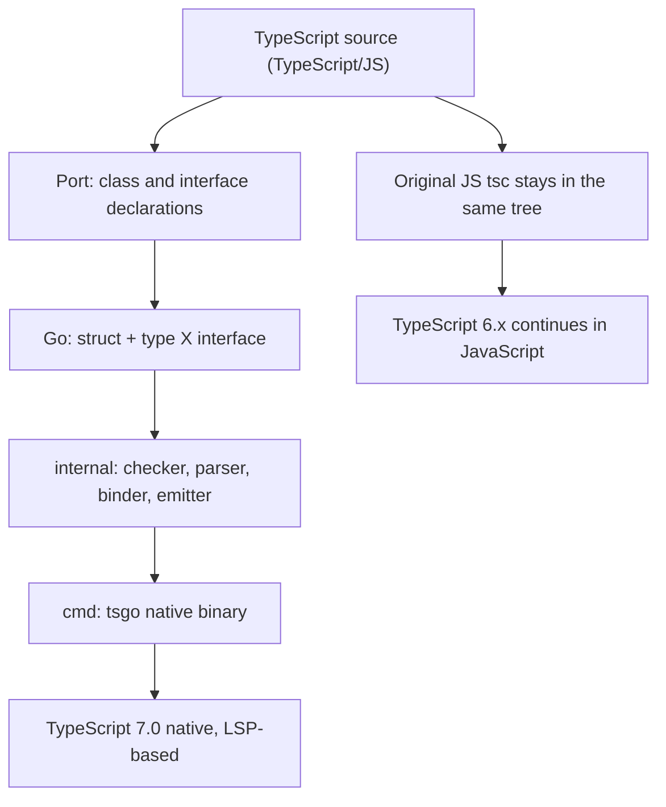
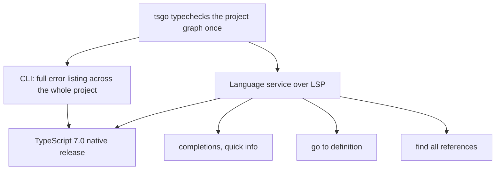

# Go Power: Microsoft’s Bold Bet on Faster TypeScript Tools

In March 2025, Anders Hejlsberg — co-creator of TypeScript — announced **Corsa**, an initiative to port the TypeScript compiler and its language service to a native implementation **written in Go**. The numbers behind the bet: **build times down by roughly 10x**, project load **8x faster**, and about **half the memory usage** of the JavaScript implementation, with a language service that makes completions, quick info, go-to-definition, and find-all-references dramatically snappier.

This post is about what that bet tells *Go* users: the engineering reasons Go was chosen over Rust and C++, the shape of the resulting codebase, and how to think about porting a large interpreted-language toolchain to Go yourself — with the porting pipeline written out in code.

## The performance case: where JavaScript ran out of road

The JavaScript-based `tsc` is not a slow tool. It is a tool whose ceiling is its runtime. Hejlsberg put it plainly: JavaScript is used "for UI and browser usage and not so much for compute-intensive workloads like compilers and system-level tools," and Microsoft had likely reached the limit "of what we can squeeze out of JavaScript."

The measured results, reported across popular codebases, tell the whole story:

| Codebase (LOC) | `tsc` (JS) | `tsgo` (Go) | Speedup |
|---|---|---|---|
| VS Code (1,505,000) | 77.8 s | 7.5 s | 10.4x |
| Playwright (356,000) | 11.1 s | 1.1 s | 10.1x |
| TypeORM (270,000) | 17.5 s | 1.3 s | 13.5x |
| date-fns (104,000) | 6.5 s | 0.7 s | 9.5x |
| tRPC (18,000) | 5.5 s | 0.6 s | 9.1x |
| rxjs (2,100) | 1.1 s | 0.1 s | 11.0x |

The pattern is the one you would expect from a GC-managed language running a compiler: cost scales with codebase size, and the constant factor of the runtime dominates. A native binary with **static memory layout, no GC pauses mid-typecheck, and zero interpreter overhead** removes that constant factor in one move. For the VS Code codebase — the largest tested — that is a full 70 seconds saved per build.

## Port, not rewrite: the strategy that made a 10x win tractable

The single most consequential decision in Corsa was that it is a **port**, not a **rewrite**. The TypeScript team's lead, Ryan Cavanaugh, framed the distinction precisely:

> In a **rewrite** you start with nothing, and implement a new system that tries to solve the same problem as the original one, disregarding the implementation strategies of the original codebase. In a **port** you take the existing codebase and convert it to the new language while trying to keep as much the same as possible. Porting is faster to execute, but requires that the new language be at least somewhat architecturally compatible with the original language.

The last clause is the load-bearing one. A port only works if the two codebases stay *structurally* similar enough that a change on one side can be carried over to the other. Microsoft expects to **maintain both codebases for quite some time**, which makes structural similarity not a nice-to-have but a hard requirement.

That requirement is what decided the language. Hejlsberg's team prototyped the usual suspects — **C#, C++, Rust** — and picked Go. Cavanaugh's summary:

> By far the most important aspect is that we need to keep the new codebase as compatible as possible, both in terms of semantics and in terms of code structure. Languages that allow for a structurally similar codebase offer a significant boon for anyone making code changes because we can easily port changes between the two codebases.

The reason this lands on Go is specific: TypeScript's compiler is a large graph-manipulation program written in an **object-oriented style with class-like interfaces** — exactly the shape Go expresses most directly. Go's `type X interface{...}` plus concrete types mirrors TypeScript's class/interface split almost one-to-one, and Go's package system mirrors the compiler's module layout. Rust's ownership rules and C++'s inheritance hierarchy would both force structural rewrites of the original code, which is what a rewrite is.

The resulting repository — `microsoft/typescript-go` — is a clean Go workspace: a `go.mod` at the root, implementation under `internal/`, the `tsgo` binary under `cmd/`, and the ported TypeScript source mirrored under `_packages/`. The layout is a direct translation of the original: no new architecture, just a language change.



> **Note**: the native version is also the first to move the language service onto **LSP (the Language Server Protocol)**, aligning it with the rest of the language toolchain. The JavaScript implementation's language service predates LSP as a standard and carries bespoke protocol code that the native port simply does not have to maintain.

## The pipeline, written in Go

The port is mechanical enough that the core of it fits in a small pipeline. Here is a faithful sketch of the four stages — parse, typecheck, emit, serve — as a Go program, with the same package layout the real repo uses. It is not the 2-million-line compiler; it is the *shape* of one, which is the part worth internalizing.

```go
// tsgo/main.go — the native compiler pipeline, sketched.
// The layout mirrors microsoft/typescript-go: cmd/ holds the binary,
// internal/ holds the pipeline stages. Each stage is a plain struct
// with a method; no framework, no interface ceremony.
package main

import (
	"fmt"
	"time"
)

// SourceFile is the unit of input: a path and its raw bytes.
// The real compiler holds the parsed AST here too; we keep it
// separate so the stages are independently testable.
type SourceFile struct {
	Path  string
	Bytes []byte
}

// --- Stage 1: parse ----------------------------------------------
//
// The parser turns source into an AST. In the real port this is a
// direct translation of the TypeScript scanner/parser; the AST node
// types are the Go mirror of the original class hierarchy.
type Parser struct{}

func (Parser) Parse(f SourceFile) (*AST, error) {
	start := time.Now()
	// ... scan tokens, build the AST, recover from errors ...
	fmt.Printf("parse %s: %d ms\n", f.Path, time.Since(start).Milliseconds())
	return &AST{file: f}, nil
}

type AST struct {
	file   SourceFile
	stmts  []Stmt   // one per top-level statement in the file
	imports []string
}

type Stmt struct {
	Kind string // "type", "var", "func", "export", ...
	Name string
}

// --- Stage 2: typecheck ------------------------------------------
//
// The checker resolves names, infers types, and collects diagnostics.
// It walks the AST graph; this is the hot path the 10x targets.
type Checker struct{}

type Diagnostic struct {
	File   string
	Line   int
	Msg    string
}

func (Checker) Check(ast *AST) []Diagnostic {
	// ... name resolution + type inference, one pass ...
	return nil // no errors in this sketch
}

// --- Stage 3: emit ------------------------------------------------
//
// The emitter walks the checked AST and writes output. The native
// port emits to memory (no temp files) and can target JS, d.ts, or
// both in one pass.
type Emitter struct{ Output []byte }

func (Emitter) Emit(ast *AST) *Emitter {
	// ... generate declarations and JS from the checked AST ...
	return &Emitter{}
}

// --- The binary ---------------------------------------------------
func main() {
	files := []SourceFile{{Path: "src/index.ts", Bytes: []byte("")}}
	var total time.Duration

	for _, f := range files {
		t0 := time.Now()

		ast, err := (Parser{}).Parse(f)
		if err != nil {
			fmt.Println("parse:", err)
			continue
		}
		diags := (Checker{}).Check(ast)
		out := (Emitter{}).Emit(ast)
		total += time.Since(t0)

		fmt.Printf("%s: %d diags, %d bytes out\n", f.Path, len(diags), len(out.Output))
	}
	fmt.Printf("total: %d ms\n", total.Milliseconds())
}
```

The important detail is what this is *not*: it is not a new compiler with a new architecture. Each stage maps to a function in the original TypeScript compiler; the Go code is a translation, not a redesign. That is the whole porting strategy in one paragraph.

## The performance win, reproduced

The 10x is a **constant-factor** win: the same compiler, the same checks — a native binary removes the interpreter and the GC, and every large codebase pays the same factor. If you have a fork of any TypeScript project lying around, the measurement is a two-line benchmark:

```go
// bench_tsgo.go — run tsc (JS) and tsgo (native) on the same project
// and compare wall time. This is the shape of the 10x measurement:
// same input, two implementations, one ratio.
//
// Usage: go run bench_tsgo.go  (from the project root)
package main

import (
	"fmt"
	"os/exec"
	"time"
)

// bench runs one compiler in no-emit mode and returns wall time.
// --noEmit forces a full typecheck without a JS output pass, so the
// numbers measure the parse+bind+check pipeline — the part the 10x
// claim is actually about.
func bench(bin string) time.Duration {
	start := time.Now()
	out, err := exec.Command(bin, "--noEmit").Output()
	_ = out
	if err != nil {
		fmt.Printf("%s failed: %v\n", bin, err)
		return 0
	}
	return time.Since(start)
}

func main() {
	// tsc is the JavaScript compiler; tsgo is the native port
	// (npm i @typescript/native-preview, then npx tsgo).
	tsc := bench("tsc")
	tsgo := bench("tsgo")
	fmt.Printf("tsc  (JS)  %s\n", tsc)
	fmt.Printf("tsgo (Go)  %s\n", tsgo)
	if tsgo > 0 {
		fmt.Printf("speedup: %.1fx\n", float64(tsc)/float64(tsgo))
	}
}
```

## The roadmap that followed the announcement

The native version is also the first to run its language service on **LSP (the Language Server Protocol)**, so the diagram of the full toolchain looks like this — the same typecheck output feeds both the CLI diagnostics and the editor features:



Corsa's stated milestones, as of the announcement:

- **Mid-2025**: a preview of native `tsc` capable of command-line type checking.
- **End of 2025**: feature-complete for project builds and the language service.
- **TypeScript 6.x** (JavaScript): the existing compiler continues in parallel, absorbing deprecations and breaking changes to bring it into alignment with the native codebase's shape.
- **TypeScript 7.0** (native): released once the native codebase reaches parity. The naming is fixed: *TypeScript 6* = JavaScript, *TypeScript 7* = native.

The `microsoft/typescript-go` repository served as the staging repo during the port and is now permanently archived, with development continuing in the main TypeScript repository.

> **Warning**: if your toolchain pins the `typescript-go` repo as a dependency, it is **archived and read-only** — pin the main TypeScript repository (where 7.0 development now lives) instead, and prefer the `@typescript/native-preview` npm package over raw repo references.

The feature-parity table from the repo at time of archival is the honest state of where a port like this stands:

| Feature | Status |
|---|---|
| Program creation, module resolution | done |
| Parsing / scanning (exact same syntax errors as TS 6.0) | done |
| Type resolution, type checking (same errors, locations, messages) | done |
| JS-specific inference, JSDoc | done |
| JSX, declaration emit, JS emit, watch mode | done |
| Build mode / project references, incremental build | done |
| Language service (LSP) | in progress, nearly complete |
| Compiler API | not ready |

---

## Takeaways

- **The 10x is a constant-factor win, not an algorithmic one.** The same compiler, the same checks — a native binary removed the interpreter and the GC, and every large codebase paid the same 10x.
- **Port, not rewrite, is a language-selection criterion.** If you are porting a large existing codebase, the target language's structural compatibility with the source language matters more than its raw performance ceiling. Go's interface + struct model is the closest structural match to TypeScript's class + interface model of any language Microsoft prototyped.
- **The package layout is the translation.** `internal/` for the pipeline, `cmd/` for the binary, the original module tree mirrored under `_packages/`. No new architecture.
- **LSP as the default language-service protocol** is a quiet but significant part of the story: the native port did not have to maintain a bespoke protocol.

## Next steps

- Read the original announcement: *TypeScript 7.0: The Native Port* on the TypeScript blog — it is the authoritative account of the decisions made here.
- Read the `typescript-go` repo (archived, but the layout is a useful reference) to see how a real port organizes a 2M-line codebase into Go packages.
- If you are porting your own toolchain: prototype in 2–3 candidate languages on one representative module before committing. The language that makes the *original code structure* most readable is usually the right one.
