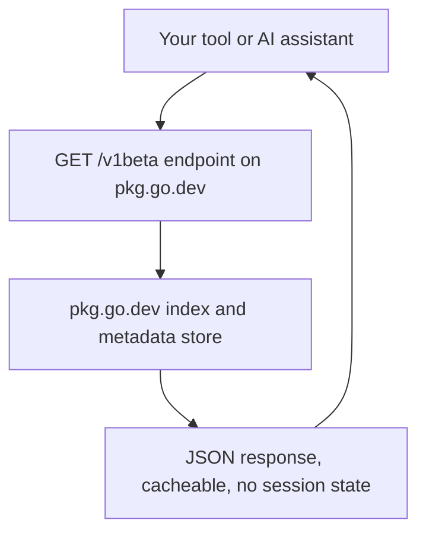
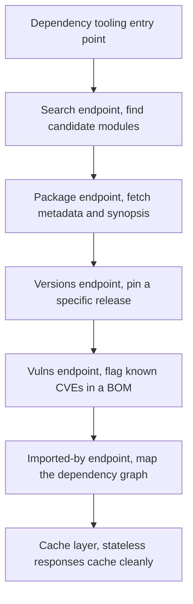

For years the only way to get data *out* of pkg.go.dev was to scrape the HTML. Dependency dashboards, CI checkers, internal package browsers, and — increasingly — AI assistants that need to reason about the Go ecosystem all ended up parsing `<a>` tags from rendered package pages. That was never going to survive a refactoring. On May 21, 2026, the Go team shipped the fix: an official, documented, versioned **REST API** for pkg.go.dev, currently served under the `/v1beta` path, with a machine-readable **OpenAPI specification** published alongside it.

This post is the working reference for that API. By the end you will know what each of the eight core endpoints returns, why the API *refuses* to guess when a package path is ambiguous (and how to handle that in your own client), how the `version` query parameter resolves semver tags, branch names, and pseudo-versions, and how to consume the whole thing from Go with a small, production-shaped client.

## What the API is (and is not)

The service is **stateless and GET-only**. No sessions, no write verbs, no mutation: every resource is an immutable snapshot you can cache aggressively. There are eight core endpoints, and every one of them is a `GET` that returns JSON:

| Endpoint | Returns |
|---|---|
| `/v1beta/package/{path}` | Information about the package at `{path}` |
| `/v1beta/module/{path}` | Information about the module at `{path}` |
| `/v1beta/versions/{path}` | All released versions of the module at `{path}` |
| `/v1beta/packages/{path}` | All packages inside the module at `{path}` |
| `/v1beta/search?q={query}` | Search results for a free-text query |
| `/v1beta/symbols/{path}` | Symbols declared by the package at `{path}` |
| `/v1beta/imported-by/{path}` | Paths of packages that import the package at `{path}` |
| `/v1beta/vulns/{path}` | Known vulnerabilities of the module or package |

The full query parameters and response shapes live in the [OpenAPI specification](https://pkg.go.dev/api), so you can generate a typed client for your language of choice — including Go.



Note the contract in the diagram: the response carries everything you need (module path, version, `isLatest`, `goos`/`goarch`, synopsis, redistributability), and there is no hidden server state to worry about when you cache it.

---

## The design principle: precision over convenience

The most important thing to internalize before writing a line of client code is the API's one firm design rule: **it will not guess which module you mean**.

`go mod tidy` has always applied a "longest module path" rule: if an import like `example.com/a/b/c` could be provided by module `example.com/a` *or* by module `example.com/a/b`, the tooling picks the longer, more specific one. (That ambiguity is exactly what makes it possible to later split off a submodule without breaking existing programs.) The pkg.go.dev *web UI* follows the same convention and quietly resolves the ambiguity for you.

The API does not. If you ask for a package path that is provided by more than one module, it returns an **ambiguity error** with the list of candidate modules, and the client has to say which one it means.

```go
package pkgapi

import (
	"encoding/json"
	"fmt"
	"io"
	"net/http"
)

// Ambiguous reports a package path that is provided by more than one
// module. Clients must disambiguate by re-issuing the request against
// one specific module.
type Ambiguous struct {
	Path               string   `json:"path"`
	CandidateModules   []string `json:"candidate_modules"`
}

func (a Ambiguous) Error() string {
	return fmt.Sprintf("package %s is provided by multiple modules: %v",
		a.Path, a.CandidateModules)
}

// GetPackage fetches package metadata for a package path. If the server
// reports ambiguity, it returns an *Ambiguous whose CandidateModules list
// the caller can iterate over to re-query each module explicitly.
func GetPackage(client *http.Client, path string) (map[string]any, error) {
	resp, err := client.Get("https://pkg.go.dev/v1beta/package/" + path)
	if err != nil {
		return nil, err
	}
	defer resp.Body.Close()

	if resp.StatusCode == http.StatusOK {
		var out map[string]any
		if err := json.NewDecoder(resp.Body).Decode(&out); err != nil {
			return nil, err
		}
		return out, nil
	}

	// The API is precise, not convenient: it tells us *which* modules this
	// path is ambiguous across and makes us choose.
	var a Ambiguous
	if e := json.NewDecoder(resp.Body).Decode(&a); e == nil &&
		len(a.CandidateModules) > 0 {
		return nil, &a
	}

	body, _ := io.ReadAll(resp.Body)
	return nil, &httpError{code: resp.StatusCode, body: string(body)}
}

type httpError struct {
	code int
	body string
}

func (e *httpError) Error() string {
	return fmt.Sprintf("pkg.go.dev API: status %d: %s", e.code, e.body)
}
```

The `Ambiguous` type is the whole trick: a typed error the rest of your code can switch on. A CI tool that checks "does `example.com/a/b/c` have known vulnerabilities?" can recover by looping over `CandidateModules` and querying each one explicitly.

---

## Specifying versions

Every endpoint that serves package, module, or symbol information accepts an optional **`version`** query parameter, and it accepts three distinct kinds of value:

1. **Semantic versions** — `?version=v1.2.3`. You get exactly that tagged release.
2. **Default branch names** — `?version=master` (or `main`). The API resolves the branch to its corresponding **pseudo-version** for you; arbitrary branch names are not supported.
3. **Omitted** — the request resolves against the **latest tagged version**, which is what you want for the vast majority of tooling.

The branch-to-pseudo-version resolution is worth seeing in the wild. The Go team's own example from the announcement:

```bash
$ curl -s "https://pkg.go.dev/v1beta/package/github.com/google/go-cmp/cmp?version=master" \
    | jq '{path, version}'
{
  "path": "github.com/google/go-cmp/cmp",
  "version": "v0.7.1-0.20260310220054-34c9473539b8"
}
```

Note the `v0.7.1-0.20260310220054-...` shape: a pseudo-version derived from a commit *after* tag `v0.7.1`. Your client gets the exact commit it is looking at, expressed in the version language Go already uses.

---

## The reference implementation: pkgsite-cli

Because the API is new, the Go team also published a reference client, `pkgsite-cli`, to demonstrate real interaction patterns (pagination, formatting, flag handling). You install it with a module-versioned `go install`:

```bash
$ go install golang.org/x/pkgsite/cmd/internal/pkgsite-cli@latest
```

The commands that matter for scripting:

| Invocation | What it shows |
|---|---|
| `pkgsite-cli search "uuid"` | Module search results with module + version + synopsis |
| `pkgsite-cli package <path>` | Package metadata (name, module, version, synopsis) |
| `pkgsite-cli package --imported-by <path>` | Which packages import it |
| `pkgsite-cli package --symbols <path>` | Symbols declared by the package |
| `pkgsite-cli module -versions <path>` | Version history of a module |
| `pkgsite-cli module -packages -versions <path>` | Both, at once |

The team is explicit that the **CLI's interface is not yet stable** — the API is the stable contract, the CLI is a working demo. Build your integrations against the OpenAPI spec, not against the CLI's flag layout.



The flow in the diagram is the shape of a real consumer: resolve a candidate, fetch its metadata, pin a version, cross-check vulnerabilities, then map who depends on it. Because every step is a plain GET, each step is independently cacheable — which is exactly what you want in a CI pipeline that runs the whole thing on every commit.

---

## Stability and the road to v1

The endpoints ship under **`/v1beta`**, and the team's stated commitment is **backward compatibility**: existing integrations should keep working as the interface grows. The plan is to move to a formal `v1` after a period of community feedback confirms stability. The OpenAPI spec is the single source of truth for response shapes, so if you generate a client, regenerate it whenever the spec changes and let the diff tell you what broke.

> **Note**:`v1beta` means the endpoint paths and the *addition* of fields are expected to be stable, but do not assume the exact JSON field names are final until v1 is cut. Generate your client from the OpenAPI spec and re-run it on a schedule; the diff is your early-warning system.

> **Warning**:`version=master` / `version=main` resolves to a pseudo-version that *moves* over time. If your tooling caches responses, key the cache on the resolved pseudo-version, not on the branch name, or you will silently serve stale data under a stable label.

---

## Takeaways

- **pkg.go.dev now has a real API**: eight GET-only endpoints under `/v1beta`, stateless, cache-friendly, documented by an OpenAPI spec at `pkg.go.dev/api`.
- **The design rule is precision over convenience**: a package path provided by multiple modules returns an *ambiguity error* listing the candidates; your client must re-query a specific module. Model it as a typed `Ambiguous` error.
- **The `version` query parameter** accepts semver tags (`v1.2.3`), the default branches (`master`/`main`, auto-resolved to a pseudo-version), or nothing (latest tag).
- **`pkgsite-cli`** is the reference implementation for trying the API from a terminal; treat its flag layout as a demo, not a contract.
- **Build against the OpenAPI spec, not the CLI**: regenerate your client on a schedule and let the diff be your change-detection.

### Next steps

1. `go install golang.org/x/pkgsite/cmd/internal/pkgsite-cli@latest` and run `search` plus `package --imported-by` on a module you use daily.
2. Generate a Go client from the OpenAPI spec and wire it into one existing tool (a BOM checker is the natural first customer).
3. Add a regression test that hits `/v1beta/package/` for an ambiguous path and asserts the `Ambiguous` candidate list — that one test pins the behavior you are most likely to get wrong.

*Source: [Introducing the pkg.go.dev API](https://go.dev/blog/pkgsite-api) (Ethan Lee, Hana Kim, Jonathan Amsterdam, May 21, 2026).*
