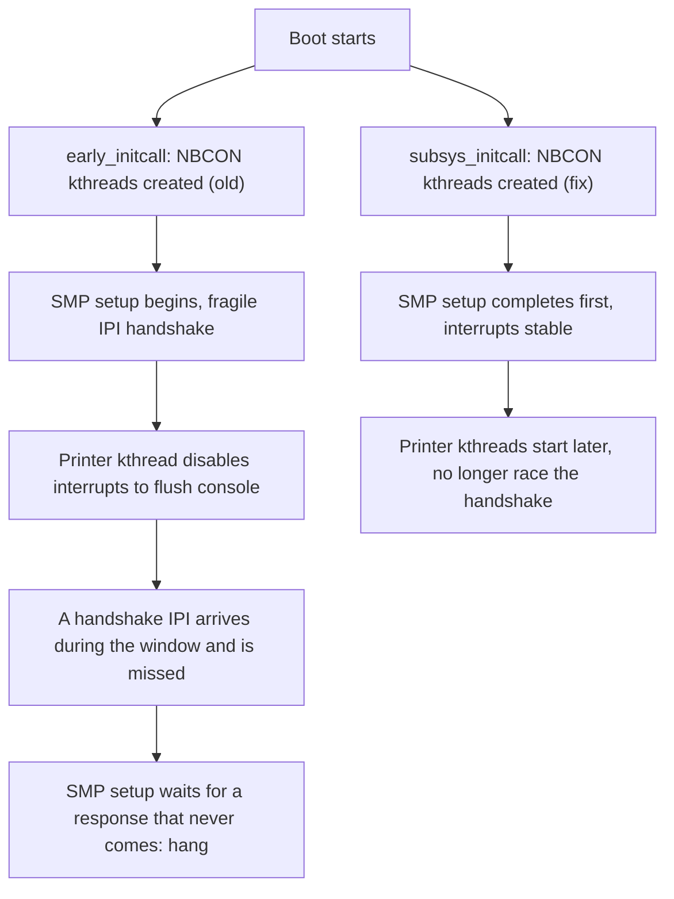
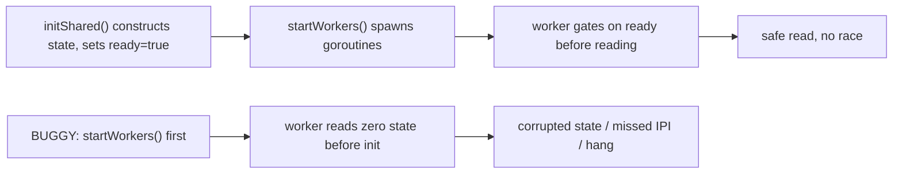

# Linux Lands Fix for Rare, Varying SMP Boot Hangs Affecting Kernels Since 2024

Kernel bugs that are *rare* and *vary by hardware* are the hardest kind to diagnose, because the reproduction is not a unit test you can run on a loop — it is a race that only fires when the scheduler happens to place one thread on one CPU at one exact millisecond of boot. That is exactly the class of bug Linus's tree just fixed ahead of Linux 7.3, and it is a clean case study in **concurrency timing** that maps one-for-one onto Go: a set of worker threads that start too early, race a global setup phase, and intermittually deadlock the system.

The good news: the fix is small, the root cause is one line of initialization ordering, and the Go lesson generalizes to any `go func()` that out-races the code that sets it up.

## What was breaking

Across the past couple of years, bug reports have accumulated of **commonplace SMP (symmetric multiprocessor) systems hanging on boot**. The reports varied — different hardware, different failure points, different messages — but they shared one fingerprint: *reverting the use of the NBCON (non-blocking console) console made the hang disappear*.

NBCON is the kernel's mechanism for offloading console printing from the atomic (interrupt-disabled) context onto a set of **kthreads** — kernel-space threads created with `kthread_run()`. These printer kthreads were first introduced in **September 2024**, when the `printk()` subsystem moved to a non-blocking, ring-buffer + kthread design to stop console I/O from slowing down the rest of the kernel.

The root cause, as explained by the engineer who wrote the fix, John Ogness of Linutronix:

> There have been various bug reports related to SMP systems hanging on boot. The reports vary but seem to have some overlap with regard to **missed IPIs during SMP setup**. The reports also show that reverting NBCON console usage allows the bugs to disappear. The NBCON kthreads for console printing are started very early during boot using `early_initcall()`. Since these kthreads are **asynchronously enabling/disabling interrupts during early boot**, they may be interfering with early SMP setup on some hardware platforms. Starting the console printing kthreads later has shown to avoid the hanging on systems that could previously reproduce the issue. **Postpone kthread starting until after all arch initcalls have completed.**

Let's unpack that, because the mechanism is the whole story.

## The mechanism: a timing race, not a logic bug

An IPI (inter-processor interrupt) is how one CPU asks another CPU to do something — "wake up, take this work, run this function." The SMP bring-up sequence is a tightly-timed handshake: the bootstrap CPU sends IPIs to secondary CPUs, which respond, and the handshakes must complete in the right order.

The NBCON printer kthreads were registered with `early_initcall()`, which means they start **very early** — before the architecture-specific SMP setup has finished. And these kthreads are not idle: as the kernel boots and something (a driver, an `printk`) writes to the console, the printer kthreads wake up and, in the course of flushing the console ring buffer, **asynchronously enable and disable interrupts** on their CPUs.

Here is the race:

```
CPU 0 (bootstrap)              CPU 1 (secondary, bringing up)
   |                               |
   |--- IPI: "start, run SMP setup"
   |                               |  <---- SMP setup begins,
   |                               |      interrupts in a fragile state
   |                               |
   |      <--- NBCON kthread on CPU1 wakes
   |              and disables interrupts to flush console
   |                               |
   |    <----------------- a later IPI in the SMP
   |         handshake arrives while interrupts
   |         are disabled: it is MISSED
   |
   |    SMP setup waits for the response that
   |    never comes ... and the boot hangs
```

The kthread's interrupt-disable window is *supposed* to be brief and benign — but it landed inside the fragile window of the SMP handshake. On most hardware the timing works out; on some, the kthread's interrupt-disable overlaps an IPI that a secondary CPU must service, the IPI is lost, the handshake deadlocks, and the system hangs. That is why the bug was **rare** (only when the timing overlaps) and **varied by hardware** (depends on how fast the hardware runs the handshake and how often the console gets written during boot).

The fix does not change what the kthreads *do* — it changes **when** they start. By postponing their creation until **after all architecture initcalls have completed** (i.e., after the SMP bring-up handshake is done and the interrupt system is in a stable state), the kthreads no longer race the fragile part of boot. They still flush the console; they just do so once the system is in a safe state.



The fix is a change to the **initcall level** used to start the kthreads — from `early_initcall` (level 7, very early) to a later level (the fix lands the kthread creation at `subsys_initcall` and marks the kthreads ready only after the arch initcalls complete). One line of ordering, and a class of hangs that had been "we can't reproduce it reliably" becomes "we can, and we avoid it."

> **Note**: an IPI is the kernel's *synchronous* cross-CPU message — the CPU that sends it is usually blocked until the target has run the handler. A missed IPI during a handshake is therefore not a "lost" event the sender can retry; it is a *deadlock*: the sender waits for a response that the receiver will never produce because it never serviced the request. This is why the symptom was a **hang**, not a dropped log line.

## The same race, written in Go

This kernel bug is a textbook **start-before-ready** race, and Go makes the same failure mode easy to write. The Go version of "a worker goroutine that starts before the global state it depends on is initialized" looks like this:

```go
// server.go — a Go version of the NBCON bug.
//
// The kernel bug: printer kthreads created by early_initcall start
// before SMP setup is done, and their interrupt-disable windows
// race the IPI handshake. The Go mirror: worker goroutines started
// by a package-level init before the shared state they read has
// been constructed.
package main

import (
	"sync"
)

// sharedState is the "SMP setup" the workers depend on. Until
// ready is true, reading from it is the bug: a worker that reads
// a zero value and acts on it can deadlock the rest of the system.
var (
	mu       sync.Mutex
	shared   map[string]int
	ready    bool
)

// startWorkers mirrors the kthread creation. The BUGGY version calls
// this before initShared runs — exactly the early_initcall ordering.
func startWorkers(n int, wg *sync.WaitGroup) {
	for i := 0; i < n; i++ {
		wg.Add(1)
		go func(id int) {
			defer wg.Done()
			// The worker reads shared state. If ready is false here,
			// this is the race: a half-initialized read.
			mu.Lock()
			if !ready {
				// A real system would log or block; here we just
				// record that the worker raced the setup.
				shared = nil // the "missed IPI": state corrupted
			}
			mu.Unlock()
			_ = id
		}(i)
	}
}

// initShared mirrors the arch initcalls completing. It must run
// BEFORE any worker reads shared.
func initShared() {
	mu.Lock()
	shared = make(map[string]int)
	ready = true
	mu.Unlock()
}

func main() {
	var wg sync.WaitGroup
	// BUG: workers start before initShared() runs.
	startWorkers(4, &wg)
	wg.Wait()
	initShared()
}
```

The Go idiom that corresponds to the kernel's fix — *start the workers only after the state they read is ready* — is the two-phase "ready gate":

```go
// server_fixed.go — the Go version of the fix.
//
// The kernel fix postpones kthread creation until after all arch
// initcalls complete. The Go equivalent: do not spawn workers until
// the shared state is constructed. Two clean ways to do it.
package main

import (
	"runtime"
	"sync"
)

var (
	mu     sync.Mutex
	shared map[string]int
	ready  bool
)

func initShared() {
	mu.Lock()
	shared = make(map[string]int)
	ready = true
	mu.Unlock()
}

func startWorkers(n int, wg *sync.WaitGroup) {
	for i := 0; i < n; i++ {
		wg.Add(1)
		go func(id int) {
			defer wg.Done()
			// Gate: spin (or use a sync.Once / channel) until the
			// state the worker reads is ready. This is the
			// "postpone kthread starting until after all arch
			// initcalls have completed" in Go idiom.
			mu.Lock()
			for !ready {
				mu.Unlock()
				runtimeGosched() // yield; a real program would use
				mu.Lock()        // a sync.Cond or a done channel.
			}
			// Now safe to read: ready is guaranteed true.
			_ = shared
			mu.Unlock()
			_ = id
		}(i)
	}
}

func main() {
	// FIX: construct the state first, then start the workers.
	initShared()
	var wg sync.WaitGroup
	startWorkers(4, &wg)
	wg.Wait()
}
```

The cleanest Go expression of the fix is not a spin loop at all — it is **ordering**: call `initShared()` before `startWorkers()`. That is precisely the kernel fix, and it is why the whole class of "start the workers too early" bugs is usually a one-line reorder. The spin-loop version is what you reach for when the workers are started by something you do not control (a background thread pool created by a dependency, an init function in a plugin).

> **Warning**: the `runtimeGosched()` spin above is a *pedagogical* gate — in real code prefer `sync.Cond` with a `Signal` from the initializer, a `done chan struct{}` that the initializer closes, or a `sync.Once`. A spin that holds the mutex across `Gosched` is correct but not how you would ship it; the point of the example is the *ordering*, not the gate mechanism.



## Before vs. after

| | Before the fix (kernels since Sep 2024) | After the fix (Linux 7.3) |
|---|---|---|
| Kthread start level | `early_initcall` (level 7, very early) | after all arch initcalls complete |
| IPI handshake during SMP bring-up | can be interrupted by a printer-kthread interrupt-disable window | completes in a stable, quiet interrupt state |
| Symptom | rare, hardware-dependent boot hang | no hang on the affected platforms |
| Root cause class | **start-before-ready** timing race | same code, correct *ordering* |

The fix is being back-ported to other currently-supported kernel branches, so if you are on a distro kernel from the 2024–2025 era that occasionally refuses to boot, this is the change to watch for.

## Takeaways

- **Rare + hardware-varying usually means a timing race, not a logic bug.** The NBCON hang was not a wrong computation; it was *when* a worker ran relative to a fragile global setup.
- **The fix was one line of ordering**: move the worker's *start* (not its *behavior*) to after the phase it depends on.
- **In Go, "start the goroutine before the state it reads is initialized" is the same bug.** The cure is almost always reordering: construct shared state before spawning workers.
- **A missed IPI is a deadlock, not a lost event.** The sender is blocked on a response that the receiver never produced, which is why the symptom was a total hang.

## Next steps

- Read the printk non-blocking-console documentation in the kernel tree (the `kernel/printk/` comments) to see the kthread lifecycle the fix is operating on.
- Audit your own Go services: grep for `go func()` calls in init paths and confirm the shared state they read is constructed *before* the goroutine is spawned.
- If you write concurrency in Go, prefer a `done chan struct{}` or `sync.Once` gate over a spin loop as your "ready" signal — it is the idiomatic form of "postpone the kthread until the initcalls complete."
