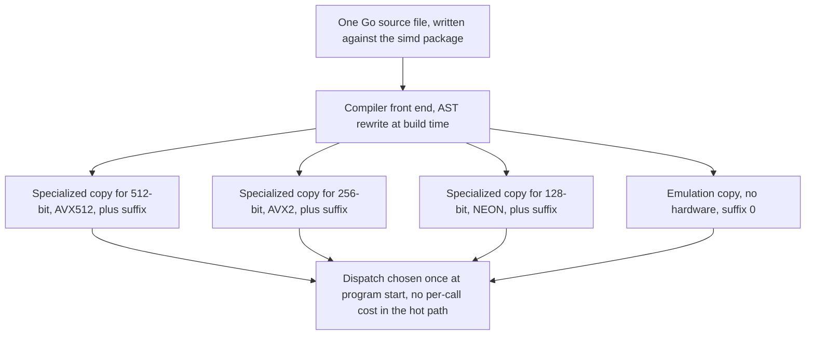
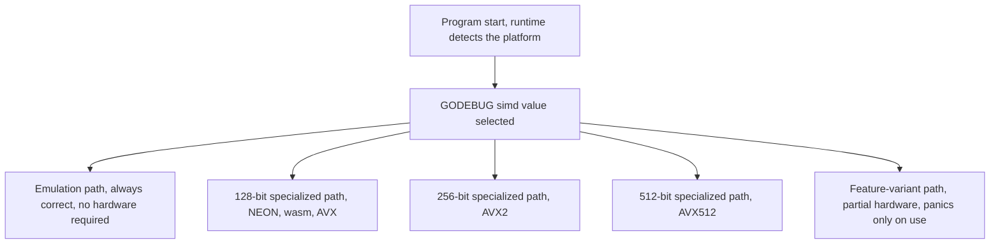

Before 1.26, the only way to get SIMD performance out of a Go program was to write Go assembly, a bar high enough that plenty of code that *could* vectorize simply never did. The experimental `archsimd` package (1.26) lowered that bar for `amd64`, and 1.27 extends it to `arm64` NEON and `wasm`. But architecture-specific SIMD has a second problem that assembly never fully solves: **the platforms disagree about everything** — vector sizes, which operations exist, how masks are represented, which features need runtime detection. `amd64` has 128/256/512-bit vectors; `arm64` has 128-bit NEON and 128–2048-bit SVE; `wasm` has a single fixed 128-bit size. `AVX512` uses dedicated mask registers; `NEON` and `wasm` get by with vector bitmasks; `SVE` allocates one bit per byte with the least-significant bit governing the operation.

Go 1.27's answer is an experimental **`simd` package**: a **portable, platform- and size-agnostic** SIMD interface, loosely based on **Highway for C++**. The design goals, in the Go team's words: write-once code that runs at *near-assembly performance* on hardware that supports it, a *competent emulation* on platforms that don't, operations restricted to the **intersection of all platforms**, and an API that is **easy to read** — even, the release notes add, "especially if an LLM ends up writing the code."

This post walks through the motivation, the type system, a complete working example, the `ToArch`/`FromArch` escape hatch, and the `GODEBUG` controls for testing against different hardware configurations.

---

## Why the intersection, and what it excludes

The package removes **fixed-size vectors from the type system entirely**. Vector types are capitalized, plural, primitive types — `simd.Float32s`, `simd.Uint8s`, `simd.Int64s` — whose *length is deliberately unspecified* and is instead the size the current hardware reports at program start (128 bits on `arm64` NEON, 128/256/512 on `amd64` depending on the detected feature set, 128 on `wasm`). A method like `x.Add(y)` means "add the two vectors," and the exact instruction the compiler emits is a function of the platform, not of your source.

The operation set is the **intersection** of what all supported hardware does, with gaps **filled by efficient emulation in terms of other SIMD instructions** — so code written against `simd` *always runs*, on every platform, including ones without SIMD at all. The current support matrix:

| Platform | Hardware `simd` targets (1.27) |
|---|---|
| `amd64` | AVX, AVX2, AVX512 |
| `arm64` | NEON (128-bit) |
| `wasm` | 128-bit SIMD instructions |



The diagram is the implementation story in one picture: `simd` is simultaneously a package, an internal implementation package, and a **compiler front-end AST rewrite**. At build time the compiler creates specialized copies of every function, type, and variable that mentions a `simd` type, with the `simd` types replaced by size-specific bridge types, and suffixes the copies (`@simd512`, `@simd256`, `@simd128`, `@simd0`). A function that mentions `simd` only in its body becomes a tiny wrapper that switches **once, at program start**, on the detected vector length and calls the matching specialized copy; inside the specialized copies, calls go straight to specialized calls — no dispatch inside the vector loop. The result is that the `ToArch`/type-switch machinery, which *looks* like it should cost a virtual call per operation, is optimized away in the hot path.

---

## A complete example: inner product over `[]float32`

Vectors are loaded from and stored to slices. The canonical first program — a dot product — is the whole shape of the API:

```go
//go:build goexperiment.simd

package main

import "simd"

// innerProduct returns the inner product of x and y.
// The loop step is a.Len() because the vector length is
// hardware-defined and not a constant you can name.
func innerProduct(x, y []float32) float32 {
	var a simd.Float32s
	i := 0
	// Main loop: exactly one full vector per iteration.
	for i = 0; i < len(x)-a.Len()+1; i += a.Len() {
		u := simd.LoadFloat32s(x[i : i+a.Len()])
		v := simd.LoadFloat32s(y[i : i+a.Len()])
		a = u.MulAdd(v, a) // fused multiply-add: a = u*v + a
	}
	// Tail: fewer than a.Len() elements left; the Part variant
	// returns how many it actually loaded.
	if i < len(x) {
		u, _ := simd.LoadFloat32sPart(x[i:])
		v, _ := simd.LoadFloat32sPart(y[i:])
		a = u.MulAdd(v, a)
	}
	return sum(a)
}

// sum is a scalar fold over the vector's elements.
// Go 1.27 has no cross-lane reduce yet; ReduceSum lands in 1.28,
// at which point this body becomes: return simd.ReduceSum(x).
func sum(x simd.Float32s) float32 {
	s := make([]float32, x.Len())
	x.Store(s)
	var r float32
	for _, e := range s {
		r += e
	}
	return r
}
```

Three details in that code are the entire practical API:

1. **`x[i : i+a.Len()]` is not a typo** — `LoadFloat32s` takes a slice of exactly one vector's worth of elements, and the slice bound is computed from `Len()`, the runtime-determined vector length.
2. **`MulAdd` is a fused operation**: `u*v + a` in one step, the classic strength-reduction of an accumulation loop.
3. **The tail must be handled with the `Part` variant** (`LoadFloat32sPart`/`StorePart`), because the last chunk is shorter than a full vector and the plain `Load` would over-read.

Comparisons produce **mask types** matched to the element width — comparing `Int8s` yields `Mask8s` — and masks drive `IfElse`/`Masked` for lane-conditional logic, the portable stand-in for the hardware's own masking registers.

---

## The operation surface, and the escape hatch

The 1.27 `simd` package supports, across the ten vector types and four mask types:

| Category | Representative operations |
|---|---|
| Load / store / broadcast | `LoadV`, `LoadVPart`, `BroadcastV`, `Store`, `StorePart` |
| Arithmetic | `Add`, `Sub`, `Mul`, `MulAdd`, `Neg`, `Abs`, `Sqrt` (floats), `Min`, `Max`, `Average`, saturated add/sub (integers) |
| Logical | `And`, `Or`, `Xor`, `Not`, `AndNot` |
| Compare (returns masks) | `Equal`, `NotEqual`, `Less`, `Greater`, `LessEqual`, `GreaterEqual` |
| Masking | `Masked`, `IfElse(mask, y)` |
| Shift / rotate | `ShiftAllLeft/Right`, `RotateAllLeft/Right` |
| Convert / reshape | `ConvertToIntW/UintW/FloatW`, `ToBits`, `BitsToIntW`, `ReshapeToUint{8,16,32}64s`, `ToMask` |

Two deliberate gaps are worth naming because they shape what you can write in 1.27:

- **No cross-lane reduction.** There is no sum-across-the-vector in 1.27 (the `sum` helper in the example exists for that reason); **`ReduceSum` is coming in Go 1.28**, and the team's stated preference is to add the *high-level* operation (sum reduction) rather than the primitive ("add pairs") it is usually built from, precisely because the reduction depth depends on vector length.
- **`CarrylessMultiplyEven/Odd`** exists and is deliberately **constant-time**, because its main uses are cryptography and CRC.

When the intersection is not enough, the **`ToArch` / `FromArch` bridge** is the escape hatch: every `simd` vector type has a `ToArch()` method returning an `any` that you type-switch on the architecture-specific `archsimd` type, and `simd.<Type>FromArch` converts back. The 1.27 blog's example is a complete `OnesCount` (per-lane popcount) implementation for `Int8s`, and it is instructive, because it shows the *three* implementations one operation needs in the bridge world:

```go
//go:build goexperiment.simd && amd64

package simd_test

import (
	"simd"
	"simd/archsimd"
)

var popcnt4x16 = [16]int8{0, 1, 1, 2, 1, 2, 2, 3, 1, 2, 2, 3, 2, 3, 3, 4}

// OnesCount returns the number of set bits in each Int8 lane.
// AVX/AVX2 have no POPCNT for 8-bit lanes: build a 16-entry lookup
// from the two 4-bit halves. AVX512 has the real instruction.
func OnesCount(v simd.Int8s) simd.Int8s {
	switch x := v.ToArch().(type) {
	case archsimd.Int8x32: // 256-bit: two 16-wide LUT lookups + add
		lut := archsimd.LoadInt8x32Array(&popcnt4x16)
		mask := archsimd.BroadcastInt8x32(0x0f)
		lo := x.And(mask)
		hi := x.ToBits().ReshapeToUint16s().
			ShiftAllRight(4).ReshapeToUint8s().BitsToInt8().And(mask)
		return simd.Int8sFromArch(lut.PermuteOrZero(lo).
			Add(lut.PermuteOrZero(hi)))
	case archsimd.Int8x64: // 512-bit: native instruction
		return simd.Int8sFromArch(x.OnesCount())
	default: // no 8-bit SIMD here: fall back to pure-Go
		return OnesCountEmulated(v)
	}
}
```

The same file pattern repeats for `arm64`/`wasm` (NEON and wasm both *do* have `OnesCount`, so the type switch is one case plus the emulated default) and for the remaining architectures (just the emulated path). The `default:` case matters: **some machines have no hardware SIMD at all** (or, in the Raspberry-Pi case, NEON but no PMULL carryless-multiply), and the emulated path is the portability guarantee keeping the promise that "it always runs."

> **Note**: the `ToArch` type switch and interface indirection look expensive but are not: the compiler's `simd` specialization pass rewrites them so that the hot path is the direct, size-specialized call chain with the dispatch hoisted to program start. If you do see dispatch in a profile, the release notes' trick is a gratuitous mention of a `simd` type in the function signature to force the specialization boundary higher.

> **Warning**: everything here is gated behind **`GOEXPERIMENT=simd` at build time**, and the package docs and the proposal issue explicitly call the API experimental and non-stable. Do not put `simd` in the API of a library you version by semver; keep it behind an internal build tag, and expect the 1.28 changes (SVE in `archsimd`, more `simd` operations, "feature variants") to move the goalposts.

---

## Testing against hardware you don't have: the GODEBUG levels

Because the vector length and the feature set are both *runtime* facts, 1.27 ships a `GODEBUG` knob for exercising every code path without a fleet of machines:

| Setting | Behavior |
|---|---|
| `GODEBUG=simd=0` | Force the **emulation**, even on hardware that has SIMD — your CI's cheapest cross-platform check |
| `GODEBUG=simd=128` | Use 128-bit vectors and their features; **panic at startup** if the hardware lacks them |
| `GODEBUG=simd=256` / `simd=512` | Prefer 256/512-bit vectors if possible |
| `GODEBUG=simd=+128` / `+256` / `+512` | Use that width *even if some features are missing*: a missing instruction panics only if the code actually executes it. This is the Raspberry-Pi (NEON, no PMULL) and Apple-Silicon-under-amd64-emulation (AVX2, no VPCLMULQDQ) case |

The two flavors of the knob are a genuine workflow: the plain `=N` form for a clean, failing-fast test of "does my code run on 128-bit hardware," and the `+N` form for the long tail of partial-feature hardware that you do not want to downgrade all the way to scalar emulation.



---

## What is coming

The 1.27 release is explicitly the first step of a rolling plan:

- **`ReduceSum` (and the reduction family)** in the 1.28 `simd` package, replacing scalar folds like the `sum` helper above.
- **SVE support in `archsimd`** (and, if it proves out, in `simd`) — the variable-vector-length architecture is the one that most stresses "size-agnostic" design, and it is the next platform the intersection has to absorb.
- **More operations** in `simd`: `OnesCount`, mask operations, vector shuffling.
- **"Feature variants"**: a mechanism so that a platform with a near-complete implementation (the Raspberry Pi's NEON-without-PMULL case) does not fall all the way to scalar emulation for the one missing instruction.

For a Go developer the planning implication is simple: the *algorithmic* shape of a vectorized kernel (load a vector, loop by `Len()`, handle the tail with `Part`, fold the result) is stable across all of this, so the cost of writing your kernels against `simd` now is mostly the `GOEXPERIMENT` flag and the expectation that a 1.28 patch widens the method set rather than rewrites the calls.

---

## Takeaways

- **`simd` is the portable layer; `archsimd` is the architecture-specific layer.** `simd` types (`Float32s`, `Uint8s`, …) have *no fixed length* — the vector is as wide as the hardware says — and the operation set is the intersection of AVX/AVX2/AVX512, NEON, and wasm, with gaps filled by instruction-level emulation so **every program always runs**.
- **The build-time story is an AST rewrite, not a runtime library**: the compiler generates size-specialized copies of everything that mentions `simd` types and dispatches **once, at program start**, so the hot path has no per-call overhead; the `ToArch` type switch is optimized away in exactly the places it would have been expensive.
- **The practical loop is three lines of shape**: `for i += v.Len() { u := Load(v[i:i+Len()]); ... }` plus a `Load*Part` tail. There is no `ReduceSum` in 1.27 (it lands in 1.28), so cross-lane folds are still scalar for now.
- **`GODEBUG=simd=0/128/256/512` and the `+`-variants** give you a CI story that covers the emulated, 128-bit, 256-bit, and 512-bit paths, plus the partial-feature hardware (Raspberry Pi, Apple-emulated amd64) without a fleet of machines.
- **It is experimental and flagged** (`GOEXPERIMENT=simd`, non-stable API); keep it out of your public API surface until the 1.28 additions settle the method set.

### Next steps

1. Build a toy kernel (the `innerProduct` above is the whole tutorial) with `go build -tags goexperiment.simd` and run it under `GODEBUG=simd=0` to confirm the emulation path gives you the same *numbers* as the hardware path — that equality test is the entire portability guarantee.
2. For any `amd64` codebase you maintain, benchmark the same kernel against the existing `archsimd` types to see where `simd`'s emulation is close enough to hardware that the portable version is simply the right default.
3. Watch the 1.28 release notes for the `ReduceSum`/mask-operation additions and for SVE in `archsimd` — that is the release that decides whether `simd` can be the default for your `arm64` workloads.

*Source: [Platform-independent SIMD in Go](https://go.dev/blog/simd-experiment) (David Chase, Junyang Shao, 24 September 2026) and the [Go 1.27 Release Notes](https://go.dev/doc/go1.27).*
