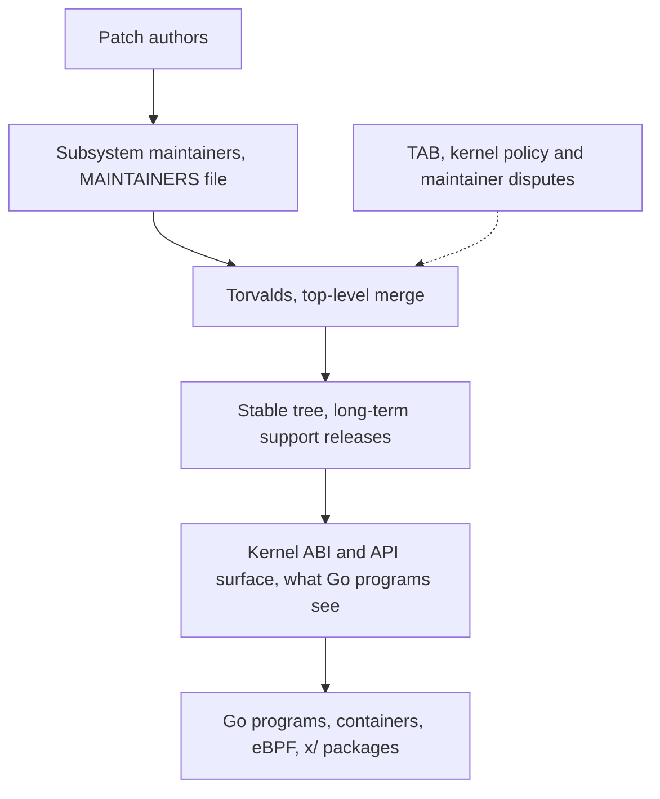
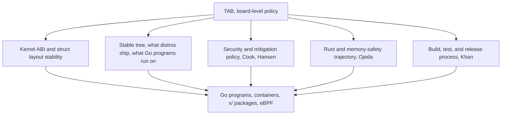

On October 16, 2026, LWN reported a small headline with outsized consequences for anyone who runs Go on Linux: the results of the **2026 election for the Linux Foundation Technical Advisory Board (TAB)** were announced. **Kees Cook, Dave Hansen, Miguel Ojeda, and Shuah Khan** have all been **re-elected**, and **Laurent Pinchart** is **joining the board**.

The announcement is three sentences long. The reason it matters is that the TAB is the top rung of the governance chain that every line of the Linux kernel passes through before it lands — and the people who are re-elected there decide what the kernel is allowed to be. If your production Go servers, your `golang.org/x/` dependencies, your containers, and your eBPF programs all sit on top of the Linux kernel, the TAB is where the rules get made. This post unpacks what the TAB actually is, how the kernel's governance chain works, what the 2026 roster change means, and what it implies for Go developers in practice.

## What the TAB is

The Linux Foundation's **Technical Advisory Board** is the technical governance body for the Linux kernel (and, in a broader sense, the foundation's technology portfolio). It is the board the kernel community defers to on the questions that are too big for any single maintainer and too structural for a mailing-list vote:

- **Kernel direction and policy** — the standing rules of the kernel, the things that are *always* true.
- **Maintainer appointments and disputes** — who gets to merge which subsystem, and what happens when the maintainer of a major subsystem is unavailable, disagrees with Torvalds, or retires.
- **Release and process policy** — the release-cycle expectations, the stable-tree rules, the merge-window rules.
- **Foundation-level technical decisions** — licensing, compatibility promises, and the interface between the kernel and the foundation's other projects.

The kernel itself is governed by a **maintainer tree**: Linus Torvalds at the top, area maintainers (the `MAINTAINERS` file) below him, and the people who write the patches below that. The TAB sits *beside* that tree, not on top of it: it does not pick commits, it sets the conditions under which the maintainer tree operates, and it is the designated tie-breaker when the tree itself is the thing in dispute.

Read the solid lines as the *code path*: a patch becomes a commit becomes a release becomes the kernel your program runs on. The dotted line is the *governance path*: the TAB does not touch your code, it touches the people and rules that decide what your code is allowed to assume about the kernel.

---

## The 2026 result, and the board it produces

The LWN item is deliberately terse, so the result is best read against the board's current roster as listed on the Linux Foundation's leadership page:

| Member | Position | Focus area |
|---|---|---|
| **Kees Cook** (re-elected) | Google; Debian developer since 2007; TAB member since 2019 | Kernel security, hardening defaults, security API design |
| **Dave Hansen** (re-elected) | Intel; x86 architecture maintainer; TAB since 2022 | x86 memory management, side-channel mitigations, VFS |
| **Miguel Ojeda** (re-elected) | Rust-for-Linux maintainer | Rust in the kernel, memory-safety work |
| **Shuah Khan** (re-elected) | Linux Fellow at the Linux Foundation; kernel maintainer | Kernel build/test infrastructure, release processes |
| **Laurent Pinchart** (new) | Long-tenured maintainer of the `media/` (V4L2) subsystem | Multimedia drivers, driver-API policy |

The remainder of the board — **Greg Kroah-Hartman** (maintainer of the stable kernel branch and a large number of subsystems), **David Hildenbrand** (memory management and virtio), **Steven Rostedt** (tracing, `ftrace`, PREEMPT_RT), and **Theodore Ts'o** (ext2/3/4, long-time TAB member) — is unchanged. Two properties of the result are worth stating plainly:

- **This is continuity, not rotation.** Four of the five 2026 seats were re-elected and the only new face is a single member. The board is deliberately a *stable* body: it is the one place in Linux governance where a person can be expected to be the same person in three years.
- **The new member is a senior maintainer, not a newcomer to the kernel.** Laurent Pinchart has been one of the longest-tenured maintainers in the kernel tree (the media/V4L2 area) for over a decade. He is not being elevated from the community; he is being added to a board that already contains a number of his peers, to widen the board's coverage of driver and API policy.

> **Note**: the TAB is a *foundation* board. Its members are kernel engineers in their day jobs, and its role is policy and arbitration, not day-to-day merging. If you are reading the 2026 result as "five new people now decide what goes into the kernel," that is a category error: the `MAINTAINERS` file, not the TAB, is where merge decisions happen.

---

## Why the board's composition matters for a Go developer

The honest answer is: you will never talk to the TAB. The reason the election still deserves a post is that the TAB is the single most *concentrated* place in the kernel world where a Go developer's assumptions about the platform are decided. Three concrete channels connect the board's decisions to Go code:

1. **The kernel ABI is the contract.** A Go program on Linux is a consumer of the kernel's system-call and file-descriptor ABI, and that ABI is the *only* part of the kernel that is stable in the way a language's standard library is stable. The TAB is the body that adjudicates when a maintainer wants to change a long-lived interface (a struct layout, an `ioctl` encoding, a `sysctl`) and the people who depend on it object. The stability of that adjudication is what makes "the kernel my program runs on in 2029 will still be able to read the `struct` I `mmap`'d in 2026" a credible sentence.

2. **The stable tree is where `GOOS=linux` support is anchored.** The Go toolchain is built and tested against a moving kernel; the *stable* kernel branch (maintained by Greg Kroah-Hartman, a sitting TAB member) is the one that long-lived distributions ship, and therefore the one that the majority of `GOOS=linux` programs in production are *actually* running on. The TAB's policies on what counts as a regression, what gets backported, and what the stable tree's cadence is, directly shape the kernel your Go binary sees.

3. **Security and architecture policy travel through the board.** The re-election of Kees Cook (kernel security) and Dave Hansen (x86, mitigations) is not decorative: they are the names most associated with the kernel's security posture and x86 mitigation policy. A Go program's assumptions about `seccomp` filters, `mmap`/`mprotect` behavior, and the availability of specific `arm64` features are, in the end, policy questions that the board is the one to answer when maintainers disagree.

The right way to read the second diagram is this: the TAB is a *single point of policy* that fans out into the properties your Go program depends on. It is not a code path; it is the thing that decides what a code path is allowed to look like.

---

## What this 2026 result signals

Three things, in order of how defensible they are:

- **The kernel's Rust-for-Linux trajectory is being watched at the board level, not just the maintainer level.** Miguel Ojeda's re-election is the clearest single signal in the result: the decision about *how much* Rust the kernel accepts, and under what compatibility rules, is being treated as a board-level question, not just a maintainer question. For a Go developer this is indirectly relevant: the kernel's Rust surface and its C ABI are the same surface, and the board's posture toward it shapes what the C ABI is willing to churn.
- **Driver and media API policy gets a permanent, senior voice.** Laurent Pinchart's addition is the most concrete change in the result. The `media/`/V4L2 area is one of the most *politicized* corners of the kernel (every camera, capture driver, and streaming pipeline touches it), and the board is now staffing a long-tenured maintainer to arbitrate the API questions in that area. If you run Go code that does any V4L2-adjacent work (capture, streaming, media pipelines), this is the board seat that directly covers your surface.
- **The stable-tree and security-policy seats are unchanged, which is the quiet, important part of the result.** Kroah-Hartman, Cook, and Hansen all remain on the board. The three people who collectively define "what the stable kernel is allowed to do" and "what the kernel's security posture is allowed to be" have not turned over. That is the part of the result that most directly protects the `GOOS=linux` assumptions your programs are built on.

> **Warning**: a common misread of TAB news is to treat a new member as a new *decision-maker* for the next release cycle. The TAB is a standing, continuous body: its members do not "take effect" at the next merge window. A 2026 election result does not change what Linux 7.3 (released the same week, October 18, 2026) contains, and it will not change what Linux 7.4 contains in any direct sense. Its effect is on the *standing rules* that future releases are judged against.

---

## Takeaways

- The **2026 TAB election** re-elected **Kees Cook, Dave Hansen, Miguel Ojeda, and Shuah Khan**, and added **Laurent Pinchart**; the rest of the board (Kroah-Hartman, Hildenbrand, Rostedt, Ts'o) is unchanged.
- The TAB is the **governance** layer, not the **code** layer: it sets the kernel's standing rules and arbitrates maintainer-level disputes; the `MAINTAINERS` file is where merge decisions actually happen.
- For **Go developers**, the board's composition matters through three channels: the kernel **ABI** (the only stable contract your program has), the **stable tree** (what your production `GOOS=linux` binaries actually run on), and **security/architecture policy** (the hardening and mitigation rules your program assumes).
- The 2026 result is best read as a **continuity** statement: the security, stable-tree, and x86 policy seats are unchanged, and the single new seat is a senior, long-tenured driver- and API-policy maintainer.

### Next steps

1. Keep the [Linux Foundation TAB leadership page](https://www.linuxfoundation.org/technical-advisory-board) bookmarked; it is the canonical, current roster, and the 2026 result is a delta against it.
2. Read the *kernel* that ships with your next distribution release (the stable tree), not the merge window, when you want to know what your Go program will actually be running against in six months.
3. If you maintain a long-lived `GOOS=linux` service, track the `MAINTAINERS` entries for the specific subsystems your service touches (the `net/`, `media/`, and `fs/` areas for most services) — those are the maintainer-level counterparts to the board-level seats covered here, and they are where the day-to-day ABI decisions are made.

*Source: [Results from the 2026 TAB election](https://lwn.net/Articles/1101020/) (LWN, October 16, 2026); roster per the [Linux Foundation TAB page](https://www.linuxfoundation.org/technical-advisory-board).*
