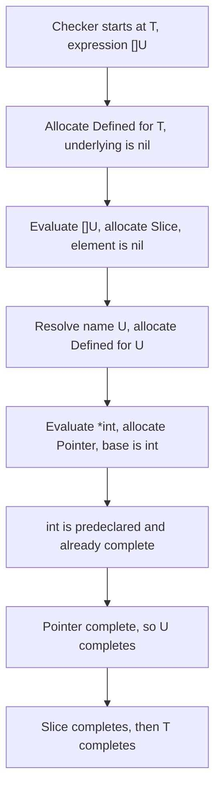
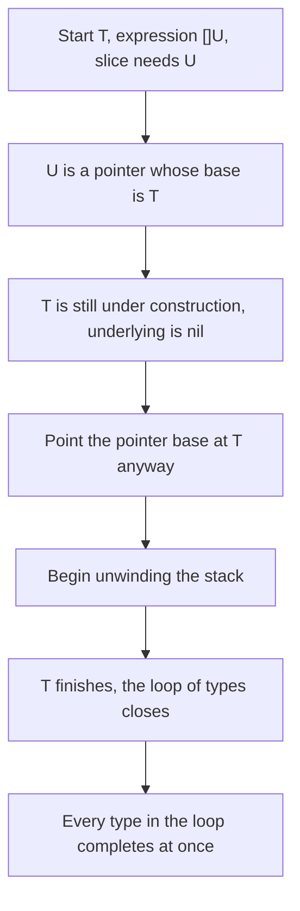

# Type Construction and Cycle Detection

Go's static typing is a big part of why it is a good fit for production systems that have to be robust. Every time `go build` runs, the compiler first parses each package into an AST and hands that AST to the type checker. In Go 1.26, the language team overhauled a part of that type checker that most programmers never think about: how it *constructs* types, and how it detects when a type's definition is circular. The result: a simpler construction algorithm, and a class of corner-case **compiler panics** that now produce ordinary type errors.

This post walks the full mechanism — type construction, recursive types, **incomplete values**, and the upstream/downstream guard that is the heart of the 1.26 change — and ends with runnable code that reproduces the new behavior locally.

## What type checking actually verifies

The type checker eliminates whole classes of errors at compile time. Its two jobs are to verify that:

- **types appearing in the AST are valid** — for example, a map's key type must be comparable,
- **operations on those types are valid** — for example, you cannot add an `int` and a `string`.

To do this, the checker builds an **internal representation** for every type it encounters while walking the AST. The Go team calls this informally *type construction*. As we will see, Go's type system is famously simple, and type construction is deceptively complex in a few corners.

---

## Type construction, step by step

Consider a pair of type declarations:

```go
type T []U
type U *int
```

When the checker starts, it meets the declaration of `T` first. The AST records a *type definition*: the name `T` bound to the expression `[]U`. `T` is a **defined type**, so the checker allocates its internal `Defined` node, which holds a pointer to the type of the expression on the right — its `underlying`. That pointer is `nil` at first: the expression has not been evaluated yet.

Evaluating `[]U` allocates a `Slice` node holding a pointer to the element type. `U` is just a name, so that pointer is `nil` too. The checker resolves the name `U` to its declaration, allocates `U`'s own `Defined` node, and evaluates `*int` into a `Pointer` node whose base is the predeclared type `int`. Predeclared types are constructed *before* the checker walks the AST, so `int` is already complete and we just point at it.

The key property here is **completeness**. A type is *complete* when every field of its internal node is populated **and** every type it points to is complete. `int` has no fields, so it is vacuously complete; that makes `*int` complete; that completes `U`; that completes `[]U`; that completes `T`. Construction unwinds the stack and everything ends up complete.

The process is naturally **depth-first**: a type can only complete after everything it depends on has completed, so completion order is always "deepest dependency first."



> **Note**: the walk above is the *happy path*. Up to this point, evaluating any type expression always *returned a complete type* — a convenience the rest of the checker relies on. Recursive types break exactly that assumption.

---

## Recursive types and the loop trick

Go allows recursive types, the classic example being:

```go
type Node struct {
	next *Node
}
```

Now make the earlier example recursive:

```go
type T []U
type U *T
```

Walking to the evaluation of `*T`, the checker is stuck: it knows `T` is a `Defined`, but its `underlying` is still `nil` — it is mid-construction. The 1.26 answer is simple: **point the `Pointer`'s base at `T` anyway**, even though `T` is incomplete. The bet is that when `T` finishes constructing, it will point at a complete type, which in turn makes the `*T` pointer complete. The checker unwinds, the loop closes, and **every type in the loop completes simultaneously** the moment the type that started it finishes.

The price: evaluating `T` can now return an *incomplete* type. Before recursion, the checker could freely **deconstruct** (look inside) any type returned from evaluation. After recursion, it cannot — deconstructing an incomplete type is unsound. That matters because many checks *need* deconstruction: verifying that a map key is comparable means inspecting the key's underlying type.

The way out is **deferral**. Type construction itself only ever *refers* to types; it does not deconstruct them. So the checker simply delays the deconstructing checks until the end of type checking, when everything is complete. It makes no difference *when* during type checking a type error is reported — only that it is reported.



---

## Incomplete values: where the bind appears

Now combine recursion with *values*. Array types carry a size that is part of the type, and the size can come from a constant expression such as a call to `unsafe.Sizeof`. Go's `unsafe.Sizeof` and `len` can be constant-evaluated, and their arguments can be **incomplete values** — values whose types are still under construction. Consider:

```go
type T [unsafe.Sizeof(T{})]int
```

To build `T`'s array node, the checker must compute the size. Computing the size of `T` requires **deconstructing** `T` (array length and element size). So the array cannot complete before `T` completes, and `T` cannot complete before the array does. The loop trick from the previous section fails, because the two types cannot complete *simultaneously*.

Notice the contrast: `type T [unsafe.Sizeof(new(T))]int` is *sound*. `new(T)` has type `*T`, and every pointer has the same size — no deconstruction of `T` is needed. The **pointerness** of `*T` carries enough type information for `unsafe.Sizeof`, while bare `T` does not. In fact it is *never* sound to operate on an incomplete value whose type is a defined type: a bare type name conveys no underlying information at all.

---

## Cycle detection in Go 1.26: upstreams and downstreams

Fundamentally, `type T [unsafe.Sizeof(T{})]int` is invalid because the size of `T` cannot be determined without knowing the size of `T`. This is the **cyclic size definition** case of a broader class of errors called **cycle errors**, which generally involve circular definitions of Go constructs. (The classic `type T T` is in the same class for different reasons.)

The 1.26 design separates the two ends of any expression chain:

- **Downstreams** *consume* potentially incomplete values. There are many of them, and some are not syntactically obvious: passing `T{}` to a function, slicing `T{}[:]`, indexing `T{}[0]` — all invalid, because each one requires deconstructing `T`.
- **Upstreams** *produce* potentially incomplete values. There are fewer of them, and they are enumerable by inspecting the language's syntax: conversions, function calls, assertions, channel receives, map accesses, dereferences —

```go
type T [unsafe.Sizeof(T(42))]int                // conversion

func f() T
type T [unsafe.Sizeof(f())]int                  // function call

var i interface{}
type T [unsafe.Sizeof(i.(T))]int                // assertion

type T [unsafe.Sizeof(<-(make(<-chan T)))]int  // channel receive

type T [unsafe.Sizeof(make(map[int]T)[42])]int  // map access

type T [unsafe.Sizeof(*new(T))]int             // dereference
```

Because upstreams are finite and enumerable, the 1.26 checker inserts **one small guard at every upstream**: as soon as the type of the produced value is known, check that it is complete; if not, report a cycle error and return an `invalid` operand so the incomplete value cannot escape downstream.

The concrete change, adapted from the type checker's call-expression evaluator:

```go
// callExpr is the type checker's call-expression evaluator, trimmed to
// the case that matters here: T(42), a conversion.
// The + lines are the Go 1.26 change.
func callExpr(call *syntax.CallExpr) operand {
	x := typeOrValue(call.Fun)
	switch x.mode() {
	case typeExpr:
		// T(...) — this is a conversion.
		T := x.typ()
		// + If T is still under construction, its underlying type is
		// + unknown, so no downstream may deconstruct it. Report a
		// + cycle error now, instead of panicking later.
		if !isComplete(T) {
			reportCycleErr(T)
			return invalid // an invalid operand poisons the rest of the chain
		}
		// ... handle the conversion; T *is* safe to deconstruct now
	}
	return operand{}
}
```

The same pattern is applied at every other upstream. Once an incomplete value is contained at its source, it can no longer leak into the rest of the conversion logic or into any downstream operator — and the cycle is reported as a normal, explained diagnostic naming `T`.

You can reproduce the behavior yourself with the stdlib type checker:

```go
// cyclecheck.go feeds the canonical cyclic-size declaration to Go's
// type checker and prints the diagnostics.
//
// Pre-1.26, inputs like this were one of the corner cases that could
// panic the compiler (golang/go#75918, #76383, #76384, #76478, and
// more). 1.26's systematic detection reports them as clean type
// errors. Build and run:
//
//	go run cyclecheck.go
package main

import (
	"fmt"
	"go/ast"
	"go/importer"
	"go/parser"
	"go/token"
	"go/types"
)

// The source under test. T's size is defined in terms of T itself,
// so no consistent size can exist: a cycle error, not a checker bug.
const src = `
package t

import "unsafe"

type T [unsafe.Sizeof(T{})]int
`

func main() {
	fset := token.NewFileSet()
	file, err := parser.ParseFile(fset, "t.go", src, parser.AllErrors)
	if err != nil {
		fmt.Println("parse:", err)
		return
	}

	conf := &types.Config{
		Importer: importer.Default(),
		Error: func(err error) {
			// The checker reports every diagnostic, not just the
			// first one, so the full picture of the cycle is visible.
			fmt.Printf("diag: %v\n", err)
		},
	}
	info := &types.Info{
		Defs:      make(map[*ast.Ident]types.Object),
		Uses:      make(map[*ast.Ident]types.Object),
		Types:     make(map[ast.Expr]types.TypeAndValue),
		Implicits: make(map[ast.Expr]types.TypeAndValue),
	}
	_ = conf.Check("t", fset, []*ast.File{file}, info)
}
```

> **Warning**: if a package in your tree *used to* only fail as a compiler panic — i.e. it never compiled cleanly — upgrading to a 1.26 toolchain converts that panic into a clean cycle error pointing at your source. The build is now failing at your declaration, not inside the compiler. That is progress, but it can look like a new breakage.

---

## Before vs. after

| | Go before 1.26 | Go 1.26 |
|---|---|---|
| Construction algorithm | more complex, tuned to stay tractable | simpler; recursion handled by pointing at incomplete types |
| Cycle detection | bespoke, per-construct checks that did not always fire | one systematic completeness guard at every upstream |
| `type T [unsafe.Sizeof(T{})]int` | compiler panic (golang/go#75918, #76383, #76384, #76478) | clean "cyclic definition of T" diagnostic |
| Incomplete values | could escape into downstream operators and surface as panics | contained at the source via the `invalid` operand |

There is no observable change for ordinary code: `type Node struct { next *Node }` works exactly as before. The 1.26 work is pure corner-case removal — and it sets the type checker up for the improvements the team has teased for future releases.

---

## Takeaways

- **Type construction is depth-first and completeness-based**: a type completes only when every type it points to is complete.
- **Recursive types break the old invariant** that evaluation always returns a complete type; the checker copes by pointing at incomplete types and completing the whole loop at once.
- **Incomplete values** (values of types still under construction) are the dangerous case; only operations that do not deconstruct the type are sound.
- **Go 1.26 cycle detection is one guard at every upstream**, where incomplete values are born: check completeness, report a cycle error, return `invalid`.
- **The practical effect is a more stable compiler**: five-plus known panics became ordinary diagnostics.

## Next steps

- Run the `cyclecheck.go` program above against your local toolchain and read the diagnostic it prints.
- Skim the language spec's section on type definitions to see the exact grammar that makes upstreams enumerable.
- Follow the Go blog: the type-checker series is the best place to learn what the compiler is about to make easier.
