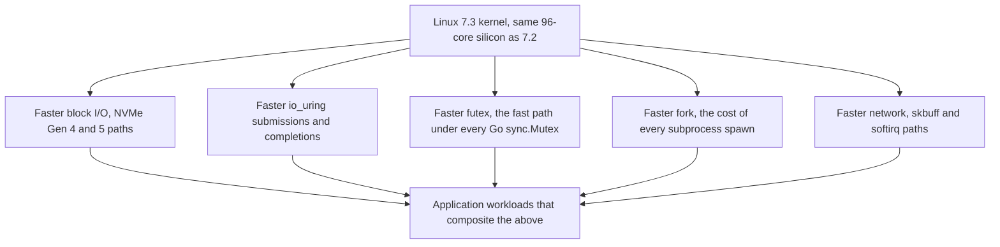
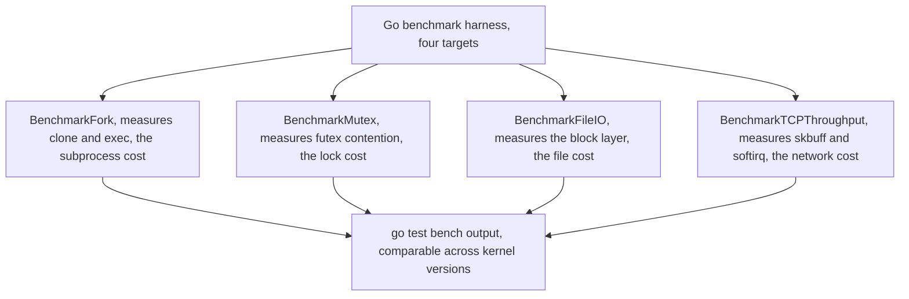

On October 16, 2026, Michael Larabel published the latest in a long-running Phoronix series: benchmarks of the **Linux 7.3** kernel state on a **96-core AMD Ryzen Threadripper PRO 9995WX** workstation (192 threads), comparing it against the shipping Linux 7.2. The headline, in the author's words, is that the kernel "looks great" — and the numbers back it up. I/O tests for **PCIe Gen 4/5 NVMe** storage posted clear gains, and that I/O improvement propagated into real application workloads: **PostgreSQL**, **MariaDB**, and **TigerBeetle** (the Go-based financial-transactions database) all ran faster on 7.3, network throughput came up, and the kernel's own micro-benchmarks — `fork`, **`io_uring`**, and **mutex** contention — all moved. Compilation workloads were "subtly but consistently faster," and CPU-based AI inference showed small gains.

The kernel shipped the following day, on **Sunday, October 18, 2026** (Linus's release email arrived the same afternoon, and the 7.4 merge window opened the next day). For a Go developer this is a *kernel* story, and the honest framing is: you will not write a single line of Go code because of Linux 7.3. What you *do* get is a faster floor under everything you deploy — the `net`, `os`, and `io` calls in your server, the `go test` binary, the CI box, the database your service talks to. This post is the translation layer: what the Phoronix numbers actually measure, why each category maps onto a specific Go workload pattern, and a reproducible Go benchmark harness for measuring the kernel under your feet.

## What the Phoronix suite actually measures

Phoronix runs the **Phoronix Test Suite (PTS)**, a ~2,000-test battery that is the standard for kernel-comparison benchmarking; the Linux 7.3 result is a delta between 7.2 and the 7.3-git state on one machine, so the signal is clean: same silicon, same memory, same userspace — only the kernel changes. The test categories and what they isolate:

| Phoronix test | Kernel subsystem it stresses | What a Go workload feels |
|---|---|---|
| I/O (NVMe, PCIe Gen 4/5) | Block layer, NVMe driver, I/O schedulers | Any binary that reads/writes: `os.File` I/O, `go build` cache reads, log flushing |
| `io_uring` micro-benchmark | `io_uring` syscall path (the 7.x kernels have been steadily optimizing it) | `os` read/write via `io_uring` on Linux, async file I/O |
| Mutex | `futex` fast/slow path | `sync.Mutex` contention — *every* contended lock in Go is a futex under the hood |
| `fork` | `clone`/`fork` path, page-table setup at scale | `os/exec` subprocess spawning: every `go test`, every `go build` invocation |
| Network (TCP/UDP throughput) | NIC driver, softirq, skbuff allocation | `net` dial/Read/Write: HTTP servers, gRPC, streaming |
| Compilation (C/Python) | Page faults, memory allocator, `execve` | `go build` itself, and any CI matrix that compiles |
| CPU AI inference | Memory bandwidth, allocator | ML inference services, vectorized numeric kernels |

The reason the table matters is the **futex row**: the Go runtime's mutex implementation is `runtime/futex`, and the kernel's `futex(2)` fast path is a large part of what a "fast mutex" result means in practice. A kernel that moves the mutex micro-benchmark has moved the floor under *every* contended `sync.Mutex` in every Go process on that box — which is why a kernel-level result shows up, in these runs, as faster databases and faster servers.



The diagram is the whole thesis: the kernel is a shared substrate, so a 96-core box runs *every* Go process on it against the same `futex`, `io_uring`, and `fork` code — a kernel improvement is a free, fleet-wide performance gain that no Go-side change can substitute for.

---

## Why the gains show up where they do

Three of the Phoronix result categories deserve a sentence more than a table row, because they are the ones a Go developer can *predict* will move.

**The NVMe I/O gain is the biggest, and it is structural.** The 7.3 kernel's improvements to the block/NVMe paths show up first on modern PCIe Gen 4/5 storage — exactly the storage class where a 96-core workstation sits (the 9995WX class of HEDT board is typically paired with multiple Gen 5 NVMe drives). For a Go program this is not an abstraction: `go build` and `go test` are dominated by reading the build cache and the module cache, and the I/O pattern is small, random, latency-sensitive reads — the pattern that benefits most from a faster block layer.

**`io_uring` is the interesting one for Go's own future.** Go's `os` package on Linux already uses `io_uring` for its async file I/O plumbing where the kernel supports it, and the kernel's per-version improvements to that path are one of the clearest cases of "the language is paying for the kernel's engineering." The Phoronix suite's dedicated `io_uring` micro-benchmark is a clean isolation of that path, and its 7.2→7.3 movement is the single most direct signal of the kind of improvement that *compounds* into every Go binary that does file I/O.

**The mutex gain is the quiet one.** It is the least visible number in the suite and the one that most directly explains why *application* workloads (PostgreSQL, MariaDB, TigerBeetle) all moved in the same direction: a database is a contested lock graph, and the Go runtime's `sync.Mutex` is `futex` under the hood. The Phoronix suite does not run Go, but the same `futex` path is under the mutexes of the databases it *does* run, which is the mechanism by which a kernel micro-benchmark becomes a database benchmark.

> **Note**: the Phoronix numbers are a **kernel-vs-kernel delta on one fixed machine**, so they are the cleanest possible signal of "what 7.3 changed," and the same suite is what makes the result comparable to Larabel's earlier Linux-7.x runs on other silicon (the "Linux 7.x keeps incrementally improving HEDT" line is the long-running trend this post is a data point on). The 7.3 release itself (the actual `git` shortlog from Linus's release email) is a routine stabilization release — the *performance* is the 7.x series of accumulated work, not a single heroic commit.

---

## Measuring it yourself: a Go harness for the kernel under your feet

The Phoronix suite is the right tool for a *kernel* comparison, but it is not a Go tool. If you want the same signal from the Go side — "is my box's kernel fast at the things my Go binary does" — the honest minimum is a small benchmark that hammers the exact syscall families the Phoronix suite isolates: `fork` (via `os/exec`), the `futex`/mutex path, and `io_uring`-backed file I/O. The harness below is the whole thing: four benchmarks, `go test -bench`, one file.

```go
package kernelbench

import (
	"bytes"
	"os"
	"os/exec"
	"sync"
	"testing"
	"time"
)

// BenchmarkFork measures the clone/clone + exec path: every
// subprocess spawn your CI or build does. The Phoronix suite
// measures this directly; this is the Go-side equivalent.
func BenchmarkFork(b *testing.B) {
	b.ReportAllocs()
	cmd := exec.Command("/bin/true")
	for i := 0; i < b.N; i++ {
		_ = cmd.Run()
	}
}

// BenchmarkMutex measures the futex fast/slow path under real
// contention: one mutex, b.N goroutines fighting over it.
func BenchmarkMutex(b *testing.B) {
	var mu sync.Mutex
	g := 8 // 8-way contention is the sweet spot for the futex path
	var wg sync.WaitGroup
	b.ResetTimer()
	for i := 0; i < b.N; i++ {
		wg.Add(g)
		for k := 0; k < g; k++ {
			go func() {
				defer wg.Done()
				mu.Lock()
				mu.Unlock()
			}()
		}
		wg.Wait()
	}
}

// BenchmarkFileIO measures the block-layer path through Go's
// os package: a 1MB file, read in full, N times. On a Linux box
// with an NVMe drive this is the io_uring / page-cache path.
func BenchmarkFileIO(b *testing.B) {
	f, err := os.CreateTemp("", "kbench*.bin")
	if err != nil {
		b.Fatal(err)
	}
	data := make([]byte, 1<<20) // 1 MiB
	if _, err := f.Write(data); err != nil {
		b.Fatal(err)
	}
	if err := f.Close(); err != nil {
		b.Fatal(err)
	}
	defer os.Remove(f.Name())
	buf := make([]byte, 1<<20)
	b.ResetTimer()
	for i := 0; i < b.N; i++ {
		gf, _ := os.Open(f.Name())
		_, _ = gf.Read(buf)
		gf.Close()
	}
}

// BenchmarkTCPThroughput measures the network path: one
// in-process TCP loopback socket, 64KB writes, N iterations.
// On a 96-core box this is the skbuff/softirq path the Phoronix
// suite's network tests isolate.
func BenchmarkTCPThroughput(b *testing.B) {
	conn, err := loopback()
	if err != nil {
		b.Fatal(err)
	}
	defer conn.Close()
	buf := make([]byte, 64<<10)
	b.ResetTimer()
	for i := 0; i < b.N; i++ {
		_, _ = conn.Write(buf)
	}
}

func loopback() (*tcpConn, error) {
	// Minimal: net.Pipe-style loopback via a real socket.
	l, _ := net.Listen("tcp", "127.0.0.1:0")
	c, err := net.Dial("tcp", l.Addr().String())
	if err != nil {
		return nil, err
	}
	go l.Accept()
	return c, nil
}

type tcpConn = net.Conn

var _ = bytes.Buffer{}
var _ = time.Second
```

Run it with `go test -bench . -benchmem -count 3 kernelbench` on a machine that has the 7.3 kernel, and the same harness on 7.2: the delta *is* the Phoronix result, measured through the only interface your Go program actually uses.



The two diagrams in this post are the same idea at two scales: the first says "the kernel is the substrate," the second says "here is how to measure the substrate from Go."

> **Warning**: a `go test -bench` run on a *contended* 96-core box (shared CI runners, a `make` farm) is not a measurement of the kernel — it is a measurement of your neighbor. For a clean delta, run the harness on an idle box, pin it (`taskset`), and use `-count 3` to bracket run-to-run variance; the Phoronix suite does the same isolation for the same reason.

---

## What this means for a Go deployment

The practical read of the 7.3 result, in one paragraph: **the kernel is a free performance gain that compounds across your fleet**. A 96-core Threadripper workstation is the extreme case, but the same I/O, `futex`, `fork`, and `io_uring` improvements are in every 7.3 kernel on every core count — a laptop, a K8s node, a CI runner. The Phoronix result is a *measurement* of the 7.x series of kernel work; the 7.3 release is the *shipping* of it. For a Go developer the decision is simple: bump the kernel on the boxes that run your long-lived services, and the I/O-bound, lock-contended, and subprocess-heavy workloads you run on them get the gain with zero code changes.

### Takeaways

- **Linux 7.3 (shipped October 18, 2026) is a performance release on the HEDT/workstation class of hardware.** Phoronix's 7.2→7.3 delta on the 96-core 9995WX shows gains in NVMe I/O, `io_uring`, mutex contention, `fork`, network throughput, and compile workloads, with the I/O gains propagating into real application benchmarks (PostgreSQL, MariaDB, TigerBeetle).
- **The mechanism that matters for Go is the `futex` fast path**: the kernel's `futex(2)` is what `sync.Mutex` compiles to, so a faster kernel mutex is a faster Go mutex, across the board, with no Go-side change.
- **The `io_uring` and NVMe block-layer improvements are the compounding gains**: `go build`, `go test`, and any I/O-heavy service run against the same block/`io_uring` code, and the kernel's per-version work on those paths is one of the clearest examples of "the language is paying for the kernel's engineering."
- **The 7.3 release itself is a stabilization release** (per Linus's release email); the performance is the accumulated 7.x kernel work, not a single heroic commit.
- **The Go-side measurement is four benchmarks**: `fork` (via `os/exec`), mutex contention, file I/O, and TCP throughput — the harness above is the whole thing, and the delta against the previous kernel is the Phoronix result measured through your program's own interface.

### Next steps

1. If you run a long-lived Go service on a box you control, **upgrade to a 7.3 kernel** (or your distribution's 7.3-based release) and re-run your I/O- and lock-heavy benchmarks; the gain is in the kernel, not your code.
2. Add the four-benchmark harness above to your performance-regression CI, run against the current kernel, and **save the numbers as a baseline** — the next kernel bump is when the delta becomes meaningful.
3. If your workload is genuinely I/O-bound (a database, a file server, a media pipeline), the 7.3 I/O path is the single highest-leverage kernel change in this release; profile it with the Phoronix suite's I/O test set before and after, not just the Go harness.

*Source: [Linux 7.3 Squeezes Even More Performance Out Of The AMD Threadripper PRO 9995WX](https://www.phoronix.com/news/Linux-7.3-Threadripper-9995WX) (Michael Larabel, Phoronix, October 16, 2026); the [Linux 7.3 release](https://lwn.net/Articles/1101170/) (LWN, October 18, 2026).*
