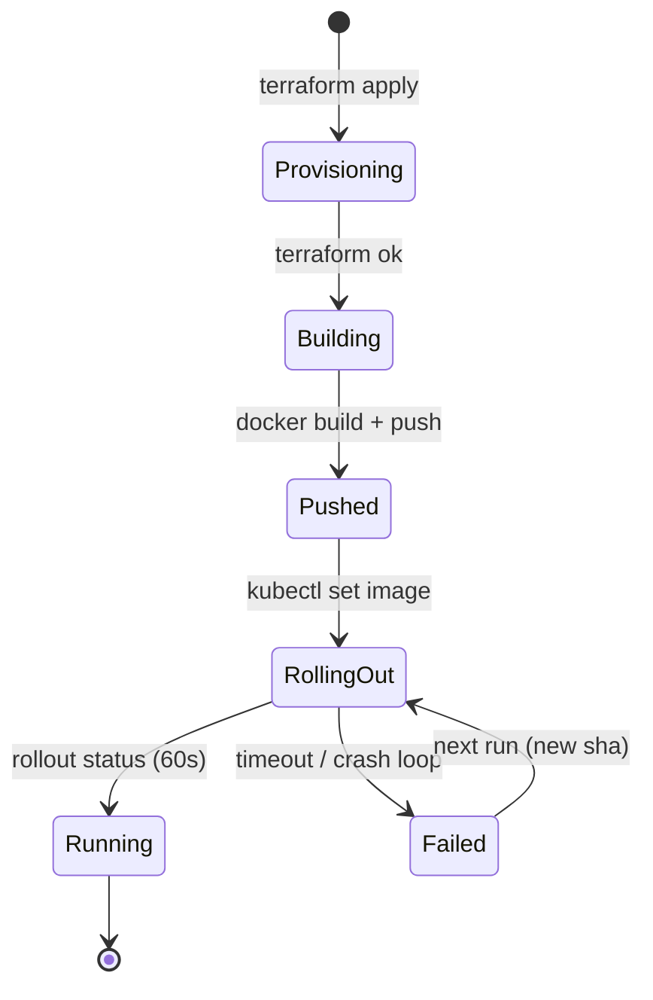

---

title: "Docker, K8s, and Terraform: The Go Ops Triad That Actually Ships"
date: 2026-10-15T09:00:00+00:00
author: "Punit Naran"
description: "Docker, K8s, and Terraform: The Go Ops Triad That Actually Ships"
tags: ["Go", "DevOps", "Kubernetes", "Docker", "Terraform"]
draft: false
---

The three tools every Go deploy runs on are all written in Go: **Docker** builds the image, **Kubernetes** runs the image, **Terraform** provisions the infrastructure the image runs on. That is the whole ops pipeline — `build → run → provision` — and the reason it is boring is that each step is a Go binary with a stable CLI and a well-defined exit code. The tools that do not ship (Ansible, Chef, Puppet, Salt) are all config-push frameworks: agent-based, stateful, and one more thing to keep alive. The triad is pull-based, declarative, and stateless — which is exactly what Go's `go build` culture likes.

This post is the ~30-line Go orchestrator that runs the whole triad, plus the three gotchas that actually kill it: the `latest`-tag race, the unbounded rollout, and the deploy-before-provision ordering trap. By the end your deploy pipeline is one `go run`, and you know which of the three failure modes you have hit when a deploy goes sideways.

## The pipeline: build → run → provision

Each leg is a separate Go binary; the only shared state between them is a registry tag and a cluster name. Nothing in the triad requires an agent on the node — Docker talks to a registry, kubectl talks to the API server, terraform talks to the provider API. That agentless property is why the triad survives a node loss: the new node pulls the image and joins the cluster, no bootstrapping daemon needed.

```mermaid
sequenceDiagram
    participant M as go run (orchestrator)
    participant TF as terraform
    participant D as docker
    participant K as kubectl
    M-->>TF: apply -chdir=infra
    TF--->>M: exit 0 (state file written)
    M-->>D: build -t golang4u:<sha> .
    D-->>D: push golang4u:<sha>
    D--->>M: exit 0
    M-->>K: set image deployment/golang4u golang4u=golang4u:<sha>
    K-->>K: rollout status --timeout=60s
    K--->>M: exit 0 (rollout done)
```



---

## The code: the triad as a 30-line Go program

The pipeline is three `go` binaries in a row — `docker`, `kubectl`, `terraform` — and the *orchestrator* of those three commands is itself just a `go` binary. That is the post in one line: the whole ops pipeline is Go calling Go. The program below is the whole triad: compute the tag once, run the three legs in order, and make every leg bounded.

```go
package main

import (
	"fmt"
	"log"
	"os"
	"os/exec"
	"strings"
)

// run executes a command and streams its output so a failure is
// visible line by line, not as a swallowed exit code.
func run(name string, args ...string) {
	cmd := exec.Command(name, args...)
	cmd.Stdout = os.Stdout
	cmd.Stderr = os.Stderr
	if err := cmd.Run(); err != nil {
		log.Fatalf("%s %s: %v", name, strings.Join(args, " "), err)
	}
}

// gitShortSHA is the only tag the triad uses. A deterministic,
// content-addressed tag is what keeps two concurrent deploys from
// pulling two different "latest" images.
func gitShortSHA() string {
	out, err := exec.Command("git", "rev-parse", "--short", "HEAD").Output()
	if err != nil {
		log.Fatalf("git rev-parse: %v", err)
	}
	return strings.TrimSpace(string(out))
}
```

```go
// main is the triad: provision first (nodes must exist before pods
// can schedule), then build + push the image, then roll the
// deployment. The order is load-bearing — see the gotchas below.
func main() {
	tag := gitShortSHA()
	reg := "registry.local"
	img := reg + "/golang4u:" + tag

	// 1. provision: terraform applies the node + network state
	//    before anything tries to schedule onto it.
	run("terraform", "-chdir=infra", "apply", "-auto-approve")

	// 2. build: docker build + push, tagged by git SHA.
	run("docker", "build", "-t", img, ".")
	run("docker", "push", img)

	// 3. deploy: point the deployment at the new image and wait
	//    for the rollout with a hard timeout — the only failure
	//    detector the pipeline has.
	run("kubectl", "set", "image", "deployment/golang4u", "golang4u="+img)
	run("kubectl", "rollout", "status", "deployment/golang4u", "--timeout=60s")

	fmt.Println("triad complete:", img)
}
```

Thirty lines, three commands, one program. (A `Makefile` with the same three targets is a one-for-one translation of this file; the Go form is the point — the *orchestrator* is a Go binary, the same language as everything else in the pipeline.)

## The three gotchas that kill it

1. **The `latest` tag is a pull race.** Two deploys at once build two different images, both tagged `latest`, and the registry serves whichever was pushed second — so a *deterministic* tag (`git rev-parse --short HEAD`) is the only tag that is. Every image in the triad is content-addressed by its commit.
2. **`rollout status` without `--timeout` hangs the whole pipeline.** A pod that fails its readiness check keeps the rollout open forever; without the 60s cap, the deploy blocks, CI times out, and nobody can tell which leg failed. The timeout is the failure detector; the triad has no other health signal.
3. **Deploy before provision = Pending pods.** `kubectl rollout status` counts replicas, not ready *nodes*. A pod on an unprovisioned node is `Pending` until terraform creates the capacity, so the orchestrator runs `provision` first. Reordering the two is the single most common cause of "the deploy succeeded and the cluster is broken."

## Provisioning and deploys: the state model

| Concern | Who owns the state | What breaks when the triad is mis-ordered |
|---|---|---|
| Image identity | Docker registry, by git SHA tag | Two `latest` builds → nondeterministic deploys |
| Cluster shape (nodes, net) | Terraform state file (`infra/terraform.tfstate`) | Deploy lands before nodes exist → pods `Pending` |
| Desired version per app | Kubernetes `Deployment` spec | `set image` with a stale tag → old image re-rolled |
| Rollout health | `rollout status --timeout` | No timeout → pipeline hangs on a stuck pod |

The separation is the design: **Terraform owns *infrastructure*, Kubernetes owns *workloads*, Docker owns *artifacts*.** When two of the three disagree (a tag in the registry that K8s points at, a node in Terraform's state that K8s has not scheduled onto), the deploy is *broken*, not *failing* — nothing errors, it just does not come up. That is why the order is enforced in `all`, not left to the operator.

> **Note**: keep `terraform -chdir=infra` pointed at the same `infra/` directory in CI and locally. The state file is the source of truth; if CI provisions from one copy of `infra/` and you deploy from another, the two states drift and the "it works in my terminal" class of incident begins.

> **Warning**: `kubectl set image` mutates the live `Deployment` spec out of band. If you ever switch the manifest to a versioned file (kubectl apply / kustomize), the hand-edited spec and the file will disagree on the next `apply`, and the file wins — silently rolling back your image. Pick one source of truth for the image tag: the `set image` command, or a template that injects `$(TAG)`.

## Takeaways

- **The triad is pull-based and agentless**: Docker pulls from a registry, K8s schedules from an image ref, Terraform applies against a provider API. Nothing to keep alive on the node.
- **One tag, computed once**: the git short SHA is the only deterministic identifier across all three legs. `latest` is a race.
- **Every leg must be bounded**: `--timeout=60s` on the rollout, a plan-check before `apply -auto-approve`. An unbounded leg hangs the whole pipeline.
- **Order is enforced, not assumed**: provision → build → deploy, one line at a time. A deploy on unprovisioned nodes is `Pending`, not `Failed`.
- **The orchestrator is the only state** — it is the one place that knows the three commands and their order.

## Next steps

- **Add `terraform plan -no-color | tee plan.out` before `apply`** in CI: a zero-diff plan is a no-op deploy; diff the file to catch the "who changed infra out of band" incident class.
- **Add an image-pull smoke test** after `deploy`: `curl` the readiness endpoint of the new pod. The rollout only proves a replica exists, not that it serves.
- **Keep `infra/`, the `Dockerfile`, and the orchestrator in one repo** with the Go code. The triad is only boring when the build, the manifest, and the provision live where the code lives.
