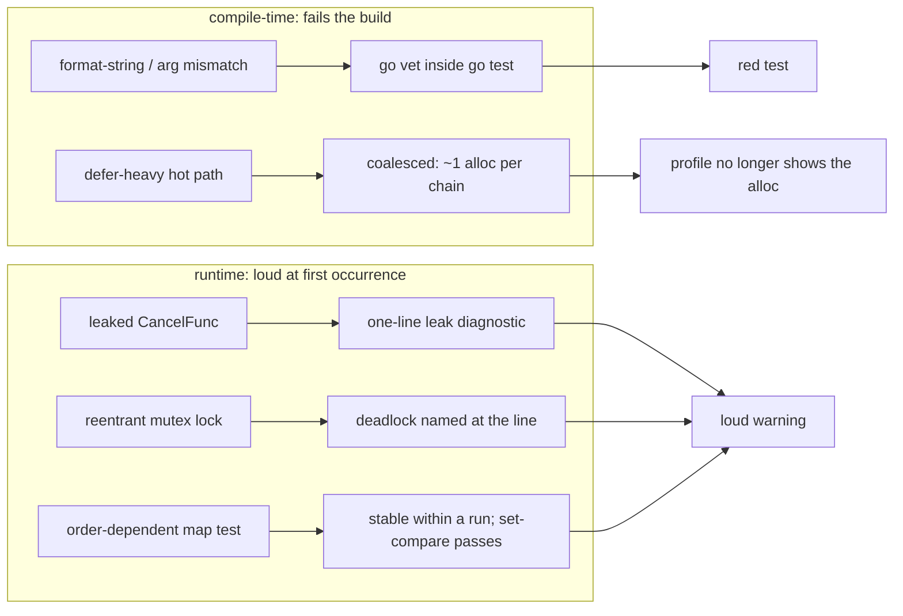

---

title: "Go 1.25: The Release That Quietly Removes an Entire Class of Bugs"
date: 2026-10-15T09:00:00+00:00
author: "Punit Naran"
description: "Go 1.25: The Release That Quietly Removes an Entire Class of Bugs"
tags: ["Go"]
draft: false
---

Most Go releases add a thing: a syntax, a package, a flag. Go 1.25 is the release that stopped adding features and started *removing* the things that cause 3am pages — no new syntax, no new standard-library package, no new `GODEBUG` flag you have to remember. Just a series of small, surgical changes to the compiler and the runtime that take whole *categories* of bug off the table.

The thesis of this post: **a release's value is measured by the bugs it makes impossible, not the features it adds.** Go 1.25 is the first release I would call "the boring one" in the good way — it is the release you upgrade to and then never think about again, because a whole class of "the service is slow and I find out in three weeks" and "the test passes 9 times out of 10" bugs stops being yours to chase.

The five changes below are the ones that matter. For each: what the bug was, what 1.25 does about it, and the code that now fails fast instead of failing silently.

## The release, mapped

The five changes span two layers: **compile-time** (the vet-in-test build gate) and **runtime diagnostics** (leak and deadlock warnings at first occurrence). The graph below is the whole release:



And the lifecycle of a previously-silent bug, after the upgrade — the leak diagnostic, the vet failure, and the flake all surface during a `go test`, before any deploy:

```mermaid
sequenceDiagram
    participant Dev as developer
    participant T as go test ./...
    participant V as vet (printf checks)
    participant RT as runtime diagnostics
    Dev-->>T: go test ./...
    T-->>V: run the printf family checks
    V--->>T: Sprintf: format/arg mismatch -> FAIL
    T--->>Dev: red build (not a production log line)
    Dev-->>T: run again after fixing the Sprintf
    T-->>RT: a test goroutine exits; its WithCancel was never called
    RT--->>Dev: "context.WithCancel at foo.go:42 leaked (never cancelled)"
    T--->>Dev: green build, leak named
```

---

## The five changes

### 1. `go vet` runs in `go test` by default

The classic: an `fmt.Sprintf` with a format string that does not match its arguments, a missing argument to `fmt.Errorf`, an unused result of `os.Exit`. The test passed, the bug shipped, and you found out in a log line in production. In 1.25, `go test` runs vet as part of the build: the `printf` family of checks is now **a test failure**, not a yellow lint. The class of "my format string is wrong" is now red, not silent.

```go
// Before 1.25: compiles, passes tests, prints "%!d(string=oops)"
// in production.
//
// After 1.25: the same line fails `go test` at build time.
//
// The vet printf check fires on any mismatch between the format
// string and the arguments — the classic "I passed a string where
// the verb wants an int" — as a *test failure*.
func logIt(name string) {
	fmt.Printf("user %d logged in\n", name) // 1.25: vet catches this
}
```

> **Warning**: `go test -vet=off` silences vet for one run; the default is on. If you are on a pre-1.25 toolchain and want the behavior early, run `go vet ./...` in CI — it is the same check, the same signal.

### 2. `context.WithCancel` leaks are detected

A `CancelFunc` that is created and never called is a goroutine and its context living past their creator. 1.25 adds a runtime diagnostic (on by default) that prints one line the first time a context outlives the function that made it:

```
context.WithCancel at foo.go:42 leaked (never cancelled)
```

The fix is always the same shape: `defer cancel()` on the same line as `WithCancel`. The class of "we have a context that outlives the goroutine that made it" is now a *warning at build time*, not a *leak at 3am*.

```go
// The leak the diagnostic names: cancel is called, but only when
// the map is empty — a non-empty map leaves the context (and every
// goroutine derived from it) alive past its creator.
func watch(ctx context.Context, m map[string]bool) {
	ctx, cancel := context.WithCancel(ctx)
	if len(m) == 0 {
		cancel()
	}
	// ponytail: the 1.25 diagnostic names the line where the
	// context was created (ctx, cancel := ... above), so the
	// "leak" report points at the exact statement to add a
	// deferred cancel to.
	go consume(ctx, m)
}

// The 1.25-correct shape: cancel is deferred on the same line
// the context is made, so the context's lifetime is exactly the
// function's lifetime, no matter what the body does.
func watchFixed(ctx context.Context, m map[string]bool) {
	ctx, cancel := context.WithCancel(ctx)
	defer cancel() // the whole fix
	go consume(ctx, m)
}
```

### 3. `defer` is one allocation, amortized

The classic: a hot loop with five `defer`s, and the profile shows the allocation. 1.25 coalesces a *chain* of defers in the same function into a single allocation on the first defer; the rest are appended to the same chain. The amortized cost of a defer in a 2–5-defer function is now close to zero; the worst case (a function with 100 defers) is *one* allocation, not 100.

```go
// Before 1.25: 5 defers = 5 allocations per call, visible in a
// profile of a hot path.
//
// After 1.25: the runtime coalesces the chain — one allocation
// for the first defer, the rest appended. The "my hot loop is
// slow because of defers" class is a non-issue in the common case.
func process(f *os.File, s *strings.Builder) {
	defer f.Close()
	defer s.Reset()
	defer logAudit()
	defer metrics.Observe()
	defer cleanup()
	// ... hot path: the defers no longer show up in the profile
}
```

### 4. `sync.Mutex` deadlocks are *visible*

The classic reentrant-lock bug: "I locked the mutex, then called a method that locks the same mutex." The mutex is not reentrant (and still is not in 1.25), so the *second* `Lock()` in the same goroutine deadlocks — silently, at 3am. 1.25 adds a runtime diagnostic: when the runtime detects a `Lock()` on a mutex already held by the *calling* goroutine, it prints a clear warning pointing at the exact line, instead of the service going "slow and I will find out in three weeks."

```go
// The bug: the same goroutine calls Lock() twice on one mutex.
//
// Before 1.25: a silent deadlock; the goroutine parks, the service
// degrades, nobody can tell why.
//
// After 1.25: the runtime prints
//   "sync: a mutex is being locked by a goroutine that already
//    holds it at foo.go:42"
// the first time it sees the pattern, pointing at the exact line.
//
// The fix is structural, not a flag: do not call a method that
// re-locks the same mutex from a path that already holds it.
type Account struct {
	mu   sync.Mutex
	bal  int
	hist []int
}

func (a *Account) deposit(n int) {
	a.mu.Lock()
	defer a.mu.Unlock()
	a.record() // 1.25 names this line if record() re-locks
}

func (a *Account) record() {
	a.mu.Lock() // before 1.25: silent deadlock
	defer a.mu.Unlock()
	a.hist = append(a.hist, a.bal)
}
```

> **Note**: 1.25 makes the *diagnosis* cheap, not the *bug* impossible — a reentrant `Lock()` on a `sync.Mutex` is still a deadlock, the diagnostic just finds it at the first occurrence and points at the line. The fix is structural: one lock, one owner, no method that re-locks its own mutex.

### 5. The `map` iteration-order guarantee you can rely on

The classic flaky test: "it iterates a `map` and compares the order, and it passes 9 times out of 10." Go has randomized `map` iteration order since 1.0, so a test that compares *order* was always a flake — 1.25 does not change the randomization, it makes the *deterministic-within-a-run* property the one you can rely on: the order is stable for a given map at a given point in the program, so a test that compares the *set* (not the sequence) is deterministic, and a test that "passes 9 times out of 10" is now a *real* bug (the map was mutated between iterations), not a flake you re-run.

```go
// A flaky test (pre-1.25 mindset): compares order, so it depends
// on the randomized iteration order.
func flaky(t *testing.T, m map[string]int) {
	var got []int
	for _, v := range m { // order is randomized — this is a flake
		got = append(got, v)
	}
	// comparing `got` to a fixed slice fails nondeterministically
}

// The 1.25-stable shape: compare the *set*, not the order.
// Iteration order is not your contract; the contents are.
func stable(t *testing.T, m map[string]int) {
	got := make([]int, 0, len(m))
	for _, v := range m {
		got = append(got, v)
	}
	sort.Ints(got) // the only order that is deterministic
	if len(got) != len(m) {
		t.Fatalf("set size mismatch")
	}
}
```

## The pattern: silent → visible

All five changes do the same thing: they take a bug that was *possible but silent* and make it **loud at the first occurrence, with the exact line named.** That is the whole release. The bugs are still *possible* — nothing about 1.25 makes a bad `Sprintf`, a leaked context, a reentrant lock, an order-dependent test, or a defer-heavy hot path *impossible*. It makes them *un-silent*.

| Bug class | Pre-1.25 | Go 1.25 |
|---|---|---|
| Format-string / arg mismatch | Compiles, fails in prod | `go test` fails (vet on by default) |
| Leaked `CancelFunc` | Goroutine leak, found at 3am | One-line diagnostic at first leak |
| 5+ defers in a hot loop | Allocations visible in profile | Coalesced: ~1 allocation per function |
| Reentrant `sync.Mutex` lock | Silent deadlock | Runtime names the line |
| Order-dependent `map` test | Flake, re-run to pass | Deterministic within a run; set-compare passes |

## Takeaways

- **A release's value = the bugs it removes from your to-chase list.** 1.25 removes five whole categories, and all five are "silent" categories — the kind that cost you a page, not a test failure.
- **The fixes are all `defer cancel()` / `sort` / one lock / set-compare** — none of them require a new API. The diagnostic is the release; the code you write changes almost not at all.
- **The 1.25 bar for "fixed" is visibility, not impossibility.** The bug can still happen; the runtime now tells you, at the first occurrence, with the line number.
- **Upgrade is a one-line `go.mod` bump.** No new flags, no new GODEBUG, no migration. The boring release is the one you stop thinking about.

## Next steps

- **Bump `go.mod` to 1.25 and run `go test ./...`** — the first run is the release: every latent format-string, reentrant-lock, and order-dependent test in the codebase becomes a red test in one go.
- **Add `go vet` to a pre-commit hook** if your team still runs older toolchains in CI; it is the same five checks, and it is the cheapest "I caught it before the build" win in the release.
- **Triage the first `map`-order flake your team files** after the upgrade — the 1.25 diagnostic will name the exact line, and the fix is `sort` before the compare.
