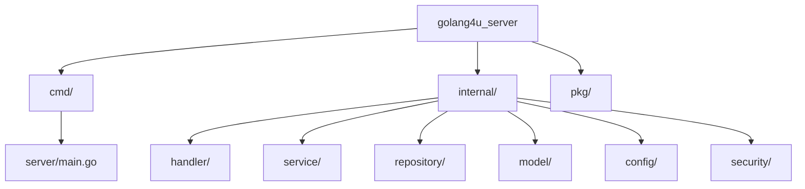

# The Golang4U Architecture: A Service-Oriented Masterclass


# Preface: Why Read This?

If you are just starting with Go, you might write everything in `main.go`. It works for a "Hello World," but it fails for a production system.
If you are an expert, you might argue about "Clean Architecture" vs "Hexagonal" vs "Onion."

**Golang4U** adopts a pragmatic, production-ready **Service-Oriented Architecture (SOA)** structure. It is designed to be:
1.  **Testable**: Every layer can be mocked.
2.  **Scalable**: New features (like a "Video" post type) don't break old ones.
3.  **Readable**: A new developer knows exactly where to put code.

This guide is not a summary. It is a **Masterclass**. We will read the code together, line by line, layer by layer. By the end, you will understand not just *how* it works, but *why* it was built this way.

---

# Chapter 1: The Blueprint (Folder Structure)

Go is infamous for not having a standard structure. However, the community has coalesced around the **Standard Go Project Layout**.
We define our project by **What it is**, not **What it does**.

### 1.1 The High-Level Map



### 1.2 `cmd/`: The Entry Point
This folder is the "Main Entrance." It contains the `main` package.
*   **Rule**: Minimal logic. This file should just parse flags, read config, and call `server.Run()`.
*   **Why?**: By keeping `main` small, we allow others to import our application code (in `internal`) without running the server.

### 1.3 `internal/`: The Private Core
In Go 1.4+, directories named `internal` are special. The Go compiler **forbids** external projects from importing packages inside `internal`.
*   **Why?**: This enforces API boundaries. We are free to break things inside `internal` without worrying about breaking 3rd-party users of our library.
*   **The Layers**:
    *   **Handler**: Speaking HTTP (Parsing JSON, Status Codes).
    *   **Service**: Business Logic (Validation, Encryption, Emailing).
    *   **Repository**: Data Access (SQL, Mongo, Redis).

### 1.4 `pkg/`: The Public Library
Code here is safe for anyone to use.
*   **Example**: `pkg/utils` might contain a helper to format dates.
*   **Rule**: No business logic here. Just generic tools.

---

# Chapter 2: Dependency Injection (The Wiring)

The most critical pattern in Golang4U is **Dependency Injection (DI)**.
Many beginners use Global Variables for database connections (`var DB *sql.DB`).
**This is the root of all evil.**
*   It makes parallel testing impossible (tests overwrite each other's DB).
*   It hides dependencies (you don't know function X uses the DB).

### 2.1 The Constructor Pattern

We use "Constructor Functions" (factories) to create our structs.

In `internal/handler/handler.go`:

```go
type Handler struct {
    DB          database.DBStore           // Interface!
    data        *ttlcache.Cache[string, any]
    PostService *service.PostService
    UserService *service.UserService
}

// The "Constructor"
func NewHandler(db database.DBStore, ps *service.PostService, ...) *Handler {
    return &Handler{
        DB:          db,
        PostService: ps,
        // ...
    }
}
```

**Key Takeaway**: The `Handler` *asks* for what it needs. It doesn't build it.

### 2.2 The Composition Root (`server.go`)

If everyone asks for dependencies, who *creates* them?
The **Composition Root**. In our case, `SetupServer` in `internal/server/server.go`.

```go
func SetupServer(db database.DBStore, config *config.Config) *Server {
    // 1. Create Services (injecting DB)
    userService := service.NewUserService(db, ...)
    postService := service.NewPostService(db, ...)

    // 2. Create Handlers (injecting Services)
    h := handler.NewHandler(config, db, userSvc, postSvc, ...)

    // 3. Create Router (injecting Handlers)
    e := echo.New()
    // ... wiring routes ...
    
    return &Server{e: e, h: h}
}
```

This creates a clear dependency graph:
`Router` -> `Handler` -> `Service` -> `Repo` -> `DB`.
It is an **Acyclic Graph**. (No circles).

---

# Chapter 3: The Presentation Layer (`Handler`)

The **Handler** layer is the Diplomat. It speaks the language of the Web (HTTP).
Its job is to translate JSON into Go Structs, call the Service, and translate results back to JSON.
**It must NEVER contain business logic.**

### Detailed Walkthrough: `HandleFormSubmission`

Let's look at a complex handler in `internal/handler/handler.go`.

```go
func (h *Handler) HandleFormSubmission(c echo.Context) error {
    // 1. Protocol Decoding
    formType := c.Param("formType") // "news", "jobs", etc.
    
    // 2. Security Check (Virus Scan)
    // The handler knows about 'filescan', but not 'how' to scan.
    if err := h.fs.ScanData(c, nil); err != nil {
        return err // 403 Forbidden or 500 Internal Error
    }

    // 3. User Context (Authentication)
    // We retrieve the authenticated user from the request context/token.
    userStore, err := GetAvatar(c, h.TTLDB, h.DB)
    if err != nil { return err }

    // 4. State Validation (Handler Logic)
    // "Is the user banned? Is the user verified?"
    // This is borderline business logic, but it's acceptable here 
    // as it gates access to the service call.
    if userStore.Disable {
        return c.JSON(http.StatusForbidden, "Disabled")
    }

    // 5. Routing Logic
    switch formType {
    case "news":
        return h.handleNews(c, ctx)
    case "learn":
        return h.handleLearn(c, ctx)
    // ...
    }
}
```

### The Sub-Handlers pattern
Notice `handleNews`. The main handler is getting too big, so we split it.

```go
func (h *Handler) handleNews(c echo.Context, ctx context.Context) error {
    // A. Bind (JSON -> Struct)
    data := new(formdata.NewsFormData)
    if err := c.Bind(data); err != nil { return err }
    
    // B. Validate (Struct Tags)
    if err := c.Validate(data); err != nil { return err }
    
    // C. File Handling
    // The handler knows about Multipart Forms. The Service does not.
    // So the handler extracts the []byte here.
    data.NewsCover, _ = readFile(c, "news-cover")

    // D. Call Service
    return h.PostService.CreateNews(ctx, data)
}
```

**Why extract the file bytes here?**
If we passed `c *echo.Context` to the Service, the Service would depend on `echo` (HTTP). That violates our layering. By extracting `[]byte`, the Service receives pure data. It can be tested without a web server.

---

# Chapter 4: The Business Layer (`Service`)

The **Service** layer is the Brain. It contains the rules of the application.
"Users must be 18+." "Passwords must be encrypted." "Emails must be unique."

### Case Study: `UserService.CreateUser`

In `internal/service/user_service.go`:

```go
func (s *UserService) CreateUser(newUser *user.User) error {
    // Logic 1: Decryption (Privacy)
    // The raw request has encrypted fields. We unlock them here.
    plainEmail, _ := security.DecryptECIES(s.privKey, newUser.EncrypedEmail)

    // Logic 2: Blind Indexing (Uniqueness)
    // Check if email exists without storing plain email.
    hash := sha256.Sum256(plainEmail)
    if s.repo.Exists(hash) {
        return Error("Already Registered")
    }

    // Logic 3: Roles
    if s.repo.Count() == 0 {
         newUser.Role = "admin" // First user is King
    }

    // Logic 4: Persistence
    return s.repo.Save(newUser)
}
```

**Notice what is missing**:
*   No `c.JSON`. The service returns `error` or `struct`. It doesn't know about JSON.
*   No `http.StatusForbidden`. It returns domain errors (`ErrDuplicateUser`).

---

# Chapter 5: The Data Layer (`Repository`)

The **Repository** layer is the Librarian. It knows how to talk to the database.
We define it using an Interface in `internal/database/database.go`.

```go
type DBStore interface {
    GetUserStore(key string) (interface{}, error)
    SetUserStore(key string, value interface{}) error
    CountUsers() (int64, error)
    // ...
}
```

### Why usage Interface? (The Mocking Power)

Imagine writing a test for `Service.CreateUser`.
If `Service` depended on `*mongo.Client`, you would need to run a MongoDB Docker container just to run `go test`. That's slow.

With an interface, we can do this:

```go
// mocks/db_mock.go
type MockDB struct {
    users map[string]interface{}
}

func (m *MockDB) SetUserStore(key string, val interface{}) error {
    m.users[key] = val
    return nil
}
```

Now our unit tests run in milliseconds.

### The "Store" Wrapper Pattern

Golang4U uses a NoSQL database (MongoDB implied by key-value semantics in `database.go`).
But we don't just dump the `User` struct. We wrap it.

```go
type Store struct {
    User         User          // The Public Profile
    ReferalCodes []ReferalCode // Internal Referral Data
    Disable      bool          // Admin Flag
    Lifetime     time.Time     // TTL for temp users
}
```

This "Metadata Wrapper" allows us to add system-level flags (like `Disable`) without polluting the `User` object that might be returned to the frontend Main API.

---

# Chapter 6: Cross-Cutting Concerns

Some logic touches every layer.

### 6.1 Configuration (`config/`)
We load config once in `main`, and pass it down.
`Handler` needs `config.ClamavURL`.
`Service` needs `config.GmailToken`.
This is passed via the Constructor, ensuring every component has explicitly declared its configuration needs.

### 6.2 Security (`security/` & `ipfilter/`)
Security is often implemented as **Middleware** (wrapping the Handler).
*   **IPFilter**: Checks IP before Handler logic.
*   **RateLimit**: Checking frequency.
*   **PASETO**: Checks Auth Tokens.

But deep security (Encryption) happens in `Service` (as seen in `CreateUser`).

---

# Chapter 7: Error Handling Strategy

Go errors are values. In `golang4u`, we propagate them up.

1.  **Repository**: Returns `mongo.ErrNoDocuments`.
2.  **Service**: Wraps it: `fmt.Errorf("user not found: %w", err)`.
3.  **Handler**: Unwraps it (using `errors.Is`) and decides the HTTP status.
    *   If `user not found` -> `404 Not Found`.
    *   If `db connection failed` -> `500 Internal Error`.

This keeps the "HTTPness" in the handler. The Service shouldn't decide if an error is a 400 or a 404; it just says "It failed because X".

---

# Conclusion

The Golang4U architecture is an exercise in **Discipline**.
It is tempting to just write a SQL query inside a Handler.
It is tempting to just use a global `var DB`.

But by adhering to this **Service-Oriented-Architecture**, we gain:
1.  **Isolation**: Bugs in the DB layer don't break the HTTP layer logic.
2.  **Clarity**: New developers know exactly where to put new code.
3.  **Confidence**: We can test every piece in isolation.

This is the standard for professional Go engineering.

