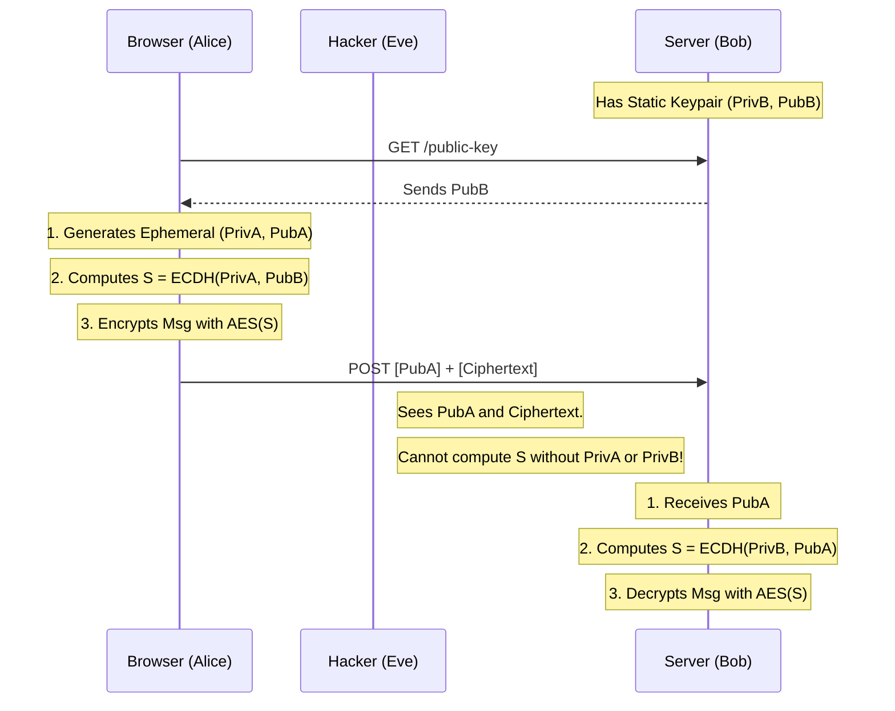

# Encryption Everywhere: End-to-End Security with ECIES and AES-GCM


# Introduction

HTTPS (TLS) is fantastic. It encrypts the pipe between the user and your server. But what happens if:
1.  You have a load balancer or CDN that terminates TLS before the request reaches your app?
2.  You have a compromised middleware logging requests?
3.  You want to ensure **nobody**, not even your infrastructure provider, can read a user's password in transit?

This is where **Application-Layer Encryption** comes in.

In Golang4U, we use **ECIES (Elliptic Curve Integrated Encryption Scheme)** for data in transit (Frontend -> Backend) and **AES-GCM** for data at rest.

---

# 1. Understanding ECIES (Conceptual)

ECIES is a hybrid encryption scheme. It combines the best of Asymmetric (Public Key) and Symmetric (Shared Key) cryptography.

**The Actors:**
*   **Alice (Browser)**: Wants to send a secret message.
*   **Bob (Server)**: Has a static Public Key ($Pub_B$).

**The Workflow:**
1.  **Key Generation**: Alice generates a temporary (ephemeral) key pair ($Priv_A, Pub_A$).
2.  **Key Agreement (ECDH)**: Alice uses her $Priv_A$ and Bob's $Pub_B$ to mathematically derive a **Shared Secret** ($S$).
3.  **Encryption**: Alice encrypts the message with AES using $K_{enc}$ derived from $S$.
4.  **Transmission**: Alice sends her Public Key ($Pub_A$) along with the ciphertext.



Bob receives it, does the math in reverse, regenerates $K_{enc}$, and decrypts the message.

---

# 2. Frontend Implementation (Web Crypto API)

We don't need heavy JS libraries. Modern browsers support `SubtleCrypto`.

```javascript
// assets/js/crypto_utils.js (Simplified)

async function encryptData(plaintext, serverPublicKeyHex) {
    // 1. Import Server's Public Key
    const serverKey = await window.crypto.subtle.importKey(
        "spki",
        hexToArrayBuffer(serverPublicKeyHex),
        { name: "ECDH", namedCurve: "P-256" },
        false, []
    );

    // 2. Generate Ephemeral Key Pair for this encryption
    const ephemeralKeyPair = await window.crypto.subtle.generateKey(
        { name: "ECDH", namedCurve: "P-256" },
        true, ["deriveKey"]
    );

    // 3. Derive Shared Secret (AES-GCM key)
    const sharedKey = await window.crypto.subtle.deriveKey(
        { name: "ECDH", public: serverKey },
        ephemeralKeyPair.privateKey,
        { name: "AES-GCM", length: 256 },
        false, ["encrypt"]
    );

    // 4. Encrypt
    const iv = window.crypto.getRandomValues(new Uint8Array(12));
    const encrypted = await window.crypto.subtle.encrypt(
        { name: "AES-GCM", iv: iv },
        sharedKey,
        new TextEncoder().encode(plaintext)
    );

    // 5. Pack: EphemeralPublicKey + IV + Ciphertext
    return pack(ephemeralKeyPair.publicKey, iv, encrypted);
}
```

This effectively creates a secure tunnel *inside* the HTTPS tunnel.

---

# 3. Backend Implementation (Go `crypto/ecdh`)

On the Go side, we parse this package.

```go
// internal/crypto/ecies.go

func Decrypt(payload []byte, serverPrivKey *ecdh.PrivateKey) ([]byte, error) {
    // 1. Unpack payload
    // [Pub Key (65 bytes)] [IV (12 bytes)] [Ciphertext (rest)]
    clientPubKeyBytes := payload[:65]
    iv := payload[65:77]
    ciphertext := payload[77:]
    
    // 2. Parse Client's Ephemeral Public Key
    clientPubKey, err := ecdh.P256().NewPublicKey(clientPubKeyBytes)
    if err != nil { return nil, err }
    
    // 3. ECDH: Derive Shared Secret
    sharedSecret, err := serverPrivKey.ECDH(clientPubKey)
    if err != nil { return nil, err }
    
    // 4. Derive AES Key (using HKDF or similar standard, usually just the secret directly if simple)
    // In strict ECIES, we use KDF. For simple P-256+AES-GCM, we might just use the secret if 32 bytes 
    // or run it through SHA-256.
    block, _ := aes.NewCipher(sharedSecret)
    gcm, _ := cipher.NewGCM(block)
    
    // 5. Decrypt
    return gcm.Open(nil, iv, ciphertext, nil)
}
```

### Why P-256?
We chose the **NIST P-256** curve because:
1.  **Hardware Support**: It has hardware acceleration on most CPUs (AES-NI).
2.  **Browser Standard**: It is universally supported by the Web Crypto API.

---

# 4. Securing Data at Rest: AES-GCM

Once we decrypt the data, we might need to store it.
*   **Passwords**: NEVER encrypt passwords. Always **Hash** them (Argon2 / bcrypt).
*   **PII (Emails, Phones)**: Encrypt.
*   **Tokens (OAuth, 2FA)**: Encrypt.

We use **AES-GCM (Galois/Counter Mode)**.

### Authenticated Encryption
AES in CBC (Cipher Block Chaining) mode is malleable. If an attacker flips a bit in the ciphertext, it decrypts to garbage—or worse, specific garbage.
**GCM** solves this by adding an "Authentication Tag". If the ciphertext is tampered with (even 1 bit), the decryption function returns an error `authentication failed` rather than corrupt data.

```go
func EncryptStorage(plaintext []byte) ([]byte, error) {
    // Master Key loaded from secure env
    block, _ := aes.NewCipher(masterKey)
    gcm, _ := cipher.NewGCM(block)
    
    // ALWAYS use a random Nonce
    nonce := make([]byte, gcm.NonceSize())
    io.ReadFull(rand.Reader, nonce)
    
    // Seal = Encrypt + Append Auth Tag
    return gcm.Seal(nonce, nonce, plaintext, nil), nil
}
```

### The Nonce Dangers
The **Nonce** (Number used ONCE) is critical. If you reuse a nonce with the same key, an attacker can XOR the ciphertexts to recover the plaintext.
*   **Fix**: We randomly generate a 12-byte nonce for *every* encryption operation and store it alongside the ciphertext.

---

# Conclusion

Cryptography is a double-edged sword. Implemented correctly, it provides mathematical certainty of privacy. Implemented poorly (reused nonces, weak curves), it provides a false sense of security.

Golang4U adheres to strict standards: **ECDH P-256** for key exchange, **AES-256-GCM** for encryption, and standard **Web Crypto** APIs. This ensures our user's data remains theirs, regardless of who is listening on the wire.

In the final post of our series, we tackle the implementation of **Two-Factor Authentication (TOTP)** to secure user accounts.

