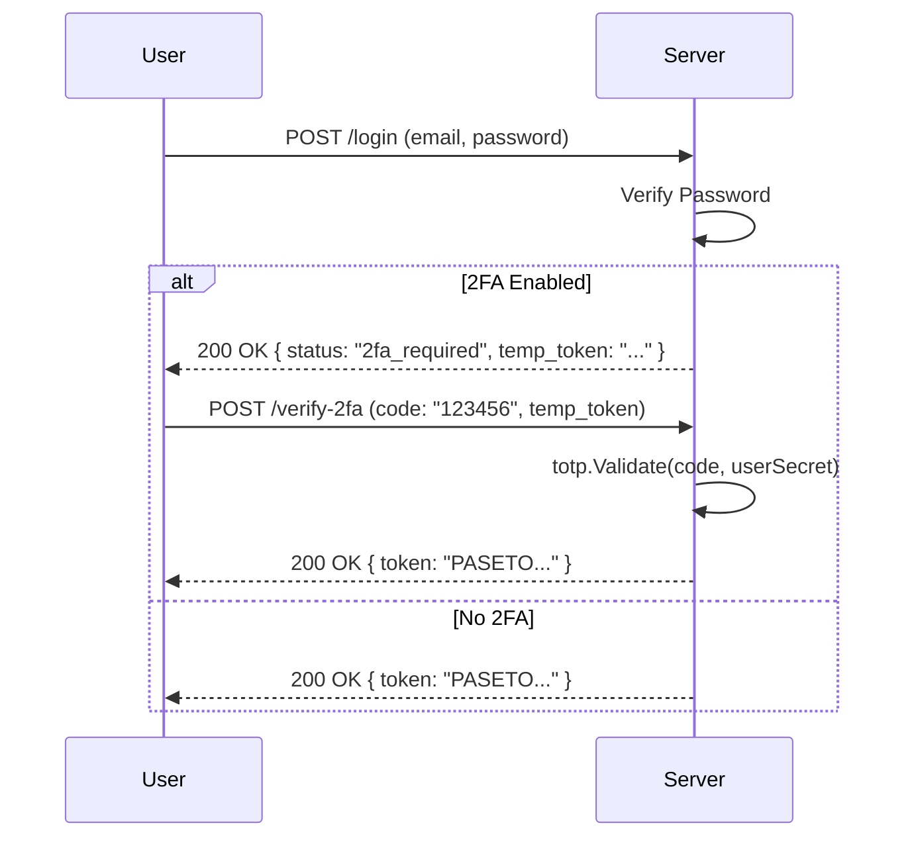

# Double the Security: Implementing Two-Factor Authentication (TOTP)


# Introduction

Passwords are distinctively terrible.
*   Users reuse them.
*   Users choose "Password123".
*   Users write them on sticky notes.

Even with strong password policies, a database leak from *another* site can compromise your users. **Two-Factor Authentication (2FA)** mitigates this by requiring a second factor: something physically in the user's possession (their phone).

In this guide, we implement standard **TOTP (Time-based One-Time Password)**, compatible with Google Authenticator, Authy, and Microsoft Authenticator.

---

# 1. Understanding TOTP (RFC 6238)

TOTP is built on top of **HOTP (HMAC-based One-Time Password)**.

### The Algorithm
$$TOTP(K, T) = Truncate(HMAC-SHA-1(K, T))$$

Where:
*   $K$ is the **Shared Secret** (a random string of bytes known only to Server and User).
*   $T$ is the **Time Counter**, calculated as $\lfloor \frac{CurrentUnixTime}{30} \rfloor$.
*   **30** is the standard step size (seconds).

Every 30 seconds, the value $T$ increments by 1. The algorithms on the phone and server independently run the HMAC hash and produce the same 6-digit code.

---

# 2. Implementation Lifecycle

### 2.1 Setup (Enable 2FA)

When a user wants to enable 2FA:

1.  **Generate Secret**: We generate a cryptographically secure random key (20 bytes).
2.  **Generate URI**: We format this into a standard URL scheme:
    `otpauth://totp/Golang4U:user@email.com?secret=JBSWY3DPEHPK3PXP&issuer=Golang4U`
3.  **Generate QR Code**: We render this URL as a QR code image (PNG) so the user can scan it.

**Go Code (using `pquerna/otp`)**:

```go
import (
    "github.com/pquerna/otp/totp"
    "bytes"
    "image/png"
)

func Generate2FASetup(email string) (*totp.Key, []byte, error) {
    // Generate Key
    key, err := totp.Generate(totp.GenerateOpts{
        Issuer:      "Golang4U",
        AccountName: email,
    })
    if err != nil { return nil, nil, err }
    
    // Generate QR Code Image
    var buf bytes.Buffer
    img, err := key.Image(200, 200)
    png.Encode(&buf, img)
    
    return key, buf.Bytes(), nil
}
```

### 2.2 Verification (The Handshake)

We **cannot** enable 2FA just because we generated a key. The user *must* prove they scanned it successfully.
1.  Frontend displays QR Code.
2.  User scans it and enters the 6-digit code (`123456`) shown on their screen.
3.  Server validates `123456` against the generated secret.
4.  **Only if valid**, we save the Secret to the User's DB profile (Encrypted!) and set `two_factor_enabled = true`.

### 2.3 Login Flow with 2FA

Once enabled, the login flow changes:



**The "Temp Token"**: This is a critical security detail. The initial response *must not* be a valid session token. It should be a restricted token that *only* allows access to the `/verify-2fa` endpoint. In Golang4U, we use a PASETO with a special `scope: "pre-auth"`.

---

# 3. Recovery: The "Bus Factor"

What if the user drops their phone in a lake? They are locked out forever.
This is why **Recovery Codes** are mandatory.

When 2FA is enabled, we generate 5-10 random strings (e.g., `a1b2-c3d4`).
*   **User Side**: "Save these codes in a safe place."
*   **Server Side**: We Hash them (bcrypt) and store them in a `recovery_codes` collection.

If the user cannot generate a TOTP, they can use a Recovery Code.
*   Server verifies Code against Hash.
*   **Important**: The used code is immediately **deleted** from the DB. Use only once.

---

# 4. Security Considerations

1.  **Time Drift**: Clocks aren't perfect. We allow a verification window of `1` step (current time +/- 30 seconds) to account for slight network or device delays.
2.  **Rate Limiting**: The `/verify-2fa` endpoint MUST be strictly rate-limited (e.g., 3 attempts per minute). 6 digits is only 1 million combinations; a brute force attack is trivial without rate limiting.
3.  **Encrypted Secrets**: The TOTP secret in the database allows anyone with read access to clone the user's 2FA device. This field MUST be encrypted with AES-GCM (as discussed in the Cryptography article).

---

# Conclusion

By implementing TOTP, Golang4U aligns with industry best practices for account security. It adds a trivial amount of friction for a massive gain in trust. Combined with our ECIES encryption and PASETO tokens, our authentication system is defense-in-depth incarnate.

This concludes our deep dive series into the Golang4U architecture. We hope these articles have provided you with a clear roadmap for building your own secure, scalable Go applications.

